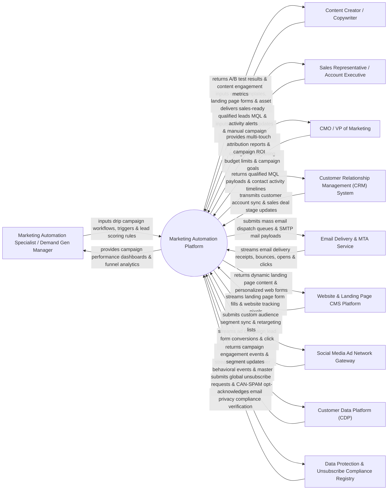

# Context Diagram — Marketing Automation Platform

## Mermaid Code

## Actor & Interaction Table | Bảng Actor & Tương tác

| # | Actor | Actor Type | Data Sent TO System | Data Received FROM System | Notes |
|---|-------|------------|---------------------|---------------------------|-------|
| 1 | Marketing Automation Specialist / Demand Gen Manager | Primary | Automated drip campaign workflows, lead scoring rule sets, behavioral triggers, audience segment rules. | Campaign execution dashboards, lead funnel progression analytics, workflow branch conversion rates. | Marketing operations expert designing multi-channel automated drip campaigns and lead nurturing flows. |
| 2 | Content Creator / Copywriter | Primary | HTML email templates, landing page designs, lead magnet assets, A/B test copy variations. | Email heatmap analytics, A/B test statistical winner results, form conversion rates. | Content creator uploading marketing assets and testing copy/design performance. |
| 3 | Sales Representative / Account Executive | Primary | Lead disposition updates (Accepted/Rejected), manual contact campaign enrollments, sales notes. | Sales-ready Marketing Qualified Lead (MQL) alerts, real-time prospect activity notifications (email open/link click). | Sales team member receiving automated lead handoffs and tracking prospect engagement. |
| 4 | CMO / VP of Marketing | Primary | Campaign budget allocations, quarterly MQL targets, multi-touch attribution model preferences. | Multi-touch campaign ROI reports, customer acquisition cost (CAC) metrics, pipeline revenue attribution. | Marketing executive reviewing macro marketing campaign performance and pipeline contribution. |
| 5 | Customer Relationship Management (CRM) System | Supporting | Contact account updates, closed-won deal notifications, opportunity stage changes, sales rep assignments. | Real-time MQL lead creation, contact activity timeline sync, campaign membership tags. | Central CRM (Salesforce, HubSpot) synchronizing sales pipeline and lead handoff data. |
| 6 | Email Delivery & MTA Service | Supporting | SMTP delivery confirmations, hard/soft bounce status, spam complaint webhooks, link click timestamps. | Outbound mass email dispatch queues, MIME email payloads, DKIM/SPF signed headers. | High-volume Mail Transfer Agent (MTA) service (SendGrid, Mailgun, Amazon SES) executing email dispatches. |
| 7 | Website & Landing Page CMS Platform | Supporting | Form submission payloads, web page visit telemetry, gated asset downloads, video watch durations. | Dynamic web content rules, embedded smart forms, personalized CTA popups. | Content management system hosting marketing landing pages, forms, and web tracking scripts. |
| 8 | Social Media Ad Network Gateway | Supporting | Lead ad form submissions (Meta/LinkedIn), ad click tracking events, campaign impression costs. | Custom audience sync lists, lookalike audience payloads, retargeting segment definitions. | Social ad networks (Meta Ads, LinkedIn Campaign Manager, Google Ads) receiving audience lists for retargeting. |
| 9 | Customer Data Platform (CDP) | Supporting | Unified customer behavioral events, cross-device identities, real-time event streams. | Campaign engagement event logs, segment membership updates, lead score changes. | Enterprise CDP providing unified single customer view data for hyper-personalized automation. |
| 10 | Data Protection & Unsubscribe Compliance Registry | Supporting / Regulatory | CAN-SPAM / CASL / GDPR email compliance rules, global suppression lists, opt-out requests. | Opt-out confirmation receipts, global suppression list sync, compliance verification tokens. | Regulatory compliance framework managing email unsubscribes and anti-spam legal compliance. |

## System Boundary Description | Mô tả Phạm vi Hệ thống

The **Marketing Automation Platform** is an enterprise demand generation, lead nurturing, and multi-channel campaign orchestration system designed to automate customer journeys, score lead engagement, manage email marketing, and measure marketing ROI.

**Inside System Scope:**
- Visual multi-branch drag-and-drop campaign workflow builder (Drip campaigns, event-triggered journeys).
- Behavioral lead scoring, lead grading, and automated MQL-to-CRM handoff workflows.
- Dynamic HTML email builder, landing page form management, and automated A/B split testing.
- Audience segmentation engine with multi-condition behavioral and demographic filtering.
- Two-way CRM synchronization, social ad network custom audience sync, and CAN-SPAM/GDPR compliance suppression.

**Outside System Scope:**
- Direct physical printing and postal mail delivery of paper flyers (handled by Direct Mail Print Houses).
- Direct hosting of core e-commerce product catalogs (handled by E-Commerce Platforms).
- Direct financial accounting and general ledger tax auditing (handled by ERP Systems).
