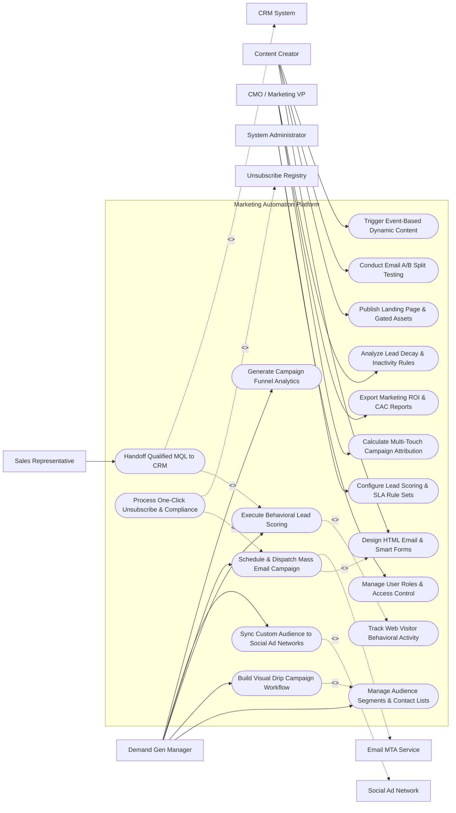

# Use Case Diagram — Marketing Automation Platform

## Mermaid Code

## Actor Table | Bảng Actor

| # | Actor | Actor Type | Role Description | Related Use Cases |
|---|-------|------------|------------------|-------------------|
| 1 | Demand Gen Manager | Primary | Marketing automation specialist building workflows, segmenting audiences, setting up lead scoring, and running campaigns. | UC01, UC02, UC05, UC07, UC10, UC14 |
| 2 | Content Creator | Primary | Copywriter or web designer creating HTML emails, landing pages, forms, A/B tests, and dynamic content assets. | UC03, UC04, UC08, UC13 |
| 3 | Sales Representative | Primary | Account rep receiving qualified MQL handoffs and tracking prospect marketing engagement. | UC06 |
| 4 | CMO / Marketing VP | Primary | Executive evaluating multi-touch attribution, campaign ROI, customer acquisition cost (CAC), and lead decay. | UC11, UC15, UC18 |
| 5 | System Administrator | Primary | IT administrative user managing security roles, integration APIs, and lead scoring rule parameters. | UC16, UC17 |
| 6 | CRM System | System (Secondary) | Connected CRM (Salesforce/HubSpot) receiving MQL lead payloads and syncing sales opportunity stages. | UC06 |
| 7 | Email MTA Service | System (Secondary) | Email delivery service (SendGrid/Mailgun) executing mass mail dispatches and returning bounce webhooks. | UC07 |
| 8 | Social Ad Network | System (Secondary) | Advertising platform (Meta/LinkedIn/Google) receiving custom audience lists for targeted ad campaigns. | UC10 |
| 9 | Unsubscribe Registry | System (Secondary) | Compliance registry processing opt-out requests and maintaining global suppression lists. | UC12 |

## Use Case Table | Bảng Use Case

| # | UC ID | Use Case Name | Primary Actor | Secondary Actor | Description | Priority |
|---|-------|---------------|---------------|-----------------|-------------|----------|
| 1 | UC01 | Manage Audience Segments & Contact Lists | DemandGen | None | Creates static and dynamic Smart Lists based on contact demographic and behavioral filters. | High |
| 2 | UC02 | Build Visual Drip Campaign Workflow | DemandGen | None | Designs multi-branch automated customer journeys with delay timers, decision split trees, and actions. | Critical |
| 3 | UC03 | Design HTML Email & Smart Forms | ContentCreator | None | Builds responsive drag-and-drop HTML email templates and smart landing page web forms. | High |
| 4 | UC04 | Publish Landing Page & Gated Assets | ContentCreator | None | Publishes SEO-optimized landing pages with gated content assets (e-books, whitepapers, webinars). | High |
| 5 | UC05 | Execute Behavioral Lead Scoring | DemandGen | None | Calculates dynamic lead scores based on web page visits, email opens, link clicks, and form fills. | High |
| 6 | UC06 | Handoff Qualified MQL to CRM | SalesRep | CRM System | Automatically creates or updates MQL contact records in the connected CRM when score threshold is met. | Critical |
| 7 | UC07 | Schedule & Dispatch Mass Email Campaign | DemandGen | Email MTA | Schedules and dispatches mass email campaigns to target audience segments via MTA gateway. | High |
| 8 | UC08 | Conduct Email A/B Split Testing | ContentCreator | None | Tests subject lines, sender names, or email content variations on a sample size to send the winning version. | High |
| 9 | UC09 | Track Web Visitor Behavioral Activity | DemandGen | None | Ingests website tracking pixel events, identifying known contact web page views and session durations. | High |
| 10 | UC10 | Sync Custom Audience to Social Ad Networks | DemandGen | Social Ad Net | Exports audience segment email hashes to Meta Ads and LinkedIn Campaign Manager for ad retargeting. | High |
| 11 | UC11 | Calculate Multi-Touch Campaign Attribution | MarketingVP | None | Evaluates First-Touch, Last-Touch, and Multi-Touch (W-Shaped) attribution models for pipeline revenue. | High |
| 12 | UC12 | Process One-Click Unsubscribe & Compliance | DemandGen | Compliance Reg | Enforces one-click email unsubscribe links, updates suppression lists, and maintains CAN-SPAM compliance. | Critical |
| 13 | UC13 | Trigger Event-Based Dynamic Content | ContentCreator | None | Personalizes email and web page content blocks based on contact industry, job role, or past behavior. | Medium |
| 14 | UC14 | Generate Campaign Funnel Analytics | DemandGen | None | Displays real-time campaign funnel conversion rates (Sent -> Opened -> Clicked -> Form Fill -> MQL). | High |
| 15 | UC15 | Export Marketing ROI & CAC Reports | MarketingVP | None | Compiles campaign expenditure vs closed-won revenue to calculate Customer Acquisition Cost (CAC) and ROI. | High |
| 16 | UC16 | Manage User Roles & Access Control | Admin | None | Controls user login accounts, RBAC permissions, and team workspace folder visibility. | High |
| 17 | UC17 | Configure Lead Scoring & SLA Rule Sets | Admin | DemandGen | Sets point values for behavioral actions (+10 points per email click) and configures MQL thresholds. | High |
| 18 | UC18 | Analyze Lead Decay & Inactivity Rules | MarketingVP | None | Decrements lead scores for inactive contacts (-5 points per 30 days of inactivity) to maintain lead freshness. | Medium |

## Use Case Specification | Đặc tả Use Case

---

### UC02 — Build Visual Drip Campaign Workflow

| Field | Detail |
|-------|--------|
| **UC ID** | UC02 |
| **Use Case Name** | Build Visual Drip Campaign Workflow |
| **Actor(s)** | Primary: Marketing Automation Specialist / Demand Gen Manager   Secondary: None |
| **Description** | Configures visual, multi-step automated customer nurture journeys featuring trigger events, delay timers, conditional decision branches (If/Else), and automated actions (Send Email, Add to List, Update Score). |
| **Precondition** | 1. Audience segment or entry trigger event is defined (UC01).   2. HTML email templates and assets are published (UC03). |
| **Main Flow** | 1. User opens "Visual Workflow Canvas" and clicks "Create New Nurture Campaign".   2. User configures Entry Trigger: `Contact Fills Out Whitepaper Form`.   3. User adds Action Step: `Send Welcome Email #1`.   4. User adds Time Delay Step: `Wait 3 Days`.   5. User adds Decision Split Node: `Did Contact Click Link in Email #1?`.   6. User builds Branch YES:   &nbsp;&nbsp;&nbsp;&nbsp; a. Add Action: `Increase Lead Score by +15 Points`.   &nbsp;&nbsp;&nbsp;&nbsp; b. Add Action: `Send Product Demo Email #2A`.   7. User builds Branch NO:   &nbsp;&nbsp;&nbsp;&nbsp; a. Add Action: `Send Case Study Reminder Email #2B`.   8. User sets Campaign Exit Condition: `Contact Requests Demo OR MQL Threshold Reached`.   9. User clicks "Publish & Activate Workflow"; System validates workflow logic (no orphaned nodes) and activates campaign. |
| **Alternative Flow** | **AF1** — Re-Enrollment Rule Configuration: User enables "Allow Contact Re-Enrollment after 90 Days", allowing contacts to enter the nurture workflow multiple times over a long period. |
| **Exception Flow** | **EX1** — Orphaned Decision Branch Warning: Workflow canvas contains an unlinked decision branch; System blocks campaign publishing, highlighting the disconnected node in red. |
| **Postcondition** | Automated campaign workflow is validated, activated, and begins evaluating contact entry triggers. |
| **Business Rule** | **BR1**: Automated workflow emails MUST automatically suppress contacts listed on the Global Unsubscribe Suppression List. |

---

### UC05 — Execute Behavioral Lead Scoring

| Field | Detail |
|-------|--------|
| **UC ID** | UC05 |
| **Use Case Name** | Execute Behavioral Lead Scoring |
| **Actor(s)** | Primary: Demand Gen Manager   Secondary: None |
| **Description** | Evaluates real-time digital body language (email opens, link clicks, web page visits, asset downloads) against pre-defined scoring rules to dynamically update contact lead qualification scores. |
| **Precondition** | 1. Web tracking pixel is active on website (UC09).   2. Lead scoring rules and point values are configured (UC17). |
| **Main Flow** | 1. System tracking engine detects a behavioral event from a known contact (e.g., Contact `jane.doe@enterprise.com` visits `/pricing` page).   2. System fetches active lead scoring rule matrix:   &nbsp;&nbsp;&nbsp;&nbsp; a. Email Open = +5 points.   &nbsp;&nbsp;&nbsp;&nbsp; b. High-Value Link Click = +10 points.   &nbsp;&nbsp;&nbsp;&nbsp; c. Pricing Page Visit = +25 points.   &nbsp;&nbsp;&nbsp;&nbsp; d. Webinar Attendance = +30 points.   3. System adds +25 points to Jane's current Behavioral Score (50 -> 75 points).   4. System recalculates Total Lead Score: `Demographic Score (25) + Behavioral Score (75) = 100 Points`.   5. System checks MQL Qualification Threshold (Threshold = 80 Points).   6. Total Score (100) >= Threshold (80); System sets Lead Status to `MQL_QUALIFIED`.   7. System triggers UC06 (Handoff Qualified MQL to CRM), sending contact details and activity timeline to sales. |
| **Alternative Flow** | **AF1** — Lead Score Decay Execution: System runs nightly decay rule (UC18); Contact has zero activity for 30 days, System subtracts -10 points, reducing total score. |
| **Exception Flow** | **EX1** — Competitor Domain Score Suppression: Inbound lead domain belongs to a competitor (`@competitor.com`); System sets score to 0 and suppresses MQL qualification handoff. |
| **Postcondition** | Lead score is updated, score history audit log is saved, and MQL status handoff is triggered if threshold is met. |
| **Business Rule** | **BR1**: Reaching the MQL lead score threshold MUST immediately trigger automated lead handoff to the CRM within <= 60 seconds. |

---

### UC08 — Conduct Email A/B Split Testing

| Field | Detail |
|-------|--------|
| **UC ID** | UC08 |
| **Use Case Name** | Conduct Email A/B Split Testing |
| **Actor(s)** | Primary: Content Creator   Secondary: None |
| **Description** | Tests two or more variations of an email (subject line, sender name, CTA button, email layout) on a sample percentage of the target audience, automatically sending the winning version to the remainder. |
| **Precondition** | 1. Target audience segment contains at least 5,000 active contacts.   2. Email templates and copy variations are created (UC03). |
| **Main Flow** | 1. User opens "Email Campaign Creator" and selects "Enable A/B Split Test".   2. User selects Variable to Test: `Subject Line`.   3. User inputs Variation A: `"3 Ways to Boost Marketing ROI"`.   4. User inputs Variation B: `"Unlock 300% Higher Conversion Rates Today"`.   5. User sets Sample Split Percentage: `20% Sample Size` (10% receives Variation A, 10% receives Variation B, 80% receives Winner).   6. User sets Winning Criteria: `Highest Unique Click Rate` after a `4-Hour Test Window`.   7. User clicks "Launch A/B Campaign Test".   8. System dispatches Variations A and B to the 20% sample group.   9. After 4 hours, System calculates results:   &nbsp;&nbsp;&nbsp;&nbsp; a. Variation A: 4.2% Click Rate.   &nbsp;&nbsp;&nbsp;&nbsp; b. Variation B: 8.7% Click Rate (WINNER).   10. System automatically dispatches Variation B to the remaining 80% audience. |
| **Alternative Flow** | **AF1** — Manual Winner Selection: User selects "Manual Winner Selection"; System sends test samples, alerts user after 4 hours with performance metrics, and waits for user to click "Send Variation B". |
| **Exception Flow** | **EX1** — Statistical Tie Result: Both variations yield identical 5.0% click rates after test window; System defaults to sending Variation A to the remaining 80% audience and logs tie. |
| **Postcondition** | A/B split test is executed, winning variation is determined, and winning email is dispatched to remaining audience. |
| **Business Rule** | **BR1**: A/B split testing sample sizes MUST contain a minimum of 1,000 contacts per variation to ensure statistical significance. |

---

### UC10 — Sync Custom Audience to Social Ad Networks

| Field | Detail |
|-------|--------|
| **UC ID** | UC10 |
| **Use Case Name** | Sync Custom Audience to Social Ad Networks |
| **Actor(s)** | Primary: Demand Gen Manager   Secondary: Social Ad Network |
| **Description** | Automatically exports SHA-256 encrypted email hashes of specific audience segments to Meta Ads and LinkedIn Campaign Manager APIs for multi-channel ad retargeting and lookalike modeling. |
| **Precondition** | 1. Target audience segment is defined (e.g., Active MQL Leads or Cart Abandoners).   2. Social ad network API connections (Meta/LinkedIn) are authorized. |
| **Main Flow** | 1. User opens "Ad Network Audience Synchronization" module.   2. User selects Source Audience Segment: `Enterprise MQL Leads - Unclosed`.   3. User selects Target Ad Network: `LinkedIn Campaign Manager - Custom Audience ID #88412`.   4. User enables "Daily Auto-Sync Schedule".   5. System fetches contact email addresses from segment, applies cryptographic `SHA-256` hashing to raw emails, and packages JSON payload.   6. System transmits hashed email list over secure HTTPS API to LinkedIn Ad Gateway.   7. LinkedIn Ad Gateway matches hashes against user profiles, updates custom audience size, and returns API success response (`LINKEDIN_SYNC_SUCCESS_200`).   8. System logs sync timestamp and displays active custom audience match count (e.g., 3,420 matched profiles). |
| **Alternative Flow** | **AF1** — Audience Exclusion Sync (Suppression): User syncs "Closed-Won Customers" list to Meta Ads as an Exclusion Custom Audience, preventing existing customers from seeing lead generation ads. |
| **Exception Flow** | **EX1** — Ad Network API Token Expired: Social ad network OAuth token has expired; System flags "Ad Sync Auth Error", dispatches email alert to user, and retries sync post-re-authentication. |
| **Postcondition** | Hashed email segment is synced to social ad networks, custom audience is updated, and multi-channel ad retargeting is enabled. |
| **Business Rule** | **BR1**: Plaintext customer emails MUST NEVER be transmitted to external ad networks; all email payloads MUST be SHA-256 hashed prior to API dispatch. |

---

### UC12 — Process One-Click Unsubscribe & Compliance

| Field | Detail |
|-------|--------|
| **UC ID** | UC12 |
| **Use Case Name** | Process One-Click Unsubscribe & Compliance |
| **Actor(s)** | Primary: Demand Gen Manager   Secondary: Data Protection & Unsubscribe Compliance Registry |
| **Description** | Processes recipient email unsubscribe requests via RFC 8058 One-Click List-Unsubscribe headers or preference center forms, updating global suppression lists to enforce CAN-SPAM/GDPR compliance. |
| **Precondition** | 1. Recipient receives an automated email containing compliant unsubscribe links. |
| **Main Flow** | 1. Email client (e.g., Gmail) sends automated HTTP POST request via RFC 8058 `List-Unsubscribe` header OR recipient clicks "Unsubscribe" footer link.   2. System receives unsubscribe request for email `john.smith@domain.com`.   3. System displays Unsubscribe Confirmation Preference Center page:   &nbsp;&nbsp;&nbsp;&nbsp; a. Option A: Unsubscribe from specific newsletter category.   &nbsp;&nbsp;&nbsp;&nbsp; b. Option B: Opt-out of all marketing communications (Global Suppression).   4. Recipient selects "Opt-out of all marketing communications" and submits.   5. System immediately sets contact record preference `EMAIL_OPT_OUT = TRUE`.   6. System adds email to Global Suppression List and records opt-out timestamp.   7. System dispatches suppression list update to connected CRM (UC06) and compliance registry.   8. System renders instant confirmation screen: "You have been successfully unsubscribed." |
| **Alternative Flow** | **AF1** — Preference Center Update: Recipient unchecks "Product Updates" but remains subscribed to "Weekly Digest"; System updates category preference flags without adding contact to global suppression list. |
| **Exception Flow** | **EX1** — Spam Complaint Webhook Processing: Recipient marks email as spam in Yahoo Mail; MTA webhooks send `SPAM_COMPLAINT_EVENT`, System automatically treats complaint as a Global Unsubscribe and suppresses contact. |
| **Postcondition** | Contact email is flagged as opted-out, global suppression list is updated, and future marketing emails are blocked. |
| **Business Rule** | **BR1**: Unsubscribe requests MUST be fully processed and marketing emails suppressed in real time (maximum <= 10 seconds of submission) in compliance with CAN-SPAM laws. |
