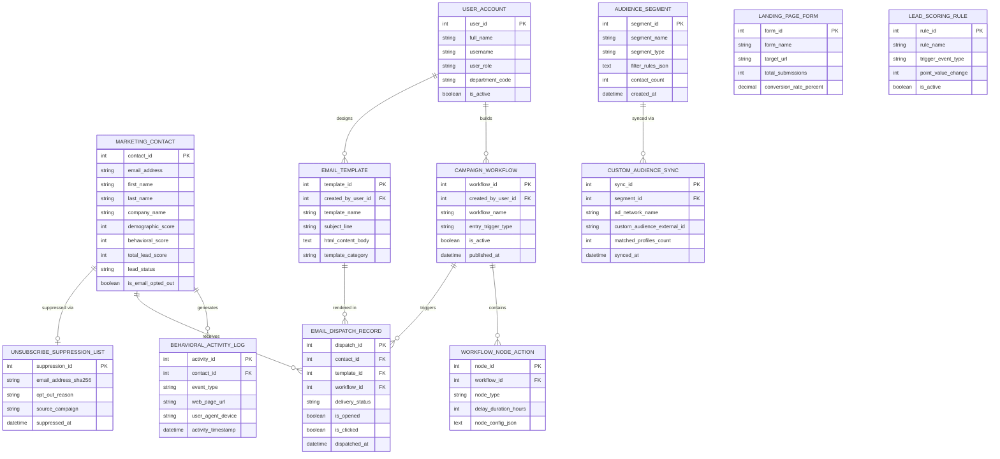

# Conceptual ERD — Marketing Automation Platform

## Mermaid Code

## Entity Description Table | Bảng mô tả Entity

| # | Entity Name | Vietnamese Name | Description | Key Attributes | Main Relationships |
|---|-------------|-----------------|-------------|----------------|-------------------|
| 1 | USER_ACCOUNT | Tài khoản Nguời dùng | System credentials and access roles for demand gen managers, content creators, and admins. | `user_id`, `username`, `user_role`, `department_code` | Builds `CAMPAIGN_WORKFLOW`, designs `EMAIL_TEMPLATE`. |
| 2 | MARKETING_CONTACT | Contact Marketing | Master contact profiles storing email, name, company, demographic/behavioral scores, and opt-out status. | `contact_id`, `email_address`, `total_lead_score`, `lead_status`, `is_email_opted_out` | Generates `BEHAVIORAL_ACTIVITY_LOG`, receives `EMAIL_DISPATCH_RECORD`, suppressed via `UNSUBSCRIBE_SUPPRESSION_LIST`. |
| 3 | AUDIENCE_SEGMENT | Phân đoạn Tập Khách hàng | Static or dynamic audience segments defined by demographic and behavioral rule filters. | `segment_id`, `segment_name`, `segment_type`, `filter_rules_json`, `contact_count` | Synced via `CUSTOM_AUDIENCE_SYNC`. |
| 4 | CAMPAIGN_WORKFLOW | Luồng Chạy Chắc chắn (Drip) | Visual multi-step automated campaign workflows featuring entry triggers and execution states. | `workflow_id`, `workflow_name`, `entry_trigger_type`, `is_active`, `published_at` | Contains `WORKFLOW_NODE_ACTION`, triggers `EMAIL_DISPATCH_RECORD`, built by `USER_ACCOUNT`. |
| 5 | WORKFLOW_NODE_ACTION | Nút Hành động Trong Luồng | Individual execution nodes (Send Email, Delay Timer, Decision Split) within a workflow canvas. | `node_id`, `workflow_id`, `node_type`, `delay_duration_hours`, `node_config_json` | Belongs to `CAMPAIGN_WORKFLOW`. |
| 6 | EMAIL_TEMPLATE | Mẫu Email HTML | Responsive HTML email templates storing subject lines, preheader text, and body content. | `template_id`, `template_name`, `subject_line`, `html_content_body`, `template_category` | Rendered in `EMAIL_DISPATCH_RECORD`, designed by `USER_ACCOUNT`. |
| 7 | LANDING_PAGE_FORM | Biểu mẫu Landing Page | Gated landing page forms capturing prospect lead entries and tracking conversion rates. | `form_id`, `form_name`, `target_url`, `total_submissions`, `conversion_rate_percent` | Standalone lead capture entity. |
| 8 | LEAD_SCORING_RULE | Quy tắc Chấm điểm Lead | Configured scoring rule definitions mapping trigger event types to point value changes (+/-). | `rule_id`, `rule_name`, `trigger_event_type`, `point_value_change`, `is_active` | Standalone scoring engine entity. |
| 9 | BEHAVIORAL_ACTIVITY_LOG | Nhật ký Hoạt động Hành vi | Digital body language logs recording web page views, link clicks, form fills, and video plays. | `activity_id`, `contact_id`, `event_type`, `web_page_url`, `activity_timestamp` | Belongs to `MARKETING_CONTACT`. |
| 10 | EMAIL_DISPATCH_RECORD | Nhật ký Gửi Email Mass | Mass email delivery execution records tracking delivery status, opens, clicks, and bounces. | `dispatch_id`, `contact_id`, `template_id`, `workflow_id`, `delivery_status`, `is_opened`, `is_clicked` | Relates `MARKETING_CONTACT`, `EMAIL_TEMPLATE`, and `CAMPAIGN_WORKFLOW`. |
| 11 | CUSTOM_AUDIENCE_SYNC | Đồng bộ Audiences Mạng Xã hội | Social ad network sync records tracking hashed email exports to Meta Ads and LinkedIn. | `sync_id`, `segment_id`, `ad_network_name`, `custom_audience_external_id`, `synced_at` | Belongs to `AUDIENCE_SEGMENT`. |
| 12 | UNSUBSCRIBE_SUPPRESSION_LIST | Danh sách Chặn Email Global | SHA-256 hashed email suppression list enforcing CAN-SPAM and GDPR email opt-out compliance. | `suppression_id`, `email_address_sha256`, `opt_out_reason`, `source_campaign`, `suppressed_at` | Belongs to `MARKETING_CONTACT`. |

## Relationship Description | Mô tả Quan hệ

| # | From Entity | Cardinality | To Entity | Label | Business Explanation |
|---|-------------|-------------|-----------|-------|----------------------|
| 1 | MARKETING_CONTACT | 1 to 0..N | BEHAVIORAL_ACTIVITY_LOG | generates | A marketing contact generates digital behavioral activity logs. |
| 2 | MARKETING_CONTACT | 1 to 0..N | EMAIL_DISPATCH_RECORD | receives | A marketing contact receives mass email dispatch records. |
| 3 | MARKETING_CONTACT | 1 to 0..1 | UNSUBSCRIBE_SUPPRESSION_LIST | suppressed via | An opted-out contact is suppressed via the global suppression list. |
| 4 | AUDIENCE_SEGMENT | 1 to 0..N | CUSTOM_AUDIENCE_SYNC | synced via | An audience segment is synced to social ad networks via custom audience sync. |
| 5 | CAMPAIGN_WORKFLOW | 1 to 1..N | WORKFLOW_NODE_ACTION | contains | A campaign workflow contains multiple execution node actions. |
| 6 | CAMPAIGN_WORKFLOW | 1 to 0..N | EMAIL_DISPATCH_RECORD | triggers | A campaign workflow triggers mass email dispatches. |
| 7 | EMAIL_TEMPLATE | 1 to 0..N | EMAIL_DISPATCH_RECORD | rendered in | An HTML email template is rendered in mass email dispatches. |
| 8 | USER_ACCOUNT | 1 to 0..N | CAMPAIGN_WORKFLOW | builds | A demand gen user account builds campaign workflows. |
| 9 | USER_ACCOUNT | 1 to 0..N | EMAIL_TEMPLATE | designs | A content creator user account designs HTML email templates. |
