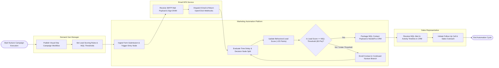

# Swimlane Diagram — Marketing Automation Platform

## Mermaid Code

## Flow Description | Mô tả luồng

| Lane | Actor | Role in Flow |
|------|-------|-------------|
| 1 | Demand Gen Manager | Publishes visual drip campaign workflows, establishes lead scoring point values, and sets MQL qualification thresholds. |
| 2 | Marketing Automation Platform | Ingests landing page form submissions, evaluates workflow delay timers and decision splits, updates behavioral lead scores, evaluates MQL thresholds, packages MQL contact payloads for CRM handoff, and routes unqualified contacts to continued nurture branches. |
| 3 | Email MTA Service | Receives mass email SMTP dispatches, signs DKIM/SPF headers, dispatches messages to recipients, and streams open/click/bounce webhooks back to the platform. |
| 4 | Sales Representative | Receives real-time MQL alerts and contact digital body language timelines in the CRM, initiating prompt sales outreach calls to qualified leads. |
