# Action Tree — Marketing Automation Platform

## Mermaid Code

```mermaid
graph TD
    Root["Marketing Automation Platform"]

    Root --> M1["Audience Segmentation & List Management"]
    Root --> M2["Visual Workflow & Journey Orchestration"]
    Root --> M3["Email & Content Asset Management"]
    Root --> M4["Behavioral Lead Scoring & CRM Handoff"]
    Root --> M5["Multi-Channel Retargeting & Ad Sync"]
    Root --> M6["Attribution Analytics & Compliance"]

    M1 --> A11["Create Static & Dynamic Smart Lists"]
    M1 --> A12["Filter Contacts by Demographic & Behavioral Rules"]
    M1 --> A13["Ingest Unified Customer Profiles from CDP"]
    M1 --> A14["Maintain Global Audience Suppression Lists"]

    M2 --> A21["Design Multi-Branch Visual Drip Campaign Canvases"]
    M2 --> A22["Configure Time Delay & Relative Schedule Nodes"]
    M2 --> A23["Set Conditional Decision Split Trees (If/Else)"]
    M2 --> A24["Set Campaign Exit & Re-Enrollment Conditions"]

    M3 --> A31["Build Drag-and-Drop Responsive HTML Emails"]
    M3 --> A32["Publish Gated Landing Pages & Smart Forms"]
    M3 --> A33["Conduct Email A/B Split Testing (Subject/Copy)"]
    M3 --> A34["Insert Dynamic Personalized Content Blocks"]

    M4 --> A41["Ingest Web Tracking Pixel Behavioral Events"]
    M4 --> A42["Calculate Real-Time Demographic & Behavioral Scores"]
    M4 --> A43["Handoff Qualified MQL Leads to Connected CRM"]
    M4 --> A44["Apply Lead Score Decay for Inactive Contacts"]

    M5 --> A51["Export SHA-256 Hashed Audiences to Meta Ads"]
    M5 --> A52["Sync Target Account Lists to LinkedIn Ad Manager"]
    M5 --> A53["Trigger Automated Retargeting Display Ads"]
    M5 --> A54["Track Social Lead Gen Form Conversions"]

    M6 --> A61["Calculate First-Touch, Last-Touch & W-Shaped Attribution"]
    M6 --> A62["Generate Customer Acquisition Cost (CAC) Reports"]
    M6 --> A63["Process One-Click List-Unsubscribe (RFC 8058) Links"]
    M6 --> A64["Enforce CAN-SPAM, CASL & GDPR Email Compliance"]
```

## Module Description | Mô tả Module

| # | Module | Description | Actions |
|---|--------|-------------|---------|
| 1 | Audience Segmentation & List Management | Creates static/dynamic Smart Lists, filters contacts by behavioral/demographic rules, ingests CDP profiles, and manages suppression lists. | Create Dynamic Smart Lists, Filter Contacts by Behavioral Rules, Ingest CDP Profiles, Maintain Suppression Lists. |
| 2 | Visual Workflow & Journey Orchestration | Designs visual multi-branch drip campaigns, configures delay timers, sets conditional decision trees (If/Else), and defines exit conditions. | Design Visual Drip Canvases, Configure Time Delay Nodes, Set Conditional Decision Trees, Set Campaign Exit Rules. |
| 3 | Email & Content Asset Management | Builds HTML emails, publishes gated landing page forms, executes A/B split tests, and inserts dynamic personalized content blocks. | Build Responsive HTML Emails, Publish Gated Landing Pages, Conduct Email A/B Split Testing, Insert Dynamic Content. |
| 4 | Behavioral Lead Scoring & CRM Handoff | Ingests web tracking pixel events, updates dynamic lead scores, hands off qualified MQLs to CRM, and executes score decay rules. | Ingest Web Tracking Pixels, Calculate Behavioral Scores, Handoff MQLs to CRM, Apply Lead Score Decay. |
| 5 | Multi-Channel Retargeting & Ad Sync | Exports SHA-256 hashed audience segments to Meta/LinkedIn Ads, triggers retargeting display ads, and tracks social lead conversions. | Export Hashed Audiences to Meta, Sync Lists to LinkedIn Ad Manager, Trigger Retargeting Ads, Track Social Lead Forms. |
| 6 | Attribution Analytics & Compliance | Calculates multi-touch attribution models, generates CAC/ROI reports, processes one-click unsubscribes, and enforces CAN-SPAM/GDPR compliance. | Calculate Multi-Touch Attribution, Generate CAC & ROI Reports, Process One-Click Unsubscribes, Enforce CAN-SPAM Compliance. |
