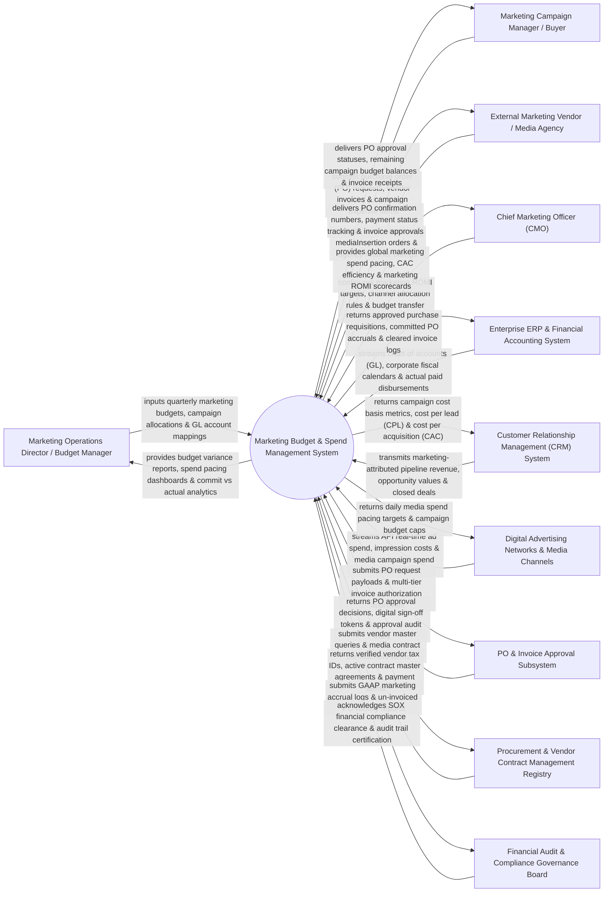

# Context Diagram — Marketing Budget & Spend Management System

## Mermaid Code

## Actor & Interaction Table | Bảng Actor & Tương tác

| # | Actor | Actor Type | Data Sent TO System | Data Received FROM System | Notes |
|---|-------|------------|---------------------|---------------------------|-------|
| 1 | Marketing Operations Director / Budget Manager | Primary | Quarterly marketing budget allocations, campaign budget splits, General Ledger (GL) account mappings, budget reallocation transfers. | Budget variance reports ($Budget - Actual$), spend pacing velocity, committed vs actual spend analytics, forecast overspend alerts. | Marketing ops leader allocating marketing budgets across regions, channels, and campaigns. |
| 2 | Marketing Campaign Manager / Buyer | Primary | Purchase Order (PO) requests, vendor invoice uploads, campaign expense items, insertion orders (IO). | PO approval status notifications, remaining real-time campaign budget balances, invoice processing receipts. | Campaign manager submitting expense requests and monitoring campaign budget consumption. |
| 3 | External Marketing Vendor / Media Agency | Primary | Vendor invoices, media insertion orders, agency monthly retainer billings, service delivery receipts. | PO confirmation numbers, invoice payment status tracking, invoice clearance notifications. | Third-party vendor or ad agency submitting invoices for marketing services and media buys. |
| 4 | Chief Marketing Officer (CMO) | Primary | Global marketing ROMI targets, channel budget allocation rules, emergency budget transfer caps. | Global marketing spend pacing heatmaps, Customer Acquisition Cost (CAC) trends, channel ROMI scorecards. | Executive overseeing global marketing budget allocation, spend pacing, and ROMI performance. |
| 5 | Enterprise ERP & Financial Accounting System | Supporting | Chart of Accounts (GL), fiscal period calendars, actual paid disbursement clearing logs (SAP / NetSuite). | Approved purchase requisitions, committed PO accruals, cleared invoice journal entries. | Enterprise ERP synchronizing general ledger accounts and recording committed marketing liabilities. |
| 6 | Customer Relationship Management (CRM) System | Supporting | Marketing-attributed pipeline revenue, opportunity deal values, closed-won customer contract revenue. | Campaign cost basis metrics, Cost Per Lead (CPL), Cost Per Acquisition (CAC), marketing ROMI. | CRM system linking marketing spend data to revenue pipelines to measure return on marketing investment. |
| 7 | Digital Advertising Networks & Media Channels | Supporting | Real-time ad spend API feeds (Google Ads API, Meta Ads API, LinkedIn Ads API), daily impression costs. | Daily ad spend pacing targets, automated campaign budget caps, daily budget limit updates. | Digital ad platforms streaming daily advertising expenditure into the budget management system. |
| 8 | PO & Invoice Approval Subsystem | Supporting | PO approval decisions, digital sign-off tokens, approval hierarchy routing matrices, sign-off logs. | PO request payloads, multi-tier invoice authorization approvals, escalation notifications. | Workflow engine enforcing multi-level approval chains based on spend dollar thresholds ($PO > \$10k$). |
| 9 | Procurement & Vendor Contract Management Registry | Supporting | Verified vendor tax IDs (W-9 / W-8BEN), active Master Services Agreements (MSA), payment terms (Net 30/60). | Vendor master validation queries, committed contract terms, vendor spend aggregation requests. | Corporate procurement system managing approved vendor registries and master contract terms. |
| 10 | Financial Audit & Compliance Governance Board | Supporting / Regulatory | SOX compliance rules, GAAP marketing accrual guidelines, corporate expense policy limits. | GAAP marketing accrual logs, un-invoiced PO liability reports, financial audit trail signatures. | Internal audit board verifying marketing spend compliance with SOX and GAAP accounting standards. |

## System Boundary Description | Mô tả Phạm vi Hệ thống

The **Marketing Budget & Spend Management System** is an enterprise marketing financial management, purchase order (PO) workflow, real-time ad spend tracking, GL account allocation, and marketing ROMI platform designed to prevent budget overruns.

**Inside System Scope:**
- Multi-tier budget allocation hierarchy (Region -> Business Unit -> Marketing Channel -> Campaign -> GL Account).
- Real-time digital ad spend ingestion via APIs (Google Ads, Meta, LinkedIn) with automated spend pacing alerts.
- Purchase Order (PO) creation, multi-level dollar threshold approval workflows, and committed spend tracking.
- Month-end GAAP marketing accrual calculation (Un-invoiced POs = Committed Liabilities) and ERP synchronization.
- Real-time Customer Acquisition Cost ($\text{CAC} = \frac{\text{Total Marketing Spend}}{\text{Acquired Customers}}$) and ROMI calculation.

**Outside System Scope:**
- Direct physical printing of paper invoices (handled by Commercial Printers).
- Direct processing of bank wire transfers for vendor payments (handled by Corporate ERP / Accounts Payable).
- Direct graphic design of marketing advertisement banner creative (handled by Creative Design Agencies).
