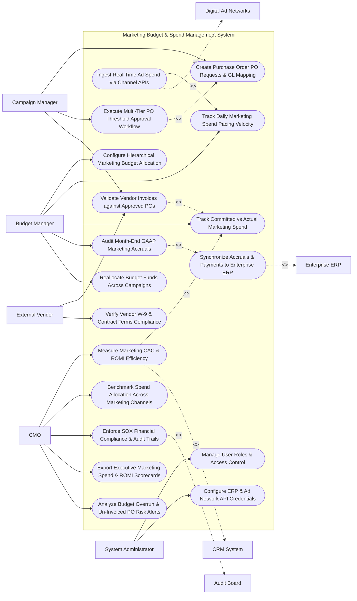

# Use Case Diagram — Marketing Budget & Spend Management System

## Mermaid Code

## Actor Table | Bảng Actor

| # | Actor | Actor Type | Role Description | Related Use Cases |
|---|-------|------------|------------------|-------------------|
| 1 | Budget Manager | Primary | Marketing ops leader managing hierarchical budget allocations, spend pacing velocity, committed vs actual tracking, and GL accruals. | UC01, UC03, UC07, UC08, UC12 |
| 2 | Campaign Manager | Primary | Campaign manager creating PO requests, mapping GL accounts, initiating approval workflows, and matching invoices. | UC04, UC05, UC06 |
| 3 | External Vendor | Primary | Third-party vendor or ad agency submitting invoices, verifying W-9 tax details, and checking PO clearance status. | UC06, UC09 |
| 4 | CMO | Primary | Executive evaluating marketing CAC, ROMI, channel allocation benchmarks, SOX compliance, and overspend alerts. | UC10, UC11, UC13, UC15, UC18 |
| 5 | System Administrator | Primary | IT admin managing user security roles, ERP API connectors, and ad network OAuth tokens. | UC16, UC17 |
| 6 | Digital Ad Networks | System (Secondary) | Ad platforms (Google Ads, Meta, LinkedIn) streaming real-time daily expenditure APIs. | UC02 |
| 7 | Enterprise ERP | System (Secondary) | Financial accounting system (SAP/NetSuite) receiving approved PO accruals and cleared vendor invoices. | UC14 |
| 8 | CRM System | System (Secondary) | Enterprise CRM supplying pipeline revenue and closed deal values to compute marketing ROMI. | UC10 |
| 9 | Audit Board | System (Secondary) | Compliance board auditing marketing spend for SOX compliance and financial audit trails. | UC13 |

## Use Case Table | Bảng Use Case

| # | UC ID | Use Case Name | Primary Actor | Secondary Actor | Description | Priority |
|---|-------|---------------|---------------|-----------------|-------------|----------|
| 1 | UC01 | Configure Hierarchical Marketing Budget Allocation | BudgetManager | None | Configures multi-level budget trees (Fiscal Year -> Quarter -> Business Unit -> Channel -> Campaign -> GL Account). | Critical |
| 2 | UC02 | Ingest Real-Time Ad Spend via Channel APIs | BudgetManager | AdNetworks | Ingests daily ad spend data directly via APIs from Google Ads, Meta, LinkedIn Ads, and TikTok. | Critical |
| 3 | UC03 | Track Daily Marketing Spend Pacing Velocity | BudgetManager | None | Calculates daily spend burn rate vs target pacing curves, flagging under-spending or over-spending channels. | High |
| 4 | UC04 | Create Purchase Order PO Requests & GL Mapping | CampaignManager | None | Creates PO requests for marketing expenses, attaching vendor quotes and mapping GL expense accounts. | Critical |
| 5 | UC05 | Execute Multi-Tier PO Threshold Approval Workflow | CampaignManager | None | Routes PO requests through automated approval chains based on spend thresholds (e.g., PO $> \$10\text{k}$ requires Director sign-off). | Critical |
| 6 | UC06 | Validate Vendor Invoices against Approved POs | CampaignManager | Vendor | Performs 3-way matching between vendor invoices, approved PO line items, and proof of performance deliverables. | Critical |
| 7 | UC07 | Track Committed vs Actual Marketing Spend | BudgetManager | None | Tracks Total Allocated Budget vs Committed POs vs Actual Paid Invoices vs Remaining Available Budget in real time. | Critical |
| 8 | UC08 | Audit Month-End GAAP Marketing Accruals | BudgetManager | Enterprise ERP | Calculates month-end un-invoiced PO liabilities (Accruals = Committed PO Value - Invoiced Value) for GAAP accounting. | Critical |
| 9 | UC09 | Verify Vendor W-9 & Contract Terms Compliance | Vendor | None | Verifies vendor tax identification numbers (W-9 / W-8BEN), active MSA contracts, and Net 30/60 payment terms. | High |
| 10 | UC10 | Measure Marketing CAC & ROMI Efficiency | CMO | CRM System | Computes Customer Acquisition Cost ($\text{CAC} = \frac{\text{Marketing Spend}}{\text{New Customers}}$) and Return on Marketing Investment (ROMI). | Critical |
| 11 | UC11 | Benchmark Spend Allocation Across Marketing Channels | CMO | None | Renders comparative spend distribution across channels (Paid Search, Social, Events, PR, Content) against industry benchmarks. | High |
| 12 | UC12 | Reallocate Budget Funds Across Campaigns | BudgetManager | None | Executes mid-quarter budget reallocations, transferring unspent funds from low-performing campaigns to high-ROMI initiatives. | High |
| 13 | UC13 | Enforce SOX Financial Compliance & Audit Trails | CMO | Audit Board | Maintains immutable audit logs of all budget changes, PO approvals, and invoice clearances for SOX compliance. | High |
| 14 | UC14 | Synchronize Accruals & Payments to Enterprise ERP | System | Enterprise ERP | Transmits approved PO requisitions, month-end accrual journal entries, and cleared invoices to SAP or NetSuite. | Critical |
| 15 | UC15 | Export Executive Marketing Spend & ROMI Scorecards | CMO | None | Renders executive scorecards detailing total marketing spend, budget variance, CAC trends, and net ROMI multipliers. | High |
| 16 | UC16 | Manage User Roles & Access Control | Admin | None | Controls user login credentials, RBAC permissions, and PO approval financial authorization limits. | High |
| 17 | UC17 | Configure ERP & Ad Network API Credentials | Admin | None | Configures API connections and OAuth tokens for SAP, NetSuite, Google Ads, Meta Ads, and LinkedIn Ads. | High |
| 18 | UC18 | Analyze Budget Overrun & Un-Invoiced PO Risk Alerts | CMO | None | Dispatches urgent notifications when a campaign budget reaches $90\%$ consumption or PO accruals exceed limits. | High |

## Use Case Specification | Đặc tả Use Case

---

### UC02 — Ingest Real-Time Ad Spend via Channel APIs

| Field | Detail |
|-------|--------|
| **UC ID** | UC02 |
| **Use Case Name** | Ingest Real-Time Ad Spend via Channel APIs |
| **Actor(s)** | Primary: Budget Manager / Marketing Operations Director   Secondary: Digital Advertising Networks & Media Channels |
| **Description** | Ingests daily advertising expenditure data directly via REST APIs from Google Ads, Meta, LinkedIn, and TikTok, updating marketing spend pacing in real time. |
| **Precondition** | 1. API connection tokens and OAuth credentials for ad platforms are configured.   2. Ad platform campaigns are mapped to marketing budget codes. |
| **Main Flow** | 1. System executes daily automated ad spend ingestion job at 01:00 AM EST.   2. System queries Google Ads API (`GET /v16/customers/884-123-9941/googleAds:searchStream`):   &nbsp;&nbsp;&nbsp;&nbsp; a. Ingests Yesterday's Spend: `$4,500.00` across 12 Search Campaigns.   3. System queries Meta Ads API (`GET /v18.0/act_99412/insights`):   &nbsp;&nbsp;&nbsp;&nbsp; a. Ingests Yesterday's Spend: `$3,200.00` across 8 Instagram Campaigns.   4. System queries LinkedIn Ads API (`GET /v2/adAnalyticsV2`):   &nbsp;&nbsp;&nbsp;&nbsp; a. Ingests Yesterday's Spend: `$2,100.00` across 4 Sponsored Content Campaigns.   5. System aggregates Daily Digital Ad Spend: $\$4,500 + \$3,200 + \$2,100 = \$9,800.00 \text{ Daily Spend}$.   6. System attaches spend to Channel Budget Accounts: `GL-5010 (Paid Search)` and `GL-5020 (Paid Social)`.   7. System updates UC03 (Track Daily Marketing Spend Pacing Velocity), updating month-to-date digital ad spend to `$196,000.00` against `$200,000.00` monthly budget allocation. |
| **Alternative Flow** | **AF1** — Automated Ad Spend Cap Execution: Digital ad spend reaches 98% of monthly budget cap on Day 25; System calls Google Ads API (`SET campaign.status = PAUSED`), automatically pausing campaigns to prevent overrun. |
| **Exception Flow** | **EX1** — Ad Network API Authentication Failure: Meta Ads API OAuth token expires; System flags `API_AUTH_EXPIRED`, dispatches alert to Admin, and retains last known spend estimate until re-authenticated. |
| **Postcondition** | Daily ad spend across digital channels is ingested, mapped to GL accounts, and spend pacing dashboards update. |
| **Business Rule** | **BR1**: Digital ad spend MUST be ingested daily via official APIs and mapped to designated General Ledger (GL) expense codes. |

---

### UC05 — Execute Multi-Tier PO Threshold Approval Workflow

| Field | Detail |
|-------|--------|
| **UC ID** | UC05 |
| **Use Case Name** | Execute Multi-Tier PO Threshold Approval Workflow |
| **Actor(s)** | Primary: Marketing Campaign Manager, Marketing Operations Director   Secondary: PO & Invoice Approval Subsystem |
| **Description** | Routes purchase order (PO) requests through automated multi-level approval hierarchies based on dollar thresholds before committing funds or issuing PO numbers to vendors. |
| **Precondition** | 1. Campaign manager creates a PO request with attached vendor quote and GL code (UC04).   2. Multi-tier approval threshold rules are active. |
| **Main Flow** | 1. Campaign Manager submits PO Request: `Q4 Tech Conference Event Sponsorship (Amount: $45,000.00)`.   2. System evaluates Multi-Tier Approval Threshold Rules:   &nbsp;&nbsp;&nbsp;&nbsp; a. Tier 1 (Up to $5,000): Campaign Manager Approval -> `PASSED`.   &nbsp;&nbsp;&nbsp;&nbsp; b. Tier 2 ($5,001 to $25,000): Marketing Director Approval -> `APPROVAL_REQUIRED`.   &nbsp;&nbsp;&nbsp;&nbsp; c. Tier 3 ($25,001 to $100,000): VP of Marketing Approval -> `APPROVAL_REQUIRED`.   3. System routes PO Approval Request #PO-88412 to Tier 2 Approver (`Marketing Director Sarah Jenkins`).   4. Director Sarah Jenkins receives push notification and approves request (`APPROVED`).   5. System routes PO Approval Request #PO-88412 to Tier 3 Approver (`VP of Marketing Dave Miller`).   6. VP Dave Miller reviews budget availability (Remaining Budget: $120,000) and clicks "Approve PO".   7. System issues Official Purchase Order Number: `PO-2026-88412`, updates Committed Spend (+ $45,000.00), and transmits PO package to Vendor and Enterprise ERP. |
| **Alternative Flow** | **AF1** — Executive CMO Approval Tier: PO amount is $150,000 (> $100,000 threshold); System adds mandatory CMO sign-off tier to approval chain before PO issuance. |
| **Exception Flow** | **EX1** — Insufficient Campaign Budget Error: Campaign Manager attempts to create a $30,000 PO for a campaign with only $10,000 remaining budget; System blocks PO creation, requiring a budget reallocation (UC12) first. |
| **Postcondition** | PO request completes multi-tier approval, official PO number is issued, committed spend updates, and ERP sync triggers. |
| **Business Rule** | **BR1**: Purchase Order requests exceeding specified dollar thresholds MUST obtain sequential multi-level managerial approvals prior to PO release. |

---

### UC08 — Audit Month-End GAAP Marketing Accruals

| Field | Detail |
|-------|--------|
| **UC ID** | UC08 |
| **Use Case Name** | Audit Month-End GAAP Marketing Accruals |
| **Actor(s)** | Primary: Budget Manager / Marketing Operations Director   Secondary: Enterprise ERP & Financial Accounting System (SAP / NetSuite) |
| **Description** | Calculates month-end un-invoiced PO liabilities (Accrual = Committed PO Value - Invoiced Value) to ensure compliance with GAAP accrual accounting guidelines and SOX financial controls. |
| **Precondition** | 1. Active approved POs and cleared vendor invoices are logged in system (UC06).   2. Fiscal month-end close date (e.g., Oct 31, 2026) is reached. |
| **Main Flow** | 1. User opens "Month-End GAAP Marketing Accrual Console".   2. User selects Accounting Period: `October 2026 Close`.   3. System scans all active open Purchase Orders for October 2026.   4. System calculates Accrual Liabilities for each open PO:   &nbsp;&nbsp;&nbsp;&nbsp; a. PO #PO-88410 (Agency Retainer): Committed `$20,000.00` | Invoiced `$20,000.00` -> `Accrual = $0.00`.   &nbsp;&nbsp;&nbsp;&nbsp; b. PO #PO-88412 (Event Sponsorship): Committed `$45,000.00` | Invoiced `$0.00` (Service Delivered in Oct, Invoice Pending) -> `Accrual = $45,000.00`.   &nbsp;&nbsp;&nbsp;&nbsp; c. PO #PO-88415 (PR Wire Service): Committed `$10,000.00` | Invoiced `$4,000.00` -> `Accrual = $6,000.00`.   5. System computes Total October GAAP Marketing Accrual Liability:   $$\text{Total Accrual} = \$45,000.00 + \$6,000.00 = \$51,000.00 \text{ Accrued Liability}$$   6. System generates GAAP Accrual Journal Entry:   &nbsp;&nbsp;&nbsp;&nbsp; a. Debit: Marketing Expense GL Accounts `$51,000.00`.   &nbsp;&nbsp;&nbsp;&nbsp; b. Credit: Accrued Marketing Liabilities `$51,000.00`.   7. System transmits journal entry payload to Enterprise ERP (SAP API) and exports certified accrual audit report for Corporate Controller. |
| **Alternative Flow** | **AF1** — Accrual Reversal in Subsequent Month: On November 1st, System automatically generates reversing journal entries in SAP to clear October accruals as actual vendor invoices arrive. |
| **Exception Flow** | **EX1** — Disputed Un-Invoiced PO Variance: Vendor claims $50,000 delivered on a $40,000 PO; System flags $10,000 variance for Budget Manager review before finalizing month-end accrual entry. |
| **Postcondition** | Month-end un-invoiced PO liabilities are calculated, GAAP journal entries are posted to ERP, and certified accrual reports export. |
| **Business Rule** | **BR1**: Marketing services delivered within a fiscal month but not yet invoiced MUST be accrued as committed liabilities under GAAP accounting standards. |

---

### UC10 — Measure Marketing CAC & ROMI Efficiency

| Field | Detail |
|-------|--------|
| **UC ID** | UC10 |
| **Use Case Name** | Measure Marketing CAC & ROMI Efficiency |
| **Actor(s)** | Primary: Chief Marketing Officer (CMO), VP of Demand Generation   Secondary: Customer Relationship Management (CRM) System |
| **Description** | Combines total actual marketing spend (digital ads, agency fees, events) with CRM-attributed pipeline revenue and new customer counts to measure Customer Acquisition Cost (CAC) and Return on Marketing Investment (ROMI). |
| **Precondition** | 1. Actual marketing spend is aggregated across GL accounts (UC07).   2. Closed-won new customer count and pipeline revenue are synchronized from CRM. |
| **Main Flow** | 1. User opens "Marketing Efficiency & ROMI Scorecard Studio".   2. User selects Analysis Period: `Q3 2026` and Scope: `Global Marketing`.   3. System retrieves Total Actual Marketing Expenditure ($S$):   &nbsp;&nbsp;&nbsp;&nbsp; a. Paid Media Spend: `$400,000.00`.   &nbsp;&nbsp;&nbsp;&nbsp; b. Agency & Vendor Fees: `$150,000.00`.   &nbsp;&nbsp;&nbsp;&nbsp; c. Events & Sponsorships: `$200,000.00`.   &nbsp;&nbsp;&nbsp;&nbsp; d. Headcount & Tools Allocation: `$250,000.00`.   &nbsp;&nbsp;&nbsp;&nbsp; e. Total Marketing Spend ($S$): `$1,000,000.00`.   4. System retrieves CRM Performance Data for Q3 2026:   &nbsp;&nbsp;&nbsp;&nbsp; a. New Customers Acquired ($N$): `200 Enterprise Customers`.   &nbsp;&nbsp;&nbsp;&nbsp; b. Marketing-Attributed Closed-Won Revenue ($R$): `$5,000,000.00 ARR`.   5. System calculates Customer Acquisition Cost (CAC):   $$\text{Blended CAC} = \frac{\text{Total Spend}}{\text{New Customers}} = \frac{\$1,000,000.00}{200} = \$5,000.00 \text{ per Acquired Customer}$$   6. System calculates Return on Marketing Investment (ROMI Multiplier):   $$\text{ROMI Multiplier} = \frac{\text{Attributed Revenue}}{\text{Total Spend}} = \frac{\$5,000,000.00}{\$1,000,000.00} = 5.0\times \text{ ROMI Multiplier (500\% Return)}$$   7. System renders Channel CAC & ROMI Comparison Matrix (Paid Search ROMI: 7.2x, Events ROMI: 3.1x) and exports executive CMO briefing PDF. |
| **Alternative Flow** | **AF1** — LTV-to-CAC Ratio Calculation: System incorporates Customer Lifetime Value ($LTV = \$45,000$), calculating $\text{LTV:CAC Ratio} = \frac{\$45,000}{\$5,000} = 9.0\times$ (Healthy benchmark > 3.0x). |
| **Exception Flow** | **EX1** — Un-Attributed Revenue Warning: 30% of closed deals lack marketing campaign attribution; System displays disclaimer "ROMI calculated on 70% attributed pipeline basis". |
| **Postcondition** | Blended CAC ($5,000), channel-specific ROMI multipliers (5.0x), and LTV:CAC ratios are calculated and rendered on executive dashboards. |
| **Business Rule** | **BR1**: Blended Customer Acquisition Cost (CAC) MUST include all marketing spend components (paid media, agencies, events, overhead) divided by new acquired customers. |

---

### UC12 — Reallocate Budget Funds Across Campaigns

| Field | Detail |
|-------|--------|
| **UC ID** | UC12 |
| **Use Case Name** | Reallocate Budget Funds Across Campaigns |
| **Actor(s)** | Primary: Budget Manager / Marketing Operations Director   Secondary: None |
| **Description** | Executes mid-quarter budget reallocations, transferring unspent funds from low-performing campaigns to high-ROMI marketing initiatives while enforcing budget governance rules. |
| **Precondition** | 1. Hierarchical budget allocation is active (UC01).   2. Real-time spend pacing and ROMI metrics are calculated (UC03, UC10). |
| **Main Flow** | 1. Budget Manager opens "Mid-Quarter Budget Reallocation Console".   2. System identifies Under-Pacing / Low-ROMI Campaign: `Trade Show Booth Event (Campaign #CMP-102)` -> Allocated: `$100,000` | Spent: `$40,000` | Uncommitted Surplus: `$60,000` | ROMI: `1.5x`.   3. System identifies Over-Performing / High-ROMI Campaign: `Paid Search Google Ads (Campaign #CMP-405)` -> Allocated: `$150,000` | Spent: `$145,000` | ROMI: `7.2x`.   4. Budget Manager creates Budget Transfer Request:   &nbsp;&nbsp;&nbsp;&nbsp; a. Source Campaign: `#CMP-102 (Trade Show Booth)` -> Deduct `$40,000.00`.   &nbsp;&nbsp;&nbsp;&nbsp; b. Destination Campaign: `#CMP-405 (Paid Search)` -> Add `$40,000.00`.   5. System verifies Transfer Rules: Transfer amount ($40k) <= Available uncommitted surplus ($60k) -> `TRANSFER_VALID`.   6. Budget Manager clicks "Execute Budget Reallocation".   7. System updates Campaign Allocations: `#CMP-102` reduced to `$60,000`, `#CMP-405` increased to `$190,000`.   8. System dispatches API call to Google Ads API, increasing daily ad spend budget cap from $5,000 to $6,500/day to utilize reallocated funds.   9. System logs budget transfer audit trail for financial compliance. |
| **Alternative Flow** | **AF1** — Cross-Business Unit Budget Transfer: Reallocation transfers funds between different business units (e.g., US Sales to EMEA Sales); System routes request to CMO for mandatory cross-BU approval. |
| **Exception Flow** | **EX1** — Over-Committed Source Budget Error: Budget Manager attempts to transfer $50,000 from a campaign with $30,000 in committed open POs; System blocks transfer: "Cannot Transfer Committed PO Funds - Cancel PO First". |
| **Postcondition** | Budget allocations are transferred between campaigns, digital ad spend caps update, and financial audit logs update. |
| **Business Rule** | **BR1**: Budget reallocations MUST NOT transfer funds that are already encumbered by approved Purchase Orders. |
