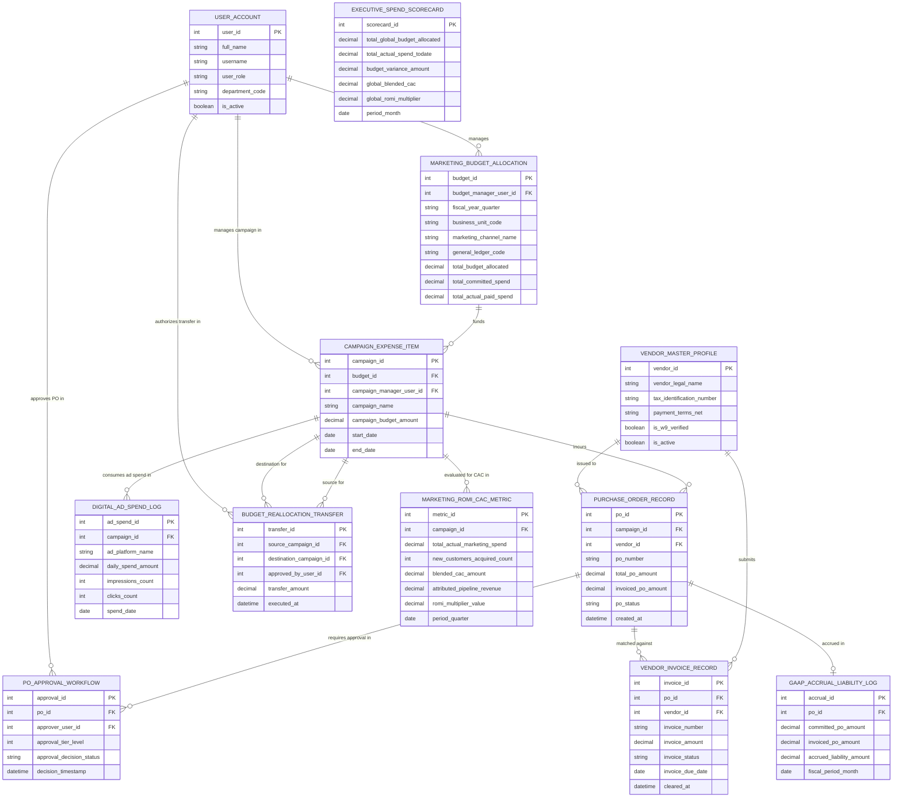

# Conceptual ERD — Marketing Budget & Spend Management System

## Mermaid Code

## Entity Description Table | Bảng mô tả Entity

| # | Entity Name | Vietnamese Name | Description | Key Attributes | Main Relationships |
|---|-------------|-----------------|-------------|----------------|-------------------|
| 1 | USER_ACCOUNT | Tài khoản Nguời dùng | System credentials and access roles for budget managers, campaign managers, CMOs, and admins. | `user_id`, `username`, `user_role`, `department_code` | Manages `MARKETING_BUDGET_ALLOCATION`, manages campaign in `CAMPAIGN_EXPENSE_ITEM`, approves PO in `PO_APPROVAL_WORKFLOW`, authorizes `BUDGET_REALLOCATION_TRANSFER`. |
| 2 | MARKETING_BUDGET_ALLOCATION | Phân bổ Ngân sách Marketing | Hierarchical budget allocation entity tracking fiscal quarter, business unit code, marketing channel, GL code, and totals. | `budget_id`, `budget_manager_user_id`, `fiscal_year_quarter`, `business_unit_code`, `general_ledger_code`, `total_budget_allocated`, `total_committed_spend` | Funds `CAMPAIGN_EXPENSE_ITEM`, managed by `USER_ACCOUNT`. |
| 3 | CAMPAIGN_EXPENSE_ITEM | Mục Chi phí Campaign | Marketing campaign budget container tracking campaign name, budget amount, start/end dates, and manager ID. | `campaign_id`, `budget_id`, `campaign_manager_user_id`, `campaign_name`, `campaign_budget_amount`, `start_date`, `end_date` | Belongs to `MARKETING_BUDGET_ALLOCATION`, incurs `PURCHASE_ORDER_RECORD`, consumes ad spend in `DIGITAL_AD_SPEND_LOG`, evaluated in `MARKETING_ROMI_CAC_METRIC`. |
| 4 | PURCHASE_ORDER_RECORD | Bản ghi Purchase Order (PO) | Formal purchase order record tracking PO number, total amount, invoiced amount, status, vendor ID, and creation date. | `po_id`, `campaign_id`, `vendor_id`, `po_number`, `total_po_amount`, `invoiced_po_amount`, `po_status` | Belongs to `CAMPAIGN_EXPENSE_ITEM` and `VENDOR_MASTER_PROFILE`, requires approval in `PO_APPROVAL_WORKFLOW`, matched against `VENDOR_INVOICE_RECORD`, accrued in `GAAP_ACCRUAL_LIABILITY_LOG`. |
| 5 | VENDOR_MASTER_PROFILE | Profile Vendor Master | Vendor profile entity storing vendor legal name, tax ID (W-9), payment terms (Net 30/60), W-9 verification status, and active flag. | `vendor_id`, `vendor_legal_name`, `tax_identification_number`, `payment_terms_net`, `is_w9_verified` | Issued to `PURCHASE_ORDER_RECORD`, submits `VENDOR_INVOICE_RECORD`. |
| 6 | PO_APPROVAL_WORKFLOW | Luồng Phê duyệt PO | Multi-tier PO threshold approval record tracking approver user ID, approval tier level, and decision status. | `approval_id`, `po_id`, `approver_user_id`, `approval_tier_level`, `approval_decision_status` | Belongs to `PURCHASE_ORDER_RECORD`, approved by `USER_ACCOUNT`. |
| 7 | VENDOR_INVOICE_RECORD | Bản ghi Hóa đơn Vendor | Vendor invoice record tracking invoice number, invoice amount, status (Approved/Paid), due date, and clearance timestamp. | `invoice_id`, `po_id`, `vendor_id`, `invoice_number`, `invoice_amount`, `invoice_status`, `cleared_at` | Belongs to `PURCHASE_ORDER_RECORD` and `VENDOR_MASTER_PROFILE`. |
| 8 | DIGITAL_AD_SPEND_LOG | Nhật ký Spend Quảng cáo Ad | Daily digital ad spend log ingesting API expenditure from Google, Meta, and LinkedIn with impression/click counts. | `ad_spend_id`, `campaign_id`, `ad_platform_name`, `daily_spend_amount`, `impressions_count`, `clicks_count`, `spend_date` | Belongs to `CAMPAIGN_EXPENSE_ITEM`. |
| 9 | GAAP_ACCRUAL_LIABILITY_LOG | Sổ cái Nợ dồn tích GAAP Accrual | Month-end GAAP marketing accrual liability record tracking committed PO value, invoiced value, and accrued liability $. | `accrual_id`, `po_id`, `committed_po_amount`, `invoiced_po_amount`, `accrued_liability_amount`, `fiscal_period_month` | Belongs to `PURCHASE_ORDER_RECORD`. |
| 10 | BUDGET_REALLOCATION_TRANSFER | Chuyển Phân bổ Ngân sách | Mid-quarter budget transfer record tracking source campaign ID, destination campaign ID, transfer amount, and authorizer ID. | `transfer_id`, `source_campaign_id`, `destination_campaign_id`, `approved_by_user_id`, `transfer_amount` | Relates source and destination `CAMPAIGN_EXPENSE_ITEM`, authorized by `USER_ACCOUNT`. |
| 11 | MARKETING_ROMI_CAC_METRIC | Chỉ số CAC & ROMI Marketing | Campaign marketing efficiency record tracking actual spend, new customers acquired, blended CAC $, pipeline revenue, and ROMI multiplier. | `metric_id`, `campaign_id`, `total_actual_marketing_spend`, `new_customers_acquired_count`, `blended_cac_amount`, `romi_multiplier_value` | Belongs to `CAMPAIGN_EXPENSE_ITEM`. |
| 12 | EXECUTIVE_SPEND_SCORECARD | Scorecard Executive Spend | Executive marketing spend scorecard aggregating global budget allocated, actual spend to date, budget variance, global CAC, and ROMI. | `scorecard_id`, `total_global_budget_allocated`, `total_actual_spend_todate`, `budget_variance_amount`, `global_blended_cac`, `global_romi_multiplier` | Standalone executive performance entity. |

## Relationship Description | Mô tả Quan hệ

| # | From Entity | Cardinality | To Entity | Label | Business Explanation |
|---|-------------|-------------|-----------|-------|----------------------|
| 1 | MARKETING_BUDGET_ALLOCATION | 1 to 1..N | CAMPAIGN_EXPENSE_ITEM | funds | A marketing budget allocation funds multiple campaign expense items. |
| 2 | CAMPAIGN_EXPENSE_ITEM | 1 to 0..N | PURCHASE_ORDER_RECORD | incurs | A campaign expense item incurs purchase orders (POs). |
| 3 | CAMPAIGN_EXPENSE_ITEM | 1 to 0..N | DIGITAL_AD_SPEND_LOG | consumes ad spend in | A campaign expense item consumes daily ad spend in digital ad logs. |
| 4 | CAMPAIGN_EXPENSE_ITEM | 1 to 0..1 | MARKETING_ROMI_CAC_METRIC | evaluated for CAC in | A campaign expense item is evaluated for CAC and ROMI efficiency. |
| 5 | CAMPAIGN_EXPENSE_ITEM | 1 to 0..N | BUDGET_REALLOCATION_TRANSFER | source for | A campaign expense item acts as a source or destination for budget transfers. |
| 6 | VENDOR_MASTER_PROFILE | 1 to 0..N | PURCHASE_ORDER_RECORD | issued to | A vendor master profile is issued purchase order records. |
| 7 | VENDOR_MASTER_PROFILE | 1 to 0..N | VENDOR_INVOICE_RECORD | submits | A vendor master profile submits vendor invoice records. |
| 8 | PURCHASE_ORDER_RECORD | 1 to 0..N | PO_APPROVAL_WORKFLOW | requires approval in | A purchase order record requires approval in multi-tier approval workflows. |
| 9 | PURCHASE_ORDER_RECORD | 1 to 0..N | VENDOR_INVOICE_RECORD | matched against | A purchase order record is matched against vendor invoices. |
| 10 | PURCHASE_ORDER_RECORD | 1 to 0..1 | GAAP_ACCRUAL_LIABILITY_LOG | accrued in | An un-invoiced purchase order is accrued in GAAP liability logs. |
| 11 | USER_ACCOUNT | 1 to 0..N | MARKETING_BUDGET_ALLOCATION | manages | A budget manager user account manages budget allocations. |
| 12 | USER_ACCOUNT | 1 to 0..N | PO_APPROVAL_WORKFLOW | approves PO in | A marketing director user account approves PO requests. |
| 13 | USER_ACCOUNT | 1 to 0..N | BUDGET_REALLOCATION_TRANSFER | authorizes transfer in | A budget manager user account authorizes budget reallocations. |
