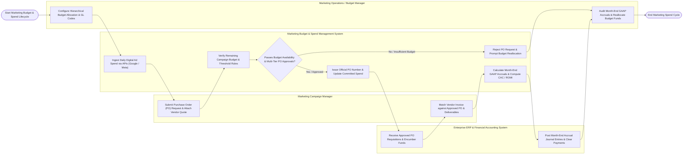

# Swimlane Diagram — Marketing Budget & Spend Management System

## Mermaid Code

## Flow Description | Mô tả luồng

| Lane | Actor | Role in Flow |
|------|-------|-------------|
| 1 | Marketing Campaign Manager | Submits PO requests with vendor quotes and GL expense codes, monitors campaign budget balances, matches vendor invoices against approved POs, and verifies proof of performance deliverables. |
| 2 | Marketing Operations / Budget Manager | Configures multi-level budget trees (BU -> Channel -> Campaign -> GL), monitors spend pacing velocity, audits month-end GAAP marketing accruals, and executes mid-quarter budget reallocations. |
| 3 | Marketing Budget & Spend Management System | Ingests daily digital ad spend APIs (Google/Meta/LinkedIn), verifies budget availability, routes POs through multi-tier threshold approval chains, issues PO numbers, updates committed vs actual spend, computes month-end un-invoiced accruals, and calculates CAC and ROMI multipliers. |
| 4 | Enterprise ERP & Financial Accounting System | Receives approved PO requisitions, encumbers committed funds in GL accounts, accepts month-end GAAP accrual journal entries, and clears vendor invoice payments (SAP / NetSuite). |
