# Action Tree — Marketing Budget & Spend Management System

## Mermaid Code

```mermaid
graph TD
    Root["Marketing Budget & Spend Management System"]

    Root --> M1["Hierarchical Budget & GL Account Allocation"]
    Root --> M2["Real-Time Digital Ad Spend API Ingestion"]
    Root --> M3["PO Creation & Multi-Tier Threshold Approvals"]
    Root --> M4["Vendor Invoice Matching & Proof of Performance"]
    Root --> M5["GAAP Accruals & Enterprise ERP Integration"]
    Root --> M6["CAC Efficiency, ROMI & Financial Audit"]

    M1 --> A11["Configure Hierarchical Budget Trees (BU, Channel, Campaign, GL Account)"]
    M1 --> A12["Set Fiscal Year & Quarterly Marketing Budget Allocations"]
    M1 --> A13["Track Real-Time Committed vs Actual vs Available Budget Balances"]
    M1 --> A14["Execute Mid-Quarter Budget Reallocations between Campaigns"]

    M2 --> A21["Ingest Daily Digital Ad Spend via Google Ads API"]
    M2 --> A22["Ingest Daily Digital Ad Spend via Meta & LinkedIn Ads APIs"]
    M2 --> A23["Track Daily Marketing Spend Pacing Velocity against Targets"]
    M2 --> A24["Automate Daily Ad Spend Caps to Prevent Budget Overruns"]

    M3 --> A31["Create Purchase Order (PO) Requests with Attached Vendor Quotes"]
    M3 --> A32["Map PO Expenses to General Ledger (GL) Chart of Accounts"]
    M3 --> A33["Execute Multi-Tier Threshold Approval Chains (PO > $10K Approvals)"]
    M3 --> A34["Issue Official PO Numbers & Encumber Committed Budget Funds"]

    M4 --> A41["Verify Vendor Tax Identification Numbers (W-9 / W-8BEN)"]
    M4 --> A42["Perform 3-Way Matching between Vendor Invoices, POs & Deliverables"]
    M4 --> A43["Validate Vendor Master Service Agreements (MSA) & Net Terms"]
    M4 --> A44["Approve Vendor Invoices for Accounts Payable (AP) Clearing"]

    M5 --> A51["Calculate Month-End Un-Invoiced PO Accruals (Committed - Invoiced)"]
    M5 --> A52["Generate GAAP Accrual Journal Entries for Corporate Accounting"]
    M5 --> A53["Synchronize Approved POs & Accruals to Enterprise ERP (SAP/NetSuite)"]
    M5 --> A54["Execute Automated Reversing Journal Entries in Subsequent Month"]

    M6 --> A61["Calculate Blended & Channel-Specific Customer Acquisition Cost (CAC)"]
    M6 --> A62["Measure Return on Marketing Investment (ROMI = Pipeline Revenue / Spend)"]
    M6 --> A63["Enforce SOX Financial Compliance & Maintain Immutable Audit Logs"]
    M6 --> A64["Export Executive Marketing Spend Pacing & ROMI Scorecards"]
```

## Module Description | Mô tả Module

| # | Module | Description | Actions |
|---|--------|-------------|---------|
| 1 | Hierarchical Budget & GL Account Allocation | Configures multi-level budget trees, sets quarterly allocations, tracks committed vs actual spend, and reallocates campaign funds. | Configure Hierarchical Budget Trees, Set Quarterly Marketing Budget Allocations, Track Committed vs Actual Budget Balances, Execute Mid-Quarter Budget Reallocations. |
| 2 | Real-Time Digital Ad Spend API Ingestion | Ingests daily ad spend APIs (Google, Meta, LinkedIn), tracks spend pacing velocity, and automates ad spend caps. | Ingest Daily Ad Spend via Google Ads API, Ingest Daily Ad Spend via Meta/LinkedIn APIs, Track Daily Spend Pacing Velocity, Automate Daily Ad Spend Caps. |
| 3 | PO Creation & Multi-Tier Threshold Approvals | Creates PO requests, maps GL accounts, executes multi-tier threshold approval chains ($PO > \$10\text{k}$), and encumbers funds. | Create Purchase Order PO Requests, Map PO Expenses to GL Chart of Accounts, Execute Multi-Tier Threshold Approval Chains, Issue Official PO Numbers. |
| 4 | Vendor Invoice Matching & Proof of Performance | Verifies vendor W-9 tax IDs, performs 3-way matching between invoices, POs, and deliverables, and approves invoices for AP clearing. | Verify Vendor W-9 Tax IDs, Perform 3-Way Matching on Invoices/POs, Validate Vendor MSA Contracts, Approve Vendor Invoices for AP Clearing. |
| 5 | GAAP Accruals & Enterprise ERP Integration | Calculates month-end un-invoiced PO liabilities, generates GAAP accrual journal entries, syncs to SAP/NetSuite ERP, and reverses accruals. | Calculate Month-End Un-Invoiced PO Accruals, Generate GAAP Accrual Journal Entries, Synchronize Accruals to Enterprise ERP, Execute Automated Reversing Journal Entries. |
| 6 | CAC Efficiency, ROMI & Financial Audit | Computes blended/channel CAC, measures ROMI multipliers, enforces SOX compliance audit trails, and exports executive scorecards. | Calculate Blended & Channel CAC, Measure Return on Marketing Investment (ROMI), Enforce SOX Financial Compliance, Export Executive ROMI Scorecards. |
