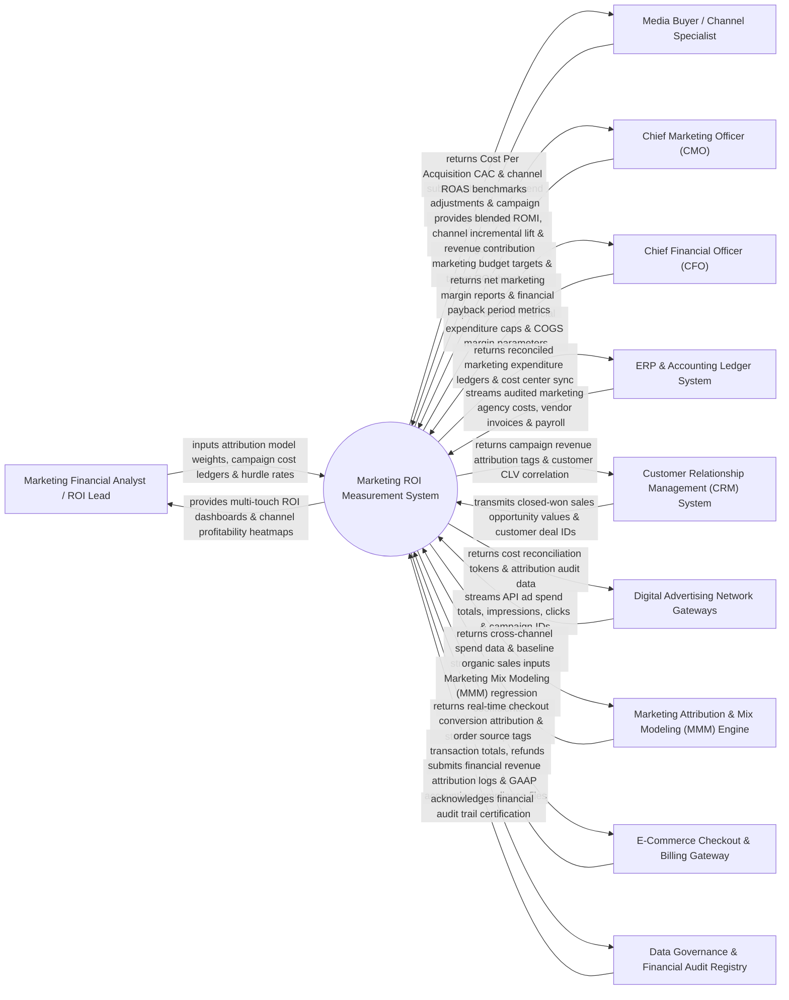

# Context Diagram — Marketing ROI Measurement System

## Mermaid Code

## Actor & Interaction Table | Bảng Actor & Tương tác

| # | Actor | Actor Type | Data Sent TO System | Data Received FROM System | Notes |
|---|-------|------------|---------------------|---------------------------|-------|
| 1 | Marketing Financial Analyst / ROI Lead | Primary | Multi-touch attribution model weights, offline campaign cost ledgers, ROI hurdle rates. | Multi-touch ROI dashboards, channel profitability heatmaps, incremental revenue lift calculations. | Financial analyst evaluating marketing spend efficiency, attribution models, and capital allocation. |
| 2 | Media Buyer / Channel Specialist | Primary | Channel ad spend adjustments, agency fee structures, campaign UTM tag mappings. | Real-time Return on Ad Spend (ROAS), Customer Acquisition Cost (CAC), channel margin benchmarks. | Paid media specialist optimizing campaign budgets based on real-time ROAS data. |
| 3 | Chief Marketing Officer (CMO) | Primary | Annual marketing budget targets, strategic ROMI benchmarks, target payback period goals. | Blended Return on Marketing Investment (ROMI), cross-channel incremental lift, pipeline contribution. | Executive monitoring global marketing budget efficiency and revenue contribution. |
| 4 | Chief Financial Officer (CFO) | Primary | Audited financial expense caps, Cost of Goods Sold (COGS) margin rates, corporate discount rates. | Net marketing margin reports, financial payback period metrics, marketing GAAP audit logs. | Finance executive auditing marketing expenditure against true net margin and corporate profitability. |
| 5 | ERP & Accounting Ledger System | Supporting | General ledger vendor invoices, marketing agency retainers, media placement expense records. | Reconciled marketing cost ledgers, marketing cost center financial sync payloads. | Backend ERP accounting system supplying verified general ledger expense data. |
| 6 | Customer Relationship Management (CRM) System | Supporting | Closed-won opportunity values, deal pipeline stages, enterprise customer account IDs. | Campaign revenue attribution tags, customer CLV correlation metrics, deal source history. | Enterprise CRM providing closed sales revenue data for B2B multi-touch attribution. |
| 7 | Digital Advertising Network Gateways | Supporting | Automated API spend totals (Google Ads, Meta, LinkedIn), impression counts, click costs. | Cost reconciliation tokens, multi-touch attribution audit logs. | Ad network APIs supplying real-time ad spend, click, and impression expenditure data. |
| 8 | Marketing Attribution & Mix Modeling (MMM) Engine | Supporting | Econometric Marketing Mix Modeling (MMM) regression coefficients, media elasticity curves. | Cross-channel spend history, baseline organic sales inputs, offline media campaign data. | Analytics engine performing advanced econometric regression to isolate TV/print/digital lift. |
| 9 | E-Commerce Checkout & Billing Gateway | Supporting | Net e-commerce transaction totals, customer refunds, recurring subscription billing revenue. | Real-time checkout revenue attribution tags, campaign order source logs. | Storefront payment gateway providing e-commerce order revenue data. |
| 10 | Data Governance & Financial Audit Registry | Supporting / Regulatory | GAAP/IFRS financial reporting compliance rules, audit trail standards, revenue recognition rules. | Financial revenue attribution audit trails, GAAP compliance verification tokens. | Regulatory governance framework ensuring financial audit integrity of marketing ROI reports. |

## System Boundary Description | Mô tả Phạm vi Hệ thống

The **Marketing ROI Measurement System** is an enterprise financial analytics, multi-touch attribution modeling, Marketing Mix Modeling (MMM), and return on investment tracking platform designed to measure the true financial impact and net margin of marketing expenditures.

**Inside System Scope:**
- Multi-touch algorithmic attribution modeling (First-Touch, Last-Touch, Linear, Time-Decay, Position-Based W-Shaped, and Data-Driven AI).
- Econometric Marketing Mix Modeling (MMM) integration evaluating offline (TV, Radio, Print) and digital media incremental lift.
- Reconciling ad network API spend data with ERP general ledger invoices and COGS margins to compute true Net Marketing Margin.
- Calculation of Return on Marketing Investment ($\text{ROMI} = \frac{\text{Net Margin Revenue} - \text{Marketing Spend}}{\text{Marketing Spend}}$), CAC, and Payback Period.
- Financial audit trail logging compliant with GAAP and IFRS revenue recognition standards.

**Outside System Scope:**
- Direct physical execution of paid ad campaigns (handled by PPC and Social Media Management Systems).
- Direct payroll payment of internal marketing staff salaries (handled by HR & Payroll ERP Systems).
- Direct hosting of corporate e-commerce product storefronts (handled by E-Commerce Platforms).
