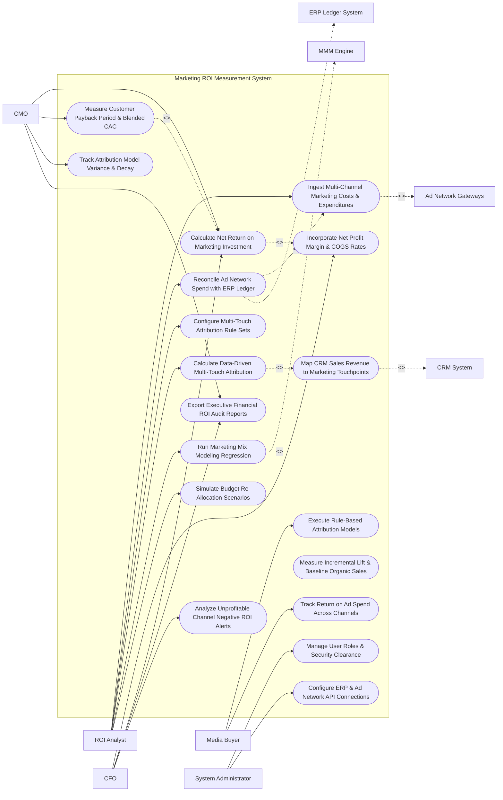

# Use Case Diagram — Marketing ROI Measurement System

## Mermaid Code

## Actor Table | Bảng Actor

| # | Actor | Actor Type | Role Description | Related Use Cases |
|---|-------|------------|------------------|-------------------|
| 1 | ROI Analyst | Primary | Financial analyst ingesting costs, configuring attribution models, running MMM regression, and simulating budget re-allocations. | UC01, UC02, UC03, UC05, UC08, UC13 |
| 2 | Media Buyer | Primary | Channel specialist monitoring rule-based attribution outputs and channel-specific ROAS metrics. | UC04, UC11 |
| 3 | CMO | Primary | Executive reviewing ROMI, customer payback periods, attribution model variances, and strategic marketing performance. | UC10, UC12, UC14, UC15 |
| 4 | CFO | Primary | Finance leader verifying COGS net profit margins, audited ROMI reports, GAAP audit trails, and negative ROI alerts. | UC07, UC10, UC15, UC18 |
| 5 | System Administrator | Primary | IT admin managing security clearance roles, ERP connection keys, and ad network API credentials. | UC16, UC17 |
| 6 | ERP Ledger System | System (Secondary) | Backend ERP general ledger supplying audited vendor invoices, agency retainers, and accounting costs. | UC02 |
| 7 | CRM System | System (Secondary) | Enterprise CRM providing closed-won sales opportunity values and customer deal timelines. | UC06 |
| 8 | Ad Network Gateways | System (Secondary) | Digital ad networks (Google, Meta, LinkedIn) streaming API ad spend, impressions, and click telemetry. | UC01 |
| 9 | MMM Engine | System (Secondary) | Econometric modeling service providing regression coefficients and media elasticity metrics. | UC08 |

## Use Case Table | Bảng Use Case

| # | UC ID | Use Case Name | Primary Actor | Secondary Actor | Description | Priority |
|---|-------|---------------|---------------|-----------------|-------------|----------|
| 1 | UC01 | Ingest Multi-Channel Marketing Costs & Expenditures | ROI Analyst | Ad Networks | Ingests digital ad spend via APIs, agency fees, sponsorship costs, and offline media expenditures. | High |
| 2 | UC02 | Reconcile Ad Network Spend with ERP Ledger | ROI Analyst | ERP System | Reconciles API reported ad spend with audited general ledger vendor invoices to eliminate accounting discrepancies. | Critical |
| 3 | UC03 | Configure Multi-Touch Attribution Rule Sets | ROI Analyst | None | Defines rule-based attribution models (First-Touch, Last-Touch, Linear, Time-Decay, Position-Based W-Shaped). | High |
| 4 | UC04 | Execute Rule-Based Attribution Models | Media Buyer | None | Applies static attribution rule sets across customer touchpoint logs to assign fractional revenue credit. | High |
| 5 | UC05 | Calculate Data-Driven Multi-Touch Attribution | ROI Analyst | CRM System | Uses machine learning algorithms (Shapley Value / Markov Chains) to dynamically calculate touchpoint credit. | Critical |
| 6 | UC06 | Map CRM Sales Revenue to Marketing Touchpoints | ROI Analyst | CRM System | Maps B2B enterprise closed-won sales opportunities in CRM to original marketing campaign touchpoints. | Critical |
| 7 | UC07 | Incorporate Net Profit Margin & COGS Rates | CFO | None | Integrates product Cost of Goods Sold (COGS) and operational overhead to calculate true net revenue. | Critical |
| 8 | UC08 | Run Marketing Mix Modeling Regression | ROI Analyst | MMM Engine | Runs econometric multi-variable regression modeling to isolate offline (TV, Radio, Billboard) and online marketing lift. | Critical |
| 9 | UC09 | Measure Incremental Lift & Baseline Organic Sales | ROI Analyst | None | Measures incremental sales generated strictly by marketing vs baseline organic sales that would occur without ads. | High |
| 10 | UC10 | Calculate Net Return on Marketing Investment | CMO | CFO | Computes Net ROMI ($\frac{\text{Net Revenue Contribution} - \text{Total Marketing Cost}}{\text{Total Marketing Cost}} \times 100\%$). | Critical |
| 11 | UC11 | Track Return on Ad Spend Across Channels | Media Buyer | None | Measures channel-level Return on Ad Spend ($\text{ROAS} = \frac{\text{Gross Revenue}}{\text{Ad Spend}}$) for Google, Meta, and Bing. | High |
| 12 | UC12 | Measure Customer Payback Period & Blended CAC | CMO | None | Calculates time (months) required for customer net margin to recover Customer Acquisition Cost (CAC). | High |
| 13 | UC13 | Simulate Budget Re-Allocation Scenarios | ROI Analyst | None | Uses predictive response curves to simulate revenue outcomes of shifting $100K budget between channels. | High |
| 14 | UC14 | Track Attribution Model Variance & Decay | CMO | None | Compares revenue attribution results across First-Touch, Last-Touch, and Data-Driven models to detect bias. | High |
| 15 | UC15 | Export Executive Financial ROI Audit Reports | CMO | CFO | Generates financial ROI audit reports detailing ROMI, CAC, ROAS, and GAAP-compliant audit trails. | High |
| 16 | UC16 | Manage User Roles & Security Clearance | Admin | None | Controls user login accounts, RBAC permissions, and sensitive financial ledger access rights. | High |
| 17 | UC17 | Configure ERP & Ad Network API Connections | Admin | None | Configures API connections to ERP ledgers (SAP, NetSuite), CRM, and advertising platforms. | High |
| 18 | UC18 | Analyze Unprofitable Channel Negative ROI Alerts | CFO | None | Triggers alert notifications when a marketing channel's Net ROMI drops below $0\%$ or fails hurdle rates. | High |

## Use Case Specification | Đặc tả Use Case

---

### UC02 — Reconcile Ad Network Spend with ERP Ledger

| Field | Detail |
|-------|--------|
| **UC ID** | UC02 |
| **Use Case Name** | Reconcile Ad Network Spend with ERP Ledger |
| **Actor(s)** | Primary: Marketing Financial Analyst / ROI Lead   Secondary: ERP & Accounting Ledger System |
| **Description** | Compares digital ad network API reported spend (Google Ads, Meta Ads) against audited ERP general ledger vendor invoices, resolving currency exchange differences and agency fee markups. |
| **Precondition** | 1. Digital ad spend APIs are connected and streaming daily spend (UC01).   2. ERP general ledger vendor invoice data is imported. |
| **Main Flow** | 1. Analyst opens "Marketing Cost Reconciliation Console" for target month (e.g., October 2026).   2. System fetches API Reported Spend:   &nbsp;&nbsp;&nbsp;&nbsp; a. Google Ads API Spend: `$150,000.00`.   &nbsp;&nbsp;&nbsp;&nbsp; b. Meta Ads API Spend: `$100,000.00`.   &nbsp;&nbsp;&nbsp;&nbsp; c. Total API Reported Spend: `$250,000.00`.   3. System fetches ERP General Ledger Accounts Payable Invoices for cost center `CC-MKTG-402`:   &nbsp;&nbsp;&nbsp;&nbsp; a. Google Credit Card Invoice: `$151,200.00` (Includes $1,200 foreign exchange fee).   &nbsp;&nbsp;&nbsp;&nbsp; b. Meta Agency Invoice: `$115,000.00` (Includes $15,000 agency management fee).   &nbsp;&nbsp;&nbsp;&nbsp; c. Total ERP Audited Ledger Spend: `$266,200.00`.   4. System calculates Discrepancy Variance: `$16,200.00 Variance` (+6.48% vs API spend).   5. System categorizes variance components (FX Fees: $1,200, Agency Retainer: $15,000).   6. Analyst accepts financial reconciliation breakdown; System updates true total marketing expenditure to `$266,200.00` for all ROI and ROMI calculations. |
| **Alternative Flow** | **AF1** — Automated Variance Threshold Approval: Discrepancy variance is < 1.0%; System automatically approves financial reconciliation without requiring manual analyst sign-off. |
| **Exception Flow** | **EX1** — Unreconciled Invoice Discrepancy Warning: ERP invoice shows a $50,000 charge with no corresponding ad network API spend; System flags "Unmatched ERP Expense Warning", dispatching alert to CFO for audit investigation. |
| **Postcondition** | Ad network API spend is fully reconciled with audited ERP ledgers, ensuring accurate cost inputs for ROMI. |
| **Business Rule** | **BR1**: Marketing ROI calculations MUST use audited ERP general ledger cost inputs rather than raw un-reconciled ad network API spend. |

---

### UC05 — Calculate Data-Driven Multi-Touch Attribution

| Field | Detail |
|-------|--------|
| **UC ID** | UC05 |
| **Use Case Name** | Calculate Data-Driven Multi-Touch Attribution |
| **Actor(s)** | Primary: Marketing Financial Analyst / ROI Lead   Secondary: CRM System |
| **Description** | Uses machine learning algorithms (Shapley Value game theory & Markov Chain probability) to evaluate customer touchpoint paths and dynamically assign fractional revenue credit to each marketing channel. |
| **Precondition** | 1. Customer multi-channel touchpoint paths and closed sales revenue are logged (UC06). |
| **Main Flow** | 1. Analyst opens "Data-Driven Attribution Engine".   2. Analyst selects Target Conversion Segment: `Enterprise B2B Deals (Q3 2026) - Total Revenue $2,500,000`.   3. System retrieves 1,420 completed customer conversion journeys containing multi-touchpoint sequences (e.g., Organic Search -> Paid Search Ad -> Whitepaper Download -> LinkedIn Ad -> Closed Sale).   4. System executes Machine Learning Data-Driven Attribution Algorithm:   &nbsp;&nbsp;&nbsp;&nbsp; a. Shapley Value Calculation: Evaluates marginal revenue contribution of each channel by comparing conversion probabilities with and without the channel presence across all touchpoint combinations.   &nbsp;&nbsp;&nbsp;&nbsp; b. Removal Effect (Markov Chain): Calculates transition probability matrices and removal impact per touchpoint.   5. System computes Dynamic Fractional Attribution Credits across channels:   &nbsp;&nbsp;&nbsp;&nbsp; a. Paid Search Ads: $875,000 attributed revenue (35.0%).   &nbsp;&nbsp;&nbsp;&nbsp; b. Organic Search Content: $625,000 attributed revenue (25.0%).   &nbsp;&nbsp;&nbsp;&nbsp; c. LinkedIn Sponsored Ads: $500,000 attributed revenue (20.0%).   &nbsp;&nbsp;&nbsp;&nbsp; d. Email Marketing Campaigns: $375,000 attributed revenue (15.0%).   &nbsp;&nbsp;&nbsp;&nbsp; e. Webinars: $125,000 attributed revenue (5.0%).   6. System updates channel revenue attributions and renders model comparison graphs vs First-Touch and Last-Touch models. |
| **Alternative Flow** | **AF1** — B2B Account-Based Touchpoint Aggregation: Touchpoints across 5 individual contacts at the same target enterprise account are aggregated into a single account-level attribution path. |
| **Exception Flow** | **EX1** — Single-Touch Journey Domination: > 80% of journeys contain only 1 touchpoint; System alerts "Insufficient Touchpoint Depth for Data-Driven Attribution - Defaulting to Position-Based W-Shaped Model". |
| **Postcondition** | Machine learning data-driven attribution weights are calculated, and fractional revenue credit is assigned to each channel. |
| **Business Rule** | **BR1**: Data-Driven Attribution algorithms MUST evaluate both converting and non-converting customer journeys to calculate true channel removal effects. |

---

### UC08 — Run Marketing Mix Modeling (MMM) Regression

| Field | Detail |
|-------|--------|
| **UC ID** | UC08 |
| **Use Case Name** | Run Marketing Mix Modeling (MMM) Regression |
| **Actor(s)** | Primary: Marketing Financial Analyst / ROI Lead   Secondary: Marketing Attribution & Mix Modeling (MMM) Engine |
| **Description** | Runs econometric multi-variable regression modeling (incorporating adstock decay and ad saturation curves) to measure the incremental sales lift of offline media (TV, Radio, Print) and digital channels. |
| **Precondition** | 1. Minimum 24 months of weekly aggregated spend and sales data is ingested.   2. Macroeconomic factors (seasonality, inflation, competitor pricing) are configured. |
| **Main Flow** | 1. Analyst opens "Marketing Mix Modeling (MMM) Studio".   2. Analyst inputs Econometric Model Variables:   &nbsp;&nbsp;&nbsp;&nbsp; a. Dependent Variable ($Y$): `Weekly Net Sales Revenue`.   &nbsp;&nbsp;&nbsp;&nbsp; b. Media Independent Variables ($X_1 \dots X_n$): `[TV Spend, Radio Spend, Digital Ad Spend, Print Spend]`.   &nbsp;&nbsp;&nbsp;&nbsp; c. External Control Variables ($Z_1 \dots Z_m$): `[Seasonality Index, Competitor Price Index, Macro Economic Index]`.   3. System applies Media Transformations:   &nbsp;&nbsp;&nbsp;&nbsp; a. Adstock Transformation (Models carryover effect of TV ads over time: Half-life = 3 weeks).   &nbsp;&nbsp;&nbsp;&nbsp; b. Hill Saturation Function (Models diminishing returns of media spend at high budget levels).   4. System executes Bayesian Ridge / Ridge Regression algorithm.   5. System outputs Model Fit Statistics ($R^2 = 0.92$) and Channel Incremental Lift Breakdown:   &nbsp;&nbsp;&nbsp;&nbsp; a. Baseline Organic Sales (No Marketing): $1,200,000 / week (60%).   &nbsp;&nbsp;&nbsp;&nbsp; b. TV Campaign Incremental Lift: $400,000 / week (20%).   &nbsp;&nbsp;&nbsp;&nbsp; c. Digital Search/Social Lift: $300,000 / week (15%).   &nbsp;&nbsp;&nbsp;&nbsp; d. Print/Radio Lift: $100,000 / week (5%).   6. System generates Diminishing Returns Curves for each channel, identifying optimal spend saturation points. |
| **Alternative Flow** | **AF1** — MMM and Attribution Blending (Triangulation): System blends top-down MMM results with bottom-up Data-Driven Attribution (UC05) to produce a unified hybrid ROI estimate. |
| **Exception Flow** | **EX1** — Multi-Collinearity Error: Two media spend channels (e.g., TV and Digital) are perfectly correlated ($r > 0.95$); System flags error, recommending variable combination or ridge penalty adjustments. |
| **Postcondition** | Econometric MMM regression coefficients are calculated, baseline organic sales are isolated, and media saturation curves are rendered. |
| **Business Rule** | **BR1**: Marketing Mix Modeling MUST incorporate adstock carryover transformation and diminishing return saturation curves for accurate offline media lift estimation. |

---

### UC10 — Calculate Net Return on Marketing Investment (ROMI)

| Field | Detail |
|-------|--------|
| **UC ID** | UC10 |
| **Use Case Name** | Calculate Net Return on Marketing Investment (ROMI) |
| **Actor(s)** | Primary: Chief Marketing Officer, Chief Financial Officer   Secondary: None |
| **Description** | Computes true Net Return on Marketing Investment ($\text{ROMI}$) by deducting product Cost of Goods Sold (COGS) and operational overhead from attributed revenue before dividing by total reconciled marketing cost. |
| **Precondition** | 1. Reconciled marketing costs are imported from ERP ledger (UC02).   2. Revenue attribution is completed (UC05/UC08).   3. Net profit margin and COGS rates are configured (UC07). |
| **Main Flow** | 1. User opens "Executive ROMI Dashboard".   2. User selects Analysis Period (e.g., Fiscal Year 2026) and Scope (`Global Marketing Operations`).   3. System retrieves Financial Inputs:   &nbsp;&nbsp;&nbsp;&nbsp; a. Total Reconciled Marketing Cost ($C$): `$2,000,000.00` (Includes media spend, agency retainers, and production).   &nbsp;&nbsp;&nbsp;&nbsp; b. Total Attributed Gross Sales Revenue ($R$): `$10,000,000.00`.   &nbsp;&nbsp;&nbsp;&nbsp; c. Product COGS & Fulfillment Margin Rate ($M$): `40% Net Profit Margin` (COGS = 60%).   4. System calculates Net Revenue Contribution ($N$): `$10,000,000 \times 40\% = \$4,000,000.00 Net Margin Revenue`.   5. System calculates Net Return on Marketing Investment ($\text{Net ROMI}$):   $$\text{Net ROMI} = \frac{\text{Net Margin Revenue} - \text{Marketing Cost}}{\text{Marketing Cost}} \times 100\%$$   $$\text{Net ROMI} = \frac{\$4,000,000 - \$2,000,000}{\$2,000,000} \times 100\% = 100.0\% \text{ Net ROMI}$$   6. System calculates Net Profit Generated ($P$): `$$4,000,000 - $2,000,000 = $2,000,000 Net Profit`.   7. System displays Net ROMI scorecard, compares result against corporate hurdle rate (50.0%), and logs GAAP-compliant audit record. |
| **Alternative Flow** | **AF1** — Gross ROMI Calculation: System computes Gross ROMI without deducting COGS: $\frac{\$10,000,000 - \$2,000,000}{\$2,000,000} \times 100\% = 400.0\% \text{ Gross ROMI}$. |
| **Exception Flow** | **EX1** — Negative ROMI Alert Execution: Net ROMI for a specific channel drops below 0.0% (-15.0%); System triggers UC18 (Analyze Unprofitable Channel Negative ROI Alerts), notifying CFO and CMO immediately. |
| **Postcondition** | Net ROMI percentage and net profit contribution are calculated, verified against hurdle rates, and logged for financial audit. |
| **Business Rule** | **BR1**: Executive financial ROMI reports MUST calculate Net ROMI by deducting COGS and product fulfillment costs from gross attributed revenue. |

---

### UC12 — Measure Customer Payback Period & Blended CAC

| Field | Detail |
|-------|--------|
| **UC ID** | UC12 |
| **Use Case Name** | Measure Customer Payback Period & Blended CAC |
| **Actor(s)** | Primary: Chief Marketing Officer   Secondary: None |
| **Description** | Calculates total Blended Customer Acquisition Cost (CAC) and computes the exact payback period (months) required for recurring customer net gross margin to fully recover initial acquisition costs. |
| **Precondition** | 1. Total marketing and sales acquisition costs are reconciled (UC02).   2. Total acquired new customers and recurring net margin profiles are imported. |
| **Main Flow** | 1. User opens "Customer Payback Period & Unit Economics Console".   2. User selects Cohort (e.g., `Q1 2026 Acquired Customers - 500 New Accounts`).   3. System retrieves Acquisition Costs:   &nbsp;&nbsp;&nbsp;&nbsp; a. Fully Loaded Marketing & Sales Spend: `$1,000,000.00`.   &nbsp;&nbsp;&nbsp;&nbsp; b. Total New Customers Acquired: `500 Accounts`.   &nbsp;&nbsp;&nbsp;&nbsp; c. Blended CAC Calculation: `$$1,000,000 / 500 = $2,000.00 Blended CAC per Customer`.   4. System retrieves Unit Economics Net Margin:   &nbsp;&nbsp;&nbsp;&nbsp; a. Average Monthly Recurring Net Margin per Customer ($M$): `$250.00 / month`.   5. System calculates Customer Payback Period in Months:   $$\text{Payback Period} = \frac{\text{Blended CAC}}{\text{Monthly Net Margin}} = \frac{\$2,000}{\$250} = 8.0 \text{ Months}$$   6. System evaluates Payback Health Benchmark: Payback Period (8.0 Months) is <= Corporate Target (12.0 Months) -> `HEALTHY_UNIT_ECONOMICS` (Green Badge).   7. System projects 3-year LTV-to-CAC Ratio: $\text{LTV} (\$9,000) / \text{CAC} (\$2,000) = 4.5\times$ LTV:CAC Ratio. |
| **Alternative Flow** | **AF1** — Paid-Only CAC vs Blended CAC Split: System calculates Paid CAC ($3,200 for customers acquired via paid ads) vs Organic CAC ($400 for organic customers) to evaluate paid media efficiency. |
| **Exception Flow** | **EX1** — Unhealthy Payback Period Warning: Payback period exceeds 18 months (22.5 months); System flags "Unhealthy CAC Payback Warning (> 18 Months)", alerting CMO to trim acquisition channels. |
| **Postcondition** | Blended CAC, CAC payback period in months, and LTV-to-CAC ratios are calculated and rendered on executive unit economics dashboards. |
| **Business Rule** | **BR1**: Blended CAC calculations MUST incorporate fully loaded marketing expenditures plus sales rep salaries/commissions spent acquiring new customers. |
