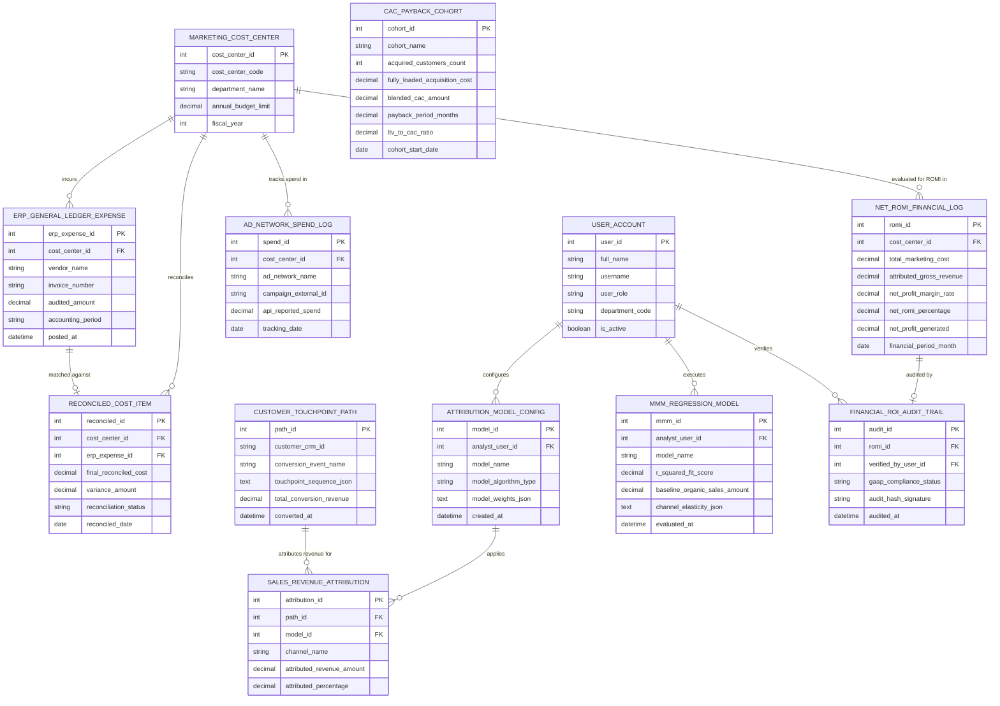

# Conceptual ERD — Marketing ROI Measurement System

## Mermaid Code

## Entity Description Table | Bảng mô tả Entity

| # | Entity Name | Vietnamese Name | Description | Key Attributes | Main Relationships |
|---|-------------|-----------------|-------------|----------------|-------------------|
| 1 | USER_ACCOUNT | Tài khoản Nguời dùng | System credentials and access roles for ROI analysts, media buyers, CMOs, and CFOs. | `user_id`, `username`, `user_role`, `department_code` | Configures `ATTRIBUTION_MODEL_CONFIG`, executes `MMM_REGRESSION_MODEL`, verifies `FINANCIAL_ROI_AUDIT_TRAIL`. |
| 2 | MARKETING_COST_CENTER | Trung tâm Chi phí Marketing | Budget cost center entity tracking department codes, annual budget limits, and fiscal years. | `cost_center_id`, `cost_center_code`, `department_name`, `annual_budget_limit`, `fiscal_year` | Incurs `ERP_GENERAL_LEDGER_EXPENSE`, tracks `AD_NETWORK_SPEND_LOG`, reconciles `RECONCILED_COST_ITEM`, evaluated in `NET_ROMI_FINANCIAL_LOG`. |
| 3 | ERP_GENERAL_LEDGER_EXPENSE | Chi phí Sổ cái ERP | Audited general ledger vendor invoices, retainers, and accounting costs imported from backend ERP. | `erp_expense_id`, `cost_center_id`, `vendor_name`, `invoice_number`, `audited_amount`, `accounting_period` | Belongs to `MARKETING_COST_CENTER`, matched against `RECONCILED_COST_ITEM`. |
| 4 | AD_NETWORK_SPEND_LOG | Nhật ký Spend Mạng Quảng cáo | Daily digital ad network API reported spend logs (Google, Meta, LinkedIn) by campaign. | `spend_id`, `cost_center_id`, `ad_network_name`, `campaign_external_id`, `api_reported_spend`, `tracking_date` | Belongs to `MARKETING_COST_CENTER`. |
| 5 | RECONCILED_COST_ITEM | Mục Chi phí Đã Đối soát | Reconciled marketing cost record resolving variances between API reported spend and ERP invoices. | `reconciled_id`, `cost_center_id`, `erp_expense_id`, `final_reconciled_cost`, `variance_amount`, `reconciliation_status` | Relates `MARKETING_COST_CENTER` and `ERP_GENERAL_LEDGER_EXPENSE`. |
| 6 | ATTRIBUTION_MODEL_CONFIG | Cấu hình Mô hình Attribution | Multi-touch attribution model parameters storing model type (Linear/Time-Decay/Data-Driven) and weights. | `model_id`, `analyst_user_id`, `model_name`, `model_algorithm_type`, `model_weights_json` | Applies `SALES_REVENUE_ATTRIBUTION`, configured by `USER_ACCOUNT`. |
| 7 | CUSTOMER_TOUCHPOINT_PATH | Chuỗi Touchpoint Khách hàng | Complete customer journey path recording touchpoint sequences, converted revenue, and timestamps. | `path_id`, `customer_crm_id`, `conversion_event_name`, `touchpoint_sequence_json`, `total_conversion_revenue` | Attributes revenue for `SALES_REVENUE_ATTRIBUTION`. |
| 8 | SALES_REVENUE_ATTRIBUTION | Attribution Doanh thu Bán hàng | Fractional sales revenue attribution results assigned to individual channels based on active attribution model. | `attribution_id`, `path_id`, `model_id`, `channel_name`, `attributed_revenue_amount`, `attributed_percentage` | Relates `CUSTOMER_TOUCHPOINT_PATH` and `ATTRIBUTION_MODEL_CONFIG`. |
| 9 | MMM_REGRESSION_MODEL | Mô hình Regression MMM | Econometric Marketing Mix Modeling regression results storing $R^2$ fit scores, baseline sales, and elasticity curves. | `mmm_id`, `analyst_user_id`, `model_name`, `r_squared_fit_score`, `baseline_organic_sales_amount`, `evaluated_at` | Executed by `USER_ACCOUNT`. |
| 10 | NET_ROMI_FINANCIAL_LOG | Nhật ký Tài chính Net ROMI | Monthly financial ROMI log recording reconciled cost, attributed gross revenue, net profit margin %, and Net ROMI %. | `romi_id`, `cost_center_id`, `total_marketing_cost`, `attributed_gross_revenue`, `net_romi_percentage`, `net_profit_generated` | Belongs to `MARKETING_COST_CENTER`, audited by `FINANCIAL_ROI_AUDIT_TRAIL`. |
| 11 | CAC_PAYBACK_COHORT | Cohort Payback CAC Khách hàng | Unit economics cohort record tracking blended CAC, monthly net margin, payback period (months), and LTV:CAC ratio. | `cohort_id`, `cohort_name`, `acquired_customers_count`, `blended_cac_amount`, `payback_period_months`, `ltv_to_cac_ratio` | Standalone unit economics entity. |
| 12 | FINANCIAL_ROI_AUDIT_TRAIL | Nhật ký Audit Tài chính GAAP | Financial audit trail verification record storing GAAP compliance status and cryptographic audit signatures. | `audit_id`, `romi_id`, `verified_by_user_id`, `gaap_compliance_status`, `audit_hash_signature`, `audited_at` | Belongs to `NET_ROMI_FINANCIAL_LOG`, verified by `USER_ACCOUNT`. |

## Relationship Description | Mô tả Quan hệ

| # | From Entity | Cardinality | To Entity | Label | Business Explanation |
|---|-------------|-------------|-----------|-------|----------------------|
| 1 | MARKETING_COST_CENTER | 1 to 0..N | ERP_GENERAL_LEDGER_EXPENSE | incurs | A marketing cost center incurs ERP general ledger expenses. |
| 2 | MARKETING_COST_CENTER | 1 to 0..N | AD_NETWORK_SPEND_LOG | tracks spend in | A marketing cost center tracks digital ad network spend. |
| 3 | MARKETING_COST_CENTER | 1 to 0..N | RECONCILED_COST_ITEM | reconciles | A marketing cost center reconciles final marketing costs. |
| 4 | MARKETING_COST_CENTER | 1 to 0..N | NET_ROMI_FINANCIAL_LOG | evaluated for ROMI in | A marketing cost center is evaluated for Net ROMI % in monthly logs. |
| 5 | ERP_GENERAL_LEDGER_EXPENSE | 1 to 0..1 | RECONCILED_COST_ITEM | matched against | An ERP expense is matched against API spend in a reconciled cost item. |
| 6 | ATTRIBUTION_MODEL_CONFIG | 1 to 0..N | SALES_REVENUE_ATTRIBUTION | applies | An attribution model applies fractional revenue attribution across channels. |
| 7 | CUSTOMER_TOUCHPOINT_PATH | 1 to 0..N | SALES_REVENUE_ATTRIBUTION | attributes revenue for | A customer touchpoint path attributes revenue to marketing channels. |
| 8 | NET_ROMI_FINANCIAL_LOG | 1 to 0..1 | FINANCIAL_ROI_AUDIT_TRAIL | audited by | A Net ROMI financial log is audited by a GAAP financial audit trail. |
| 9 | USER_ACCOUNT | 1 to 0..N | ATTRIBUTION_MODEL_CONFIG | configures | An ROI analyst user account configures attribution model rules. |
| 10 | USER_ACCOUNT | 1 to 0..N | MMM_REGRESSION_MODEL | executes | An ROI analyst user account executes Marketing Mix Modeling regression. |
| 11 | USER_ACCOUNT | 1 to 0..N | FINANCIAL_ROI_AUDIT_TRAIL | verifies | A CFO user account verifies financial ROI audit trails. |
