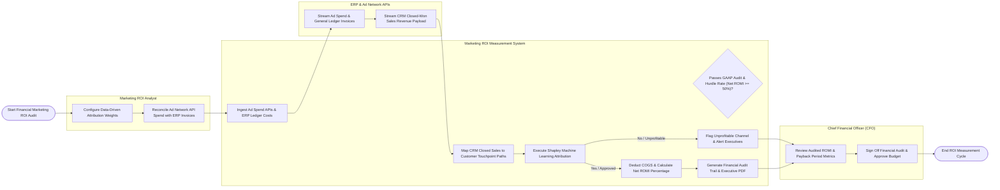

# Swimlane Diagram — Marketing ROI Measurement System

## Mermaid Code

## Flow Description | Mô tả luồng

| Lane | Actor | Role in Flow |
|------|-------|-------------|
| 1 | Marketing ROI Analyst | Configures data-driven attribution model weights, reconciles API reported ad spend against audited ERP general ledger vendor invoices, and sets financial hurdle rates. |
| 2 | Marketing ROI Measurement System | Ingests ad spend APIs and ERP ledger costs, maps CRM closed sales revenue to touchpoint paths, executes machine learning Shapley attribution, deducts product COGS, calculates Net ROMI percentages, checks hurdle rates, and generates GAAP audit trails. |
| 3 | ERP & Ad Network APIs | Streams raw digital ad spend telemetry, general ledger accounts payable invoices, and CRM closed-won sales deal payloads into the system. |
| 4 | Chief Financial Officer (CFO) | Reviews audited Net ROMI scorecards, blended CAC payback periods, and net profit margins, signing off on financial audit reports and approving future channel budget allocations. |
