# Action Tree — Marketing ROI Measurement System

## Mermaid Code

```mermaid
graph TD
    Root["Marketing ROI Measurement System"]

    Root --> M1["Cost Ingestion & ERP Reconciliation"]
    Root --> M2["Multi-Touch Attribution Modeling"]
    Root --> M3["Marketing Mix Modeling (MMM) Studio"]
    Root --> M4["Net ROMI & Financial Margin Engine"]
    Root --> M5["Unit Economics & CAC Payback Analytics"]
    Root --> M6["Predictive Budget Optimization & GAAP Audit"]

    M1 --> A11["Ingest Ad Network API Spend (Google, Meta, LinkedIn)"]
    M1 --> A12["Import Audited ERP General Ledger Vendor Invoices"]
    M1 --> A13["Reconcile API Spend Variances & Currency Exchange Fees"]
    M1 --> A14["Map Reconciled Expenses to Marketing Cost Centers"]

    M2 --> A21["Configure Rule-Based Attribution (First, Last, Linear, W-Shaped)"]
    M2 --> A22["Execute Machine Learning Data-Driven Attribution (Shapley Values)"]
    M2 --> A23["Map B2B CRM Closed-Won Sales Revenue to Touchpoint Paths"]
    M2 --> A24["Track Attribution Model Variance & Channel Credit Shifts"]

    M3 --> A31["Run Econometric Multi-Variable Regression Modeling"]
    M3 --> A32["Transform Media Variables with Adstock Carryover Half-Lives"]
    M3 --> A33["Apply Hill Saturation Functions for Diminishing Returns"]
    M3 --> A34["Isolate Offline Media Lift (TV, Radio, Print) vs Baseline Organic Sales"]

    M4 --> A41["Deduct Product COGS & Fulfillment Overhead Margins"]
    M4 --> A42["Calculate Net Return on Marketing Investment (Net ROMI %)"]
    M4 --> A43["Measure Channel-Specific Net Profit Generated"]
    M4 --> A44["Alert on Unprofitable Channels (Net ROMI < 0%)"]

    M5 --> A51["Calculate Blended Customer Acquisition Cost (CAC)"]
    M5 --> A52["Measure Customer Payback Period in Months"]
    M5 --> A53["Project 3-Year Customer LTV-to-CAC Ratios"]
    M5 --> A54["Compare Paid-Only CAC vs Organic Acquisition Costs"]

    M6 --> A61["Simulate Predictive Budget Re-Allocation Scenarios"]
    M6 --> A62["Optimize Spend Allocation Across Channel Saturation Curves"]
    M6 --> A63["Generate GAAP & IFRS Compliant Financial Audit Trails"]
    M6 --> A64["Export Executive Financial ROMI PDF Scorecards"]
```

## Module Description | Mô tả Module

| # | Module | Description | Actions |
|---|--------|-------------|---------|
| 1 | Cost Ingestion & ERP Reconciliation | Ingests ad spend APIs, imports ERP general ledger invoices, reconciles spend variances, and maps expenses to cost centers. | Ingest Ad Network API Spend, Import ERP General Ledger Invoices, Reconcile Spend Variances, Map Expenses to Cost Centers. |
| 2 | Multi-Touch Attribution Modeling | Configures rule-based attribution, executes machine learning Shapley data-driven attribution, maps CRM sales, and tracks model variance. | Configure Rule-Based Attribution, Execute Data-Driven Shapley Attribution, Map CRM Sales to Touchpoint Paths, Track Model Variance. |
| 3 | Marketing Mix Modeling (MMM) Studio | Runs econometric regression, applies adstock transformations and Hill saturation functions, and isolates offline media lift vs organic baseline. | Run Econometric Regression, Transform Media via Adstock Half-Lives, Apply Hill Saturation Functions, Isolate Offline Media Lift. |
| 4 | Net ROMI & Financial Margin Engine | Deducts COGS, calculates Net ROMI %, measures net profit generated, and triggers alerts on unprofitable channels. | Deduct COGS & Overhead Margins, Calculate Net ROMI %, Measure Net Profit Generated, Alert on Unprofitable Channels. |
| 5 | Unit Economics & CAC Payback Analytics | Calculates blended CAC, measures customer payback period in months, projects LTV-to-CAC ratios, and compares paid vs organic CAC. | Calculate Blended CAC, Measure Customer Payback Period, Project LTV-to-CAC Ratios, Compare Paid vs Organic CAC. |
| 6 | Predictive Budget Optimization & GAAP Audit | Simulates budget re-allocations, optimizes spend along saturation curves, generates GAAP audit trails, and exports ROMI scorecards. | Simulate Budget Re-Allocations, Optimize Spend along Saturation Curves, Generate GAAP Audit Trails, Export Executive ROMI Scorecards. |
