# Context Diagram — Multi-Channel Marketing Management System

## Mermaid Code

```mermaid
flowchart LR
    MarketingDirector["Omnichannel Marketing Director / Campaign Orchestrator"]
    CampaignManager["Cross-Channel Campaign Manager"]
    Consumer["Target Consumer / Multichannel User"]
    CMO["CMO / Chief Revenue Officer"]
    EmailSMSGateway["Email & SMS Marketing Gateway"]
    PushMobileGateway["Push Notification & Mobile App Gateway"]
    SocialAdGateway["Social Media & Paid Search Gateway"]
    DirectMailGateway["Direct Mail & Offline Print Service Gateway"]
    CDPIdentityEngine["CDP & Identity Resolution Engine"]
    PrivacyRegistry["Omnichannel Privacy & Channel Opt-Out Compliance Registry"]

    System(("Multi-Channel Marketing Management System"))

    MarketingDirector -->|"inputs cross-channel journey strategies, channel rules & frequency caps"| System
    System -->|"provides unified multi-channel campaign calendar & touchpoint attribution"| MarketingDirector

    CampaignManager -->|"inputs channel creatives, message triggers & fall-back routing logic"| System
    System -->|"returns channel delivery status, message engagement & conversion metrics"| CampaignManager

    Consumer -->|"submits multi-channel touchpoint interactions, clicks & channel preferences"| System
    System -->|"delivers synchronized email, SMS, mobile push, social ads & direct mail"| Consumer

    CMO -->|"configures channel budget allocations & target acquisition cost limits"| System
    System -->|"provides cross-channel ROI, customer journey velocity & blended CAC"| CMO

    System -->|"submits email dispatches & SMS text message payloads"| EmailSMSGateway
    EmailSMSGateway -->|"returns email opens, SMS delivery receipts & link clicks"| System

    System -->|"submits iOS/Android mobile push & web push notification payloads"| PushMobileGateway
    PushMobileGateway -->|"returns push impression webhooks & mobile app open events"| System

    System -->|"submits custom audience sync & multi-channel social ad dispatches"| SocialAdGateway
    SocialAdGateway -->|"returns ad impressions, click telemetry & social ad spend"| System

    System -->|"submits personalized physical postcard & direct mail print files"| DirectMailGateway
    DirectMailGateway -->|"returns postal delivery tracking codes & barcode scan events"| System

    CDPIdentityEngine -->|"streams cross-device identity graphs & unified customer profiles"| System
    System -->|"returns cross-channel touchpoint event logs & channel preference updates"| CDPIdentityEngine

    System -->|"submits channel opt-out checks & global suppression verification"| PrivacyRegistry
    PrivacyRegistry -->|"acknowledges GDPR/CCPA multi-channel consent compliance clearance"| System
```

## Actor & Interaction Table | Bảng Actor & Tương tác

| # | Actor | Actor Type | Data Sent TO System | Data Received FROM System | Notes |
|---|-------|------------|---------------------|---------------------------|-------|
| 1 | Omnichannel Marketing Director / Campaign Orchestrator | Primary | Cross-channel customer journey maps, channel fallback rules, global frequency caps, channel priority matrices. | Unified multi-channel campaign calendar, touchpoint attribution reports, journey drop-off heatmaps. | Marketing leader orchestrating synchronized campaigns across email, SMS, mobile push, social ads, and direct mail. |
| 2 | Cross-Channel Campaign Manager | Primary | Channel-specific creative assets, event triggers, A/B test variations, target segment lists. | Channel delivery receipts, message engagement rates, cross-channel conversion metrics. | Campaign operations specialist executing and monitoring multi-channel marketing dispatches. |
| 3 | Target Consumer / Multichannel User | Primary | Channel preference choices (Email vs SMS), message opens, link clicks, mobile app opens, postal barcode scans. | Synchronized promotional emails, SMS flash alerts, mobile app push notifications, retargeting social ads, physical postcards. | Consumer interacting with brand messaging across multiple digital and physical touchpoints. |
| 4 | CMO / Chief Revenue Officer | Primary | Omnichannel marketing budget caps, target Customer Acquisition Cost (CAC), Return on Marketing Investment (ROMI) goals. | Cross-channel marketing ROI, customer journey conversion velocity, blended CAC, lifetime value by acquisition channel. | Executive reviewing holistic multi-channel marketing performance and revenue contribution. |
| 5 | Email & SMS Marketing Gateway | Supporting | Email delivery receipts, open/click webhooks, SMS delivery confirmations, carrier bounce codes. | Mass email dispatch queues, SMS text message payloads, short-code sender tags. | Message delivery infrastructure (SendGrid, Twilio, Postmark) executing email and SMS communications. |
| 6 | Push Notification & Mobile App Gateway | Supporting | Push impression webhooks, mobile app open events, in-app banner interaction telemetry. | iOS/Android push notification payloads, web push dispatches, in-app messaging triggers. | Mobile engagement service (Firebase Cloud Messaging, OneSignal, Braze) delivering app push notifications. |
| 7 | Social Media & Paid Search Gateway | Supporting | Social ad impressions, click telemetry, sponsored ad costs, audience match rates. | Custom audience segment exports (SHA-256), paid social ad sets, retargeting campaign triggers. | Advertising platforms (Meta Ads, Google Ads, LinkedIn Ads) powering synchronized digital ad retargeting. |
| 8 | Direct Mail & Offline Print Service Gateway | Supporting | Postal delivery tracking codes, Intelligent Mail Barcode (IMb) scan events, undeliverable address flags. | Automated print API payloads, PDF postcard print files, recipient mailing address lists. | Direct mail automation service (Lob, Postalytics) executing physical postcard and letter mailings via API. |
| 9 | Customer Data Platform (CDP) & Identity Resolution Engine | Supporting | Cross-device identity graphs (email, phone, device ID, cookie ID), unified customer master profiles. | Cross-channel touchpoint event logs, channel preference updates, campaign interaction history. | Enterprise CDP unifying customer identities across devices and channels into a single profile. |
| 10 | Omnichannel Privacy & Channel Opt-Out Compliance Registry | Supporting / Regulatory | Channel-specific opt-out registries (Do-Not-Call, Do-Not-Mail, CAN-SPAM, TCPA, GDPR). | Channel clearance confirmation receipts, global opt-out suppression list updates. | Governance framework enforcing channel-specific privacy compliance (Email, SMS, Push, Direct Mail). |

## System Boundary Description | Mô tả Phạm vi Hệ thống

The **Multi-Channel Marketing Management System** is an enterprise cross-channel campaign orchestration, journey automation, channel fallback, and unified message dispatch platform designed to synchronize marketing across Email, SMS, Mobile Push, Social Ads, and Direct Mail.

**Inside System Scope:**
- Omnichannel customer journey builder with channel fallback routing (e.g., Send Email -> If Unopened in 24 Hrs -> Send Mobile Push -> If No App -> Send SMS).
- Cross-channel frequency capping enforcing daily message limits across all channels to prevent customer fatigue.
- Direct Mail API automation linking digital customer triggers to physical postcard print-and-mail dispatches.
- Unified cross-device identity resolution mapping email addresses, mobile phone numbers, push tokens, and mailing addresses.
- Multi-touch attribution modeling measuring channel contribution (First-Touch, Last-Touch, Linear, Time-Decay) and blended CAC.

**Outside System Scope:**
- Direct physical postal mail delivery by postal carriers (handled by USPS, FedEx, DHL).
- Direct mobile cellular network tower routing (handled by Telecom Carriers like Verizon, AT&T).
- Direct hosting of corporate ERP accounting ledgers (handled by Enterprise ERP Systems).
