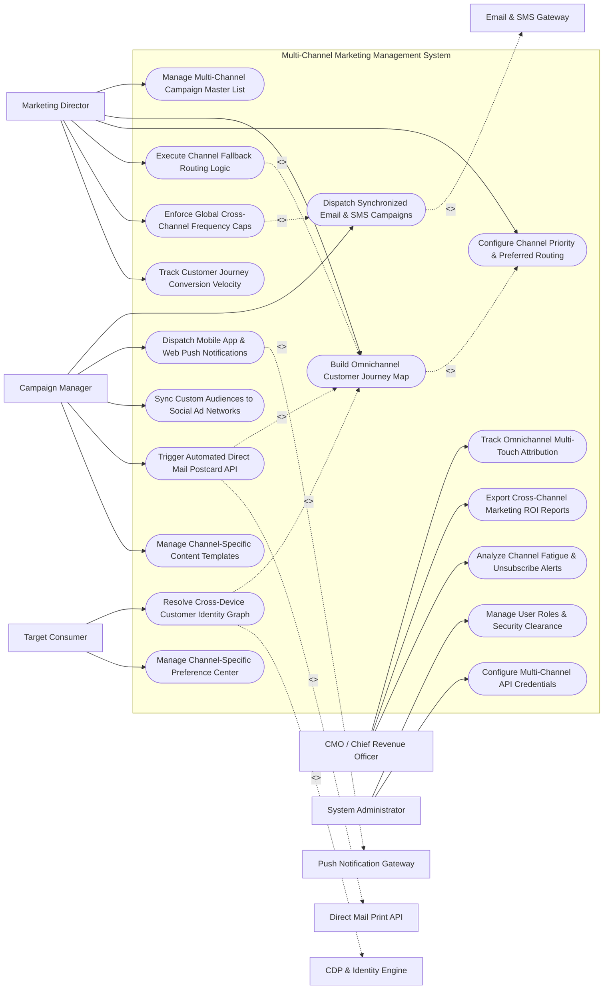

# Use Case Diagram — Multi-Channel Marketing Management System

## Mermaid Code

## Actor Table | Bảng Actor

| # | Actor | Actor Type | Role Description | Related Use Cases |
|---|-------|------------|------------------|-------------------|
| 1 | Marketing Director | Primary | Omnichannel strategist building customer journey maps, channel fallback rules, frequency caps, and journey velocity metrics. | UC01, UC02, UC03, UC05, UC10, UC14 |
| 2 | Campaign Manager | Primary | Operations specialist executing synchronized dispatches across Email, SMS, Mobile Push, Social Ads, and Direct Mail. | UC04, UC06, UC07, UC08, UC09 |
| 3 | Target Consumer | Primary | Consumer receiving multi-channel touchpoints and updating channel communication preferences. | UC12, UC13 |
| 4 | CMO / Chief Revenue Officer | Primary | Executive evaluating multi-touch attribution, channel ROI, blended CAC, and channel fatigue alerts. | UC11, UC15, UC18 |
| 5 | System Administrator | Primary | IT administrative user managing RBAC roles, API keys, and channel gateway credentials. | UC16, UC17 |
| 6 | Email & SMS Gateway | System (Secondary) | Delivery infrastructure (SendGrid/Twilio) executing mass email and SMS dispatches. | UC04 |
| 7 | Push Notification Gateway | System (Secondary) | Mobile push service (Firebase/OneSignal/Braze) delivering iOS/Android push notifications. | UC06 |
| 8 | Direct Mail Print API | System (Secondary) | Print automation service (Lob/Postalytics) printing and mailing physical postcards via API. | UC08 |
| 9 | CDP & Identity Engine | System (Secondary) | Enterprise CDP resolving cross-device identity graphs into unified customer profiles. | UC12 |

## Use Case Table | Bảng Use Case

| # | UC ID | Use Case Name | Primary Actor | Secondary Actor | Description | Priority |
|---|-------|---------------|---------------|-----------------|-------------|----------|
| 1 | UC01 | Manage Multi-Channel Campaign Master List | Director | None | Centralizes all active cross-channel campaigns, target customer segments, and channel schedules. | High |
| 2 | UC02 | Build Omnichannel Customer Journey Map | Director | None | Designs multi-touch customer journeys specifying trigger events, delay timers, channel nodes, and exit rules. | Critical |
| 3 | UC03 | Configure Channel Priority & Preferred Routing | Director | None | Establishes customer-preferred channel routing rules (e.g., If customer prefers SMS -> Route SMS first). | High |
| 4 | UC04 | Dispatch Synchronized Email & SMS Campaigns | CampaignMgr | EmailSMS | Dispatches synchronized email broadcasts and SMS flash notifications to targeted segments. | Critical |
| 5 | UC05 | Execute Channel Fallback Routing Logic | Director | None | Automatically cascades un-engaged touchpoints to secondary channels (Email -> Push -> SMS -> Direct Mail). | Critical |
| 6 | UC06 | Dispatch Mobile App & Web Push Notifications | CampaignMgr | PushGW | Sends targeted iOS/Android mobile push notifications and web browser push alerts. | High |
| 7 | UC07 | Sync Custom Audiences to Social Ad Networks | CampaignMgr | None | Transmits SHA-256 hashed audience segments to Meta Ads and Google Ads for synchronized ad retargeting. | High |
| 8 | UC08 | Trigger Automated Direct Mail Postcard API | CampaignMgr | DirectMail | Transmits PDF print files and mailing addresses to direct mail print APIs to mail physical postcards. | High |
| 9 | UC09 | Manage Channel-Specific Content Templates | CampaignMgr | None | Manages responsive HTML email, 160-char SMS text, 90-char push, and 4x6 print postcard templates. | High |
| 10 | UC10 | Enforce Global Cross-Channel Frequency Caps | Director | None | Blocks message dispatches if a customer has reached their global daily frequency cap (e.g., max 2 msgs/day). | Critical |
| 11 | UC11 | Track Omnichannel Multi-Touch Attribution | CMO | None | Evaluates First-Touch, Last-Touch, Linear, Time-Decay, and W-Shaped attribution models across all channels. | High |
| 12 | UC12 | Resolve Cross-Device Customer Identity Graph | Consumer | CDP System | Maps email addresses, phone numbers, mobile push tokens, and physical addresses to a single customer ID. | Critical |
| 13 | UC13 | Manage Channel-Specific Preference Center | Consumer | None | Provides self-service portal for customers to opt in or opt out of specific marketing channels (Email, SMS, Mail). | High |
| 14 | UC14 | Track Customer Journey Conversion Velocity | Director | None | Measures average time (days/hours) elapsed for customers to progress from first touchpoint to final purchase. | High |
| 15 | UC15 | Export Cross-Channel Marketing ROI Reports | CMO | None | Renders unified executive dashboards detailing spend, impressions, revenue, and ROAS across all 5 channels. | High |
| 16 | UC16 | Manage User Roles & Security Clearance | Admin | None | Controls user login accounts, RBAC permissions, and team workspace folder clearance. | High |
| 17 | UC17 | Configure Multi-Channel API Credentials | Admin | None | Manages API keys, OAuth tokens, and webhook endpoints for Email, SMS, Push, and Direct Mail gateways. | High |
| 18 | UC18 | Analyze Channel Fatigue & Unsubscribe Alerts | CMO | None | Triggers alert notifications when a channel suffers an unsubscribe spike (> 2% increase) due to over-messaging. | Medium |

## Use Case Specification | Đặc tả Use Case

---

### UC02 — Build Omnichannel Customer Journey Map

| Field | Detail |
|-------|--------|
| **UC ID** | UC02 |
| **Use Case Name** | Build Omnichannel Customer Journey Map |
| **Actor(s)** | Primary: Omnichannel Marketing Director   Secondary: None |
| **Description** | Configures visual, multi-touch customer journey maps combining trigger events, multi-channel dispatches (Email, SMS, Push, Direct Mail), delay timers, conditional splits, and conversion exit rules. |
| **Precondition** | 1. Channel API gateways (Email, SMS, Push, Direct Mail) are authorized (UC17).   2. Channel content templates are built (UC09). |
| **Main Flow** | 1. User opens "Visual Journey Orchestrator Canvas".   2. User sets Entry Trigger: `Customer Abandons E-Commerce Shopping Cart (Cart Value > $100)`.   3. User adds Step 1 (Mobile Push): `Send Mobile App Push Notification: "Forgot Something? Complete your order now!"` (Delay: 1 Hour).   4. User adds Decision Node 1: `Did Customer Open Push or Complete Checkout?`.   5. User builds Branch NO -> Step 2 (Email): `Send Abandoned Cart Email with Dynamic Cart Items` (Delay: 24 Hours).   6. User adds Decision Node 2: `Did Customer Open Email within 48 Hours?`.   7. User builds Branch NO -> Step 3 (Channel Fallback UC05):   &nbsp;&nbsp;&nbsp;&nbsp; a. If Customer has SMS Opt-In -> `Send SMS with 10% Discount Code`.   &nbsp;&nbsp;&nbsp;&nbsp; b. If Customer has High Cart Value (>$250) & No Digital Response -> `Trigger Direct Mail Postcard API (UC08)`.   8. User sets Journey Exit Condition: `Customer Completes Order OR 14 Days Elapsed`.   9. User clicks "Activate Journey Map"; System validates workflow logic and activates real-time journey processing. |
| **Alternative Flow** | **AF1** — Customer Channel Preference Override: Journey automatically queries customer's preferred channel tag (e.g., Preferred Channel = SMS) and routes the first touchpoint via SMS instead of Push. |
| **Exception Flow** | **EX1** — Disconnected Journey Node Error: Canvas contains a decision branch with no exit action; System blocks journey activation, highlighting the broken node in red. |
| **Postcondition** | Omnichannel customer journey map is validated, activated, and begins processing customer trigger events. |
| **Business Rule** | **BR1**: Omnichannel journeys MUST evaluate customer channel opt-out flags and global frequency caps before executing any touchpoint node. |

---

### UC05 — Execute Channel Fallback Routing Logic

| Field | Detail |
|-------|--------|
| **UC ID** | UC05 |
| **Use Case Name** | Execute Channel Fallback Routing Logic |
| **Actor(s)** | Primary: Omnichannel Marketing Director   Secondary: None |
| **Description** | Automatically cascades un-engaged or undeliverable marketing messages across a prioritized hierarchy of secondary channels (Push -> Email -> SMS -> Direct Mail) to ensure message delivery. |
| **Precondition** | 1. Customer is enrolled in an active multi-channel journey (UC02).   2. Channel fallback hierarchy and timeout windows are configured. |
| **Main Flow** | 1. System attempts Primary Touchpoint: `Send Mobile Push Notification to Customer #99412`.   2. System detects Primary Channel Failure: Mobile Push API returns error `DEVICE_TOKEN_UNREGISTERED` (App uninstalled) OR 24-hour open timeout expires without interaction.   3. System initiates Channel Fallback Cascade:   &nbsp;&nbsp;&nbsp;&nbsp; a. Fallback Level 1 -> Check Email Channel: Customer has valid email (`john@domain.com`) & `EMAIL_OPT_IN = TRUE`.   &nbsp;&nbsp;&nbsp;&nbsp; b. Action: System dispatches fallback Email payload ("Special Offer Inside").   4. System sets 48-Hour Email Interaction Monitoring Window.   5. If Email is unopened after 48 hours, System initiates Fallback Level 2:   &nbsp;&nbsp;&nbsp;&nbsp; a. Check SMS Channel: Customer has valid mobile phone (`+1-555-0192`) & `SMS_OPT_IN = TRUE`.   &nbsp;&nbsp;&nbsp;&nbsp; b. Action: System dispatches fallback SMS text message ("Final Reminder: Claim your 10% discount!").   6. Customer receives SMS, clicks link, and completes order.   7. System stops fallback cascade, records `SMS_FALLBACK_CONVERTED` in journey analytics, and exits customer from journey. |
| **Alternative Flow** | **AF1** — Direct Mail High-Value Fallback: All digital channels fail or are un-engaged for a high-value VIP customer (Cart > $300); System executes Fallback Level 3, calling Direct Mail API (UC08) to print and mail a physical 4x6 discount postcard. |
| **Exception Flow** | **EX1** — All Channels Opted-Out: Customer is opted-out of all digital and physical channels; System terminates fallback cascade, logging status `FALLBACK_BLOCKED_ALL_OPTED_OUT`. |
| **Postcondition** | Un-engaged touchpoint is cascaded to secondary channels, delivery is achieved, and fallback conversion statistics update. |
| **Business Rule** | **BR1**: Channel fallback cascades MUST respect channel-specific opt-out flags and never attempt fallback dispatches on opted-out channels. |

---

### UC08 — Trigger Automated Direct Mail Postcard API

| Field | Detail |
|-------|--------|
| **UC ID** | UC08 |
| **Use Case Name** | Trigger Automated Direct Mail Postcard API |
| **Actor(s)** | Primary: Cross-Channel Campaign Manager   Secondary: Direct Mail Print API |
| **Description** | Automatically transmits PDF print files, recipient mailing addresses, and Intelligent Mail Barcodes (IMb) to direct mail print APIs (Lob/Postalytics) to print and mail physical 4x6 postcards to high-value leads. |
| **Precondition** | 1. Customer triggers a direct mail journey node (UC02/UC05) or reaches high-value VIP threshold.   2. Verified physical mailing address exists in customer profile.   3. Direct Mail API key is authorized (UC17). |
| **Main Flow** | 1. System journey node triggers a Direct Mail Action for Customer `Acme Corp / John Smith` (Address: `123 Main St, San Francisco, CA 94105`).   2. System verifies mailing address via CASS (Coding Accuracy Support System) address validation API -> `ADDRESS_VERIFIED_VALID`.   3. System renders personalized 4x6 4-color PDF Postcard Print File:   &nbsp;&nbsp;&nbsp;&nbsp; a. Front Side: High-res promotional graphic with customer name (*"Exclusive VIP Offer for John"*).   &nbsp;&nbsp;&nbsp;&nbsp; b. Back Side: Return address, recipient address block, dynamic QR code (with tracked URL & UTM parameters), and USPS Intelligent Mail Barcode (IMb).   4. System transmits print payload over secure HTTPS REST API to Direct Mail Print API Gateway (Lob API).   5. Direct Mail API accepts print job and returns tracking code (`LOB_JOB_ID_88412`).   6. Print house prints, coats, and mails physical postcard via USPS First-Class Mail within 24 hours.   7. System ingests USPS IMb tracking webhooks: `IN_TRANSIT` -> `OUT_FOR_DELIVERY` -> `DELIVERED`.   8. Customer receives physical postcard, scans QR code with smartphone, and visits tracked landing page. |
| **Alternative Flow** | **AF1** — Letter & Gift Card Dispatch: High-value corporate B2B lead triggers formal paper letter in envelope with an enclosed $25 Starbucks physical gift card code. |
| **Exception Flow** | **EX1** — CASS Address Validation Failure: Customer physical address fails CASS validation (invalid street/zip code); System blocks print API call, alerting Campaign Manager to update customer address. |
| **Postcondition** | Personalized PDF postcard print payload is generated, CASS address is verified, print API executes mailing, and USPS tracking is logged. |
| **Business Rule** | **BR1**: Direct mail print API dispatches MUST require CASS address verification prior to payload transmission to prevent returned mail costs. |

---

### UC10 — Enforce Global Cross-Channel Frequency Caps

| Field | Detail |
|-------|--------|
| **UC ID** | UC10 |
| **Use Case Name** | Enforce Global Cross-Channel Frequency Caps |
| **Actor(s)** | Primary: Omnichannel Marketing Director   Secondary: None |
| **Description** | Evaluates real-time multi-channel message dispatches against global customer frequency rules (e.g., max 2 total messages per day across Email, SMS, Push, and Mail combined) to prevent customer over-messaging and fatigue. |
| **Precondition** | 1. Global cross-channel frequency cap policy is configured in system. |
| **Main Flow** | 1. System receives a message dispatch request for Customer `john.doe@enterprise.com` from an active marketing campaign (e.g., Attempting to send an SMS Flash Sale Text).   2. System retrieves Global Frequency Cap Policy:   &nbsp;&nbsp;&nbsp;&nbsp; a. Daily Maximum Cap: `Max 2 total messages per customer per 24 hours across ALL channels`.   &nbsp;&nbsp;&nbsp;&nbsp; b. Weekly Maximum Cap: `Max 5 total messages per 7 days`.   3. System checks Customer's Message History in the past 24 hours:   &nbsp;&nbsp;&nbsp;&nbsp; a. 09:00 AM: Received 1 Marketing Email -> Count = 1.   &nbsp;&nbsp;&nbsp;&nbsp; b. 14:00 PM: Received 1 Mobile Push Notification -> Count = 2.   &nbsp;&nbsp;&nbsp;&nbsp; c. Current Attempt (16:30 PM): Attempting SMS Text -> Total would equal 3.   4. System evaluates rule: Current Attempt (3) > Daily Max Cap (2).   5. System blocks the SMS dispatch, setting status to `SUPPRESSED_FREQUENCY_CAP`.   6. System queues the blocked message in a "Deferred Dispatch Queue" to evaluate for sending the next day at 09:00 AM.   7. System logs frequency suppression audit event and updates channel fatigue analytics. |
| **Alternative Flow** | **AF1** — High-Priority Transactional Override: Message is a critical transactional alert (e.g., Password Reset or Fraud Alert); System bypasses frequency caps, delivering message immediately regardless of cap limits. |
| **Exception Flow** | **EX1** — VIP Customer Strict Frequency Rule: VIP customer profile has a strict custom cap (Max 1 msg/week); System enforces custom profile cap over global cap. |
| **Postcondition** | Marketing message is evaluated against global cross-channel frequency limits, over-cap messages are suppressed/deferred, and customer fatigue is prevented. |
| **Business Rule** | **BR1**: Commercial marketing messages MUST comply with global cross-channel frequency caps; transactional system alerts are exempt from frequency suppression. |

---

### UC12 — Resolve Cross-Device Customer Identity Graph

| Field | Detail |
|-------|--------|
| **UC ID** | UC12 |
| **Use Case Name** | Resolve Cross-Device Customer Identity Graph |
| **Actor(s)** | Primary: Target Consumer   Secondary: CDP & Identity Resolution Engine |
| **Description** | Merges disparate customer touchpoint identifiers (email address, mobile phone number, iOS/Android push tokens, web browser cookies, physical mailing address) into a single unified Customer Identity Graph. |
| **Precondition** | 1. CDP identity resolution engine API is connected.   2. Customer interacts with brand across multiple devices or channels. |
| **Main Flow** | 1. Customer performs action on Mobile App: Logs in with email `john.smith@acme.com` on iPhone (Push Token `token_ios_88412`).   2. Customer later visits desktop website, filling out a contact form with phone number `+1-555-0192` and street address `123 Main St`.   3. System transmits raw identity touchpoints to CDP & Identity Resolution Engine.   4. Identity Engine applies Deterministic and Probabilistic Matching Algorithms:   &nbsp;&nbsp;&nbsp;&nbsp; a. Deterministic Match: Email `john.smith@acme.com` matches Mobile App Login & Web Form Submission -> 100% Match.   &nbsp;&nbsp;&nbsp;&nbsp; b. Probabilistic Match: Web Browser Cookie ID matches Mobile IP Address location -> 95% Match.   5. Identity Engine unifies disparate identifiers under single Master Customer ID (`CID_99412`).   6. Identity Engine links channel handles:   &nbsp;&nbsp;&nbsp;&nbsp; a. Email: `john.smith@acme.com`.   &nbsp;&nbsp;&nbsp;&nbsp; b. SMS Phone: `+1-555-0192`.   &nbsp;&nbsp;&nbsp;&nbsp; c. Mobile Push Token: `token_ios_88412`.   &nbsp;&nbsp;&nbsp;&nbsp; d. Postal Address: `123 Main St, San Francisco, CA`.   7. System updates master customer profile, enabling seamless multi-channel campaign targeting and journey tracking across all 4 channels. |
| **Alternative Flow** | **AF1** — Identity Un-merging (Shared Device): Two users log into the same tablet with different emails; System detects distinct identity credentials and un-merges profiles to maintain clean single customer views. |
| **Exception Flow** | **EX1** — Conflicting Mobile Numbers: Customer updates mobile phone number in CRM; System archives old phone number and updates Identity Graph with new primary mobile number for SMS dispatches. |
| **Postcondition** | Disparate device and channel identifiers are resolved into a unified master Customer Identity Graph. |
| **Business Rule** | **BR1**: Identity resolution algorithms MUST enforce deterministic matching (exact email or account ID match) before merging customer profile records. |
