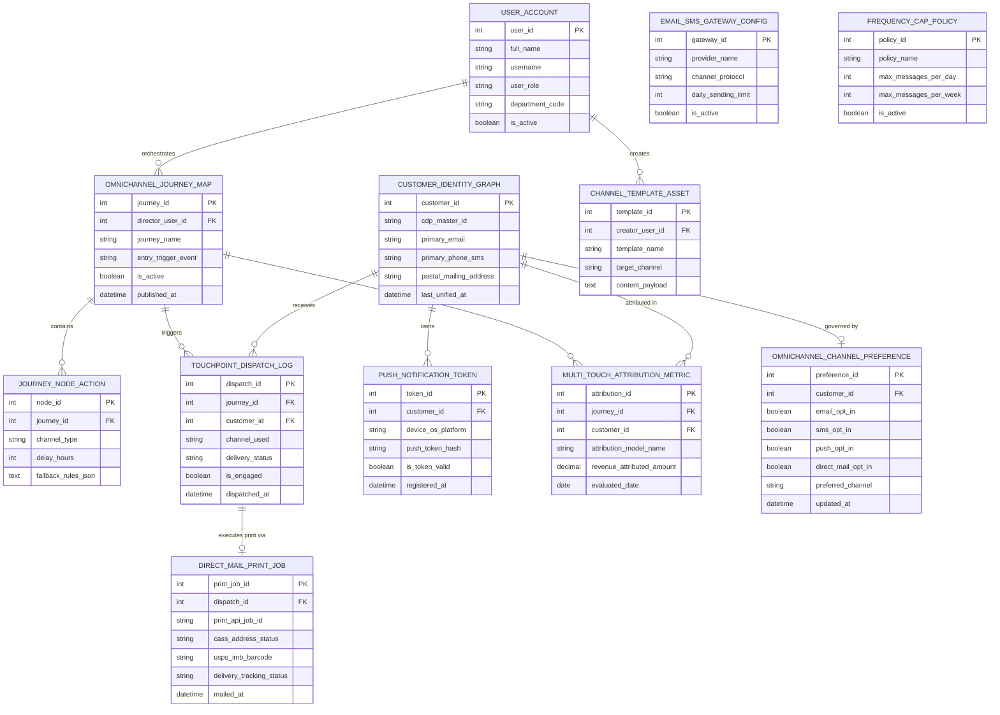

# Conceptual ERD — Multi-Channel Marketing Management System

## Mermaid Code

## Entity Description Table | Bảng mô tả Entity

| # | Entity Name | Vietnamese Name | Description | Key Attributes | Main Relationships |
|---|-------------|-----------------|-------------|----------------|-------------------|
| 1 | USER_ACCOUNT | Tài khoản Nguời dùng | System credentials and access roles for marketing directors, campaign managers, and CMOs. | `user_id`, `username`, `user_role`, `department_code` | Orchestrates `OMNICHANNEL_JOURNEY_MAP`, creates `CHANNEL_TEMPLATE_ASSET`. |
| 2 | CUSTOMER_IDENTITY_GRAPH | Graph Định danh Khách hàng | Master cross-device identity graph unifying CDP ID, primary email, SMS phone, and postal address. | `customer_id`, `cdp_master_id`, `primary_email`, `primary_phone_sms`, `postal_mailing_address` | Receives `TOUCHPOINT_DISPATCH_LOG`, owns `PUSH_NOTIFICATION_TOKEN`, governed by `OMNICHANNEL_CHANNEL_PREFERENCE`. |
| 3 | OMNICHANNEL_JOURNEY_MAP | Sơ đồ Hành trình Đa kênh | Visual omnichannel customer journey map header storing entry triggers, activation status, and published date. | `journey_id`, `director_user_id`, `journey_name`, `entry_trigger_event`, `is_active`, `published_at` | Contains `JOURNEY_NODE_ACTION`, triggers `TOUCHPOINT_DISPATCH_LOG`, evaluated for ROI in `MULTI_TOUCH_ATTRIBUTION_METRIC`. |
| 4 | JOURNEY_NODE_ACTION | Nút Hành động Hành trình | Individual execution nodes within a journey specifying channel type, delay hours, and fallback JSON. | `node_id`, `journey_id`, `channel_type`, `delay_hours`, `fallback_rules_json` | Belongs to `OMNICHANNEL_JOURNEY_MAP`. |
| 5 | CHANNEL_TEMPLATE_ASSET | Template Nội dung Kênh | Content templates tailored to target channels (HTML email, SMS text, Push text, Print postcard PDF). | `template_id`, `creator_user_id`, `template_name`, `target_channel`, `content_payload` | Created by `USER_ACCOUNT`. |
| 6 | TOUCHPOINT_DISPATCH_LOG | Nhật ký Dispatch Touchpoint | Cross-channel message dispatch log tracking channel used, delivery status, engagement, and timestamps. | `dispatch_id`, `journey_id`, `customer_id`, `channel_used`, `delivery_status`, `is_engaged`, `dispatched_at` | Relates `OMNICHANNEL_JOURNEY_MAP` and `CUSTOMER_IDENTITY_GRAPH`, executes print via `DIRECT_MAIL_PRINT_JOB`. |
| 7 | EMAIL_SMS_GATEWAY_CONFIG | Cấu hình Gateway Email/SMS | Configuration entity tracking email/SMS provider credentials, protocols, and daily sending limits. | `gateway_id`, `provider_name`, `channel_protocol`, `daily_sending_limit`, `is_active` | Standalone gateway configuration entity. |
| 8 | PUSH_NOTIFICATION_TOKEN | Token Notification Mobile Push | iOS/Android device push notification tokens and registration timestamps linked to customer profiles. | `token_id`, `customer_id`, `device_os_platform`, `push_token_hash`, `is_token_valid` | Belongs to `CUSTOMER_IDENTITY_GRAPH`. |
| 9 | DIRECT_MAIL_PRINT_JOB | Job In Ấn Thư Trực tiếp | Direct mail print job tracking Lob/Postalytics API IDs, CASS validation status, USPS barcodes, and tracking status. | `print_job_id`, `dispatch_id`, `print_api_job_id`, `cass_address_status`, `usps_imb_barcode`, `delivery_tracking_status` | Belongs to `TOUCHPOINT_DISPATCH_LOG`. |
| 10 | FREQUENCY_CAP_POLICY | Chính sách Giới hạn Tần suất | Global cross-channel frequency cap policy setting maximum allowed messages per day and per week. | `policy_id`, `policy_name`, `max_messages_per_day`, `max_messages_per_week`, `is_active` | Standalone frequency suppression entity. |
| 11 | MULTI_TOUCH_ATTRIBUTION_METRIC | Chỉ số Attribution Đa kênh | Multi-touch attribution model outputs (First-Touch, Last-Touch, Linear, W-Shaped) calculating revenue contribution. | `attribution_id`, `journey_id`, `customer_id`, `attribution_model_name`, `revenue_attributed_amount` | Relates `OMNICHANNEL_JOURNEY_MAP` and `CUSTOMER_IDENTITY_GRAPH`. |
| 12 | OMNICHANNEL_CHANNEL_PREFERENCE | Tùy chọn Kênh Khách hàng | Customer channel opt-in/opt-out preferences across Email, SMS, Mobile Push, and Direct Mail. | `preference_id`, `customer_id`, `email_opt_in`, `sms_opt_in`, `push_opt_in`, `direct_mail_opt_in`, `preferred_channel` | Belongs to `CUSTOMER_IDENTITY_GRAPH`. |

## Relationship Description | Mô tả Quan hệ

| # | From Entity | Cardinality | To Entity | Label | Business Explanation |
|---|-------------|-------------|-----------|-------|----------------------|
| 1 | CUSTOMER_IDENTITY_GRAPH | 1 to 0..N | TOUCHPOINT_DISPATCH_LOG | receives | A customer identity graph receives cross-channel touchpoint dispatches. |
| 2 | CUSTOMER_IDENTITY_GRAPH | 1 to 0..N | PUSH_NOTIFICATION_TOKEN | owns | A customer identity graph owns iOS/Android mobile push notification tokens. |
| 3 | CUSTOMER_IDENTITY_GRAPH | 1 to 0..1 | OMNICHANNEL_CHANNEL_PREFERENCE | governed by | A customer identity graph is governed by channel opt-in/opt-out preferences. |
| 4 | CUSTOMER_IDENTITY_GRAPH | 1 to 0..N | MULTI_TOUCH_ATTRIBUTION_METRIC | attributed in | A customer profile is attributed revenue in multi-touch attribution logs. |
| 5 | OMNICHANNEL_JOURNEY_MAP | 1 to 1..N | JOURNEY_NODE_ACTION | contains | An omnichannel journey map contains multiple journey node actions. |
| 6 | OMNICHANNEL_JOURNEY_MAP | 1 to 0..N | TOUCHPOINT_DISPATCH_LOG | triggers | An omnichannel journey map triggers touchpoint dispatches. |
| 7 | OMNICHANNEL_JOURNEY_MAP | 1 to 0..N | MULTI_TOUCH_ATTRIBUTION_METRIC | evaluated for ROI in | An omnichannel journey map is evaluated for ROI in multi-touch attribution metrics. |
| 8 | TOUCHPOINT_DISPATCH_LOG | 1 to 0..1 | DIRECT_MAIL_PRINT_JOB | executes print via | A touchpoint dispatch log executes physical printing via a direct mail print job. |
| 9 | USER_ACCOUNT | 1 to 0..N | OMNICHANNEL_JOURNEY_MAP | orchestrates | A marketing director user account orchestrates omnichannel journey maps. |
| 10 | USER_ACCOUNT | 1 to 0..N | CHANNEL_TEMPLATE_ASSET | creates | A campaign manager user account creates channel template assets. |
