# Swimlane Diagram — Multi-Channel Marketing Management System

## Mermaid Code

```mermaid
flowchart LR
    Start(["Start Omnichannel Campaign Journey"])

    subgraph Lane_Director["Marketing Director"]
        D1["Build Journey Map & Channel Fallback Cascade"]
        D2["Set Global Cross-Channel Frequency Caps"]
    end

    subgraph Lane_System["Multi-Channel Marketing System"]
        S1["Ingest Customer Event & Resolve Identity Graph"]
        S2["Evaluate Frequency Cap & Channel Opt-In Status"]
        S3{"Passes Global Frequency Cap & Opt-In Rules?"}
        S4["Defer Message Dispatch & Log Frequency Cap Hold"]
        S5["Package Primary Touchpoint Payload & Route API"]
        S6["Monitor Primary Timeout & Cascade Fallback Node"]
        S7["Compute Multi-Touch Attribution & Journey ROAS"]
    end

    subgraph Lane_Gateways["Channel Delivery Gateways"]
        G1["Dispatch Primary Mobile Push / Email Payload"]
        G2["Execute Fallback SMS Text / Direct Mail Print Job"]
    end

    subgraph Lane_Consumer["Target Consumer"]
        C1["Receive Touchpoint Message & Interact / Click"]
        C2["Complete E-Commerce Order Conversion"]
    end

    Finish(["End Omnichannel Journey Cycle"])

    Start --> D1 --> D2 --> S1 --> S2 --> S3
    S3 -->|"No / Over Cap"| S4 --> Finish
    S3 -->|"Yes / Cleared"| S5 --> G1 --> S6
    S6 -->|"Primary Un-engaged"| G2 --> C1 --> C2 --> S7 --> Finish
    S6 -->|"Primary Engaged"| C1 --> C2 --> S7 --> Finish
```

## Flow Description | Mô tả luồng

| Lane | Actor | Role in Flow |
|------|-------|-------------|
| 1 | Marketing Director | Builds omnichannel customer journey maps, configures channel fallback cascades (Push -> Email -> SMS -> Direct Mail), and sets global daily frequency caps. |
| 2 | Multi-Channel Marketing System | Ingests customer trigger events, resolves cross-device identity graphs, evaluates global frequency caps and channel opt-in flags, dispatches primary touchpoint API payloads, monitors response timeouts, executes fallback cascades, and computes multi-touch attribution metrics. |
| 3 | Channel Delivery Gateways | Receives API payloads across targeted channels (SendGrid for Email, Twilio for SMS, Firebase for Push, Lob for Direct Mail), executes dispatches, and streams delivery/open webhooks back to the system. |
| 4 | Target Consumer | Receives synchronized multi-channel touchpoint messages on mobile/desktop/mail, interacts with links or QR codes, and completes e-commerce conversions. |
