# Action Tree — Multi-Channel Marketing Management System

## Mermaid Code

```mermaid
graph TD
    Root["Multi-Channel Marketing Management System"]

    Root --> M1["Journey Building & Omnichannel Orchestration"]
    Root --> M2["Channel Fallback & Priority Cascade"]
    Root --> M3["Multi-Channel Dispatch & Template Engine"]
    Root --> M4["Direct Mail Print & Postal Automation"]
    Root --> M5["Cross-Device Identity & Consent Governance"]
    Root --> M6["Multi-Touch Attribution & Journey Analytics"]

    M1 --> A11["Design Visual Omnichannel Customer Journey Maps"]
    M1 --> A12["Set Trigger Events, Time Delays & Decision Nodes"]
    M1 --> A13["Configure Customer-Preferred Channel Priority Routing"]
    M1 --> A14["Set Journey Exit Conditions & Goal Completions"]

    M2 --> A21["Configure Automated Channel Fallback Routing Trees"]
    M2 --> A22["Monitor Primary Touchpoint Response Timeouts (e.g., 24 Hrs)"]
    M2 --> A23["Cascade Unopened Emails to Mobile Push or SMS Text"]
    M2 --> A24["Cascade Unengaged High-Value Leads to Direct Mail Postcards"]

    M3 --> A31["Dispatch Synchronized Mass Email & SMS Text Messages"]
    M3 --> A32["Send Targeted iOS/Android Mobile App Push Notifications"]
    M3 --> A33["Sync Custom Audience Segment Hashing to Social Ad Networks"]
    M3 --> A34["Manage Responsive HTML, Short SMS & Push Content Templates"]

    M4 --> A41["Render Personalized 4x6 4-Color PDF Postcard Print Files"]
    M4 --> A42["Validate Physical Mailing Addresses via CASS API"]
    M4 --> A43["Attach Dynamic Tracked QR Codes & USPS IMb Barcodes"]
    M4 --> A44["Ingest USPS Intelligent Mail Barcode Postal Tracking Webhooks"]

    M5 --> A51["Resolve Disparate Device IDs into Unified Master Customer Profiles"]
    M5 --> A52["Enforce Global Cross-Channel Daily Frequency Caps"]
    M5 --> A53["Provide Self-Service Multi-Channel Preference Portals"]
    M5 --> A54["Enforce CAN-SPAM, TCPA, CASL & GDPR Opt-Out Compliance"]

    M6 --> A61["Calculate First-Touch, Last-Touch, Linear & W-Shaped Attribution"]
    M6 --> A62["Measure Customer Journey Conversion Velocity (Days to Purchase)"]
    M6 --> A63["Calculate Blended Customer Acquisition Cost (CAC) across Channels"]
    M6 --> A64["Export Executive Omnichannel Campaign ROAS PDF Reports"]
```

## Module Description | Mô tả Module

| # | Module | Description | Actions |
|---|--------|-------------|---------|
| 1 | Journey Building & Omnichannel Orchestration | Designs visual omnichannel customer journey maps, configures trigger events, preferred channel priority, and journey exit rules. | Design Omnichannel Journey Maps, Set Trigger Events & Delays, Configure Preferred Channel Priority, Set Journey Exit Conditions. |
| 2 | Channel Fallback & Priority Cascade | Configures fallback routing trees, monitors primary touchpoint timeouts, and cascades unopened messages to secondary channels. | Configure Channel Fallback Trees, Monitor Touchpoint Timeouts, Cascade Unopened Emails to SMS, Cascade Unengaged Leads to Direct Mail. |
| 3 | Multi-Channel Dispatch & Template Engine | Dispatches synchronized Email, SMS, Mobile Push, and Social Ads, and manages channel-specific content templates. | Dispatch Email & SMS Messages, Send Mobile App Push Notifications, Sync Custom Audiences to Social Ads, Manage Channel Templates. |
| 4 | Direct Mail Print & Postal Automation | Renders PDF postcard print files, validates CASS addresses, attaches USPS IMb barcodes, and tracks postal delivery. | Render PDF Postcard Print Files, Validate CASS Mailing Addresses, Attach Tracked QR Codes & Barcodes, Ingest USPS Postal Tracking Webhooks. |
| 5 | Cross-Device Identity & Consent Governance | Resolves cross-device customer identity graphs, enforces global cross-channel frequency caps, and manages channel opt-out compliance. | Resolve Cross-Device Identity Graphs, Enforce Global Frequency Caps, Provide Channel Preference Portals, Enforce Anti-Spam Compliance. |
| 6 | Multi-Touch Attribution & Journey Analytics | Calculates multi-touch attribution models, measures journey conversion velocity, computes blended CAC, and exports ROAS reports. | Calculate Multi-Touch Attribution, Measure Journey Conversion Velocity, Calculate Blended CAC, Export Executive Omnichannel Reports. |
