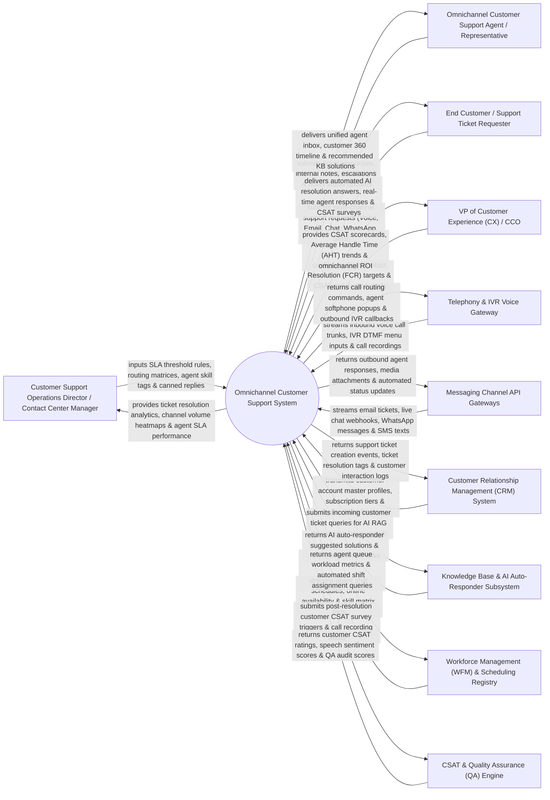

# Context Diagram — Omnichannel Customer Support System

## Mermaid Code

## Actor & Interaction Table | Bảng Actor & Tương tác

| # | Actor | Actor Type | Data Sent TO System | Data Received FROM System | Notes |
|---|-------|------------|---------------------|---------------------------|-------|
| 1 | Customer Support Operations Director / Contact Center Manager | Primary | SLA threshold rules (First Response $< 15$ mins, Resolution $< 24$ hours), queue routing matrices, agent skill tags (`VIP_SUPPORT`, `TECHNICAL_TIER2`), canned response templates. | Ticket resolution analytics, channel volume heatmaps, agent SLA compliance reports, queue bottleneck metrics. | Contact center director managing omnichannel queues, SLA rules, and agent staffing performance. |
| 2 | Omnichannel Customer Support Agent / Representative | Primary | Ticket response messages, internal private notes, ticket status updates (`Open/Pending/Solved`), escalation tags. | Unified agent workspace console, customer 360 interaction timeline, AI-recommended KB solutions, screen pops. | Support agent resolving customer inquiries across voice, email, chat, WhatsApp, and social media from a single console. |
| 3 | End Customer / Support Ticket Requester | Primary | Support ticket requests (Voice call, Email, Live Chat, WhatsApp, SMS), CSAT survey ratings, attachments. | Automated AI resolution answers, agent response messages, ticket status notifications, CSAT survey forms. | Consumer or enterprise client submitting support inquiries across any digital or voice channel. |
| 4 | VP of Customer Experience (CX) / CCO | Primary | First Contact Resolution (FCR %) targets, CSAT satisfaction goals (Target > 90%), SLA breach limits. | CSAT scorecards, Average Handle Time (AHT) trends, First Contact Resolution rates, channel cost per contact. | Executive evaluating global customer experience, customer satisfaction, and contact center efficiency. |
| 5 | Telephony & IVR Voice Gateway | Supporting | Inbound voice call trunks (SIP), IVR DTMF button presses, call recording audio streams (Twilio / Amazon Connect). | Call routing commands, agent softphone screen popups, automated IVR callbacks, call queue music. | Voice gateway handling incoming phone calls, interactive voice response (IVR) menus, and call recordings. |
| 6 | Messaging Channel API Gateways | Supporting | Inbound email tickets (SendGrid), live chat webhooks, WhatsApp Business messages, SMS texts, social media DMs. | Outbound agent response payloads, rich media attachments, automated ticket confirmation updates. | Multi-channel messaging gateways unifying digital communication channels into a single inbox stream. |
| 7 | Customer Relationship Management (CRM) System | Supporting | Customer account master profiles, subscription tiers (Gold/VIP), order history, SLA entitlement tiers. | Support ticket creation events, ticket resolution tags, customer interaction history logs. | Enterprise CRM supplying unified customer profile data and recording support interaction histories. |
| 8 | Knowledge Base & AI Auto-Responder Subsystem | Supporting | AI auto-responder suggested solutions, RAG knowledge article links, automated deflection confidence. | Incoming customer ticket queries, knowledge base article search requests, article feedback. | AI knowledge service (Zendesk Guide / RAG) searching help center articles to deflect simple tickets. |
| 9 | Workforce Management (WFM) & Scheduling Registry | Supporting | Agent shift schedules, real-time agent availability status (`Online/Busy/Offline`), skill matrix tags. | Agent queue workload metrics, queue capacity limits, automated shift assignment queries. | WFM platform managing agent shift scheduling, queue load balancing, and agent capacity limits. |
| 10 | Customer Satisfaction (CSAT) & Quality Assurance (QA) Engine | Supporting / Regulatory | Customer CSAT survey ratings (1-5 stars), NPS ratings, speech sentiment scores, agent QA scorecards. | Post-resolution CSAT survey triggers, call recording audio files, agent transcript audit logs. | Quality assurance engine collecting post-ticket CSAT surveys and performing speech/text sentiment analysis. |

## System Boundary Description | Mô tả Phạm vi Hệ thống

The **Omnichannel Customer Support System** is an enterprise unified agent workspace, multi-channel ticketing (Voice, Email, Chat, WhatsApp, SMS), AI auto-deflection, skills-based routing, and CSAT quality assurance platform designed to elevate customer satisfaction.

**Inside System Scope:**
- Unified Agent Workspace consolidating voice, email, web chat, WhatsApp, SMS, and social media tickets into one interface.
- Skills-based automatic ticket routing matching incoming tickets to agents based on language, tier, and expertise.
- AI Auto-Responder & Ticket Deflection using RAG knowledge base search to resolve basic inquiries automatically.
- Integrated Telephony & Softphone supporting IVR routing, call recording, agent screen pops, and warm transfers.
- SLA Management monitoring First Response Time (FRT), Average Handle Time (AHT), and First Contact Resolution (FCR %).

**Outside System Scope:**
- Direct physical repair of customer hardware products (handled by Authorized Service Centers).
- Direct hosting of PSTN telecommunication lines (handled by Telecom Operators).
- Direct manual composition of legal non-disclosure agreements (handled by Legal Counsel).
