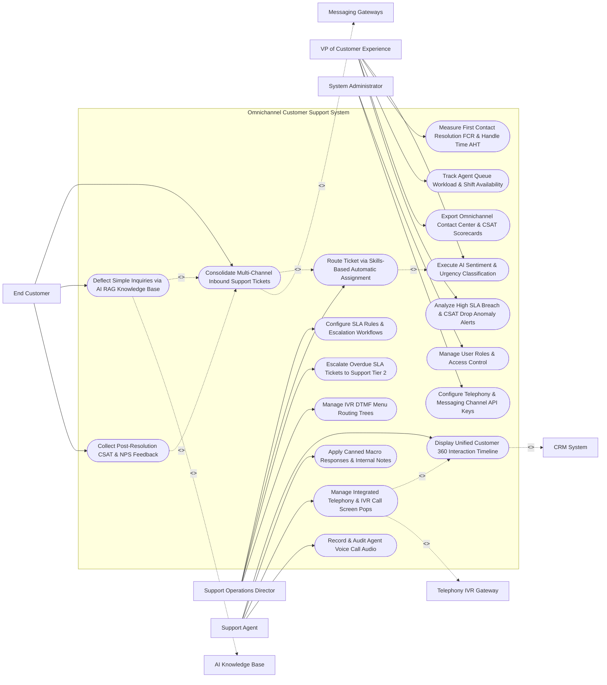

# Use Case Diagram — Omnichannel Customer Support System

## Mermaid Code

## Actor Table | Bảng Actor

| # | Actor | Actor Type | Role Description | Related Use Cases |
|---|-------|------------|------------------|-------------------|
| 1 | Support Operations Director | Primary | Contact center manager configuring SLA rules, escalation flows, skills-based routing matrices, and IVR menus. | UC01, UC05, UC06, UC09 |
| 2 | Support Agent | Primary | Customer support representative using the unified workspace to view customer timelines, apply macros, and handle softphone screen pops. | UC03, UC04, UC10, UC11 |
| 3 | End Customer | Primary | Customer submitting tickets via voice, email, chat, or WhatsApp, receiving AI answers, and rating CSAT surveys. | UC02, UC08, UC12 |
| 4 | VP of Customer Experience | Primary | Executive tracking FCR %, Average Handle Time (AHT), agent workload, CSAT scorecards, and SLA breach alerts. | UC07, UC13, UC14, UC15, UC18 |
| 5 | System Administrator | Primary | IT admin managing user security roles, telephony SIP trunk credentials, and messaging channel API tokens. | UC16, UC17 |
| 6 | Telephony IVR Gateway | System (Secondary) | Voice service (Twilio/Amazon Connect) streaming inbound calls, DTMF inputs, softphone popups, and call recordings. | UC10 |
| 7 | Messaging Gateways | System (Secondary) | Multi-channel gateways unifying email, live chat, WhatsApp, and SMS into the central ticketing inbox. | UC02 |
| 8 | AI Knowledge Base | System (Secondary) | AI RAG knowledge service searching help center documentation to deflect simple customer tickets automatically. | UC08 |
| 9 | CRM System | System (Secondary) | Enterprise CRM supplying unified customer profile data and subscription entitlement tiers. | UC03 |

## Use Case Table | Bảng Use Case

| # | UC ID | Use Case Name | Primary Actor | Secondary Actor | Description | Priority |
|---|-------|---------------|---------------|-----------------|-------------|----------|
| 1 | UC01 | Configure SLA Rules & Escalation Workflows | Manager | None | Configures SLA response targets (First Response $< 15$ mins) and automated multi-tier escalation triggers. | Critical |
| 2 | UC02 | Consolidate Multi-Channel Inbound Support Tickets | Customer | MsgGW | Consolidates incoming support requests from Voice, Email, Live Chat, WhatsApp, SMS, and Social DM into a single inbox. | Critical |
| 3 | UC03 | Display Unified Customer 360 Interaction Timeline | Agent | CRM System | Renders a unified Customer 360 view consolidating past tickets, orders, CRM attributes, and interaction logs. | Critical |
| 4 | UC04 | Apply Canned Macro Responses & Internal Notes | Agent | None | Enables agents to apply pre-approved macro text responses and log private internal notes on ticket threads. | High |
| 5 | UC05 | Route Ticket via Skills-Based Automatic Assignment | Manager | None | Automatically assigns tickets to agents based on agent language, product expertise, customer VIP tier, and queue load. | Critical |
| 6 | UC06 | Escalate Overdue SLA Tickets to Support Tier 2 | Manager | None | Automatically re-assigns tickets nearing SLA breach to Tier 2 Senior Technical Support Engineers. | High |
| 7 | UC07 | Execute AI Sentiment & Urgency Classification | CXVP | None | Analyzes ticket text using NLP to classify customer sentiment (Angry/Neutral/Happy) and urgency priority (Urgent/High/Normal). | High |
| 8 | UC08 | Deflect Simple Inquiries via AI RAG Knowledge Base | Customer | AI KB | Uses AI RAG knowledge base search to suggest instant self-service solutions, deflecting simple tickets before agent creation. | Critical |
| 9 | UC09 | Manage IVR DTMF Menu Routing Trees | Manager | None | Builds interactive voice response (IVR) phone press-button menus (e.g., "Press 1 for Sales, Press 2 for Support"). | High |
| 10 | UC10 | Manage Integrated Telephony & IVR Call Screen Pops | Agent | VoiceGW | Triggers real-time softphone screen popups displaying calling customer profile and open tickets upon call arrival. | Critical |
| 11 | UC11 | Record & Audit Agent Voice Call Audio | Agent | None | Records inbound and outbound voice call audio streams, storing encrypted call recordings for QA auditing. | High |
| 12 | UC12 | Collect Post-Resolution CSAT & NPS Feedback | Customer | None | Dispatches automated 1-click CSAT survey emails (1-5 stars) upon ticket resolution, calculating satisfaction scores. | Critical |
| 13 | UC13 | Measure First Contact Resolution FCR & Handle Time AHT | CXVP | None | Calculates First Contact Resolution rate ($\text{FCR \%} = \frac{\text{Resolved on 1st Contact}}{\text{Total Tickets}} \times 100\%$) and Average Handle Time (AHT). | Critical |
| 14 | UC14 | Track Agent Queue Workload & Shift Availability | CXVP | None | Monitors real-time agent status (`Online/Busy/Offline`), active ticket counts per agent, and queue capacity. | High |
| 15 | UC15 | Export Omnichannel Contact Center & CSAT Scorecards | CXVP | None | Renders executive scorecards detailing total ticket volume, FCR %, AHT, SLA compliance %, and CSAT ratings. | High |
| 16 | UC16 | Manage User Roles & Access Control | Admin | None | Controls user login credentials, RBAC permissions, and agent queue routing group memberships. | High |
| 17 | UC17 | Configure Telephony & Messaging Channel API Keys | Admin | None | Configures API connection parameters for Twilio, Amazon Connect, SendGrid, WhatsApp Business, and Zendesk. | High |
| 18 | UC18 | Analyze High SLA Breach & CSAT Drop Anomaly Alerts | CXVP | None | Dispatches urgent alert notifications when SLA breach rate exceeds $10\%$ or CSAT rating drops below $80\%$. | High |

## Use Case Specification | Đặc tả Use Case

---

### UC02 — Consolidate Multi-Channel Inbound Support Tickets

| Field | Detail |
|-------|--------|
| **UC ID** | UC02 |
| **Use Case Name** | Consolidate Multi-Channel Inbound Support Tickets |
| **Actor(s)** | Primary: End Customer / Support Ticket Requester   Secondary: Messaging Channel API Gateways |
| **Description** | Ingests and unifies inbound customer support inquiries from Voice, Email, Web Chat, WhatsApp, SMS, and Social Media into a standardized multi-channel ticket queue in real time. |
| **Precondition** | 1. Messaging channel gateways (SendGrid, WhatsApp Business, Twilio) are connected. |
| **Main Flow** | 1. Customer submits support request via WhatsApp (`+1-555-0192`): `"My order #88412 hasn't arrived. Where is it?"`.   2. WhatsApp Business Gateway dispatches HTTPS webhook to system.   3. System extracts sender profile: Phone `+1-555-0192` -> Matches CRM Account `Jane Doe (Gold Tier Customer)`.   4. System checks active ticket threads for Jane Doe:   &nbsp;&nbsp;&nbsp;&nbsp; a. No active open ticket found -> `CREATE_NEW_TICKET`.   5. System creates Unified Support Ticket Record:   &nbsp;&nbsp;&nbsp;&nbsp; a. Ticket ID: `#TKT-99412`.   &nbsp;&nbsp;&nbsp;&nbsp; b. Channel Source: `WhatsApp`.   &nbsp;&nbsp;&nbsp;&nbsp; c. Customer Name: `Jane Doe`.   &nbsp;&nbsp;&nbsp;&nbsp; d. Entitlement Tier: `Gold VIP Support (SLA: 15-Minute Response)`.   &nbsp;&nbsp;&nbsp;&nbsp; e. Subject / Message: `"Order #88412 Tracking Inquiry"`.   6. System triggers UC07 (Execute AI Sentiment & Urgency Classification): Classifies urgency as `HIGH_PRIORITY`.   7. System triggers UC05 (Route Ticket via Skills-Based Automatic Assignment), placing ticket in `Gold Tier Queue`.   8. System dispatches automated WhatsApp receipt notification: *"Hi Jane, we've received your request (#TKT-99412). A support specialist will respond shortly."* |
| **Alternative Flow** | **AF1** — Inbound Email Ticket Consolidation: Customer sends email to `support@company.com`; System parses MIME email headers, extracts HTML body and inline image attachments, and creates ticket `#TKT-99413`. |
| **Exception Flow** | **EX1** — Duplicate Ticket Threading: Customer sends email AND WhatsApp message 2 minutes apart regarding the same issue; System detects matching order #88412, automatically merging tickets under `#TKT-99412`. |
| **Postcondition** | Multi-channel support request is normalized into a unified ticket record, CRM customer profile is attached, SLA timer starts, and confirmation is sent. |
| **Business Rule** | **BR1**: All incoming support inquiries regardless of channel MUST be normalized into a unified ticket data structure carrying CRM entitlement metadata. |

---

### UC05 — Route Ticket via Skills-Based Automatic Assignment

| Field | Detail |
|-------|--------|
| **UC ID** | UC05 |
| **Use Case Name** | Route Ticket via Skills-Based Automatic Assignment |
| **Actor(s)** | Primary: Customer Support Operations Director   Secondary: None |
| **Description** | Automatically evaluates ticket metadata (language, product line, urgency, customer VIP tier) and routes the ticket to the optimal available support agent based on agent skill matrices. |
| **Precondition** | 1. Support ticket is created and normalized (UC02).   2. Agent skill tags (`SPANISH_FLUENT`, `TIER2_TECH`, `VIP_DESK`) and shift availability are logged. |
| **Main Flow** | 1. System receives newly created ticket `#TKT-99412` (Customer: `Jane Doe`, Tier: `Gold VIP`, Channel: `WhatsApp`, Language: `Spanish`).   2. System evaluates Required Ticket Skill Tags:   &nbsp;&nbsp;&nbsp;&nbsp; a. Required Skill 1: `VIP_GOLD_ENTITLEMENT`.   &nbsp;&nbsp;&nbsp;&nbsp; b. Required Skill 2: `SPANISH_LANGUAGE`.   &nbsp;&nbsp;&nbsp;&nbsp; c. Required Skill 3: `ORDER_LOGISTICS`.   3. System scans active online support agents (`Status == Online AND Active Tickets < Max Capacity (5)`).   4. System identifies Candidate Agents:   &nbsp;&nbsp;&nbsp;&nbsp; a. Agent Carlos: Skills `[SPANISH, VIP_GOLD, ORDER_LOGISTICS]` | Active Tickets: `2 / 5`.   &nbsp;&nbsp;&nbsp;&nbsp; b. Agent Maria: Skills `[SPANISH, VIP_GOLD]` | Active Tickets: `4 / 5`.   5. System selects Agent Carlos (100% skill match + lowest active ticket queue load).   6. System assigns Ticket `#TKT-99412` to Agent Carlos and updates ticket status to `ASSIGNED`.   7. System dispatches real-time desktop pop notification to Agent Carlos's unified workspace console. |
| **Alternative Flow** | **AF1** — Round-Robin Fallback Assignment: No agent possesses all 3 skills; System routes ticket to general `Spanish Support Queue` using round-robin distribution among available reps. |
| **Exception Flow** | **EX1** — All Qualified Agents Offline (After-Hours): All Spanish VIP agents are offline; System leaves ticket in `VIP_AFTERHOURS_QUEUE` and triggers automated SMS notification to the on-call manager. |
| **Postcondition** | Ticket is assigned to the best-matched online agent based on skill matrix and queue capacity, and desktop notifications update. |
| **Business Rule** | **BR1**: VIP customer tickets MUST be automatically routed to agents possessing VIP skill tags with a queue priority override. |

---

### UC08 — Deflect Simple Inquiries via AI RAG Knowledge Base

| Field | Detail |
|-------|--------|
| **UC ID** | UC08 |
| **Use Case Name** | Deflect Simple Inquiries via AI RAG Knowledge Base |
| **Actor(s)** | Primary: End Customer / Support Ticket Requester   Secondary: Knowledge Base & AI Auto-Responder Subsystem (Zendesk Guide / RAG) |
| **Description** | Searches vectorized help center documentation using AI RAG vector search to provide instant self-service answers to basic inquiries, deflecting tickets before agent creation. |
| **Precondition** | 1. Help center articles are vectorized and indexed in AI knowledge base.   2. Deflection confidence threshold (e.g., >= 85%) is configured. |
| **Main Flow** | 1. Customer opens web chat or submits web ticket form.   2. Customer types inquiry: `"How do I reset my password if I lost my two-factor authentication device?"`.   3. System dispatches text query to AI Knowledge Base Subsystem.   4. Subsystem executes RAG Vector Search against help center articles.   5. Subsystem identifies top matching Knowledge Article: `Article #402: "Resetting Password with 2FA Recovery Keys"` (Relevance Score: `94% Confidence`).   6. Subsystem generates concise AI Auto-Response Answer:   &nbsp;&nbsp;&nbsp;&nbsp; a. Instant Answer: `"To reset your password without 2FA, open the login screen, click 'Lost 2FA Device', and enter your 16-digit Recovery Key."`   &nbsp;&nbsp;&nbsp;&nbsp; b. Provided Link: `[Read Full Help Article #402]`.   7. System displays instant AI answer and prompts customer: `"Did this answer your question?"` with buttons `[Yes, Resolve My Issue]` and `[No, Connect to Agent]`.   8. Customer clicks `[Yes, Resolve My Issue]`.   9. System marks ticket as `DEFLECTED_SELF_SERVICE` and closes session without routing to an agent. |
| **Alternative Flow** | **AF1** — Customer Declines AI Answer: Customer clicks `[No, Connect to Agent]`; System immediately converts inquiry into a live support ticket (#TKT-99415) and routes to an agent (UC05). |
| **Exception Flow** | **EX1** — Low Search Relevance Confidence: RAG search highest relevance score is 45% (< 85% threshold); System suppresses AI auto-answer and routes ticket directly to human agent queue. |
| **Postcondition** | Inquiry is answered instantly via AI RAG search, ticket is deflected without human agent intervention, and deflection metrics update. |
| **Business Rule** | **BR1**: AI ticket deflection MUST require explicit customer confirmation ("Did this solve your issue?") before marking an inquiry as resolved. |

---

### UC10 — Manage Integrated Telephony & IVR Call Screen Pops

| Field | Detail |
|-------|--------|
| **UC ID** | UC10 |
| **Use Case Name** | Manage Integrated Telephony & IVR Call Screen Pops |
| **Actor(s)** | Primary: Omnichannel Customer Support Agent   Secondary: Telephony & IVR Voice Gateway (Twilio / Amazon Connect) |
| **Description** | Triggers real-time softphone screen popups in the agent workspace upon call arrival, displaying calling customer CRM profiles, recent orders, and open support tickets. |
| **Precondition** | 1. Support agent is logged into softphone console (`Status == Available`).   2. Twilio / Amazon Connect CTI softphone integration is active. |
| **Main Flow** | 1. Inbound voice call arrives at contact center: `Caller Phone: +1-555-0192`.   2. Telephony IVR Gateway executes IVR menu (UC09): Caller selected `"Press 2 for Order Support"`.   3. Telephony Gateway matches caller phone number `+1-555-0192` to CRM Account `Jane Doe (Gold Tier)`.   4. Telephony Gateway routes call to Agent Carlos's softphone CTI interface.   5. System triggers Softphone Screen Pop in Agent Carlos's unified workspace console:   &nbsp;&nbsp;&nbsp;&nbsp; a. Caller Name & Tier: `Jane Doe (Gold VIP Customer)`.   &nbsp;&nbsp;&nbsp;&nbsp; b. IVR Selection: `Order Support (Order #88412)`.   &nbsp;&nbsp;&nbsp;&nbsp; c. Active Open Tickets: `#TKT-99412 (WhatsApp Tracking Inquiry)`.   &nbsp;&nbsp;&nbsp;&nbsp; d. Softphone Controls: `[Answer Call] [Mute] [Transfer] [Record]`.   6. Agent Carlos clicks `[Answer Call]`.   7. Softphone connects audio stream and Agent Carlos greets customer: *"Hello Jane! Thanks for calling Gold Support. I see you're calling about Order #88412..."*   8. System initializes call recording (UC11) and updates agent status to `On Call`. |
| **Alternative Flow** | **AF1** — Warm Transfer Call Execution: Agent Carlos needs technical advice; Carlos initiates warm softphone transfer to Tier 2 Agent David, sharing screen pop context before transferring audio. |
| **Exception Flow** | **EX1** — Unrecognized Caller Phone Number: Phone number has no CRM match; Softphone pops "Unknown Caller", prompting agent to search or create a new customer profile during call. |
| **Postcondition** | Softphone screen pop renders calling customer profile and open tickets, call connects, and audio recording initializes. |
| **Business Rule** | **BR1**: Inbound voice calls MUST trigger softphone screen pops displaying calling customer CRM profiles and open tickets prior to call pickup. |

---

### UC12 — Collect Post-Resolution CSAT & NPS Feedback

| Field | Detail |
|-------|--------|
| **UC ID** | UC12 |
| **Use Case Name** | Collect Post-Resolution CSAT & NPS Feedback |
| **Actor(s)** | Primary: End Customer / Support Ticket Requester   Secondary: Customer Satisfaction (CSAT) & Quality Assurance (QA) Engine |
| **Description** | Automatically dispatches 1-click CSAT survey forms (1-5 stars) via email, SMS, or WhatsApp upon ticket resolution, logging satisfaction scores and calculating agent CSAT averages. |
| **Precondition** | 1. Support ticket status is updated to `Solved` or `Closed`.   2. CSAT survey template and rating scale (1-5 Stars) are active. |
| **Main Flow** | 1. Agent Carlos solves Ticket `#TKT-99412` for Customer Jane Doe.   2. System updates ticket status to `SOLVED`.   3. System waits 5-minute grace period (to ensure no immediate follow-up customer reply).   4. System dispatches 1-Click CSAT Survey via WhatsApp (same channel as ticket):   &nbsp;&nbsp;&nbsp;&nbsp; a. Message: *"How would you rate your support experience with Carlos for Ticket #TKT-99412?"*   &nbsp;&nbsp;&nbsp;&nbsp; b. Interactive Star Buttons: `[⭐ 1 Bad]` `[⭐ 2]` `[⭐ 3]` `[⭐ 4]` `[⭐ 5 Excellent]`.   5. Customer Jane Doe clicks `[⭐ 5 Excellent]`.   6. WhatsApp Gateway returns CSAT response webhook (`RATING_5_STARS`).   7. System logs CSAT Rating Record:   &nbsp;&nbsp;&nbsp;&nbsp; a. Rating: `5 / 5 Stars` (`POSITIVE_CSAT`).   &nbsp;&nbsp;&nbsp;&nbsp; b. Assigned Agent: `Agent Carlos`.   &nbsp;&nbsp;&nbsp;&nbsp; c. Ticket ID: `#TKT-99412`.   8. System updates Agent Carlos's rolling 30-day CSAT score average to `98.2% Positive`. |
| **Alternative Flow** | **AF1** — Low CSAT Score Escalation Trigger: Customer submits 1-Star CSAT rating (`VERY_POOR`); System automatically creates a high-priority CSAT alert task for Support Manager to contact customer. |
| **Exception Flow** | **EX1** — Unanswered Survey Timeout: Customer does not respond to CSAT survey within 72 hours; System marks survey status as `EXPIRED_NO_RESPONSE` and excludes from rating average. |
| **Postcondition** | CSAT survey rating is collected, logged against agent performance records, agent CSAT averages update, and low ratings trigger manager alerts. |
| **Business Rule** | **BR1**: CSAT ratings of 1 or 2 stars MUST automatically trigger immediate manager notification tasks to conduct customer follow-up calls. |
