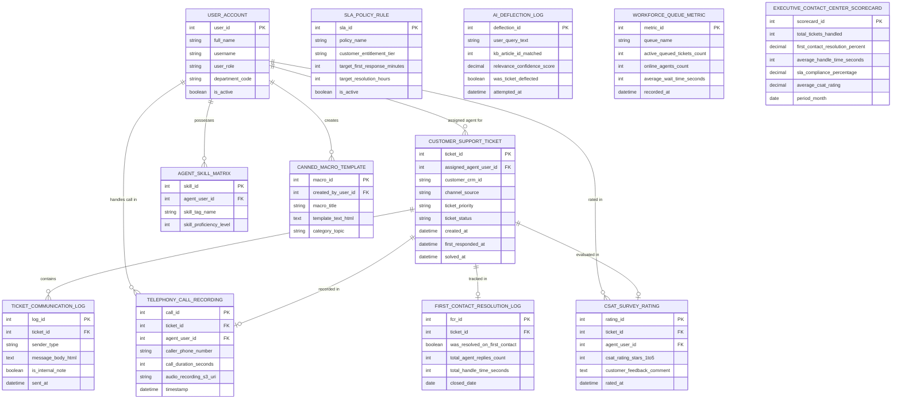

# Conceptual ERD — Omnichannel Customer Support System

## Mermaid Code

## Entity Description Table | Bảng mô tả Entity

| # | Entity Name | Vietnamese Name | Description | Key Attributes | Main Relationships |
|---|-------------|-----------------|-------------|----------------|-------------------|
| 1 | USER_ACCOUNT | Tài khoản Nguời dùng | System credentials and access roles for support managers, agents, CX VPs, and admins. | `user_id`, `username`, `user_role`, `department_code` | Assigned agent for `CUSTOMER_SUPPORT_TICKET`, possesses `AGENT_SKILL_MATRIX`, handles call in `TELEPHONY_CALL_RECORDING`. |
| 2 | CUSTOMER_SUPPORT_TICKET | Support Ticket Khách hàng | Central support ticket record tracking CRM customer ID, channel source (Voice/WhatsApp/Email), priority, status, and SLA timestamps. | `ticket_id`, `assigned_agent_user_id`, `customer_crm_id`, `channel_source`, `ticket_priority`, `ticket_status`, `created_at` | Contains `TICKET_COMMUNICATION_LOG`, recorded in `TELEPHONY_CALL_RECORDING`, evaluated in `CSAT_SURVEY_RATING`, tracked in `FIRST_CONTACT_RESOLUTION_LOG`. |
| 3 | TICKET_COMMUNICATION_LOG | Nhật ký Communication Ticket | Individual ticket message log storing sender type (Customer/Agent/Bot), HTML message body, internal note flags, and timestamps. | `log_id`, `ticket_id`, `sender_type`, `message_body_html`, `is_internal_note`, `sent_at` | Belongs to `CUSTOMER_SUPPORT_TICKET`. |
| 4 | SLA_POLICY_RULE | Quy tắc SLA Service Policy | Service Level Agreement rule entity storing customer entitlement tiers, target first response minutes, and target resolution hours. | `sla_id`, `policy_name`, `customer_entitlement_tier`, `target_first_response_minutes`, `target_resolution_hours` | Standalone SLA governance entity. |
| 5 | AGENT_SKILL_MATRIX | Ma trận Skill Agent | Support agent skill matrix record mapping skill tag names (`SPANISH`, `VIP_DESK`) and proficiency levels to user accounts. | `skill_id`, `agent_user_id`, `skill_tag_name`, `skill_proficiency_level` | Belongs to `USER_ACCOUNT`. |
| 6 | TELEPHONY_CALL_RECORDING | Ghi âm Cuộc gọi Telephony | Voice call recording record storing caller phone number, call duration seconds, and encrypted S3 audio URIs. | `call_id`, `ticket_id`, `agent_user_id`, `caller_phone_number`, `call_duration_seconds`, `audio_recording_s3_uri` | Belongs to `CUSTOMER_SUPPORT_TICKET`, handled by `USER_ACCOUNT`. |
| 7 | AI_DEFLECTION_LOG | Nhật ký Deflection AI | AI knowledge base ticket deflection log recording user query text, matched KB article ID, relevance confidence %, and deflection status. | `deflection_id`, `user_query_text`, `kb_article_id_matched`, `relevance_confidence_score`, `was_ticket_deflected` | Standalone AI self-service telemetry entity. |
| 8 | CSAT_SURVEY_RATING | Đánh giá CSAT Khách hàng | Post-resolution customer satisfaction survey rating record storing 1-5 star ratings, feedback comments, and assigned agent ID. | `rating_id`, `ticket_id`, `agent_user_id`, `csat_rating_stars_1to5`, `customer_feedback_comment` | Belongs to `CUSTOMER_SUPPORT_TICKET`, rates `USER_ACCOUNT`. |
| 9 | CANNED_MACRO_TEMPLATE | Template Macro Canned Response | Pre-approved macro response template entity storing macro titles, HTML template bodies, and category topics. | `macro_id`, `created_by_user_id`, `macro_title`, `template_text_html`, `category_topic` | Created by `USER_ACCOUNT`. |
| 10 | WORKFORCE_QUEUE_METRIC | Chỉ số Queue Workforce | Real-time queue workload metric recording active queued ticket counts, online agent counts, and average wait time seconds. | `metric_id`, `queue_name`, `active_queued_tickets_count`, `online_agents_count`, `average_wait_time_seconds` | Standalone workforce capacity entity. |
| 11 | FIRST_CONTACT_RESOLUTION_LOG | Nhật ký First Contact Resolution | First Contact Resolution (FCR) tracking record logging whether ticket was resolved on 1st contact, reply count, and total handle time. | `fcr_id`, `ticket_id`, `was_resolved_on_first_contact`, `total_agent_replies_count`, `total_handle_time_seconds` | Belongs to `CUSTOMER_SUPPORT_TICKET`. |
| 12 | EXECUTIVE_CONTACT_CENTER_SCORECARD | Scorecard Executive Contact Center | Executive contact center scorecard aggregating total tickets handled, FCR %, average handle time (AHT), SLA compliance %, and CSAT. | `scorecard_id`, `total_tickets_handled`, `first_contact_resolution_percent`, `average_handle_time_seconds`, `sla_compliance_percentage`, `average_csat_rating` | Standalone executive performance entity. |

## Relationship Description | Mô tả Quan hệ

| # | From Entity | Cardinality | To Entity | Label | Business Explanation |
|---|-------------|-------------|-----------|-------|----------------------|
| 1 | CUSTOMER_SUPPORT_TICKET | 1 to 1..N | TICKET_COMMUNICATION_LOG | contains | A support ticket contains multiple communication message logs. |
| 2 | CUSTOMER_SUPPORT_TICKET | 1 to 0..1 | TELEPHONY_CALL_RECORDING | recorded in | A voice support ticket is recorded in a telephony call recording. |
| 3 | CUSTOMER_SUPPORT_TICKET | 1 to 0..1 | CSAT_SURVEY_RATING | evaluated in | A solved support ticket is evaluated in a CSAT survey rating. |
| 4 | CUSTOMER_SUPPORT_TICKET | 1 to 0..1 | FIRST_CONTACT_RESOLUTION_LOG | tracked in | A support ticket is tracked in a First Contact Resolution log. |
| 5 | USER_ACCOUNT | 1 to 0..N | CUSTOMER_SUPPORT_TICKET | assigned agent for | A support agent user account is assigned support tickets. |
| 6 | USER_ACCOUNT | 1 to 0..N | AGENT_SKILL_MATRIX | possesses | A support agent user account possesses skill matrix tags. |
| 7 | USER_ACCOUNT | 1 to 0..N | TELEPHONY_CALL_RECORDING | handles call in | A support agent user account handles calls in voice recordings. |
| 8 | USER_ACCOUNT | 1 to 0..N | CSAT_SURVEY_RATING | rated in | A support agent user account is rated in CSAT survey ratings. |
| 9 | USER_ACCOUNT | 1 to 0..N | CANNED_MACRO_TEMPLATE | creates | A support manager user account creates canned macro templates. |
