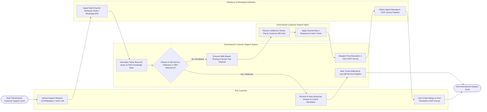

# Swimlane Diagram — Omnichannel Customer Support System

## Mermaid Code

## Flow Description | Mô tả luồng

| Lane | Actor | Role in Flow |
|------|-------|-------------|
| 1 | End Customer | Submits support inquiries via WhatsApp, voice call, or email, receives AI auto-responder answers, confirms issue resolution, or interacts with agents and rates post-resolution CSAT surveys. |
| 2 | Omnichannel Customer Support Agent | Receives real-time softphone screen pops and Customer 360 timelines, applies pre-approved canned macro responses, and marks tickets as Solved. |
| 3 | Omnichannel Customer Support System | Normalizes multi-channel tickets into a single queue, queries AI RAG knowledge bases for auto-deflection, evaluates deflection confidence thresholds, executes skills-based agent routing, dispatches post-resolution CSAT surveys, and updates CSAT scorecards. |
| 4 | Telephony & Messaging Gateways | Ingests multi-channel webhooks (Twilio/WhatsApp Business/SendGrid), connects voice call audio trunks, and delivers outbound agent messages and CSAT survey payloads. |
