# Action Tree — Omnichannel Customer Support System

## Mermaid Code

```mermaid
graph TD
    Root["Omnichannel Customer Support System"]

    Root --> M1["Multi-Channel Ticket Ingestion & Unified Workspace"]
    Root --> M2["AI RAG Auto-Deflection & Knowledge Base"]
    Root --> M3["Skills-Based Routing & SLA Governance"]
    Root --> M4["Integrated Telephony, IVR & CTI Screen Pops"]
    Root --> M5["Post-Resolution CSAT & Quality Assurance"]
    Root --> M6["Contact Center Analytics & Executive Scorecards"]

    M1 --> A11["Consolidate Inbound Support Tickets (Voice, Email, Chat, WhatsApp, SMS)"]
    M1 --> A12["Render Unified Agent Workspace Console & Customer 360 Timeline"]
    M1 --> A13["Apply Canned Macro Text Responses & Private Internal Notes"]
    M1 --> A14["Merge Duplicate Multi-Channel Ticket Threads into Master Record"]

    M2 --> A21["Execute AI RAG Vector Search against Vectorized Help Docs"]
    M2 --> A22["Formulate Concise AI Auto-Responder Answers for Self-Service"]
    M2 --> A23["Deflect Simple Inquiries before Human Agent Ticket Creation"]
    M2 --> A24["Suppress Low-Confidence AI Auto-Answers (< 85% Relevance)"]

    M3 --> A31["Execute Skills-Based Automatic Ticket Assignment to Agents"]
    M3 --> A32["Enforce Service Level Agreement SLA Timers (First Response < 15 mins)"]
    M3 --> A33["Escalate Overdue SLA Tickets to Tier 2 Senior Support Engineers"]
    M3 --> A34["Override Queue Priority for Gold VIP Entitlement Customers"]

    M4 --> A41["Manage Interactive Voice Response (IVR) Press-Button Routing Trees"]
    M4 --> A42["Trigger Real-Time Softphone Screen Pops upon Call Arrival"]
    M4 --> A43["Record & Encrypt Inbound/Outbound Softphone Voice Call Audio Streams"]
    M4 --> A44["Execute Warm Softphone Call Transfers between Support Reps"]

    M5 --> A51["Dispatch Post-Resolution 1-Click CSAT Survey Forms (1-5 Stars)"]
    M5 --> A52["Classify Post-Ticket Customer Sentiment (Positive, Neutral, Negative)"]
    M5 --> A53["Trigger Immediate Manager Alerts for Low CSAT Ratings (1 or 2 Stars)"]
    M5 --> A54["Audit Agent Call Recordings & Transcripts for Quality Assurance (QA)"]

    M6 --> A61["Measure First Contact Resolution Rate (FCR %) & Handle Time (AHT)"]
    M6 --> A62["Track Real-Time Agent Queue Workload & Shift Availability"]
    M6 --> A63["Benchmark Cost per Contact Across Voice vs Digital Channels"]
    M6 --> A64["Export Executive Contact Center Performance & CSAT Scorecards"]
```

## Module Description | Mô tả Module

| # | Module | Description | Actions |
|---|--------|-------------|---------|
| 1 | Multi-Channel Ticket Ingestion & Unified Workspace | Consolidates multi-channel tickets into one queue, renders unified agent workspaces, applies canned macros, and merges duplicate threads. | Consolidate Multi-Channel Inbound Tickets, Render Unified Agent Workspace Console, Apply Canned Macro Responses, Merge Duplicate Ticket Threads. |
| 2 | AI RAG Auto-Deflection & Knowledge Base | Executes RAG vector searches on help center docs, formulates AI self-service answers, deflects simple tickets, and suppresses low-confidence answers. | Execute AI RAG Vector Search, Formulate Concise AI Auto-Responder Answers, Deflect Simple Inquiries before Agent Creation, Suppress Low-Confidence AI Auto-Answers. |
| 3 | Skills-Based Routing & SLA Governance | Assigns tickets based on agent skill matrices, enforces SLA timers (First Response $< 15$ mins), escalates overdue tickets, and overrides VIP queues. | Execute Skills-Based Ticket Assignment, Enforce SLA Response Timers, Escalate Overdue SLA Tickets to Tier 2, Override Queue Priority for VIP Customers. |
| 4 | Integrated Telephony, IVR & CTI Screen Pops | Builds IVR routing menus, triggers CTI softphone screen pops displaying CRM profiles, records call audio, and executes warm call transfers. | Manage IVR Press-Button Routing Trees, Trigger Real-Time Softphone Screen Pops, Record & Encrypt Voice Call Audio, Execute Warm Softphone Call Transfers. |
| 5 | Post-Resolution CSAT & Quality Assurance | Dispatches 1-click CSAT surveys, classifies customer sentiment, triggers manager alerts for 1-2 star ratings, and audits agent call recordings. | Dispatch Post-Resolution 1-Click CSAT Surveys, Classify Post-Ticket Customer Sentiment, Trigger Manager Alerts for Low CSAT Ratings, Audit Agent Call Recordings for QA. |
| 6 | Contact Center Analytics & Executive Scorecards | Measures FCR % and AHT, tracks real-time agent queue workloads, benchmarks cost per contact, and exports executive CSAT scorecards. | Measure First Contact Resolution (FCR %), Track Real-Time Agent Queue Workload, Benchmark Cost per Contact Across Channels, Export Executive Contact Center Scorecards. |
