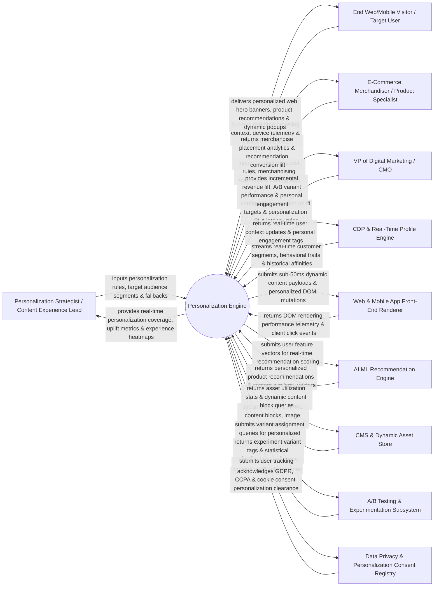

# Context Diagram — Personalization Engine

## Mermaid Code

## Actor & Interaction Table | Bảng Actor & Tương tác

| # | Actor | Actor Type | Data Sent TO System | Data Received FROM System | Notes |
|---|-------|------------|---------------------|---------------------------|-------|
| 1 | Personalization Strategist / Content Experience Lead | Primary | Personalization rule definitions, dynamic audience targeting rules, fallback experience defaults, content triggers. | Real-time personalization coverage stats, conversion uplift metrics, experience heatmaps, rule performance logs. | Digital strategist building dynamic website/app personalization rules and targeting visitor cohorts. |
| 2 | End Web/Mobile Visitor / Target User | Primary | Real-time browsing context (URL, IP location, device type, referrer, cart contents), clickstream events. | Personalized web hero banners, dynamic product recommendations, inline personalized copy, popups. | Website or mobile app user receiving real-time personalized web pages, recommendations, and offers. |
| 3 | E-Commerce Merchandiser / Product Specialist | Primary | Product pin/boost rules (e.g., "Boost high-margin items"), category exclusion lists, manual inventory overrides. | Merchandise placement performance analytics, recommendation conversion lift, inventory velocity. | Merchandiser configuring product recommendation boosting rules and managing catalog recommendations. |
| 4 | VP of Digital Marketing / CMO | Primary | Conversion revenue uplift targets, sub-50ms latency SLA limits, A/B test confidence thresholds. | Incremental revenue lift reports, A/B variant performance scorecards, dynamic personalization ROI. | Executive evaluating digital personalization strategy, conversion lift, and customer experience ROI. |
| 5 | Customer Data Platform (CDP) & Real-Time Profile Engine | Supporting | Real-time customer segment tags, past purchase history, brand affinity scores, location context. | Real-time user context updates, personal engagement tags, dynamic cohort assignment receipts. | CDP supplying unified customer traits and real-time behavioral segments to guide personalization. |
| 6 | Web & Mobile App Front-End Renderer | Supporting | DOM rendering performance telemetry, client-side click events, JavaScript execution timestamps. | Sub-50ms dynamic content payloads, JSON experience payloads, personalized DOM mutation scripts. | Front-end application (React, Next.js, iOS/Android SDK) rendering personalized page elements. |
| 7 | AI ML Recommendation Engine | Supporting | Collaborative filtering models, vector search embeddings, "Frequently Bought Together" graphs. | User feature vectors, real-time product similarity scores, personalized recommendation lists. | AI recommendation service (Amazon Personalize / Vector Search) providing real-time item rankings. |
| 8 | Content Management System (CMS) & Dynamic Asset Store | Supporting | Dynamic HTML content blocks, personalized hero banners, responsive image URLs, copy variants. | Asset utilization statistics, dynamic content block queries, asset expiration webhooks. | Content repository supplying dynamic banner graphics, copy variations, and HTML components. |
| 9 | A/B Testing & Dynamic Experimentation Subsystem | Supporting | Experiment variant tags (Control vs Personalized Variant A/B), statistical confidence levels. | Variant assignment queries, real-time conversion event postbacks, experiment metrics. | Experimentation platform (Optimizely/VWO) running split tests to measure personalization lift vs control. |
| 10 | Data Privacy & Personalization Consent Registry | Supporting / Regulatory | GDPR cookie consent status, CCPA opt-out rules, do-not-track privacy headers. | Personalization consent clearance tokens, anonymized guest tracking flags. | Regulatory framework ensuring user consent is verified before serving personalized experiences. |

## System Boundary Description | Mô tả Phạm vi Hệ thống

The **Personalization Engine** is an enterprise real-time web/mobile content personalization, AI product recommendation, dynamic content decisioning, and sub-50ms edge rendering platform designed to deliver hyper-relevant experiences to every visitor.

**Inside System Scope:**
- Sub-50ms real-time dynamic content decisioning engine evaluating visitor context (location, device, weather, referral source, CDP segment).
- AI product recommendation algorithms (Collaborative Filtering, Content-Based, "Frequently Bought Together", Next-Best-Action).
- Visual visual rule builder for pinning, boosting, or filtering product recommendations based on inventory and margin.
- Dynamic DOM mutation and JSON API payload dispatching for React, Next.js, iOS, and Android applications.
- A/B testing integration measuring incremental conversion uplift vs un-personalized control experiences.

**Outside System Scope:**
- Direct physical hosting of global CDN edge servers (handled by Cloudflare / Fastly Edge Workers).
- Direct hosting of master e-commerce product catalogs (handled by E-Commerce Product Information Management Systems).
- Direct graphic design creation of banner images (handled by Creative Design Teams).
