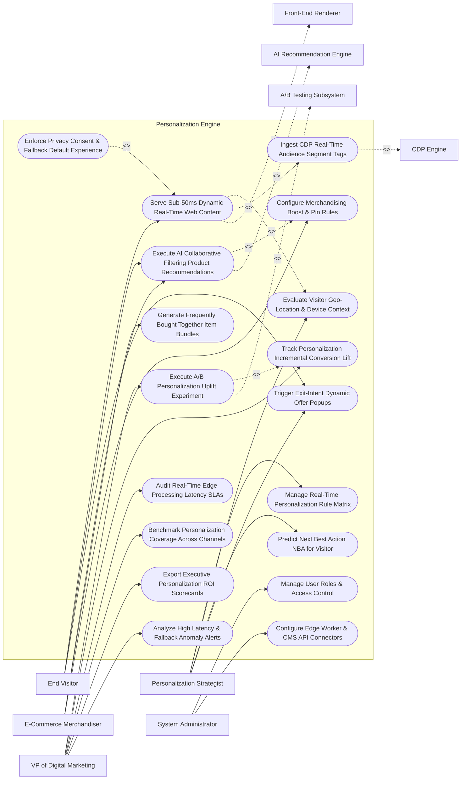

# Use Case Diagram — Personalization Engine

## Mermaid Code

## Actor Table | Bảng Actor

| # | Actor | Actor Type | Role Description | Related Use Cases |
|---|-------|------------|------------------|-------------------|
| 1 | Personalization Strategist | Primary | Digital strategist building dynamic rule matrices, setting geo/device context rules, Next-Best-Action triggers, and exit-intent popups. | UC01, UC03, UC07, UC09 |
| 2 | End Visitor | Primary | Web/mobile visitor receiving real-time dynamic web content, personalized recommendations, and targeted offers. | UC02, UC05, UC09 |
| 3 | E-Commerce Merchandiser | Primary | Merchandiser tuning AI recommendation algorithms, setting product boost/pin rules, and creating item bundle strategies. | UC05, UC06, UC08 |
| 4 | VP of Digital Marketing | Primary | Executive tracking A/B experiment conversion uplift, edge latency SLAs, channel coverage, and personalization ROI. | UC10, UC11, UC13, UC14, UC15, UC18 |
| 5 | System Administrator | Primary | IT admin managing security roles, CDN edge worker tokens, and CMS integration connectors. | UC16, UC17 |
| 6 | CDP Engine | System (Secondary) | Real-time CDP supplying visitor segment tags, past purchase history, and brand affinity scores. | UC04 |
| 7 | Front-End Renderer | System (Secondary) | Client application (React, Next.js, iOS/Android SDK) rendering personalized DOM elements in $< 50 \text{ ms}$. | UC02 |
| 8 | AI Recommendation Engine | System (Secondary) | Machine learning service running collaborative filtering and vector search embeddings for product recommendations. | UC05 |
| 9 | A/B Testing Subsystem | System (Secondary) | Experimentation platform measuring conversion lift of personalized variants vs control groups. | UC10 |

## Use Case Table | Bảng Use Case

| # | UC ID | Use Case Name | Primary Actor | Secondary Actor | Description | Priority |
|---|-------|---------------|---------------|-----------------|-------------|----------|
| 1 | UC01 | Manage Real-Time Personalization Rule Matrix | Strategist | None | Centralizes personalization rules, target audience conditions, priority rankings, and content block assignments. | Critical |
| 2 | UC02 | Serve Sub-50ms Dynamic Real-Time Web Content | Visitor | Front-End | Evaluates visitor context and dispatches personalized HTML/JSON content payloads to front-end in $< 50 \text{ ms}$. | Critical |
| 3 | UC03 | Evaluate Visitor Geo-Location & Device Context | Strategist | None | Evaluates real-time visitor IP location, local weather, device type (iOS/Desktop), and HTTP referrer source. | High |
| 4 | UC04 | Ingest CDP Real-Time Audience Segment Tags | System | CDP Engine | Ingests real-time visitor segment membership tags (`VIP_BUYER`, `CHURN_RISK`, `SPORTS_AFFINITY`) from CDP. | Critical |
| 5 | UC05 | Execute AI Collaborative Filtering Product Recommendations | Visitor | Rec Engine | Runs machine learning collaborative filtering algorithms to generate personalized product recommendation carousels. | Critical |
| 6 | UC06 | Generate Frequently Bought Together Item Bundles | Merchandiser | None | Analyzes co-purchase transaction histories to auto-generate dynamic "Frequently Bought Together" product cross-sells. | High |
| 7 | UC07 | Predict Next Best Action NBA for Visitor | Strategist | None | Evaluates visitor session progression to determine the optimal Next Best Action (e.g., Offer Discount vs Request Demo). | High |
| 8 | UC08 | Configure Merchandising Boost & Pin Rules | Merchandiser | None | Configures business logic to pin specific featured items or boost high-margin/high-stock products in AI recommendations. | High |
| 9 | UC09 | Trigger Exit-Intent Dynamic Offer Popups | Visitor | None | Detects mouse cursor movement toward browser close button, triggering an instant personalized exit-intent discount popup. | High |
| 10 | UC10 | Execute A/B Personalization Uplift Experiment | DigitalVP | A/B Testing | Runs split experiments comparing personalized variant performance against an un-personalized control group. | Critical |
| 11 | UC11 | Track Personalization Incremental Conversion Lift | DigitalVP | None | Measures incremental revenue, order conversion rate lift, and average order value (AOV) generated by personalization. | High |
| 12 | UC12 | Enforce Privacy Consent & Fallback Default Experience | System | None | Checks cookie consent flags; If consent is denied, serves pre-configured non-personalized default fallback content. | Critical |
| 13 | UC13 | Audit Real-Time Edge Processing Latency SLAs | DigitalVP | None | Measures end-to-end edge processing response latency against strict sub-50ms SLAs to prevent page load slowdowns. | High |
| 14 | UC14 | Benchmark Personalization Coverage Across Channels | DigitalVP | None | Calculates the percentage of total website/app sessions that receive personalized experiences vs default content. | High |
| 15 | UC15 | Export Executive Personalization ROI Scorecards | DigitalVP | None | Renders executive scorecards detailing incremental revenue generated, A/B test win rates, and personalization Net ROMI. | High |
| 16 | UC16 | Manage User Roles & Access Control | Admin | None | Controls user login credentials, RBAC permissions, and personalization rule publishing authorization. | High |
| 17 | UC17 | Configure Edge Worker & CMS API Connectors | Admin | None | Manages API keys, Cloudflare Edge Worker tokens, and CMS headless API connection parameters. | High |
| 18 | UC18 | Analyze High Latency & Fallback Anomaly Alerts | DigitalVP | None | Triggers urgent alert notifications when edge decisioning latency exceeds 100ms or fallback rates spike $> 15\%$. | High |

## Use Case Specification | Đặc tả Use Case

---

### UC02 — Serve Sub-50ms Dynamic Real-Time Web Content

| Field | Detail |
|-------|--------|
| **UC ID** | UC02 |
| **Use Case Name** | Serve Sub-50ms Dynamic Real-Time Web Content |
| **Actor(s)** | Primary: End Web/Mobile Visitor   Secondary: Web & Mobile App Front-End Renderer |
| **Description** | Evaluates real-time visitor context (IP location, device, referrer, CDP segment) at the CDN edge and dispatches personalized HTML/JSON content payloads to the application in $< 50 \text{ ms}$. |
| **Precondition** | 1. Personalization rule matrix and dynamic content blocks are active (UC01).   2. CDN Edge Worker (Cloudflare/Fastly) connection is deployed. |
| **Main Flow** | 1. Visitor requests web page: `https://company.com/homepage`.   2. Request hits CDN Edge Worker running Personalization Engine decisioning script.   3. Engine extracts real-time Visitor Context:   &nbsp;&nbsp;&nbsp;&nbsp; a. IP Geo-Location: `Chicago, IL, USA` (Current Weather: `Rainy 45°F`).   &nbsp;&nbsp;&nbsp;&nbsp; b. Device & Browser: `iPhone 15 Pro (Mobile Web)`.   &nbsp;&nbsp;&nbsp;&nbsp; c. HTTP Referrer: `Google Search (Keyword: "waterproof rain jackets")`.   &nbsp;&nbsp;&nbsp;&nbsp; d. CDP Segment Tag: `VIP_REPEAT_BUYER` (Fetched from edge KV store in 4 ms).   4. Engine scans active Personalization Rule Matrix:   &nbsp;&nbsp;&nbsp;&nbsp; a. Rule 402 (`RAINY_WEATHER_VIP`): If `Location == Rainy AND Segment == VIP` -> Serve `Hero Banner #402 (Rain Jacket Promo)` + `Personalized Headline: "Welcome Back, Alex! Stay Dry in Chicago"`.   5. Engine compiles dynamic JSON experience payload.   6. Engine measures Decisioning Latency: `18 milliseconds` (Target: <= 50 ms).   7. Engine transmits JSON payload to Front-End Renderer (Next.js App), which hydrates DOM without page flicker or layout shift. |
| **Alternative Flow** | **AF1** — Server-Side Edge HTML Mutation: Edge worker modifies page HTML on-the-fly at the CDN edge, streaming fully personalized HTML directly to the browser with zero client-side JavaScript execution needed. |
| **Exception Flow** | **EX1** — Latency Timeout Fallback Execution: Decisioning lookup exceeds 50 ms timeout threshold (e.g., 65 ms); System aborts personalization lookup and serves UC12 (Fallback Default Experience), logging latency breach. |
| **Postcondition** | Personalized web content is evaluated at the edge in $< 50 \text{ ms}$, DOM is rendered without flicker, and latency metrics update. |
| **Business Rule** | **BR1**: Real-time personalization decisioning MUST execute at the edge with an end-to-end processing latency of <= 50 milliseconds to prevent layout flickering. |

---

### UC05 — Execute AI Collaborative Filtering Product Recommendations

| Field | Detail |
|-------|--------|
| **UC ID** | UC05 |
| **Use Case Name** | Execute AI Collaborative Filtering Product Recommendations |
| **Actor(s)** | Primary: End Web/Mobile Visitor, E-Commerce Merchandiser   Secondary: AI Machine Learning Recommendation Engine |
| **Description** | Runs machine learning collaborative filtering and item-vector search embeddings to generate personalized "Recommended for You" product carousels based on user behavioral history. |
| **Precondition** | 1. Customer purchase histories and browsing clickstream logs are processed by ML models.   2. Merchandising boost and pin rules are configured (UC08). |
| **Main Flow** | 1. Visitor opens product page or cart view on mobile app.   2. System requests real-time product recommendations for Visitor `CID_99412`.   3. AI Recommendation Engine retrieves Visitor Feature Vector:   &nbsp;&nbsp;&nbsp;&nbsp; a. Recent Page Views: `[Hiking Boots, Waterproof Backpack, Camping Tent]`.   &nbsp;&nbsp;&nbsp;&nbsp; b. Past Purchase Categories: `Outdoor Apparel & Hiking Gear`.   4. AI Engine executes Collaborative Filtering & Vector Similarity Search:   &nbsp;&nbsp;&nbsp;&nbsp; a. Item-to-Item Similarity: Identifies top 10 products purchased by users with similar vector embeddings.   &nbsp;&nbsp;&nbsp;&nbsp; b. Output Candidates: `[Trail Socks, Thermal Jacket, Trekking Poles, GPS Watch]`.   5. System applies Merchandising Boost Rules (UC08):   &nbsp;&nbsp;&nbsp;&nbsp; a. Boost Rule: `Boost High-Margin Items (+25% score boost)`.   &nbsp;&nbsp;&nbsp;&nbsp; b. Filter Rule: `Exclude Already Purchased SKUs`.   6. System re-ranks candidates and returns Top 4 Product Recommendations: `1. Thermal Jacket`, `2. Trail Socks`, `3. Trekking Poles`, `4. GPS Watch`.   7. Front-end renders "Recommended for You" carousel on screen.   8. Visitor clicks `Thermal Jacket` recommendation; System logs recommendation conversion event (`RECOMMENDATION_CLICK_SUCCESS`). |
| **Alternative Flow** | **AF1** — Anonymous Visitor Cold-Start Fallback: Visitor is an anonymous first-time guest; AI engine falls back to real-time Trending Popular Items in visitor's geo-location region. |
| **Exception Flow** | **EX1** — Out-of-Stock Item Filter: AI top recommendation (`Thermal Jacket SKU-884`) is out of stock; System automatically filters out item, replacing it with the next highest-scoring available SKU. |
| **Postcondition** | AI collaborative recommendations are generated, merchandising boost rules are applied, out-of-stock items are filtered, and carousel renders. |
| **Business Rule** | **BR1**: Product recommendations MUST automatically filter out out-of-stock SKUs and items previously purchased by the active customer. |

---

### UC08 — Configure Merchandising Boost & Pin Rules

| Field | Detail |
|-------|--------|
| **UC ID** | UC08 |
| **Use Case Name** | Configure Merchandising Boost & Pin Rules |
| **Actor(s)** | Primary: E-Commerce Merchandiser / Product Specialist   Secondary: None |
| **Description** | Configures business merchandising rules allowing merchandisers to pin specific featured products to recommendation slots or boost high-margin and high-inventory items within AI recommendations. |
| **Precondition** | 1. Product catalog inventory and margin data are synchronized.   2. AI recommendation engine algorithms are active (UC05). |
| **Main Flow** | 1. Merchandiser opens "Merchandising Rule Console".   2. Merchandiser selects Strategy Target: `Homepage Recommendation Carousel`.   3. Merchandiser configures Pinning Rule:   &nbsp;&nbsp;&nbsp;&nbsp; a. Rule: `Pin Product SKU-1001 (New Flagship Rain Jacket) to Recommendation Slot #1`.   &nbsp;&nbsp;&nbsp;&nbsp; b. Duration: `Oct 25 to Nov 05, 2026`.   4. Merchandiser configures Boosting Rules:   &nbsp;&nbsp;&nbsp;&nbsp; a. Boost Rule 1: `Boost High-Margin Products (Gross Margin > 50%) by +30% Weight`.   &nbsp;&nbsp;&nbsp;&nbsp; b. Boost Rule 2: `Boost High-Inventory Items (Stock > 500 units) by +20% Weight`.   5. Merchandiser configures Exclusion Rules: `Exclude Clearance Items from Homepage Carousel`.   6. Merchandiser clicks "Preview Recommendation Scoring Shift".   7. System runs simulation showing before-and-after product rankings: Slot #1 updated to `Pinned SKU-1001`, high-margin items shifted to Slots #2 and #3.   8. Merchandiser clicks "Publish Merchandising Rules"; System updates real-time recommendation scoring weights across all live carousels. |
| **Alternative Flow** | **AF1** — Automated Inventory-Driven Demotion: Product stock drops below 10 units; System automatically demotes item score by -50% to prevent selling out before promotion ends. |
| **Exception Flow** | **EX1** — Pinned Item Out of Stock Error: Merchandiser attempts to pin an out-of-stock SKU; System displays error "Cannot Pin Out-of-Stock Item - Restock Inventory First", blocking rule save. |
| **Postcondition** | Merchandising boost, pin, and exclusion rules are published, updating recommendation scoring weights across live carousels. |
| **Business Rule** | **BR1**: Merchandising pin rules MUST override AI algorithmic rankings for designated recommendation slots while honoring inventory availability. |

---

### UC10 — Execute A/B Personalization Uplift Experiment

| Field | Detail |
|-------|--------|
| **UC ID** | UC10 |
| **Use Case Name** | Execute A/B Personalization Uplift Experiment |
| **Actor(s)** | Primary: VP of Digital Marketing, Personalization Strategist   Secondary: A/B Testing & Experimentation Subsystem |
| **Description** | Executes controlled split experiments comparing conversion rates, average order value (AOV), and incremental revenue of personalized experiences against an un-personalized baseline control group. |
| **Precondition** | 1. Personalization rule is configured (UC01).   2. A/B testing subsystem (Optimizely/VWO integration) is active. |
| **Main Flow** | 1. User opens "Personalization Experimentation Studio".   2. User selects Target Campaign: `Homepage Hero Banner Personalization`.   3. User configures Experiment Parameters:   &nbsp;&nbsp;&nbsp;&nbsp; a. Control Group (50% Traffic): Serves default static hero banner.   &nbsp;&nbsp;&nbsp;&nbsp; b. Variant A (50% Traffic): Serves dynamic AI personalized hero banner based on weather and CDP segment.   &nbsp;&nbsp;&nbsp;&nbsp; c. Target Conversion Goal: `Checkout Purchase Completed (Revenue)`.   &nbsp;&nbsp;&nbsp;&nbsp; d. Minimum Statistical Confidence Threshold: `95.0% Statistical Significance`.   4. User clicks "Launch A/B Personalization Experiment".   5. System splits incoming visitor traffic 50/50, tagging visitors in A/B Testing Subsystem.   6. System tracks visitor behavior over 14 days (100,000 total visitor sessions):   &nbsp;&nbsp;&nbsp;&nbsp; a. Control Group: 50,000 Sessions | 1,200 Conversions | 2.40% Conversion Rate | `$120,000 Revenue`.   &nbsp;&nbsp;&nbsp;&nbsp; b. Variant A (Personalized): 50,000 Sessions | 1,650 Conversions | 3.30% Conversion Rate | `$165,000 Revenue`.   7. System calculates Incremental Personalization Uplift:   $$\text{Conversion Rate Lift} = \frac{3.30\% - 2.40\%}{2.40\%} \times 100\% = +37.5\% \text{ Conversion Lift}$$   $$\text{Incremental Revenue} = \$165,000 - \$120,000 = +\$45,000.00 \text{ Net Revenue Lift}$$   8. System evaluates Statistical Significance: $p \text{-value} = 0.002 \implies 99.8\% \text{ Confidence}$ ($> 95.0\%$ threshold -> `STATISTICALLY_SIGNIFICANT_WINNER`).   9. User clicks "Roll Out Winner to 100% Traffic"; System updates rule to serve Variant A to all visitors. |
| **Alternative Flow** | **AF1** — Multi-Armed Bandit Auto-Allocation: System uses Multi-Armed Bandit (MAB) machine learning to dynamically route more traffic (e.g., 80%) to the winning personalized variant in real time. |
| **Exception Flow** | **EX1** — Negative Personalization Lift Alert: Variant A causes a -10% drop in conversion rate; System triggers alert "Negative Personalization Lift Detected", prompting strategist to pause experiment. |
| **Postcondition** | A/B personalization experiment is executed, incremental revenue lift is quantified, statistical significance is verified, and winning variant is deployed. |
| **Business Rule** | **BR1**: Personalization revenue lift claims MUST be validated via controlled A/B split testing reaching a minimum statistical significance of >= 95%. |

---

### UC12 — Enforce Privacy Consent & Fallback Default Experience

| Field | Detail |
|-------|--------|
| **UC ID** | UC12 |
| **Use Case Name** | Enforce Privacy Consent & Fallback Default Experience |
| **Actor(s)** | Primary: System   Secondary: Data Privacy & Personalization Consent Registry |
| **Description** | Verifies visitor cookie tracking consent flags and serves a pre-configured, non-personalized default fallback experience when consent is denied or personalization decisioning times out. |
| **Precondition** | 1. Visitor requests dynamic web page (UC02).   2. Privacy consent header or cookie flag (`analytics_consent=false`) is present. |
| **Main Flow** | 1. System receives web page request from Visitor `IP: 198.51.100.4`.   2. System queries Privacy Consent Registry to verify consent status.   3. Privacy Registry returns Consent Evaluation: `PERSONALIZATION_CONSENT_DENIED` (Visitor clicked "Reject All Cookies" on GDPR banner).   4. System suppresses CDP profile lookups, vector embedding lookups, and behavioral tracking pixels.   5. System falls back to Non-Personalized Default Experience Rule:   &nbsp;&nbsp;&nbsp;&nbsp; a. Hero Banner: Serves static generic hero banner (`hero_default_static.jpg`).   &nbsp;&nbsp;&nbsp;&nbsp; b. Product Recommendations: Serves static curated list of overall top-selling items (`[Top SKU 1, Top SKU 2, Top SKU 3]`).   &nbsp;&nbsp;&nbsp;&nbsp; c. Inline Copy: Serves standard non-personalized copy ("Welcome to Our Store").   6. System dispatches non-personalized HTML/JSON payload to Front-End Renderer.   7. System logs privacy compliance audit record: `DEFAULT_FALLBACK_PRIVACY_CONSENT_DENIED`. |
| **Alternative Flow** | **AF1** — Anonymized Geo-Only Fallback: Visitor rejected tracking cookies but allows IP geo-location; System serves non-personalized generic banner tailored only to general country/region. |
| **Exception Flow** | **EX1** — Missing Default Fallback Content Error: Strategist forgot to configure a default fallback banner for a rule; System serves fallback system default template (`global_default.jpg`), preventing broken layout. |
| **Postcondition** | Tracking is suppressed for opted-out visitors, non-personalized default fallback content is served, and privacy compliance is audited. |
| **Business Rule** | **BR1**: Visitors who reject tracking consent MUST receive non-personalized default fallback experiences with zero PII tracking or profile lookups. |
