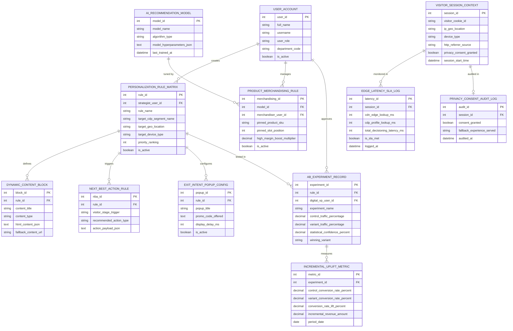

# Conceptual ERD — Personalization Engine

## Mermaid Code

## Entity Description Table | Bảng mô tả Entity

| # | Entity Name | Vietnamese Name | Description | Key Attributes | Main Relationships |
|---|-------------|-----------------|-------------|----------------|-------------------|
| 1 | USER_ACCOUNT | Tài khoản Nguời dùng | System credentials and access roles for personalization strategists, merchandisers, digital VPs, and admins. | `user_id`, `username`, `user_role`, `department_code` | Creates `PERSONALIZATION_RULE_MATRIX`, manages `PRODUCT_MERCHANDISING_RULE`, approves `AB_EXPERIMENT_RECORD`. |
| 2 | PERSONALIZATION_RULE_MATRIX | Ma trận Quy tắc Ca nhân hóa | Central personalization rule matrix entity storing target CDP segments, geo-location, device rules, and priority rankings. | `rule_id`, `strategist_user_id`, `rule_name`, `target_cdp_segment_name`, `target_geo_location`, `priority_ranking` | Defines `DYNAMIC_CONTENT_BLOCK`, triggers `NEXT_BEST_ACTION_RULE`, configures `EXIT_INTENT_POPUP_CONFIG`, tested in `AB_EXPERIMENT_RECORD`. |
| 3 | DYNAMIC_CONTENT_BLOCK | Khối Nội dung Động | Dynamic content block specification storing content titles, HTML JSON structures, and fallback URLs. | `block_id`, `rule_id`, `content_title`, `content_type`, `html_content_json`, `fallback_content_url` | Belongs to `PERSONALIZATION_RULE_MATRIX`. |
| 4 | VISITOR_SESSION_CONTEXT | Context Phiên Truy cập Visitor | Real-time visitor session context storing cookie IDs, IP location, device type, referrer, and privacy consent status. | `session_id`, `visitor_cookie_id`, `ip_geo_location`, `device_type`, `privacy_consent_granted`, `session_start_time` | Monitored in `EDGE_LATENCY_SLA_LOG`, audited in `PRIVACY_CONSENT_AUDIT_LOG`. |
| 5 | AI_RECOMMENDATION_MODEL | Mô hình Recommendation AI | Machine learning recommendation model configuration storing algorithm type (Collaborative Filtering, Vector Search) and hyperparameters. | `model_id`, `model_name`, `algorithm_type`, `model_hyperparameters_json`, `last_trained_at` | Tuned by `PRODUCT_MERCHANDISING_RULE`. |
| 6 | PRODUCT_MERCHANDISING_RULE | Quy tắc Merchandising Sản phẩm | Business merchandising rule entity storing pinned product SKUs, pinned slot positions, and margin boost multipliers. | `merchandising_id`, `model_id`, `merchandiser_user_id`, `pinned_product_sku`, `pinned_slot_position`, `high_margin_boost_multiplier` | Belongs to `AI_RECOMMENDATION_MODEL`, managed by `USER_ACCOUNT`. |
| 7 | NEXT_BEST_ACTION_RULE | Quy tắc Next Best Action (NBA) | Rules triggering automated Next Best Action prompts based on visitor session stage progression. | `nba_id`, `rule_id`, `visitor_stage_trigger`, `recommended_action_type`, `action_payload_json` | Belongs to `PERSONALIZATION_RULE_MATRIX`. |
| 8 | EXIT_INTENT_POPUP_CONFIG | Cấu hình Exit-Intent Popup | Exit-intent popup configuration storing promo codes, display delay ms, and activation status. | `popup_id`, `rule_id`, `popup_title`, `promo_code_offered`, `display_delay_ms`, `is_active` | Belongs to `PERSONALIZATION_RULE_MATRIX`. |
| 9 | AB_EXPERIMENT_RECORD | Bản ghi Thử nghiệm A/B | Controlled split experiment record storing control vs variant traffic split %, statistical confidence %, and winning variant. | `experiment_id`, `rule_id`, `digital_vp_user_id`, `experiment_name`, `control_traffic_percentage`, `statistical_confidence_percent` | Belongs to `PERSONALIZATION_RULE_MATRIX`, measures `INCREMENTAL_UPLIFT_METRIC`, approved by `USER_ACCOUNT`. |
| 10 | INCREMENTAL_UPLIFT_METRIC | Chỉ số Conversion Uplift | Daily incremental conversion lift metric recording control vs variant conversion rates %, conversion lift %, and net revenue lift. | `metric_id`, `experiment_id`, `control_conversion_rate_percent`, `variant_conversion_rate_percent`, `conversion_rate_lift_percent` | Belongs to `AB_EXPERIMENT_RECORD`. |
| 11 | EDGE_LATENCY_SLA_LOG | Nhật ký Độ trễ Sub-50ms Edge | Processing latency monitoring log tracking CDN edge lookup ms, CDP profile lookup ms, total decisioning latency, and SLA status. | `latency_id`, `session_id`, `cdn_edge_lookup_ms`, `cdp_profile_lookup_ms`, `total_decisioning_latency_ms`, `is_sla_met` | Belongs to `VISITOR_SESSION_CONTEXT`. |
| 12 | PRIVACY_CONSENT_AUDIT_LOG | Nhật ký Audit Consent Privacy | Privacy compliance audit record tracking visitor consent decisions and fallback default experiences served. | `audit_id`, `session_id`, `consent_granted`, `fallback_experience_served`, `audited_at` | Belongs to `VISITOR_SESSION_CONTEXT`. |

## Relationship Description | Mô tả Quan hệ

| # | From Entity | Cardinality | To Entity | Label | Business Explanation |
|---|-------------|-------------|-----------|-------|----------------------|
| 1 | PERSONALIZATION_RULE_MATRIX | 1 to 1..N | DYNAMIC_CONTENT_BLOCK | defines | A personalization rule matrix defines dynamic content blocks. |
| 2 | PERSONALIZATION_RULE_MATRIX | 1 to 0..N | NEXT_BEST_ACTION_RULE | triggers | A personalization rule matrix triggers Next-Best-Action rules. |
| 3 | PERSONALIZATION_RULE_MATRIX | 1 to 0..N | EXIT_INTENT_POPUP_CONFIG | configures | A personalization rule matrix configures exit-intent popup offers. |
| 4 | PERSONALIZATION_RULE_MATRIX | 1 to 0..N | AB_EXPERIMENT_RECORD | tested in | A personalization rule matrix is tested in A/B split experiments. |
| 5 | AI_RECOMMENDATION_MODEL | 1 to 0..N | PRODUCT_MERCHANDISING_RULE | tuned by | An AI recommendation model is tuned by product merchandising boost/pin rules. |
| 6 | VISITOR_SESSION_CONTEXT | 1 to 0..N | EDGE_LATENCY_SLA_LOG | monitored in | A visitor session context is monitored for sub-50ms edge processing latency. |
| 7 | VISITOR_SESSION_CONTEXT | 1 to 0..1 | PRIVACY_CONSENT_AUDIT_LOG | audited in | A visitor session context is audited for privacy consent compliance. |
| 8 | AB_EXPERIMENT_RECORD | 1 to 0..N | INCREMENTAL_UPLIFT_METRIC | measures | An A/B experiment record measures daily incremental conversion uplift. |
| 9 | USER_ACCOUNT | 1 to 0..N | PERSONALIZATION_RULE_MATRIX | creates | A personalization strategist user account creates rule matrices. |
| 10 | USER_ACCOUNT | 1 to 0..N | PRODUCT_MERCHANDISING_RULE | manages | An e-commerce merchandiser user account manages merchandising rules. |
| 11 | USER_ACCOUNT | 1 to 0..N | AB_EXPERIMENT_RECORD | approves | A digital VP user account approves A/B experiments. |
