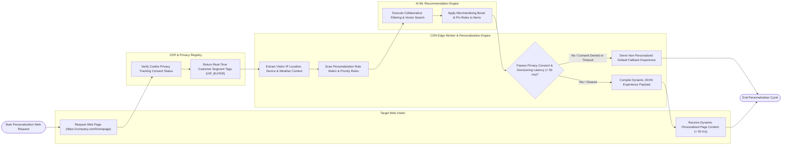

# Swimlane Diagram — Personalization Engine

## Mermaid Code

## Flow Description | Mô tả luồng

| Lane | Actor | Role in Flow |
|------|-------|-------------|
| 1 | Target Web Visitor | Requests dynamic web pages or mobile app views, transmitting IP location, device context, and clickstream events, and receiving sub-50ms personalized experiences. |
| 2 | CDP & Privacy Registry | Verifies visitor cookie privacy tracking consent flags, returning real-time customer segment tags (`VIP_BUYER`, `CHURN_RISK`) and brand affinity context to the edge worker. |
| 3 | CDN Edge Worker & Personalization Engine | Intercepts HTTP requests at the CDN edge, extracts real-time visitor context (weather, device, referrer), scans priority rule matrices, verifies sub-50ms latency SLAs, serves fallback default content if consent is denied, and compiles dynamic JSON experience payloads. |
| 4 | AI ML Recommendation Engine | Runs collaborative filtering and vector search embeddings, applying merchandiser product boost and pin rules to generate personalized item recommendation carousels. |
