# Action Tree — Personalization Engine

## Mermaid Code

```mermaid
graph TD
    Root["Personalization Engine"]

    Root --> M1["Personalization Rule & Matrix Management"]
    Root --> M2["Sub-50ms Edge Content Decisioning"]
    Root --> M3["AI Machine Learning Recommendation Engine"]
    Root --> M4["E-Commerce Merchandising & Boost Rules"]
    Root --> M5["A/B Experimentation & Conversion Lift"]
    Root --> M6["Privacy Consent & Sub-50ms Latency SLAs"]

    M1 --> A11["Manage Dynamic Personalization Rule Matrices & Priority Ranks"]
    M1 --> A12["Ingest Real-Time CDP Visitor Segment Membership Tags"]
    M1 --> A13["Evaluate Geo-Location, Local Weather & Device Context"]
    M1 --> A14["Predict Next Best Action (NBA) Prompts for Visitors"]

    M2 --> A21["Execute CDN Edge Worker Decisioning Scripts (Cloudflare/Fastly)"]
    M2 --> A22["Dispatch Sub-50ms Dynamic JSON Content Payloads to Front-End"]
    M2 --> A23["Trigger Exit-Intent Dynamic Offer Popups on Cursor Leave"]
    M2 --> A24["Hydrate Front-End React/Next.js Applications without Layout Shift"]

    M3 --> A31["Execute Collaborative Filtering & Vector Embedding Models"]
    M3 --> A32["Generate Frequently Bought Together Product Cross-Sell Bundles"]
    M3 --> A33["Generate Recommended for You Personalized Carousels"]
    M3 --> A34["Filter Out-of-Stock SKUs & Previously Purchased Items"]

    M4 --> A41["Pin Featured Product SKUs to Specific Recommendation Slots"]
    M4 --> A42["Apply Score Boost Multipliers for High-Margin Items (> 50% Margin)"]
    M4 --> A43["Apply Score Boost Multipliers for High-Inventory Products"]
    M4 --> A44["Configure Exclusion Category Rules for Specific Carousels"]

    M5 --> A51["Execute Controlled A/B Split Experiments (Control vs Variant)"]
    M5 --> A52["Measure Incremental Revenue Lift & Order Conversion Rates"]
    M5 --> A53["Verify Statistical Significance Confidence Thresholds (>= 95%)"]
    M5 --> A54["Deploy Winning Personalized Variants to 100% Traffic"]

    M6 --> A61["Enforce GDPR Cookie Consent & Suppress Opted-Out Tracking"]
    M6 --> A62["Serve Pre-Configured Non-Personalized Default Fallback Content"]
    M6 --> A63["Audit End-to-End Edge Decisioning Response Latency (< 50 ms)"]
    M6 --> A64["Export Executive Personalization Net ROMI Scorecard PDFs"]
```

## Module Description | Mô tả Module

| # | Module | Description | Actions |
|---|--------|-------------|---------|
| 1 | Personalization Rule & Matrix Management | Manages personalization rules, ingests CDP segment tags, evaluates geo/weather/device context, and predicts Next-Best-Action prompts. | Manage Rule Matrices & Ranks, Ingest Real-Time CDP Segment Tags, Evaluate Geo/Weather/Device Context, Predict Next Best Action Prompts. |
| 2 | Sub-50ms Edge Content Decisioning | Runs CDN edge scripts, dispatches dynamic JSON payloads in $< 50 \text{ ms}$, triggers exit-intent popups, and hydrates front-end applications without flicker. | Execute Edge Worker Scripts, Dispatch Dynamic JSON Payloads (< 50 ms), Trigger Exit-Intent Offer Popups, Hydrate Front-End without Flicker. |
| 3 | AI Machine Learning Recommendation Engine | Executes collaborative filtering and vector embeddings, generates "Frequently Bought Together" bundles, and filters out-of-stock items. | Execute Collaborative Filtering Models, Generate Frequently Bought Together Bundles, Generate Recommended for You Carousels, Filter Out-of-Stock Items. |
| 4 | E-Commerce Merchandising & Boost Rules | Pins featured product SKUs, applies score boost multipliers for high-margin and high-stock items, and configures category exclusions. | Pin Featured SKUs to Slots, Boost High-Margin Items (> 50% Margin), Boost High-Inventory Products, Configure Category Exclusion Rules. |
| 5 | A/B Experimentation & Conversion Lift | Runs A/B split experiments, measures incremental revenue lift, verifies 95%+ statistical significance, and deploys winning variants. | Execute Controlled A/B Split Experiments, Measure Incremental Revenue Lift, Verify Statistical Significance (>= 95%), Deploy Winning Variants to 100% Traffic. |
| 6 | Privacy Consent & Sub-50ms Latency SLAs | Enforces GDPR cookie consent, serves non-personalized default fallback content, audits sub-50ms edge processing SLAs, and exports ROI scorecards. | Enforce GDPR Cookie Consent, Serve Default Fallback Content, Audit Sub-50ms Edge Processing SLAs, Export Executive Personalization ROMI Reports. |
