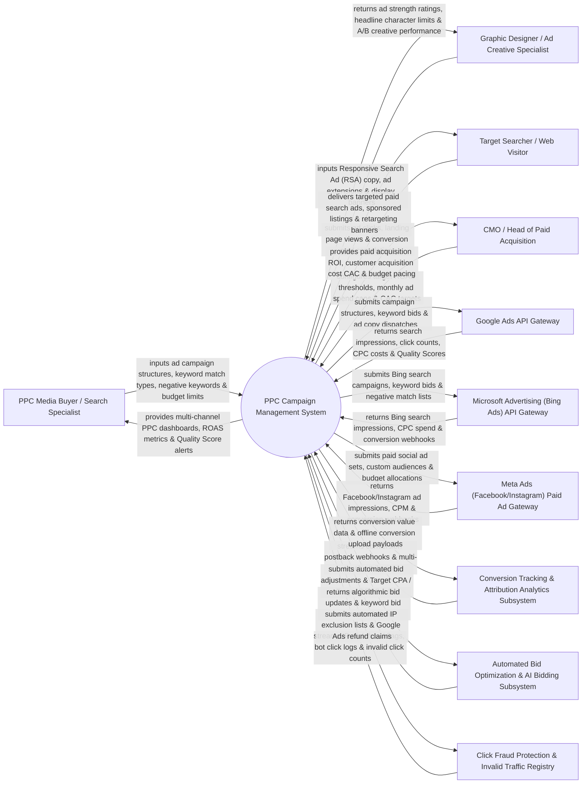

# Context Diagram — PPC Campaign Management System

## Mermaid Code

## Actor & Interaction Table | Bảng Actor & Tương tác

| # | Actor | Actor Type | Data Sent TO System | Data Received FROM System | Notes |
|---|-------|------------|---------------------|---------------------------|-------|
| 1 | PPC Media Buyer / Search Specialist | Primary | Campaign structures, match type keywords (Exact/Phrase/Broad), negative keyword lists, daily budget limits, bid strategies. | Multi-channel PPC performance dashboards, Return on Ad Spend (ROAS) charts, Quality Score alerts, budget pacing metrics. | Paid media specialist managing Google Search, Bing, and Meta ad campaigns. |
| 2 | Graphic Designer / Ad Creative Specialist | Primary | Responsive Search Ad (RSA) headlines, descriptions, callout extensions, image assets, HTML5 display banners. | Ad strength ratings (Poor -> Excellent), character length checks, A/B creative asset performance analysis. | Creative specialist crafting ad copy headlines, descriptions, extensions, and visual display banners. |
| 3 | Target Searcher / Web Visitor | Primary | Search query inputs, ad clicks, landing page visits, lead form conversions, purchase transactions. | Targeted search ads, sponsored listings, retargeting display banners, dynamic call extensions. | Consumer searching on Google/Bing or browsing social media, interacting with paid PPC ads. |
| 4 | CMO / Head of Paid Acquisition | Primary | Target ROAS benchmarks, monthly budget caps, maximum target Cost Per Acquisition (CPA) limits. | Paid acquisition ROI reports, Customer Acquisition Cost (CAC) trends, monthly spend pacing, channel budget allocations. | Executive overseeing paid ad spend efficiency, total customer acquisition costs, and advertising ROAS. |
| 5 | Google Ads API Gateway | Supporting | Impression metrics, click counts, Cost Per Click (CPC), Quality Scores, Impression Share (IS), conversion webhooks. | Campaign creation payloads, keyword bid changes, RSA ad dispatches, negative keyword lists. | Official Google Ads API executing search, display, and shopping campaign dispatches and tracking performance. |
| 6 | Microsoft Advertising (Bing Ads) API Gateway | Supporting | Bing search impressions, click volume, CPC spend, conversion telemetry. | Bing campaign structures, keyword bid updates, negative keyword list dispatches. | Microsoft Advertising API managing Bing Search and Audience Network ad campaigns. |
| 7 | Meta Ads Paid Ad Gateway | Supporting | Facebook/Instagram paid impressions, CPM costs, click-through rates (CTR), conversion webhooks. | Paid social ad sets, custom audience targeting payloads, daily budget allocations. | Meta Marketing API managing paid Facebook and Instagram sponsored ad campaigns. |
| 8 | Conversion Tracking & Attribution Analytics Subsystem | Supporting | Real-time conversion webhooks, server-side Conversion API (CAPI) events, offline CRM conversion uploads. | Conversion event mapping, transaction revenue data, offline conversion upload payloads. | Attribution engine tracking user conversions across first-touch, last-touch, and multi-touch models. |
| 9 | Automated Bid Optimization & AI Bidding Subsystem | Supporting | Algorithmic bid recommendations, Target CPA bid adjustments, Target ROAS multiplier updates. | Automated bid adjustment rules, historical conversion rate data, target CPA policy constraints. | Algorithmic bidding engine optimizing keyword bids in real time to maximize conversion volume. |
| 10 | Click Fraud Protection & Invalid Traffic Registry | Supporting | Invalid click logs, bot IP address flags, click fraud risk scores, refund credit receipts. | Automated IP exclusion dispatches, invalid click refund claim payloads. | Specialized click fraud protection service (ClickCease) identifying bot traffic and disavowing fraudulent IPs. |

## System Boundary Description | Mô tả Phạm vi Hệ thống

The **PPC Campaign Management System** is an enterprise Pay-Per-Click (PPC) ad management, automated bid optimization, cross-channel campaign orchestration, and click fraud prevention platform designed to manage paid advertising across Google Ads, Microsoft Advertising (Bing), and Meta Ads.

**Inside System Scope:**
- Multi-channel campaign structure management (Search, Display, Shopping, Retargeting) with negative keyword conflict resolution.
- Responsive Search Ad (RSA) copy creation with real-time Ad Strength scoring and asset performance rating.
- Algorithmic bid optimization supporting Target CPA, Target ROAS, Maximize Conversions, and manual CPC rules.
- Real-time click fraud detection, invalid click monitoring, and automated IP address exclusion dispatches.
- Server-side Conversion API (CAPI) integration, offline CRM conversion imports, and cross-channel ROAS analytics.

**Outside System Scope:**
- Direct physical hosting of search engine servers (handled by Google/Microsoft Data Centers).
- Direct merchant bank processing of paid ad platform credit card invoices (handled by Payment Networks).
- Direct manual creation of raw landing page HTML code (handled by CMS and Web Development Teams).
