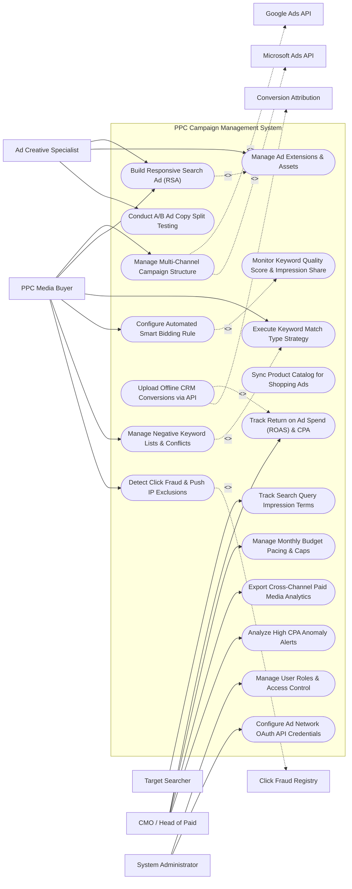

# Use Case Diagram — PPC Campaign Management System

## Mermaid Code

## Actor Table | Bảng Actor

| # | Actor | Actor Type | Role Description | Related Use Cases |
|---|-------|------------|------------------|-------------------|
| 1 | PPC Media Buyer | Primary | Paid media manager structuring campaigns, managing keywords, configuring bidding rules, and pushing dispatches. | UC01, UC02, UC04, UC05, UC08, UC10 |
| 2 | Ad Creative Specialist | Primary | Copywriter crafting Responsive Search Ad (RSA) headlines, descriptions, ad extensions, and testing ad copy variations. | UC02, UC03, UC07 |
| 3 | Target Searcher | Primary | Online consumer triggering search query impressions, ad clicks, and landing page conversions. | UC13 |
| 4 | CMO / Head of Paid | Primary | Executive tracking ROAS, Customer Acquisition Cost (CAC), budget pacing, channel efficiency, and CPA anomaly alerts. | UC11, UC14, UC15, UC18 |
| 5 | System Administrator | Primary | IT administrative user managing user RBAC access, ad account authorizations, and API token connections. | UC16, UC17 |
| 6 | Google Ads API | System (Secondary) | Official Google Ads REST API receiving campaign structures, keyword bids, ad dispatches, and returning telemetry. | UC01 |
| 7 | Microsoft Ads API | System (Secondary) | Official Microsoft Advertising API managing Bing Search campaigns, keyword bids, and ad dispatches. | UC01 |
| 8 | Conversion Attribution | System (Secondary) | Attribution engine tracking online/offline conversion postbacks, CAPI events, and revenue mapping. | UC12 |
| 9 | Click Fraud Registry | System (Secondary) | Specialized service (ClickCease) identifying bot clicks and streaming IP address exclusion payloads. | UC10 |

## Use Case Table | Bảng Use Case

| # | UC ID | Use Case Name | Primary Actor | Secondary Actor | Description | Priority |
|---|-------|---------------|---------------|-----------------|-------------|----------|
| 1 | UC01 | Manage Multi-Channel Campaign Structure | PPCBuyer | Google/Bing Ads | Structures Search, Display, Shopping, and Retargeting campaigns across Google Ads and Microsoft Advertising. | Critical |
| 2 | UC02 | Build Responsive Search Ad (RSA) | Creative | None | Composes up to 15 headlines and 4 descriptions, displaying real-time Google Ad Strength scoring (Poor -> Excellent). | Critical |
| 3 | UC03 | Manage Ad Extensions & Assets | Creative | None | Configures sitelink extensions, callout extensions, structured snippets, call extensions, and image assets. | High |
| 4 | UC04 | Execute Keyword Match Type Strategy | PPCBuyer | None | Manages Exact Match (`[keyword]`), Phrase Match (`"keyword"`), and Broad Match keywords with target bids. | High |
| 5 | UC05 | Configure Automated Smart Bidding Rule | PPCBuyer | None | Sets up AI bidding strategies (Target CPA, Target ROAS, Maximize Conversions) with automated bid cap limits. | Critical |
| 6 | UC06 | Monitor Keyword Quality Score & Impression Share | PPCBuyer | None | Tracks keyword Quality Scores (1-10), Expected CTR, Ad Relevance, Landing Page Experience, and Search Lost IS. | High |
| 7 | UC07 | Conduct A/B Ad Copy Split Testing | Creative | None | Tests ad copy variations against identical keyword ad groups to determine winning click-through rates. | High |
| 8 | UC08 | Manage Negative Keyword Lists & Conflicts | PPCBuyer | None | Compiles campaign/account-level negative keyword lists and resolves negative keyword blocking conflicts. | Critical |
| 9 | UC09 | Sync Product Catalog for Shopping Ads | PPCBuyer | None | Syncs Google Merchant Center e-commerce product feeds for dynamic Google Shopping ad campaigns. | High |
| 10 | UC10 | Detect Click Fraud & Push IP Exclusions | PPCBuyer | FraudRegistry | Identifies fraudulent bot clicks and automatically dispatches blocked IP address lists to Google Ads campaigns. | Critical |
| 11 | UC11 | Track Return on Ad Spend (ROAS) & CPA | CMO | None | Measures real-time Return on Ad Spend ($\text{ROAS} = \frac{\text{Revenue}}{\text{Ad Spend}}$) and Cost Per Acquisition ($\text{CPA} = \frac{\text{Ad Spend}}{\text{Conversions}}$). | Critical |
| 12 | UC12 | Upload Offline CRM Conversions via API | PPCBuyer | Attribution | Uploads offline CRM closed-won deal payloads (with Google Click ID `gclid`) to feed conversion data back to Google AI. | Critical |
| 13 | UC13 | Track Search Query Impression Terms | Visitor | None | Analyzes actual search queries typed by users that triggered ad impressions, adding relevant terms or negative keywords. | High |
| 14 | UC14 | Manage Monthly Budget Pacing & Caps | CMO | None | Tracks daily ad spend burn rates against monthly budget caps, pausing campaigns if budget limits are reached. | High |
| 15 | UC15 | Export Cross-Channel Paid Media Analytics | CMO | None | Renders unified paid media dashboards comparing Google Ads, Bing Ads, and Meta Ads performance side-by-side. | High |
| 16 | UC16 | Manage User Roles & Access Control | Admin | None | Controls user login credentials, spend limit approval thresholds, and workspace account visibility. | High |
| 17 | UC17 | Configure Ad Network OAuth API Credentials | Admin | None | Manages OAuth 2.0 API connection tokens, developer tokens, and customer account IDs (`client_id`). | High |
| 18 | UC18 | Analyze High CPA Anomaly Alerts | CMO | None | Triggers urgent alert notifications when campaign Cost Per Acquisition spikes $> 50\%$ above historical target limits. | High |

## Use Case Specification | Đặc tả Use Case

---

### UC02 — Build Responsive Search Ad (RSA)

| Field | Detail |
|-------|--------|
| **UC ID** | UC02 |
| **Use Case Name** | Build Responsive Search Ad (RSA) |
| **Actor(s)** | Primary: Ad Creative Specialist, PPC Media Buyer   Secondary: None |
| **Description** | Composes Responsive Search Ads (RSA) containing up to 15 headline variations and 4 description variations, evaluating real-time Google Ad Strength scoring and pinning key headlines. |
| **Precondition** | 1. Target ad group is selected in an active Search campaign.   2. Target landing page URL is defined. |
| **Main Flow** | 1. User opens "Responsive Search Ad (RSA) Builder".   2. User inputs Final Landing Page URL (`https://company.com/cloud-software`).   3. User inputs Headline Variations (up to 15 headlines, max 30 characters each):   &nbsp;&nbsp;&nbsp;&nbsp; a. Headline 1: `"Top Enterprise Cloud Software"`.   &nbsp;&nbsp;&nbsp;&nbsp; b. Headline 2: `"Automate Your Workflow Today"`.   &nbsp;&nbsp;&nbsp;&nbsp; c. Headline 3: `"Get 30-Day Free Trial"`.   4. User inputs Description Variations (up to 4 descriptions, max 90 characters each):   &nbsp;&nbsp;&nbsp;&nbsp; a. Description 1: `"Streamline operations with AI-powered cloud automation. Book your live demo now."`   &nbsp;&nbsp;&nbsp;&nbsp; b. Description 2: `"Rated #1 Cloud Platform by Gartner. ISO-27001 Certified Security. Try Free."`   5. System evaluates Real-Time Google Ad Strength Algorithm:   &nbsp;&nbsp;&nbsp;&nbsp; a. Headline Diversity Score: Good (12/15 Headlines Provided).   &nbsp;&nbsp;&nbsp;&nbsp; b. Target Keyword Inclusion Score: Excellent (Includes primary ad group keywords).   &nbsp;&nbsp;&nbsp;&nbsp; c. Description Uniqueness Score: Excellent.   &nbsp;&nbsp;&nbsp;&nbsp; d. Overall Ad Strength Rating: `EXCELLENT` (Green Badge).   6. User optional: Pins Headline 1 to Position #1 so it always displays first.   7. User saves RSA ad item; System dispatches ad payload to Google Ads API (UC01). |
| **Alternative Flow** | **AF1** — Dynamic Keyword Insertion (DKI): User inserts `{KeyWord:Cloud Software}` snippet into Headline 1, enabling Google to automatically insert the exact user search query into the ad headline. |
| **Exception Flow** | **EX1** — Headline Character Overflow: Headline 4 exceeds 30 characters (34 chars); System highlights text in red, displays error "Headline Exceeds 30 Characters", and blocks ad saving until fixed. |
| **Postcondition** | Responsive Search Ad is composed, Ad Strength is evaluated as `EXCELLENT`, and ad payload is saved for dispatch. |
| **Business Rule** | **BR1**: Responsive Search Ads MUST contain a minimum of 5 distinct headlines and 2 descriptions to meet Google Ads API requirements. |

---

### UC05 — Configure Automated Smart Bidding Rule

| Field | Detail |
|-------|--------|
| **UC ID** | UC05 |
| **Use Case Name** | Configure Automated Smart Bidding Rule |
| **Actor(s)** | Primary: PPC Media Buyer   Secondary: None |
| **Description** | Establishes automated AI bidding strategies (Target CPA, Target ROAS, Maximize Conversions) with maximum CPC bid caps and automated execution rule parameters. |
| **Precondition** | 1. Campaign has logged a minimum of 30 conversions in the past 30 days.   2. Conversion tracking is active and verified (UC12). |
| **Main Flow** | 1. User opens "Bid Strategy Manager" and selects target campaign (e.g., `Search_US_Enterprise_Cloud`).   2. User selects Smart Bidding Strategy: `Target ROAS (Return on Ad Spend)`.   3. User configures Bidding Rule Parameters:   &nbsp;&nbsp;&nbsp;&nbsp; a. Target ROAS Percentage: `400%` (System will aim for $4 revenue per $1 ad spend).   &nbsp;&nbsp;&nbsp;&nbsp; b. Maximum CPC Limit Cap: `$25.00` (Prevents AI from placing runaway high bids).   &nbsp;&nbsp;&nbsp;&nbsp; c. Minimum CPC Limit Floor: `$1.50`.   4. User enables Advanced Bid Adjustments:   &nbsp;&nbsp;&nbsp;&nbsp; a. Device Adjustment: `Mobile +20%`.   &nbsp;&nbsp;&nbsp;&nbsp; b. Location Adjustment: `California +15%`.   &nbsp;&nbsp;&nbsp;&nbsp; c. Dayparting Schedule: `Monday-Friday 08:00 to 18:00 EST (+10%)`.   5. User clicks "Apply Smart Bidding Strategy".   6. System validates conversion volume eligibility ($> 30$ conversions/month), updates campaign settings, and pushes bid strategy payload to Google Ads API.   7. System continuously monitors performance, adjusting keyword bids dynamically at auction time. |
| **Alternative Flow** | **AF1** — Target CPA Strategy: User selects `Target CPA` mode and inputs Target Cost Per Lead `$75.00`; System optimizes bids to maximize conversions at or below $75 per lead. |
| **Exception Flow** | **EX1** — Insufficient Conversion Volume Warning: Campaign has only 8 conversions in past 30 days; System flags "Low Conversion Data Warning (< 30 Conversions) - Smart Bidding Accuracy May Be Limited", recommending `Manual CPC with Enhanced Bidding`. |
| **Postcondition** | Smart Bidding strategy (Target ROAS 400%) is active, bid limits are set, and real-time auction bid adjustments begin. |
| **Business Rule** | **BR1**: Automated Smart Bidding strategies MUST enforce a user-defined Maximum CPC Bid Limit to prevent unexpected ad spend overruns. |

---

### UC08 — Manage Negative Keyword Lists & Conflicts

| Field | Detail |
|-------|--------|
| **UC ID** | UC08 |
| **Use Case Name** | Manage Negative Keyword Lists & Conflicts |
| **Actor(s)** | Primary: PPC Media Buyer   Secondary: None |
| **Description** | Compiles campaign and account-level negative keyword lists (preventing ads from showing for irrelevant searches) and automatically detects and resolves negative keyword blocking conflicts. |
| **Precondition** | 1. User holds PPC campaign manager permissions. |
| **Main Flow** | 1. User opens "Negative Keyword Manager".   2. User selects Negative Keyword List: `Global Account Negative List (B2B SaaS)`.   3. User adds new negative keyword terms:   &nbsp;&nbsp;&nbsp;&nbsp; a. Broad Negative: `free` (Blocks "free cloud software").   &nbsp;&nbsp;&nbsp;&nbsp; b. Phrase Negative: `"open source"` (Blocks "open source cloud ERP").   &nbsp;&nbsp;&nbsp;&nbsp; c. Exact Negative: `[cracked software]` (Blocks exact search).   4. User applies negative keyword list to 12 active Search campaigns.   5. System runs Automated Negative Conflict Scanner:   &nbsp;&nbsp;&nbsp;&nbsp; a. Scans all target positive keywords against the new negative keywords.   &nbsp;&nbsp;&nbsp;&nbsp; b. Detects Conflict: Positive Exact Keyword `[free cloud trial]` is blocked by Negative Broad Keyword `free`.   6. System flags "Negative Keyword Conflict Warning" and highlights the affected positive keyword in yellow.   7. User modifies negative keyword from `free` (broad) to `[free download]` (exact), resolving the conflict.   8. System pushes updated negative keyword lists to Google Ads and Bing Ads APIs. |
| **Alternative Flow** | **AF1** — One-Click Add from Search Terms: User reviews Search Terms Report (UC13), checks irrelevant queries (`"cheap jobs"`), and clicks "Add as Campaign Negative Keyword". |
| **Exception Flow** | **EX1** — Account-Wide Negative Conflict Lock: Negative keyword blocks > 20% of active campaign target keywords; System locks list dispatch and prompts user to confirm conflict overrides. |
| **Postcondition** | Negative keyword lists are compiled, conflicts with positive keywords are resolved, and lists are dispatched to ad networks. |
| **Business Rule** | **BR1**: Negative keyword additions MUST trigger an automated conflict scan to ensure high-converting positive keywords are not blocked. |

---

### UC10 — Detect Click Fraud & Push IP Exclusions

| Field | Detail |
|-------|--------|
| **UC ID** | UC10 |
| **Use Case Name** | Detect Click Fraud & Push IP Exclusions |
| **Actor(s)** | Primary: PPC Media Buyer   Secondary: Click Fraud Protection Registry |
| **Description** | Analyzes ad click patterns, identifies fraudulent bot clicks, competitor click abuse, and automated scraper IPs, automatically dispatching IP exclusion lists to Google Ads campaigns. |
| **Precondition** | 1. Click fraud tracking script is active on landing pages.   2. Click Fraud Protection API (ClickCease) is integrated. |
| **Main Flow** | 1. System ingests real-time ad click telemetry from landing page tracking script.   2. System analyzes click behavior heuristics:   &nbsp;&nbsp;&nbsp;&nbsp; a. IP Address `192.0.2.45` clicked search ad 8 times in 10 minutes with 0-second page duration.   &nbsp;&nbsp;&nbsp;&nbsp; b. Device fingerprint matches a known automated proxy botnet node.   3. System flags `192.0.2.45` as `FRAUDULENT_BOT_CLICK` (Click Fraud Risk Score: 98/100).   4. System adds IP address `192.0.2.45` to Campaign IP Exclusion List (`ip_exclusions.json`).   5. System transmits IP exclusion payload via Google Ads API to block the IP from seeing or clicking future ads.   6. System calculates invalid click metrics:   &nbsp;&nbsp;&nbsp;&nbsp; a. Blocked Fraudulent Clicks Today: 142 clicks.   &nbsp;&nbsp;&nbsp;&nbsp; b. Ad Spend Saved Today: `$1,065.00`.   7. System packages automated Invalid Click Credit Request payload for submission to Google Ads support for refund credit. |
| **Alternative Flow** | **AF1** — Geo-Fencing Click Suppression: System detects 90% of invalid clicks originating from a specific non-target country (e.g., proxy servers in Country X); System automatically adds country exclusion to campaign geo-targeting. |
| **Exception Flow** | **EX1** — Corporate VPN False Positive Warning: An IP address belongs to a major enterprise customer VPN (`acme_corp_vpn`); User overrides bot classification and whitelists IP address to allow legit enterprise clicks. |
| **Postcondition** | Fraudulent IP address is detected, added to IP exclusion list, dispatched to Google Ads API, and click fraud savings update. |
| **Business Rule** | **BR1**: Fraudulent IP addresses with > 3 invalid clicks in 15 minutes MUST be automatically added to the Google Ads Campaign IP Exclusion List within <= 60 seconds. |

---

### UC12 — Upload Offline CRM Conversions via API

| Field | Detail |
|-------|--------|
| **UC ID** | UC12 |
| **Use Case Name** | Upload Offline CRM Conversions via API |
| **Actor(s)** | Primary: PPC Media Buyer   Secondary: Conversion Tracking & Attribution Subsystem |
| **Description** | Matches offline closed-won sales deal records in CRM with Google Click ID (`gclid`) tokens and uploads conversion values back to Google Ads to train Smart Bidding algorithms on high-value revenue. |
| **Precondition** | 1. Inbound lead form captures Google Click ID (`gclid`) hidden field and passes token to CRM.   2. Opportunity in CRM transitions to `CLOSED_WON` status. |
| **Main Flow** | 1. System detects closed-won deal event in CRM: Account `Acme Corp`, Closed Deal Value `$50,000`, Google Click ID `gclid_99412abc88`.   2. System retrieves conversion upload schedule and prepares Offline Conversion Payload:   &nbsp;&nbsp;&nbsp;&nbsp; a. `gclid`: `gclid_99412abc88`.   &nbsp;&nbsp;&nbsp;&nbsp; b. `conversion_name`: `Offline_Closed_Won_Sale`.   &nbsp;&nbsp;&nbsp;&nbsp; c. `conversion_value`: `$50,000.00`.   &nbsp;&nbsp;&nbsp;&nbsp; d. `conversion_time`: `2026-10-30 14:30:00 EST`.   3. System applies SHA-256 hashing to customer email (`john@acme.com`) for Google Enhanced Conversions alignment.   4. System transmits offline conversion payload over secure HTTPS API to Google Ads Conversion Service.   5. Google Ads API processes upload and matches conversion to original search click (`PUBLISH_CONVERSION_SUCCESS_200`).   6. Google Ads AI Smart Bidding engine ingests the $50,000 conversion value to optimize future bidding toward enterprise buyer queries.   7. System updates campaign ROAS reporting to reflect offline sales revenue. |
| **Alternative Flow** | **AF1** — Multi-Stage Offline Funnel Upload: System uploads intermediate offline funnel conversions (`MQL_Qualified = $500 value`, `Sales_Demo_Completed = $2,000 value`, `Closed_Won = $50,000 value`). |
| **Exception Flow** | **EX1** — Expired GCLID Token Error ($> 90$ Days Old): Google Click ID token is 95 days old, exceeding Google's 90-day conversion attribution window; Google API rejects conversion with error `GCLID_EXPIRED`, system logs attribution limitation. |
| **Postcondition** | Offline CRM conversion value is uploaded to Google Ads API, conversion attribution is updated, and Smart Bidding algorithms ingest revenue data. |
| **Business Rule** | **BR1**: Offline CRM conversion uploads MUST include the `gclid` token or SHA-256 hashed customer email and be transmitted within 90 days of original ad click. |
