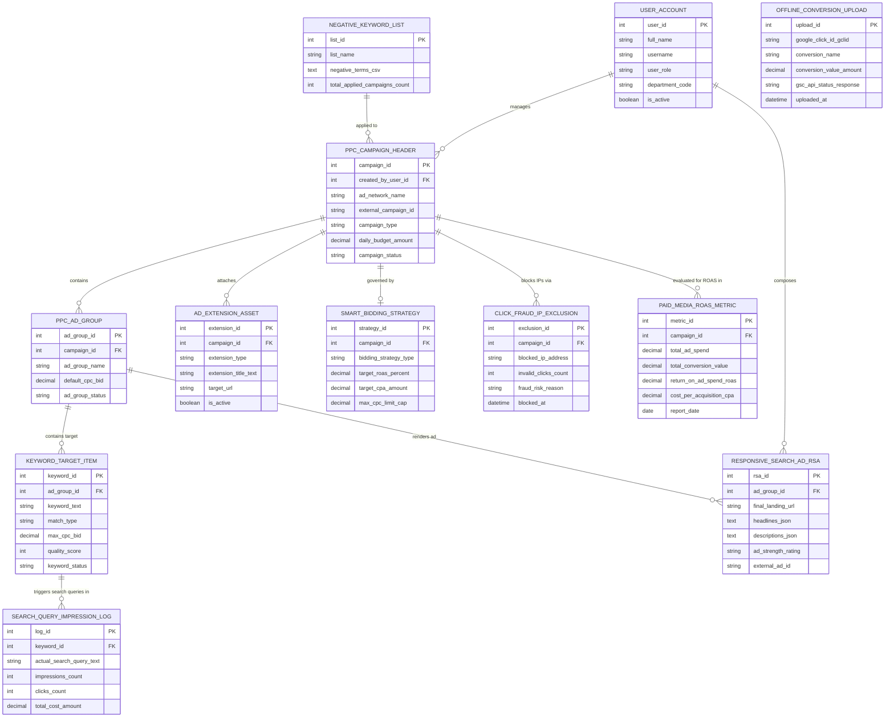

# Conceptual ERD — PPC Campaign Management System

## Mermaid Code

## Entity Description Table | Bảng mô tả Entity

| # | Entity Name | Vietnamese Name | Description | Key Attributes | Main Relationships |
|---|-------------|-----------------|-------------|----------------|-------------------|
| 1 | USER_ACCOUNT | Tài khoản Nguời dùng | System user credentials and access roles for PPC buyers, creative specialists, and CMOs. | `user_id`, `username`, `user_role`, `department_code` | Manages `PPC_CAMPAIGN_HEADER`, composes `RESPONSIVE_SEARCH_AD_RSA`. |
| 2 | PPC_CAMPAIGN_HEADER | Header Chiến dịch PPC | Master PPC campaign header entity storing ad network name, external ID, daily budget, and status. | `campaign_id`, `created_by_user_id`, `ad_network_name`, `external_campaign_id`, `daily_budget_amount` | Contains `PPC_AD_GROUP`, attaches `AD_EXTENSION_ASSET`, governed by `SMART_BIDDING_STRATEGY`, evaluated for ROAS in `PAID_MEDIA_ROAS_METRIC`. |
| 3 | PPC_AD_GROUP | Nhóm Quảng cáo PPC | PPC ad group grouping related target keywords and responsive search ads with default CPC bids. | `ad_group_id`, `campaign_id`, `ad_group_name`, `default_cpc_bid`, `ad_group_status` | Belongs to `PPC_CAMPAIGN_HEADER`, contains `KEYWORD_TARGET_ITEM`, renders `RESPONSIVE_SEARCH_AD_RSA`. |
| 4 | KEYWORD_TARGET_ITEM | Từ khóa Nhắm mục tiêu | Target keyword item storing keyword phrase, match type (Exact/Phrase/Broad), max CPC, and Quality Score. | `keyword_id`, `ad_group_id`, `keyword_text`, `match_type`, `max_cpc_bid`, `quality_score` | Belongs to `PPC_AD_GROUP`, triggers `SEARCH_QUERY_IMPRESSION_LOG`. |
| 5 | RESPONSIVE_SEARCH_AD_RSA | Quảng cáo Tìm kiếm RSA | Responsive Search Ad entity storing headlines, descriptions, landing page URL, and Google Ad Strength score. | `rsa_id`, `ad_group_id`, `final_landing_url`, `headlines_json`, `descriptions_json`, `ad_strength_rating` | Belongs to `PPC_AD_GROUP`, composed by `USER_ACCOUNT`. |
| 6 | AD_EXTENSION_ASSET | Tiện ích Mở rộng Quảng cáo | Ad extension assets (sitelinks, callouts, call extensions, image assets) attached to campaigns. | `extension_id`, `campaign_id`, `extension_type`, `extension_title_text`, `target_url` | Belongs to `PPC_CAMPAIGN_HEADER`. |
| 7 | SMART_BIDDING_STRATEGY | Chiến lược Bầu cử AI | Automated AI smart bidding rule configuration (Target CPA, Target ROAS) with maximum CPC caps. | `strategy_id`, `campaign_id`, `bidding_strategy_type`, `target_roas_percent`, `max_cpc_limit_cap` | Belongs to `PPC_CAMPAIGN_HEADER`. |
| 8 | NEGATIVE_KEYWORD_LIST | Danh sách Từ khóa Phủ định | Campaign and account-level negative keyword lists preventing ad display for irrelevant searches. | `list_id`, `list_name`, `negative_terms_csv`, `total_applied_campaigns_count` | Applied to `PPC_CAMPAIGN_HEADER`. |
| 9 | CLICK_FRAUD_IP_EXCLUSION | Chặn IP Fraud Click | Blocked IP address exclusion list tracking invalid bot clicks, click fraud reasons, and block dates. | `exclusion_id`, `campaign_id`, `blocked_ip_address`, `invalid_clicks_count`, `fraud_risk_reason` | Belongs to `PPC_CAMPAIGN_HEADER`. |
| 10 | OFFLINE_CONVERSION_UPLOAD | Upload Chuyển đổi Offline | Offline CRM conversion upload records matching Google Click IDs (`gclid`) with revenue amounts. | `upload_id`, `google_click_id_gclid`, `conversion_name`, `conversion_value_amount`, `uploaded_at` | Standalone conversion attribution entity. |
| 11 | SEARCH_QUERY_IMPRESSION_LOG | Nhật ký Search Query Thực tế | Real user search query logs tracking actual search queries that triggered ad impressions and clicks. | `log_id`, `keyword_id`, `actual_search_query_text`, `impressions_count`, `clicks_count`, `total_cost_amount` | Belongs to `KEYWORD_TARGET_ITEM`. |
| 12 | PAID_MEDIA_ROAS_METRIC | Chỉ số ROAS Mạng Quảng cáo | Daily paid media financial performance metrics tracking ad spend, revenue, ROAS %, and CPA. | `metric_id`, `campaign_id`, `total_ad_spend`, `total_conversion_value`, `return_on_ad_spend_roas`, `cost_per_acquisition_cpa` | Belongs to `PPC_CAMPAIGN_HEADER`. |

## Relationship Description | Mô tả Quan hệ

| # | From Entity | Cardinality | To Entity | Label | Business Explanation |
|---|-------------|-------------|-----------|-------|----------------------|
| 1 | PPC_CAMPAIGN_HEADER | 1 to 1..N | PPC_AD_GROUP | contains | A PPC campaign header contains multiple PPC ad groups. |
| 2 | PPC_CAMPAIGN_HEADER | 1 to 0..N | AD_EXTENSION_ASSET | attaches | A PPC campaign header attaches ad extension assets (sitelinks, callouts). |
| 3 | PPC_CAMPAIGN_HEADER | 1 to 0..1 | SMART_BIDDING_STRATEGY | governed by | A PPC campaign header is governed by an automated AI Smart Bidding strategy. |
| 4 | PPC_CAMPAIGN_HEADER | 1 to 0..N | CLICK_FRAUD_IP_EXCLUSION | blocks IPs via | A campaign blocks bot IPs via click fraud IP exclusion records. |
| 5 | PPC_CAMPAIGN_HEADER | 1 to 0..N | PAID_MEDIA_ROAS_METRIC | evaluated for ROAS in | A campaign is evaluated for ROAS % and CPA metrics in daily financial logs. |
| 6 | PPC_AD_GROUP | 1 to 1..N | KEYWORD_TARGET_ITEM | contains target | A PPC ad group contains target keyword items. |
| 7 | PPC_AD_GROUP | 1 to 1..N | RESPONSIVE_SEARCH_AD_RSA | renders ad | A PPC ad group renders Responsive Search Ads (RSA). |
| 8 | KEYWORD_TARGET_ITEM | 1 to 0..N | SEARCH_QUERY_IMPRESSION_LOG | triggers search queries in | A target keyword item triggers actual user search queries in impression logs. |
| 9 | NEGATIVE_KEYWORD_LIST | 1 to 0..N | PPC_CAMPAIGN_HEADER | applied to | A negative keyword list is applied across multiple PPC campaigns. |
| 10 | USER_ACCOUNT | 1 to 0..N | PPC_CAMPAIGN_HEADER | manages | A PPC media buyer user account manages campaign headers. |
| 11 | USER_ACCOUNT | 1 to 0..N | RESPONSIVE_SEARCH_AD_RSA | composes | An ad creative specialist user account composes Responsive Search Ads. |
