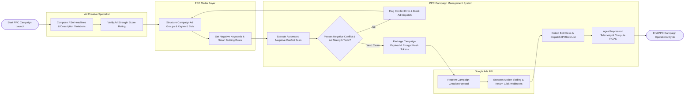

# Swimlane Diagram — PPC Campaign Management System

## Mermaid Code

## Flow Description | Mô tả luồng

| Lane | Actor | Role in Flow |
|------|-------|-------------|
| 1 | Ad Creative Specialist | Composes Responsive Search Ad (RSA) headlines and descriptions, verifies Ad Strength ratings, and configures ad extension assets. |
| 2 | PPC Media Buyer | Structures search/display campaigns, assigns keyword match types, configures negative keyword lists, and sets Smart Bidding strategy rules (Target CPA/ROAS). |
| 3 | PPC Campaign Management System | Executes automated negative keyword conflict scans, validates Ad Strength thresholds, packages campaign API dispatches, detects click fraud bot activity, pushes IP exclusions, and computes real-time ROAS metrics. |
| 4 | Google Ads API | Ingests campaign structure payloads, executes auction bidding for search queries, dispatches ad impressions, and streams click/cost/conversion telemetry webhooks back to the system. |
