# Action Tree — PPC Campaign Management System

## Mermaid Code

```mermaid
graph TD
    Root["PPC Campaign Management System"]

    Root --> M1["Campaign Structure & Match Type Management"]
    Root --> M2["RSA Creative Building & Ad Strength QA"]
    Root --> M3["Smart Bidding & Algorithmic Optimization"]
    Root --> M4["Negative Keyword Conflict Resolution"]
    Root --> M5["Click Fraud Protection & IP Exclusion"]
    Root --> M6["Attribution Analytics & Budget Pacing"]

    M1 --> A11["Structure Search, Display & Shopping Campaigns"]
    M1 --> A12["Manage Exact, Phrase & Broad Keyword Bids"]
    M1 --> A13["Sync Google Merchant Center Product Catalog Feeds"]
    M1 --> A14["Configure Geo-Location & Device Bid Adjustments"]

    M2 --> A21["Compose Responsive Search Ads (RSA) Headlines & Copy"]
    M2 --> A22["Evaluate Real-Time Google Ad Strength Ratings"]
    M2 --> A23["Attach Sitelink, Callout & Image Ad Extensions"]
    M2 --> A24["Insert Dynamic Keyword Insertion (DKI) Snippets"]

    M3 --> A31["Configure Target ROAS & Target CPA Smart Bidding Rules"]
    M3 --> A32["Enforce Maximum CPC Bid Limit Overrun Caps"]
    M3 --> A33["Track Keyword Quality Scores (1-10) & Search Lost IS"]
    M3 --> A34["Schedule Automated Dayparting Bidding Rules"]

    M4 --> A41["Compile Account & Campaign-Level Negative Lists"]
    M4 --> A42["Scan for Negative Keyword Conflicts with Positive Bids"]
    M4 --> A43["Add Negative Keywords directly from Search Query Reports"]
    M4 --> A44["Dispatch Negative Lists to Google & Bing Ads APIs"]

    M5 --> A51["Analyze Ad Click Telemetry for Bot & Scraper Heuristics"]
    M5 --> A52["Calculate Invalid Click Risk Scores & Fraud Alerts"]
    M5 --> A53["Push Blocked IP Address Exclusion Lists to Google Ads API"]
    M5 --> A54["Submit Automated Refund Claims for Fraudulent Clicks"]

    M6 --> A61["Upload Offline CRM Conversions with Google Click ID (gclid)"]
    M6 --> A62["Calculate Return on Ad Spend (ROAS) & Customer Acquisition Cost (CAC)"]
    M6 --> A63["Monitor Daily Spend Pacing against Monthly Budget Caps"]
    M6 --> A64["Export Unified Google Ads, Bing Ads & Meta Ads Reports"]
```

## Module Description | Mô tả Module

| # | Module | Description | Actions |
|---|--------|-------------|---------|
| 1 | Campaign Structure & Match Type Management | Manages search/display/shopping structures, keyword match types (Exact/Phrase/Broad), product feeds, and bid adjustments. | Structure PPC Campaigns, Manage Keyword Match Bids, Sync Merchant Center Product Feeds, Configure Geo-Location Bid Adjustments. |
| 2 | RSA Creative Building & Ad Strength QA | Composes Responsive Search Ads (RSA), evaluates Ad Strength scores, attaches ad extensions, and inserts Dynamic Keyword Insertion (DKI). | Compose RSA Headlines & Copy, Evaluate Ad Strength Ratings, Attach Sitelink & Image Extensions, Insert Dynamic Keyword Snippets. |
| 3 | Smart Bidding & Algorithmic Optimization | Configures Target ROAS/CPA bidding rules, enforces maximum CPC limits, monitors Quality Scores, and sets dayparting schedules. | Configure Target ROAS & Target CPA Rules, Enforce Max CPC Limits, Track Quality Scores, Schedule Dayparting Bidding. |
| 4 | Negative Keyword Conflict Resolution | Compiles negative keyword lists, scans for conflicts with positive target keywords, adds negative search terms, and dispatches lists. | Compile Negative Keyword Lists, Scan for Negative Conflicts, Add Negatives from Search Reports, Dispatch Negative Lists to APIs. |
| 5 | Click Fraud Protection & IP Exclusion | Analyzes click heuristics for bot fraud, calculates invalid click risk scores, dispatches IP exclusion lists, and requests refund claims. | Analyze Click Telemetry for Bot Fraud, Calculate Invalid Click Scores, Push Blocked IP Exclusion Lists, Submit Fraud Refund Claims. |
| 6 | Attribution Analytics & Budget Pacing | Uploads offline CRM conversions (`gclid`), calculates ROAS % and CAC, tracks monthly budget pacing, and exports cross-channel reports. | Upload Offline CRM Conversions (`gclid`), Calculate ROAS & CAC Metrics, Monitor Monthly Budget Pacing, Export Paid Media Reports. |
