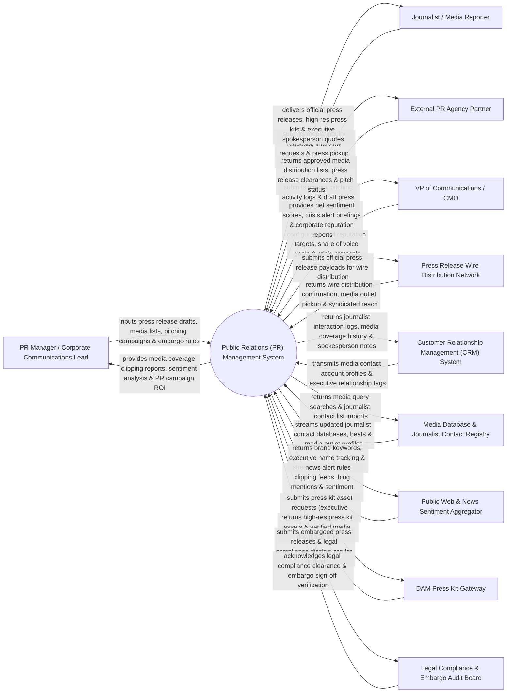

# Context Diagram — Public Relations (PR) Management System

## Mermaid Code

## Actor & Interaction Table | Bảng Actor & Tương tác

| # | Actor | Actor Type | Data Sent TO System | Data Received FROM System | Notes |
|---|-------|------------|---------------------|---------------------------|-------|
| 1 | PR Manager / Corporate Communications Lead | Primary | Press release drafts, journalist media lists, pitch email campaigns, embargo date/time rules. | Media coverage clipping reports, net sentiment analysis, press release wire analytics, PR ROI scorecards. | PR professional managing corporate announcements, pitching journalists, and tracking media coverage. |
| 2 | Journalist / Media Reporter | Primary | Media inquiry requests, interview booking requests, article publication feedback, quote verification. | Official press releases, embargoed media alerts, high-res press kits, executive spokesperson bios. | External journalist or editor receiving press pitches, downloading media kits, and covering brand stories. |
| 3 | External PR Agency Partner | Primary | Agency pitching activity logs, media outreach notes, draft press release submissions. | Approved media distribution lists, press release clearance badges, media coverage pickup counts. | External agency partner managing media relations and pitching on behalf of the corporate brand. |
| 4 | VP of Communications / CMO | Primary | Brand reputation targets, Share of Voice (SOV) goals, corporate crisis escalation playbooks. | Net sentiment scores, crisis alert briefings, global media coverage heatmaps, executive reputation reports. | Executive evaluating corporate reputation, media reach, and crisis communications performance. |
| 5 | Press Release Wire Distribution Network | Supporting | Wire distribution confirmation receipts, syndicated media outlet pickup counts, reader impressions. | Official press release payloads (PR Newswire / BusinessWire), distribution distribution category tags. | Commercial wire service distributing press releases to newsrooms, financial portals, and search engines. |
| 6 | Customer Relationship Management (CRM) System | Supporting | Enterprise media contact account profiles, key relationship tags, past corporate interaction notes. | Journalist interaction logs, published media coverage histories, spokesperson briefing notes. | Enterprise CRM synchronizing media contact relationships and tracking key journalist profiles. |
| 7 | Media Database & Journalist Contact Registry | Supporting | Updated journalist contact databases (Cision, Meltwater), media outlet beats, contact email addresses. | Media query searches, target journalist contact imports, media list segment requests. | Media database API supplying verified journalist contact information, media outlets, and topical beats. |
| 8 | Public Web & News Sentiment Aggregator | Supporting | Online news clipping feeds, trade publication articles, blog mentions, NLP sentiment scores. | Brand keyword queries, executive spokesperson tracking parameters, crisis news alert rules. | News aggregator monitoring online publications and classifying brand mention sentiment in real time. |
| 9 | Digital Asset Management (DAM) Press Kit Gateway | Supporting | High-res executive headshots, vector brand logos, product b-roll videos, dynamic press kit links. | Press kit asset request payloads, asset permission checks, media download telemetry. | DAM integration supplying high-res media kits and executive headshots to journalists. |
| 10 | Legal Compliance & Embargo Audit Board | Supporting / Regulatory | SEC Fair Disclosure (Reg FD) rules, legal compliance sign-offs, embargo non-disclosure policies. | Embargoed press release drafts, financial disclosure review files, legal clearance verification tokens. | Internal legal board ensuring press releases comply with financial disclosure laws and embargo rules. |

## System Boundary Description | Mô tả Phạm vi Hệ thống

The **Public Relations (PR) Management System** is an enterprise media relations, press release distribution, journalist CRM, media coverage clipping, and sentiment analysis platform designed to build corporate reputation and manage media coverage.

**Inside System Scope:**
- Media Database & Journalist CRM managing journalist profiles, topical beats, pitch histories, and contact preferences.
- Press Release Creator & Embargo Engine managing legal sign-offs, embargo timers, and wire network distribution (PR Newswire).
- Personalized Journalist Pitching Engine sending targeted email pitches with open/click tracking.
- Automated Media Clipping & Sentiment Analysis aggregating online news coverage, AVE (Advertising Value Equivalency), and sentiment.
- Interactive Online Press Room hosting downloadable media kits, executive bios, and press release archives.

**Outside System Scope:**
- Direct physical hosting of TV broadcast news studios (handled by Broadcast Networks).
- Direct physical printing of daily newspapers (handled by Newspaper Publishing Companies).
- Direct legal representation for corporate SEC lawsuits (handled by External Corporate Law Firms).
