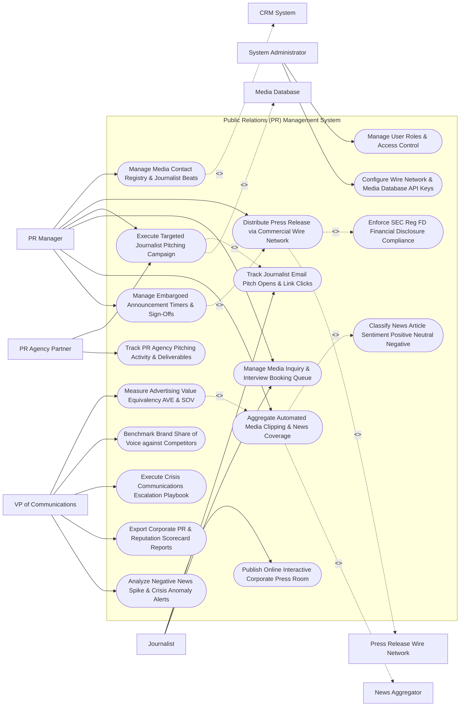

# Use Case Diagram — Public Relations (PR) Management System

## Mermaid Code

## Actor Table | Bảng Actor

| # | Actor | Actor Type | Role Description | Related Use Cases |
|---|-------|------------|------------------|-------------------|
| 1 | PR Manager | Primary | Corporate communications lead drafting press releases, managing media lists, executing email pitches, and tracking clipping. | UC01, UC02, UC05, UC07, UC08, UC12 |
| 2 | Journalist | Primary | Media reporter receiving pitches, accessing the online press room, booking interviews, and reading press releases. | UC04, UC06, UC07 |
| 3 | PR Agency Partner | Primary | External agency managing pitching campaigns and logging outreach deliverables. | UC05, UC14 |
| 4 | VP of Communications | Primary | Executive evaluating Advertising Value Equivalency (AVE), Share of Voice (SOV), crisis playbooks, and PR ROI. | UC10, UC11, UC13, UC15, UC18 |
| 5 | System Administrator | Primary | IT admin managing user security roles, wire network API credentials, and media database tokens. | UC16, UC17 |
| 6 | Press Release Wire Network | System (Secondary) | Wire distribution network (PR Newswire/BusinessWire) distributing official releases to newsrooms. | UC02 |
| 7 | News Aggregator | System (Secondary) | Media monitoring engine scraping web news articles, trade publications, and classifying sentiment. | UC08 |
| 8 | Media Database | System (Secondary) | Journalist contact registry (Cision/Meltwater) supplying updated contact profiles and beats. | UC05 |
| 9 | CRM System | System (Secondary) | Enterprise CRM synchronizing media contact relationships and spokesperson briefing notes. | UC01 |

## Use Case Table | Bảng Use Case

| # | UC ID | Use Case Name | Primary Actor | Secondary Actor | Description | Priority |
|---|-------|---------------|---------------|-----------------|-------------|----------|
| 1 | UC01 | Manage Media Contact Registry & Journalist Beats | PRManager | CRM System | Centralizes journalist profiles, publication outlets, topical beats, pitch preferences, and outreach notes. | Critical |
| 2 | UC02 | Distribute Press Release via Commercial Wire Network | PRManager | Wire Network | Formats and transmits official press releases to commercial wire services (PR Newswire / BusinessWire). | Critical |
| 3 | UC03 | Enforce SEC Reg FD Financial Disclosure Compliance | System | None | Verifies financial press releases meet SEC Regulation Fair Disclosure rules for simultaneous public release. | Critical |
| 4 | UC04 | Publish Online Interactive Corporate Press Room | Journalist | None | Hosts a web-based press room featuring press release archives, downloadable media kits, and spokesperson bios. | High |
| 5 | UC05 | Execute Targeted Journalist Pitching Campaign | PRManager | MediaDB | Dispatches personalized 1-to-1 email pitches to selected journalist media lists based on topical beats. | Critical |
| 6 | UC06 | Track Journalist Email Pitch Opens & Link Clicks | Journalist | None | Tracks open rates, link clicks, and press kit downloads for individual journalist email pitches. | High |
| 7 | UC07 | Manage Media Inquiry & Interview Booking Queue | PRManager | None | Routes incoming journalist media inquiries, manages executive spokesperson availability, and schedules interviews. | High |
| 8 | UC08 | Aggregate Automated Media Clipping & News Coverage | PRManager | News Aggregator | Scrapes online news sites, trade magazines, and blogs to automatically aggregate brand news clippings. | Critical |
| 9 | UC09 | Classify News Article Sentiment Positive Neutral Negative | System | News Aggregator | Uses NLP sentiment analysis to classify aggregated news clippings as Positive, Neutral, or Negative. | High |
| 10 | UC10 | Measure Advertising Value Equivalency AVE & SOV | VPComms | None | Computes Advertising Value Equivalency ($\text{AVE} = \text{Ad Rate} \times \text{Article Size}$) and Share of Voice (SOV). | Critical |
| 11 | UC11 | Benchmark Brand Share of Voice against Competitors | VPComms | None | Compares media mention volume, reach, and sentiment against key industry competitors. | High |
| 12 | UC12 | Manage Embargoed Announcement Timers & Sign-Offs | PRManager | None | Enforces strict media embargo timers (e.g., "Embargoed until Oct 30 at 09:00 AM EST") and legal sign-offs. | Critical |
| 13 | UC13 | Execute Crisis Communications Escalation Playbook | VPComms | None | Activates pre-approved crisis response templates, executive notification escalation, and dark site landing pages. | High |
| 14 | UC14 | Track PR Agency Pitching Activity & Deliverables | Agency | None | Tracks outreach activity, coverage secured, and campaign progress submitted by external PR agencies. | High |
| 15 | UC15 | Export Corporate PR & Reputation Scorecard Reports | VPComms | None | Renders executive scorecards detailing total media clips, total impressions, AVE generated, and net sentiment. | High |
| 16 | UC16 | Manage User Roles & Access Control | Admin | None | Controls user login credentials, RBAC permissions, and press release distribution authorization. | High |
| 17 | UC17 | Configure Wire Network & Media Database API Keys | Admin | None | Configures API connection parameters for PR Newswire, Cision, Meltwater, and BusinessWire. | High |
| 18 | UC18 | Analyze Negative News Spike & Crisis Anomaly Alerts | VPComms | None | Dispatches urgent SMS/email notifications when negative media sentiment spikes $> 25\%$ within 4 hours. | High |

## Use Case Specification | Đặc tả Use Case

---

### UC02 — Distribute Press Release via Commercial Wire Network

| Field | Detail |
|-------|--------|
| **UC ID** | UC02 |
| **Use Case Name** | Distribute Press Release via Commercial Wire Network |
| **Actor(s)** | Primary: PR Manager / Corporate Communications Lead   Secondary: Press Release Wire Distribution Network (PR Newswire / BusinessWire) |
| **Description** | Formats, validates legal sign-offs, and dispatches official corporate press releases to commercial wire services for global syndication to newsrooms, financial portals, and search engines. |
| **Precondition** | 1. Press release draft is approved by Legal and C-suite.   2. PR Newswire / BusinessWire API account credentials are active. |
| **Main Flow** | 1. User opens "Press Release Distribution Console".   2. User selects Approved Press Release: `ACME Cloud Launches AI Security Platform (ID: #PR-402)`.   3. User configures Distribution Parameters:   &nbsp;&nbsp;&nbsp;&nbsp; a. Target Wire Circuit: `US National + Tech Trade Wire`.   &nbsp;&nbsp;&nbsp;&nbsp; b. Distribution Date & Time: `Immediate Distribution (Oct 30, 2026 at 09:00 AM EST)`.   &nbsp;&nbsp;&nbsp;&nbsp; c. Multimedia Assets: Attaches 1 Vector Logo PDF + 1 Executive Headshot Image (from DAM).   &nbsp;&nbsp;&nbsp;&nbsp; d. Industry Categorization: `Software / Cybersecurity / Cloud Computing`.   4. System executes UC03 (Enforce SEC Reg FD Financial Disclosure Compliance):   &nbsp;&nbsp;&nbsp;&nbsp; a. Checks material financial disclosure flag: Contains material earnings data -> Enforces simultaneous public wire distribution.   5. User clicks "Transmit Press Release to Wire Network".   6. System transmits HTTPS REST API payload to PR Newswire API endpoint.   7. PR Newswire API accepts release, returns Confirmation ID `PRN-88412-US`, and syndicates release to 4,500 newsrooms and financial portals (Yahoo Finance, Bloomberg, MarketWatch).   8. System updates press release status to `DISTRIBUTED_LIVE` and begins tracking wire pickup. |
| **Alternative Flow** | **AF1** — Scheduled Embargo Wire Dispatch: Press release is scheduled for future release; System transmits payload to wire network with instructions to hold and release at `Oct 30 at 06:00 AM EST`. |
| **Exception Flow** | **EX1** — Missing Legal Sign-Off Error: Press release lacks mandatory Legal Compliance sign-off tag; System blocks wire transmission, displaying error "Legal Approval Required prior to Wire Distribution". |
| **Postcondition** | Press release is transmitted to commercial wire network, syndicated across newsrooms, and status updates to live. |
| **Business Rule** | **BR1**: Press releases containing material financial information MUST enforce simultaneous public distribution via wire networks to comply with SEC Reg FD. |

---

### UC05 — Execute Targeted Journalist Pitching Campaign

| Field | Detail |
|-------|--------|
| **UC ID** | UC05 |
| **Use Case Name** | Execute Targeted Journalist Pitching Campaign |
| **Actor(s)** | Primary: PR Manager, External PR Agency Partner   Secondary: Media Database & Journalist Contact Registry |
| **Description** | Builds targeted media lists based on journalist beats and dispatches personalized 1-to-1 email pitches with open/click tracking to secure media coverage. |
| **Precondition** | 1. Journalist media list is compiled from Cision/Meltwater database (UC01).   2. Approved pitch email template and media assets are ready. |
| **Main Flow** | 1. User opens "Journalist Pitching Studio".   2. User selects Target Media List: `Cybersecurity Tech Editors (150 Verified Contacts)`.   3. User configures Pitch Email Template:   &nbsp;&nbsp;&nbsp;&nbsp; a. Subject Line: `"Exclusive: ACME Cloud unveils sub-second AI threat detection"`.   &nbsp;&nbsp;&nbsp;&nbsp; b. Personalization Tokens: `{{journalist_first_name}}`, `{{media_outlet_name}}`.   &nbsp;&nbsp;&nbsp;&nbsp; c. Pitch Body: Personal pitch note highlighting why the story fits their recent beat covering cloud security.   &nbsp;&nbsp;&nbsp;&nbsp; d. Attached Press Kit Link: Tracked link to dynamic press kit page (`press.company.com/pk/ai-security`).   4. User clicks "Send Personalized Pitch Campaign".   5. System processes 150 individual 1-to-1 email dispatches, inserting custom personalization tokens (e.g., *"Hi Sarah, saw your recent article in TechCrunch..."*).   6. System attaches unique clickstream tracking tokens to each journalist email link.   7. System begins tracking UC06 (Track Journalist Email Pitch Opens & Link Clicks):   &nbsp;&nbsp;&nbsp;&nbsp; a. Journalist Sarah opens email at 10:15 AM -> `PITCH_OPENED`.   &nbsp;&nbsp;&nbsp;&nbsp; b. Journalist Sarah clicks Press Kit Link at 10:16 AM -> `PRESS_KIT_CLICKED`.   8. System alerts PR Manager: *"HOT MEDIA PITCH: Sarah Jenkins (TechCrunch) opened your pitch and downloaded the press kit"*. |
| **Alternative Flow** | **AF1** — Exclusive Media Embargo Offer: User sends exclusive embargo pitch to 1 tier-1 journalist offering a 24-hour head start interview before public wire distribution. |
| **Exception Flow** | **EX1** — Bounced Journalist Email Handling: Email to journalist bounces (`550 User Unknown`); System flags contact as `INACTIVE_EMAIL` in CRM and dispatches query to Cision API to update contact info. |
| **Postcondition** | Personalized 1-to-1 pitches are dispatched to journalists, open/click telemetry is tracked, and hot media leads trigger alerts. |
| **Business Rule** | **BR1**: Journalist pitches MUST be sent as individual 1-to-1 personalized communications rather than mass BCC mailings. |

---

### UC08 — Aggregate Automated Media Clipping & News Coverage

| Field | Detail |
|-------|--------|
| **UC ID** | UC08 |
| **Use Case Name** | Aggregate Automated Media Clipping & News Coverage |
| **Actor(s)** | Primary: PR Manager / Corporate Communications Lead   Secondary: Public Web & News Sentiment Aggregator |
| **Description** | Continuously monitors and scrapes online news sites, trade magazines, blogs, and broadcast transcripts to automatically capture, archive, and analyze brand media clippings. |
| **Precondition** | 1. Brand keywords (`"ACME Cloud"`, `"ACME Security"`, Executive names) are configured.   2. Web scraping news aggregator API (Meltwater/Cision) is active. |
| **Main Flow** | 1. System receives continuous news feed stream from News Sentiment Aggregator API.   2. System scans incoming news articles for configured brand keywords.   3. System detects new media article mention:   &nbsp;&nbsp;&nbsp;&nbsp; a. Outlet Name: `TechCrunch`.   &nbsp;&nbsp;&nbsp;&nbsp; b. Article Title: `"ACME Cloud Launches Breakthrough AI Cybersecurity Platform"`.   &nbsp;&nbsp;&nbsp;&nbsp; c. Author: `Sarah Jenkins`.   &nbsp;&nbsp;&nbsp;&nbsp; d. Publication Date: `Oct 30, 2026 at 11:30 AM EST`.   &nbsp;&nbsp;&nbsp;&nbsp; e. Monthly Unique Visitors (MUV): `25,000,000 MUV`.   4. System captures full article text, extracts full web screenshot, and archives clipping in DAM.   5. System executes UC09 (Classify News Article Sentiment):   &nbsp;&nbsp;&nbsp;&nbsp; a. NLP Sentiment Classifier evaluates text -> `94% Positive Sentiment` (Category: `POSITIVE_COVERAGE`).   6. System links clipping to PR Pitch Campaign `Cybersecurity Tech Editors`.   7. System updates Global Media Coverage Clipping Book and sends real-time notification to PR Manager: *"New Tier-1 Coverage Secured: TechCrunch published article on ACME Cloud"*. |
| **Alternative Flow** | **AF1** — Broadcast TV/Radio Transcript Clipping: News aggregator detects TV broadcast mention on CNBC; System ingests closed-caption text transcript and 30-second video clip into media database. |
| **Exception Flow** | **EX1** — Duplicate Article Syndication Removal: System detects 40 identical republished copies of a wire release across syndicated content sites; System groups copies under 1 master wire clip to prevent metric inflation. |
| **Postcondition** | Online news article is captured, archived, classified for sentiment, linked to pitch campaign, and added to the media clipping book. |
| **Business Rule** | **BR1**: Automated news clipping MUST capture full article text, outlet MUV reach, and visual screenshot baselines for every media mention. |

---

### UC10 — Measure Advertising Value Equivalency (AVE) & SOV

| Field | Detail |
|-------|--------|
| **UC ID** | UC10 |
| **Use Case Name** | Measure Advertising Value Equivalency (AVE) & SOV |
| **Actor(s)** | Primary: VP of Communications, Chief Marketing Officer   Secondary: None |
| **Description** | Computes Advertising Value Equivalency ($\text{AVE} = \text{Equivalent Ad Cost} \times \text{Multiplier}$) and Share of Voice (SOV) to measure the financial value and market share of earned media coverage. |
| **Precondition** | 1. Media clippings and outlet Monthly Unique Visitors (MUV) are aggregated (UC08).   2. Advertising rate cards for target publications are configured. |
| **Main Flow** | 1. User opens "PR ROI & Share of Voice Analytics Console".   2. User selects Campaign: `Q3 2026 Product Launch` and Date Range: `Last 30 Days`.   3. System retrieves Media Clipping Portfolio:   &nbsp;&nbsp;&nbsp;&nbsp; a. Total Media Clips Secured: `85 Published Articles`.   &nbsp;&nbsp;&nbsp;&nbsp; b. Total Estimated Impressions: `45,000,000 Potential Readers`.   &nbsp;&nbsp;&nbsp;&nbsp; c. Outlets Breakdown: `12 Tier-1 Outlets (TechCrunch, Forbes, WSJ)`, `40 Trade Outlets`, `33 Blogs`.   4. System calculates Advertising Value Equivalency (AVE) for each clip:   &nbsp;&nbsp;&nbsp;&nbsp; a. TechCrunch Full Article Ad Rate Equivalent: `$35,000.00`.   &nbsp;&nbsp;&nbsp;&nbsp; b. Forbes Mention Ad Rate Equivalent: `$20,000.00`.   &nbsp;&nbsp;&nbsp;&nbsp; c. Total Standard Ad Value ($AV$): `$150,000.00`.   &nbsp;&nbsp;&nbsp;&nbsp; d. Earned PR Multiplier ($M$): `3.0x Multiplier` (Earned media holds 3x higher credibility than paid ads).   5. System calculates Total Earned Media AVE:   $$\text{Total AVE} = \text{Standard Ad Value} \times \text{Earned Multiplier} = \$150,000 \times 3.0 = \$450,000.00 \text{ AVE}$$   6. System calculates Share of Voice (SOV) % vs Top 3 Competitors:   $$\text{SOV} = \frac{\text{Brand Mentions (450)}}{\text{Total Industry Mentions (1,000)}} \times 100\% = 45.0\% \text{ Share of Voice}$$   7. System renders Competitive SOV Donut Chart and exports executive PR ROI briefing PDF. |
| **Alternative Flow** | **AF1** — Sentiment-Weighted AVE Adjustment: System applies sentiment penalty to negative articles (Negative Clip AVE = $0.00$), ensuring negative press does not contribute positive AVE. |
| **Exception Flow** | **EX1** — Missing Publication Ad Rate: Publication has no listed ad rate card; System estimates ad value using standard CPM formula ($\text{MUV} \times \$0.02 \text{ CPM}$). |
| **Postcondition** | Advertising Value Equivalency (AVE), total potential reader impressions, and Share of Voice (SOV) % are calculated and rendered on executive scorecards. |
| **Business Rule** | **BR1**: Negative media coverage MUST be assigned an AVE value of $0.00 to prevent negative news from inflating PR performance metrics. |

---

### UC12 — Manage Embargoed Announcement Timers & Sign-Offs

| Field | Detail |
|-------|--------|
| **UC ID** | UC12 |
| **Use Case Name** | Manage Embargoed Announcement Timers & Sign-Offs |
| **Actor(s)** | Primary: PR Manager / Corporate Communications Lead   Secondary: Legal Compliance & Embargo Audit Board |
| **Description** | Manages strict media embargo timers (e.g., "Embargoed for publication until Oct 30 at 09:00 AM EST"), enforcing legal non-disclosure sign-offs and automated wire/press room publication triggers. |
| **Precondition** | 1. Press release draft is categorized as embargoed.   2. Embargo date, time, and timezone are set. |
| **Main Flow** | 1. PR Manager opens "Embargo Management Studio".   2. Manager configures Embargo Parameters for `Acquisition Announcement`:   &nbsp;&nbsp;&nbsp;&nbsp; a. Embargo Expiration Timestamp: `October 30, 2026 at 09:00:00 AM EST`.   &nbsp;&nbsp;&nbsp;&nbsp; b. Legal Sign-Off Verification: `Legal Clearance Token #LEG-88412 Active`.   3. Manager prepares Embargoed Media Pitch for Tier-1 Journalists.   4. System attaches prominent Embargo Header to all outgoing preview pitches:   &nbsp;&nbsp;&nbsp;&nbsp; a. Header Banner: `"STRICT MEDIA EMBARGO: NOT FOR PUBLICATION OR BROADCAST BEFORE OCT 30, 2026 AT 09:00 AM EST"`.   &nbsp;&nbsp;&nbsp;&nbsp; b. Digital Agreement: Requires journalist to click "I Agree to Embargo Terms" before opening full press release text.   5. System starts automated Embargo Countdown Timer in database.   6. At `October 30, 2026 at 09:00:00 AM EST` (Timer Hits 00:00:00):   &nbsp;&nbsp;&nbsp;&nbsp; a. System automatically publishes press release to Corporate Press Room (UC04).   &nbsp;&nbsp;&nbsp;&nbsp; b. System triggers wire network distribution payload (UC02).   &nbsp;&nbsp;&nbsp;&nbsp; c. System sends automated email update to pitched journalists: *"EMBARGO LIFTED: You may now publish your coverage"*.   7. System logs successful embargo execution audit trail. |
| **Alternative Flow** | **AF1** — Early Embargo Lift Emergency Execution: Competitor leaks news early; PR Manager clicks "Lift Embargo Immediately"; System immediately lifts embargo restrictions and triggers wire distribution. |
| **Exception Flow** | **EX1** — Embargo Breach / Leak Detection: A blog breaks embargo 2 hours early; System flags "EMBARGO BREACH DETECTED", alerts PR Manager, and immediately lifts embargo for all other journalists. |
| **Postcondition** | Embargo terms are enforced on pitches, countdown timer runs, and automated multi-channel publication triggers when embargo lifts. |
| **Business Rule** | **BR1**: Embargoed press releases MUST require explicit journalist digital agreement before granting access to full announcement text. |
