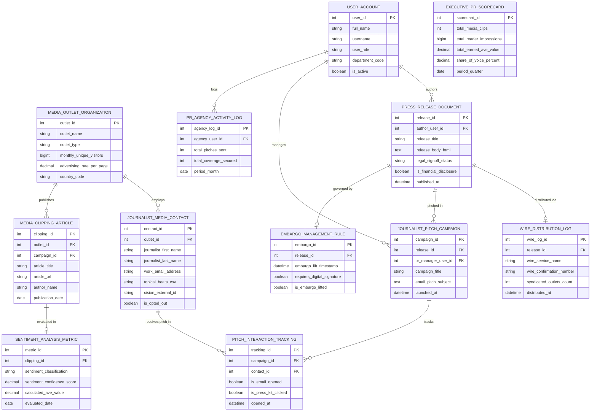

# Conceptual ERD — Public Relations (PR) Management System

## Mermaid Code

## Entity Description Table | Bảng mô tả Entity

| # | Entity Name | Vietnamese Name | Description | Key Attributes | Main Relationships |
|---|-------------|-----------------|-------------|----------------|-------------------|
| 1 | USER_ACCOUNT | Tài khoản Nguời dùng | System credentials and access roles for PR managers, agency partners, VP of Comms, and admins. | `user_id`, `username`, `user_role`, `department_code` | Authors `PRESS_RELEASE_DOCUMENT`, manages `JOURNALIST_PITCH_CAMPAIGN`, logs `PR_AGENCY_ACTIVITY_LOG`. |
| 2 | JOURNALIST_MEDIA_CONTACT | Contact Nhà báo Media | Journalist contact profile storing first/last name, work email, topical beats, Cision ID, and opt-out status. | `contact_id`, `outlet_id`, `journalist_first_name`, `work_email_address`, `topical_beats_csv`, `is_opted_out` | Belongs to `MEDIA_OUTLET_ORGANIZATION`, receives pitch in `PITCH_INTERACTION_TRACKING`. |
| 3 | MEDIA_OUTLET_ORGANIZATION | Tòa soạn Cơ quan Báo chí | Media publication entity storing outlet name, outlet type (Print/Online/Broadcast), monthly unique visitors (MUV), and ad rates. | `outlet_id`, `outlet_name`, `outlet_type`, `monthly_unique_visitors`, `advertising_rate_per_page` | Employs `JOURNALIST_MEDIA_CONTACT`, publishes `MEDIA_CLIPPING_ARTICLE`. |
| 4 | PRESS_RELEASE_DOCUMENT | Văn bản Thông cáo Báo chí | Master press release document storing title, HTML body, legal sign-off status, and SEC Reg FD financial disclosure flags. | `release_id`, `author_user_id`, `release_title`, `legal_signoff_status`, `is_financial_disclosure`, `published_at` | Distributed via `WIRE_DISTRIBUTION_LOG`, pitched in `JOURNALIST_PITCH_CAMPAIGN`, governed by `EMBARGO_MANAGEMENT_RULE`, authored by `USER_ACCOUNT`. |
| 5 | WIRE_DISTRIBUTION_LOG | Nhật ký Phân phối Wire | Commercial wire distribution log recording wire service names (PR Newswire), confirmation IDs, and syndicated outlet counts. | `wire_log_id`, `release_id`, `wire_service_name`, `wire_confirmation_number`, `syndicated_outlets_count` | Belongs to `PRESS_RELEASE_DOCUMENT`. |
| 6 | JOURNALIST_PITCH_CAMPAIGN | Chiến dịch Pitching Nhà báo | Targeted email pitch campaign header storing campaign title, email subject, launch timestamps, and PR manager ID. | `campaign_id`, `release_id`, `pr_manager_user_id`, `campaign_title`, `email_pitch_subject`, `launched_at` | Belongs to `PRESS_RELEASE_DOCUMENT`, tracks `PITCH_INTERACTION_TRACKING`, managed by `USER_ACCOUNT`. |
| 7 | PITCH_INTERACTION_TRACKING | Nhật ký Tương tác Pitching | Pitch interaction tracking record logging email opens, press kit link clicks, and timestamps per journalist. | `tracking_id`, `campaign_id`, `contact_id`, `is_email_opened`, `is_press_kit_clicked`, `opened_at` | Relates `JOURNALIST_PITCH_CAMPAIGN` and `JOURNALIST_MEDIA_CONTACT`. |
| 8 | MEDIA_CLIPPING_ARTICLE | Bài báo Media Clipping | Scraped news article clipping record storing article title, URL, author name, and publication date. | `clipping_id`, `outlet_id`, `campaign_id`, `article_title`, `article_url`, `author_name`, `publication_date` | Belongs to `MEDIA_OUTLET_ORGANIZATION`, evaluated in `SENTIMENT_ANALYSIS_METRIC`. |
| 9 | SENTIMENT_ANALYSIS_METRIC | Chỉ số Sentiment & AVE | Media clipping evaluation metric storing sentiment classification (Positive/Neutral/Negative), confidence %, and calculated AVE $. | `metric_id`, `clipping_id`, `sentiment_classification`, `sentiment_confidence_score`, `calculated_ave_value` | Belongs to `MEDIA_CLIPPING_ARTICLE`. |
| 10 | EMBARGO_MANAGEMENT_RULE | Quy tắc Embargo Báo chí | Embargo management rule storing embargo lift timestamps, digital signature requirement flags, and lift status. | `embargo_id`, `release_id`, `embargo_lift_timestamp`, `requires_digital_signature`, `is_embargo_lifted` | Governs `PRESS_RELEASE_DOCUMENT`. |
| 11 | PR_AGENCY_ACTIVITY_LOG | Nhật ký Hoạt động Agency PR | External PR agency activity log tracking total pitches sent, coverage secured, and monthly deliverables. | `agency_log_id`, `agency_user_id`, `total_pitches_sent`, `total_coverage_secured`, `period_month` | Logged by `USER_ACCOUNT`. |
| 12 | EXECUTIVE_PR_SCORECARD | Scorecard Executive PR | Executive PR scorecard aggregating total media clips, reader impressions, total earned AVE, and Share of Voice %. | `scorecard_id`, `total_media_clips`, `total_reader_impressions`, `total_earned_ave_value`, `share_of_voice_percent` | Standalone executive performance entity. |

## Relationship Description | Mô tả Quan hệ

| # | From Entity | Cardinality | To Entity | Label | Business Explanation |
|---|-------------|-------------|-----------|-------|----------------------|
| 1 | MEDIA_OUTLET_ORGANIZATION | 1 to 1..N | JOURNALIST_MEDIA_CONTACT | employs | A media outlet organization employs multiple journalist media contacts. |
| 2 | MEDIA_OUTLET_ORGANIZATION | 1 to 0..N | MEDIA_CLIPPING_ARTICLE | publishes | A media outlet organization publishes online news clipping articles. |
| 3 | PRESS_RELEASE_DOCUMENT | 1 to 0..1 | WIRE_DISTRIBUTION_LOG | distributed via | A press release document is distributed via a commercial wire network log. |
| 4 | PRESS_RELEASE_DOCUMENT | 1 to 0..N | JOURNALIST_PITCH_CAMPAIGN | pitched in | A press release document is pitched in journalist pitch campaigns. |
| 5 | PRESS_RELEASE_DOCUMENT | 1 to 0..1 | EMBARGO_MANAGEMENT_RULE | governed by | A press release document is governed by an embargo management rule. |
| 6 | JOURNALIST_PITCH_CAMPAIGN | 1 to 0..N | PITCH_INTERACTION_TRACKING | tracks | A pitch campaign tracks 1-to-1 email opens and link clicks. |
| 7 | JOURNALIST_MEDIA_CONTACT | 1 to 0..N | PITCH_INTERACTION_TRACKING | receives pitch in | A journalist media contact receives email pitches in pitch interaction tracking. |
| 8 | MEDIA_CLIPPING_ARTICLE | 1 to 0..1 | SENTIMENT_ANALYSIS_METRIC | evaluated in | A media clipping article is evaluated for sentiment and calculated AVE value. |
| 9 | USER_ACCOUNT | 1 to 0..N | PRESS_RELEASE_DOCUMENT | authors | A PR manager user account authors press release documents. |
| 10 | USER_ACCOUNT | 1 to 0..N | JOURNALIST_PITCH_CAMPAIGN | manages | A PR manager user account manages journalist pitch campaigns. |
| 11 | USER_ACCOUNT | 1 to 0..N | PR_AGENCY_ACTIVITY_LOG | logs | An agency user account logs monthly PR pitching deliverables. |
