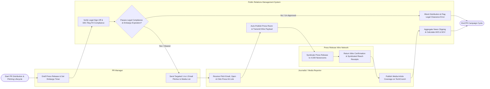

# Swimlane Diagram — Public Relations (PR) Management System

## Mermaid Code

## Flow Description | Mô tả luồng

| Lane | Actor | Role in Flow |
|------|-------|-------------|
| 1 | PR Manager | Drafts press releases, sets media embargo timers, obtains legal sign-offs, builds media lists, and sends personalized 1-to-1 email pitches to targeted journalists. |
| 2 | Journalist / Media Reporter | Receives email pitches, opens emails, clicks tracked press kit links, accesses the online press room, and publishes media coverage articles. |
| 3 | Public Relations Management System | Verifies legal sign-offs and SEC Reg FD compliance, enforces media embargo timers, publishes releases to the corporate press room upon embargo expiration, transmits payloads to wire networks, aggregates online news clippings, classifies sentiment, and calculates Advertising Value Equivalency (AVE). |
| 4 | Press Release Wire Network | Syndicates official press releases across 4,500 newsrooms, financial portals, and search engines (PR Newswire / BusinessWire), returning distribution receipts. |
