# Action Tree — Public Relations (PR) Management System

## Mermaid Code

```mermaid
graph TD
    Root["Public Relations (PR) Management System"]

    Root --> M1["Press Release Creation & SEC Compliance"]
    Root --> M2["Wire Distribution & Press Room Hosting"]
    Root --> M3["Journalist CRM & Media List Management"]
    Root --> M4["Targeted Pitching & Open/Click Tracking"]
    Root --> M5["Media Clipping & Sentiment Analysis"]
    Root --> M6["AVE Metrics & Executive Reputation Reports"]

    M1 --> A11["Draft Official Corporate Press Releases & Media Kit Assets"]
    M1 --> A12["Enforce SEC Regulation Fair Disclosure (Reg FD) Compliance"]
    M1 --> A13["Manage Media Embargo Expiration Timers & Digital Signatures"]
    M1 --> A14["Attach High-Res Executive Headshots & Vector Logos from DAM"]

    M2 --> A21["Transmit Press Release Payloads to PR Newswire & BusinessWire"]
    M2 --> A22["Publish Interactive Online Press Room Archives & Downloads"]
    M2 --> A23["Track Syndicated Newsroom & Financial Portal Distribution Reach"]
    M2 --> A24["Trigger Automated Wire Distribution upon Embargo Expiration"]

    M3 --> A31["Manage Journalist Profiles, Media Outlets & Topical Beats"]
    M3 --> A32["Import Verified Journalist Contacts from Cision & Meltwater APIs"]
    M3 --> A33["Sync Media Contact Account Histories to Salesforce CRM"]
    M3 --> A34["Route Media Inquiries & Schedule Spokesperson Interviews"]

    M4 --> A41["Dispatch Personalized 1-to-1 Email Pitches to Media Lists"]
    M4 --> A42["Track Journalist Pitch Email Open Rates & Press Kit Clicks"]
    M4 --> A43["Alert PR Managers on Hot Media Pitch Engagement Events"]
    M4 --> A44["Track External PR Agency Pitching Activity & Coverage Secured"]

    M5 --> A51["Scrape Online News Articles, Trade Magazines & Blogs"]
    M5 --> A52["Capture Full Article Text, Outlet MUV Reach & Web Screenshots"]
    M5 --> A53["Classify News Article Sentiment (Positive, Neutral, Negative)"]
    M5 --> A54["Filter Syndicated Wire Copies to Prevent Metric Inflation"]

    M6 --> A61["Calculate Advertising Value Equivalency (AVE = Ad Value * 3x)"]
    M6 --> A62["Calculate Competitive Share of Voice (SOV %) vs Industry Rivals"]
    M6 --> A63["Alert on Negative News Spikes (> 25% Negative in 4 Hours)"]
    M6 --> A64["Export Executive Corporate PR & Reputation Scorecard PDFs"]
```

## Module Description | Mô tả Module

| # | Module | Description | Actions |
|---|--------|-------------|---------|
| 1 | Press Release Creation & SEC Compliance | Drafts press releases, enforces SEC Reg FD financial disclosure compliance, manages embargo timers, and attaches DAM assets. | Draft Corporate Press Releases, Enforce SEC Reg FD Compliance, Manage Media Embargo Timers, Attach Executive Headshots & Logos from DAM. |
| 2 | Wire Distribution & Press Room Hosting | Transmits releases to PR Newswire, hosts online press rooms, tracks syndicated distribution, and triggers embargoed wire releases. | Transmit Payloads to PR Newswire, Publish Interactive Press Room, Track Syndicated Distribution Reach, Trigger Automated Wire Distribution. |
| 3 | Journalist CRM & Media List Management | Centralizes journalist profiles, imports Cision/Meltwater contacts, syncs CRM histories, and routes media inquiry interview requests. | Manage Journalist Profiles & Beats, Import Contacts from Cision/Meltwater, Sync Media Contacts to Salesforce CRM, Route Media Inquiries & Interviews. |
| 4 | Targeted Pitching & Open/Click Tracking | Dispatches 1-to-1 personalized email pitches, tracks email open/click telemetry, alerts on hot media leads, and tracks agency deliverables. | Dispatch 1-to-1 Email Pitches, Track Pitch Email Open Rates & Clicks, Alert on Hot Media Pitch Engagement, Track PR Agency Deliverables. |
| 5 | Media Clipping & Sentiment Analysis | Scrapes online news and blogs, captures screenshots and MUV reach, classifies NLP sentiment, and deduplicates syndicated wire copies. | Scrape Online News Articles, Capture Full Article Text & Screenshots, Classify News Article Sentiment, Filter Syndicated Wire Copies. |
| 6 | AVE Metrics & Executive Reputation Reports | Computes Advertising Value Equivalency (AVE), measures Share of Voice (SOV %), alerts on negative news spikes, and exports PR scorecards. | Calculate Advertising Value Equivalency (AVE), Calculate Share of Voice (SOV %), Alert on Negative News Spikes, Export Executive Corporate PR Scorecards. |
