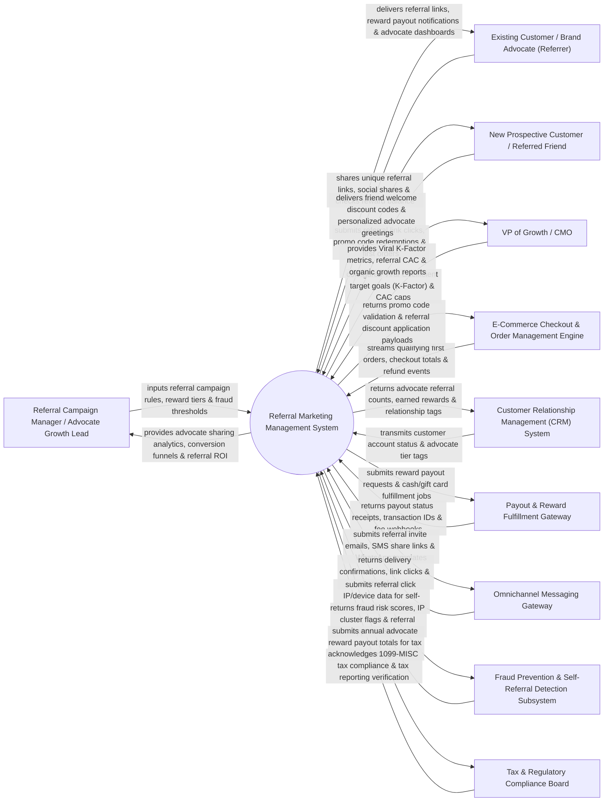

# Context Diagram — Referral Marketing Management System

## Mermaid Code

## Actor & Interaction Table | Bảng Actor & Tương tác

| # | Actor | Actor Type | Data Sent TO System | Data Received FROM System | Notes |
|---|-------|------------|---------------------|---------------------------|-------|
| 1 | Referral Campaign Manager / Advocate Growth Lead | Primary | Referral incentive rules (Give $20 / Get $20), reward tier thresholds, campaign duration, fraud detection rules. | Advocate sharing analytics, referral conversion funnels, reward payout ledgers, campaign ROI reports. | Growth marketer designing referral reward structures, managing advocate tiers, and tracking referral growth. |
| 2 | Existing Customer / Brand Advocate (Referrer) | Primary | Social media link shares, email invitation dispatches, reward withdrawal requests, advocate profile updates. | Unique referral links, advocate performance dashboards, earned reward balances, payout confirmation receipts. | Satisfied customer sharing personal referral links to invite friends and earn rewards. |
| 3 | New Prospective Customer / Referred Friend | Primary | Referral link clicks, welcome promo code redemptions, qualifying first order checkouts. | Personalized advocate greeting popups, friend welcome discount codes ($20 off), order confirmation. | New user receiving a referral link, redeeming a welcome discount, and placing their first order. |
| 4 | VP of Growth / CMO | Primary | Viral Coefficient target goals ($K\text{-Factor} > 1.0$), maximum referral CAC limits, campaign budget caps. | Viral $K\text{-Factor}$ metrics, referral CAC analysis, organic advocate growth trends, customer lifetime value. | Executive evaluating viral referral loops, advocate acquisition efficiency, and growth metrics. |
| 5 | E-Commerce Checkout & Order Management Engine | Supporting | First order completions, qualifying checkout totals, order cancellation/refund webhooks. | Referral promo code validation, friend discount application payloads, order qualification tokens. | Storefront engine validating referral promo codes at checkout and feeding order completion events. |
| 6 | Customer Relationship Management (CRM) System | Supporting | Customer account history, customer lifetime value (LTV) tiers, active account statuses. | Advocate referral counts, total rewards earned, advocate relationship tags (`BRAND_ADVOCATE_VIP`). | Enterprise CRM synchronizing advocate profile tags and tracking customer referral networks. |
| 7 | Payout & Reward Fulfillment Gateway | Supporting | Payout execution receipts, bank transaction IDs, gift card claim codes, transaction fee webhooks. | Automated cash payout requests (PayPal API), digital gift card dispatches (TangoCard API), Stripe account credits. | Payment gateway handling automated cash, store credit, or digital gift card reward dispatches. |
| 8 | Omnichannel Messaging Gateway | Supporting | Email/SMS delivery receipts, referral link click webhooks, social share confirmations. | Referral invite emails, SMS share text messages, WhatsApp share link templates. | Communication gateway executing referral invitation dispatches across email, SMS, and WhatsApp. |
| 9 | Fraud Prevention & Self-Referral Detection Subsystem | Supporting | Fraud risk scores, device fingerprint matches, IP address cluster flags, self-referral flags. | Referral click IP/device data, cookie tracking tokens, fraud verification queries. | Security engine detecting self-referrals, duplicate account creation, and referral fraud networks. |
| 10 | Tax & Regulatory Compliance Board | Supporting / Regulatory | Tax ID collection rules (IRS W-9 / 1099-MISC rules for payouts > $600/year), referral laws. | Annual advocate reward payout logs, tax threshold alert verification tokens. | Regulatory body governing financial payout tax reporting and referral marketing disclosure laws. |

## System Boundary Description | Mô tả Phạm vi Hệ thống

The **Referral Marketing Management System** is an enterprise customer referral, advocate reward fulfillment, viral growth analytics, and referral fraud prevention platform designed to harness word-of-mouth marketing and drive customer acquisition.

**Inside System Scope:**
- Dual-sided reward campaign builder (Give $X / Get $Y, Tiered Rewards, Milestone Rewards, Contest Leaderboards).
- Unique referral link generation (short URLs, QR codes, social share cards for WhatsApp, Facebook, X, Email).
- Real-time referral fraud detection identifying self-referrals, IP address matching, cookie manipulation, and fake account loops.
- Automated reward payout fulfillment integration (Store Credit, PayPal cash, TangoCard digital gift cards).
- Analytics tracking Viral Coefficient ($K\text{-Factor} = i \times c$), Advocate Sharing Rate %, Referral Conversion %, and 1099 tax reporting.

**Outside System Scope:**
- Direct physical shipping of purchased e-commerce products (handled by Warehouse & Logistics Systems).
- Direct manual processing of paper bank checks (handled by Corporate Banking Systems).
- Direct legal representation for trademark or referral law disputes (handled by Corporate Legal Counsel).
