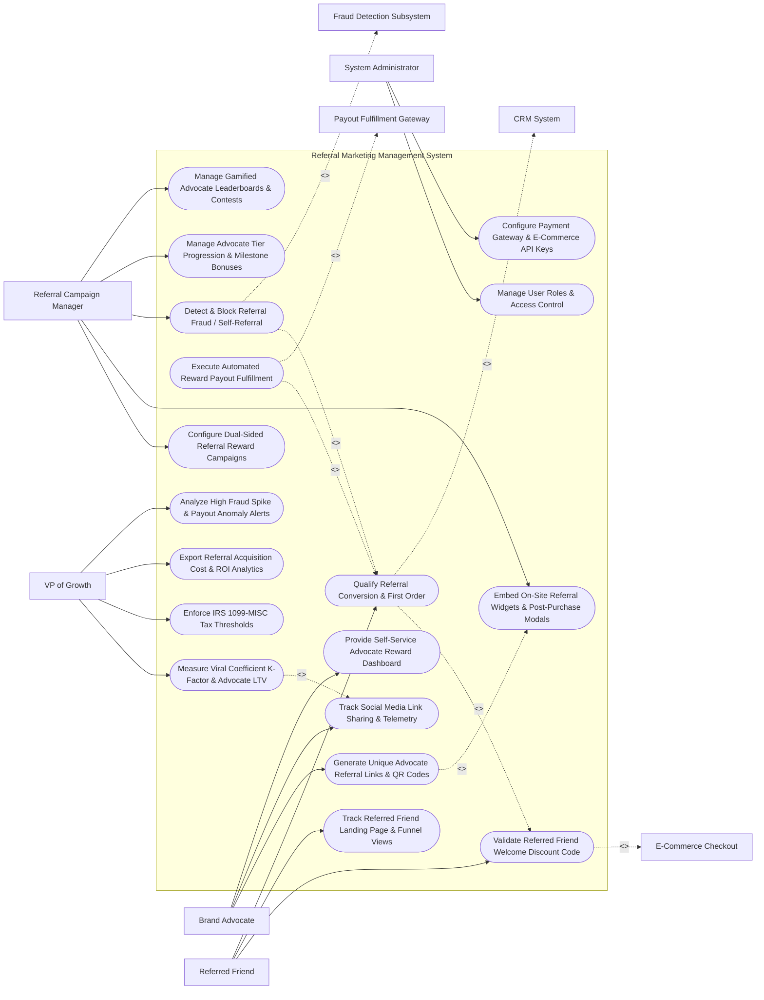

# Use Case Diagram — Referral Marketing Management System

## Mermaid Code

## Actor Table | Bảng Actor

| # | Actor | Actor Type | Role Description | Related Use Cases |
|---|-------|------------|------------------|-------------------|
| 1 | Referral Campaign Manager | Primary | Growth marketer configuring dual-sided rewards, on-site widgets, fraud rules, advocate tiers, and contests. | UC01, UC03, UC05, UC09, UC14 |
| 2 | Brand Advocate | Primary | Existing customer generating referral links, sharing on social channels, and checking earned reward balances. | UC02, UC04, UC11 |
| 3 | Referred Friend | Primary | New prospective buyer redeeming welcome discount codes, clicking referral links, and placing first orders. | UC06, UC07, UC08 |
| 4 | VP of Growth | Primary | Executive tracking Viral $K\text{-Factor}$, tax thresholds, referral CAC, and anomaly alerts. | UC12, UC13, UC15, UC18 |
| 5 | System Administrator | Primary | IT admin managing user security clearance roles, payment gateway keys, and e-commerce webhooks. | UC16, UC17 |
| 6 | E-Commerce Checkout | System (Secondary) | Storefront checkout engine validating referral promo codes and submitting first order completion webhooks. | UC06 |
| 7 | Payout Fulfillment Gateway | System (Secondary) | Payment gateway (PayPal, TangoCard, Stripe) fulfilling automated cash, store credit, or digital gift cards. | UC10 |
| 8 | Fraud Detection Subsystem | System (Secondary) | Security service evaluating IP clusters, device fingerprints, self-referral attempts, and fake account networks. | UC05 |
| 9 | CRM System | System (Secondary) | Enterprise CRM updating advocate profile tags, lifetime referral totals, and customer relationship tiers. | UC08 |

## Use Case Table | Bảng Use Case

| # | UC ID | Use Case Name | Primary Actor | Secondary Actor | Description | Priority |
|---|-------|---------------|---------------|-----------------|-------------|----------|
| 1 | UC01 | Configure Dual-Sided Referral Reward Campaigns | ReferralMgr | None | Defines dual-sided reward rules (e.g., Referrer gets $20 Cash, Friend gets $20 Off First Purchase). | Critical |
| 2 | UC02 | Generate Unique Advocate Referral Links & QR Codes | Referrer | None | Generates personalized referral short URLs (`ref.co/alex402`), social share cards, and mobile QR codes. | Critical |
| 3 | UC03 | Embed On-Site Referral Widgets & Post-Purchase Modals | ReferralMgr | None | Displays referral popups on order confirmation pages ("Share with a friend and earn $20"). | High |
| 4 | UC04 | Track Social Media Link Sharing & Telemetry | Referrer | None | Tracks share dispatches across WhatsApp, Email, Facebook, X, and records unique link click telemetry. | High |
| 5 | UC05 | Detect & Block Referral Fraud / Self-Referral | ReferralMgr | Fraud Engine | Evaluates referral clicks for IP address matching, device fingerprints, self-referral, and coupon fraud. | Critical |
| 6 | UC06 | Validate Referred Friend Welcome Discount Code | ReferredFriend | E-Commerce | Validates dynamic referral promo codes at e-commerce checkout, applying the friend's welcome discount. | Critical |
| 7 | UC07 | Track Referred Friend Landing Page & Funnel Views | ReferredFriend | None | Renders personalized landing pages ("Alex invited you! Take $20 off your first purchase") and tracks funnel steps. | High |
| 8 | UC08 | Qualify Referral Conversion & First Order | ReferredFriend | CRM System | Confirms qualifying first purchase completion, enforcing minimum spend rules and return window holding periods. | Critical |
| 9 | UC09 | Manage Advocate Tier Progression & Milestone Bonuses | ReferralMgr | None | Advances advocates into higher reward tiers (e.g., Bronze: $20/ref -> Gold: $35/ref) as referral count grows. | High |
| 10 | UC10 | Execute Automated Reward Payout Fulfillment | System | Payout GW | Automatically dispatches cash rewards (PayPal), store credit, or digital gift cards (TangoCard) to advocates. | Critical |
| 11 | UC11 | Provide Self-Service Advocate Reward Dashboard | Referrer | None | Renders advocate dashboard detailing total referrals, pending vs paid rewards, and payout withdrawal options. | High |
| 12 | UC12 | Measure Viral Coefficient K-Factor & Advocate LTV | GrowthVP | None | Calculates Viral $K\text{-Factor}$ ($K = i \times c$) and measures 3-year LTV of referred vs non-referred customers. | High |
| 13 | UC13 | Enforce IRS 1099-MISC Tax Thresholds | GrowthVP | None | Tracks annual advocate reward totals, requiring IRS W-9 submission when cumulative payouts exceed $600/year. | Critical |
| 14 | UC14 | Manage Gamified Advocate Leaderboards & Contests | ReferralMgr | None | Publishes real-time advocate leaderboards for viral contests (e.g., "Top 5 Referrers Win a MacBook"). | Medium |
| 15 | UC15 | Export Referral Acquisition Cost & ROI Analytics | GrowthVP | None | Renders executive reports detailing Referral CAC, total referred revenue, reward expense, and Net ROMI. | High |
| 16 | UC16 | Manage User Roles & Access Control | Admin | None | Controls user login credentials, RBAC permissions, and fraud rule approval authorization. | High |
| 17 | UC17 | Configure Payment Gateway & E-Commerce API Keys | Admin | None | Configures API credentials for PayPal, TangoCard, Stripe, Shopify, and WooCommerce. | High |
| 18 | UC18 | Analyze High Fraud Spike & Payout Anomaly Alerts | GrowthVP | None | Sends urgent alerts to security managers when referral fraud attempts spike $> 20\%$ or payout queues overflow. | High |

## Use Case Specification | Đặc tả Use Case

---

### UC02 — Generate Unique Advocate Referral Links & QR Codes

| Field | Detail |
|-------|--------|
| **UC ID** | UC02 |
| **Use Case Name** | Generate Unique Advocate Referral Links & QR Codes |
| **Actor(s)** | Primary: Brand Advocate (Referrer)   Secondary: None |
| **Description** | Generates a unique, personalized referral short link (e.g., `https://brand.co/r/alex-smith-402`), downloadable QR code, and pre-formatted social media sharing templates for the advocate. |
| **Precondition** | 1. Customer holds an active account or completes a purchase.   2. Dual-sided referral campaign is active (UC01). |
| **Main Flow** | 1. Customer completes checkout OR opens "Refer a Friend" tab on website/mobile app.   2. System retrieves Advocate Profile: `Alex Smith (Customer ID: CID_99412)`.   3. System checks for existing referral code: None found -> System generates unique cryptographic slug `alex-smith-402`.   4. System constructs Unique Referral Short Link: `https://brand.co/r/alex-smith-402`.   5. System renders Downloadable High-Res Vector QR Code encoding the referral URL.   6. System populates pre-formatted Social Share Templates:   &nbsp;&nbsp;&nbsp;&nbsp; a. WhatsApp Share Text: `"Hey! I love using Brand. Use my link to get $20 off your first order: https://brand.co/r/alex-smith-402"`.   &nbsp;&nbsp;&nbsp;&nbsp; b. Email Share Template: Subject `"Take $20 off Brand!"` with embedded invitation button.   &nbsp;&nbsp;&nbsp;&nbsp; c. Facebook / X Share Cards: Open Graph image preview showing $20 discount banner.   7. Customer clicks "Copy Link" or "Share to WhatsApp"; System logs share dispatch event and increments advocate sharing count. |
| **Alternative Flow** | **AF1** — Customized Vanity Link Slug: Advocate updates default slug (`alex-smith-402`) to a custom vanity slug (`alex-vip`), provided the slug is unique across the system database. |
| **Exception Flow** | **EX1** — Suspended Advocate Link Generation: Customer account is flagged for fraud or policy violation; System blocks link generation, displaying message "Account Not Eligible for Referral Program". |
| **Postcondition** | Unique referral link, QR code, and social share templates are generated and rendered on the advocate dashboard. |
| **Business Rule** | **BR1**: Referral links MUST be globally unique to each advocate and map deterministically to the advocate's master account ID. |

---

### UC05 — Detect & Block Referral Fraud / Self-Referral

| Field | Detail |
|-------|--------|
| **UC ID** | UC05 |
| **Use Case Name** | Detect & Block Referral Fraud / Self-Referral |
| **Actor(s)** | Primary: Referral Campaign Manager   Secondary: Fraud Prevention & Self-Referral Detection Subsystem |
| **Description** | Evaluates incoming referral link clicks and first-order checkouts against real-time fraud detection rules (IP address matching, device fingerprints, self-referral, fake email loops) to block fraudulent reward payouts. |
| **Precondition** | 1. Referral link click or promo code redemption is submitted.   2. Fraud detection parameters (IP matching, cookie tracking) are active. |
| **Main Flow** | 1. Referred Friend clicks link `https://brand.co/r/alex-smith-402` and attempts to place an order.   2. System captures digital telemetry tokens:   &nbsp;&nbsp;&nbsp;&nbsp; a. Referrer Data: `Alex Smith (CID_99412)`, `IP: 198.51.100.4`, `Device Fingerprint: dev_mac_884`.   &nbsp;&nbsp;&nbsp;&nbsp; b. Referred Friend Data: `New User`, `IP: 198.51.100.4`, `Device Fingerprint: dev_mac_884`, `Shipping Address: 123 Main St`.   3. System submits telemetry to Fraud Detection Subsystem.   4. Fraud Subsystem evaluates Security Violation Rules:   &nbsp;&nbsp;&nbsp;&nbsp; a. Rule 1 (Self-Referral IP Match): Referrer IP and Friend IP are identical (`198.51.100.4`) -> `VIOLATION_DETECTED`.   &nbsp;&nbsp;&nbsp;&nbsp; b. Rule 2 (Device Fingerprint Match): Referrer device and Friend device are identical -> `VIOLATION_DETECTED`.   &nbsp;&nbsp;&nbsp;&nbsp; c. Rule 3 (Same Shipping Address): Shipping addresses match -> `VIOLATION_DETECTED`.   5. Fraud Subsystem calculates Fraud Risk Score: `98 / 100` (`HIGH_FRAUD_RISK - SELF_REFERRAL`).   6. System blocks reward qualification:   &nbsp;&nbsp;&nbsp;&nbsp; a. Friend Welcome Discount: Invalidates promo code at checkout ("Referral offer not valid for self-referrals").   &nbsp;&nbsp;&nbsp;&nbsp; b. Referrer Reward: Blocks $20 payout calculation.   7. System logs fraud audit entry: `SELF_REFERRAL_BLOCKED (CID_99412)` and updates advocate risk score. |
| **Alternative Flow** | **AF1** — Shared Office IP False Positive Override: Referred friend is a legitimate co-worker on the same corporate Wi-Fi IP; Advocate submits dispute; Manager manually reviews different credit card numbers and approves referral reward. |
| **Exception Flow** | **EX1** — Automated Fraud Sybil Attack Suspension: Advocate account attempts > 10 self-referrals in 1 hour via bot scripting; System automatically suspends advocate account and flags IP address block. |
| **Postcondition** | Self-referral attempt is detected and blocked, fraudulent reward payouts are prevented, and security audit logs update. |
| **Business Rule** | **BR1**: Referral qualification MUST automatically reject transactions where referrer and referred friend share the same device fingerprint or shipping address. |

---

### UC08 — Qualify Referral Conversion & First Order

| Field | Detail |
|-------|--------|
| **UC ID** | UC08 |
| **Use Case Name** | Qualify Referral Conversion & First Order |
| **Actor(s)** | Primary: Referred Friend   Secondary: CRM System |
| **Description** | Confirms qualifying first-purchase completions made by referred friends, validating minimum purchase order spend, return window holding periods (e.g., 14-day return window), and issuing pending advocate rewards. |
| **Precondition** | 1. Referred friend places first order using advocate's referral code (UC06).   2. Fraud detection checks are cleared (UC05). |
| **Main Flow** | 1. System receives `ORDER_COMPLETED` webhook from e-commerce storefront:   &nbsp;&nbsp;&nbsp;&nbsp; a. Order ID: `ORD-99412`.   &nbsp;&nbsp;&nbsp;&nbsp; b. Customer Email: `friend.jane@gmail.com`.   &nbsp;&nbsp;&nbsp;&nbsp; c. Order Total: `$85.00` (After $20 discount).   &nbsp;&nbsp;&nbsp;&nbsp; d. Attached Referral Code: `alex-smith-402` (Referrer: Alex Smith).   2. System evaluates Campaign Qualification Rules:   &nbsp;&nbsp;&nbsp;&nbsp; a. First-Time Buyer Rule: `friend.jane@gmail.com` has 0 prior orders -> `PASSED`.   &nbsp;&nbsp;&nbsp;&nbsp; b. Minimum Order Spend Rule: Order Total ($85.00) >= Minimum Threshold ($50.00) -> `PASSED`.   3. System sets Referral Status to `PENDING_QUALIFICATION` and starts 14-Day Return Holding Period.   4. Day 14: System checks order status via E-Commerce API: Order `ORD-99412` was NOT returned or refunded -> `ORDER_QUALIFIED`.   5. System transitions Referral Status to `APPROVED_FOR_REWARD`.   6. System credits Advocate Alex Smith's pending balance with `$20.00 Reward Credit`.   7. System sends notification email/SMS to Alex Smith: *"Great news! Jane completed her purchase. You earned a $20 reward!"*.   8. System updates CRM contact profile for Alex Smith, incrementing total successful referrals count to `5`. |
| **Alternative Flow** | **AF1** — Instant Payout for Low-Risk Digital Goods: Purchase is for non-refundable digital software; System bypasses 14-day holding period and approves reward immediately upon order completion. |
| **Exception Flow** | **EX1** — Order Returned During Holding Period: Referred friend returns order `ORD-99412` on Day 5 for full refund; System catches refund webhook, cancels `PENDING_QUALIFICATION`, and notifies advocate that referral was voided. |
| **Postcondition** | Qualifying first order is verified after return holding period, referral status updates to approved, and advocate reward credit is issued. |
| **Business Rule** | **BR1**: Referral reward payouts MUST enforce a return holding period (minimum 14 days) to prevent reward payout on refunded orders. |

---

### UC10 — Execute Automated Reward Payout Fulfillment

| Field | Detail |
|-------|--------|
| **UC ID** | UC10 |
| **Use Case Name** | Execute Automated Reward Payout Fulfillment |
| **Actor(s)** | Primary: System   Secondary: Payout & Reward Fulfillment Gateway (PayPal / TangoCard / Stripe) |
| **Description** | Automatically dispatches approved reward payouts (PayPal cash, TangoCard digital gift cards, or storefront credit) to advocates upon reaching minimum payout thresholds. |
| **Precondition** | 1. Advocate holds approved reward balance (UC08).   2. Advocate reaches minimum payout threshold (e.g., $20.00 balance).   3. IRS 1099-MISC tax compliance checks are satisfied (UC13). |
| **Main Flow** | 1. Advocate Alex Smith opens reward dashboard and requests payout: `Payout Amount: $60.00`, `Reward Type: PayPal Cash`.   2. System verifies Advocate Account Eligibility:   &nbsp;&nbsp;&nbsp;&nbsp; a. Approved Balance ($60.00) >= Minimum Payout Limit ($20.00) -> `PASSED`.   &nbsp;&nbsp;&nbsp;&nbsp; b. Annual Cumulative Payout ($240.00) < IRS 1099 Tax Limit ($600.00) -> `TAX_CLEARANCE_PASSED`.   &nbsp;&nbsp;&nbsp;&nbsp; c. Fraud Risk Score = Low -> `PASSED`.   3. System constructs Payout Execution Payload for PayPal Payouts API:   &nbsp;&nbsp;&nbsp;&nbsp; a. Recipient Email: `alex.smith@paypal.com`.   &nbsp;&nbsp;&nbsp;&nbsp; b. Payout Amount: `$60.00 USD`.   &nbsp;&nbsp;&nbsp;&nbsp; c. Note: `"Acme Corp Referral Reward Payout"`.   4. System transmits HTTPS REST API payload to PayPal Payouts Gateway.   5. PayPal API processes payout, deposits $60.00 into Alex Smith's PayPal account, and returns `TRANSACTION_SUCCESS (Batch ID: #PAY-88412)`.   6. System deducts $60.00 from Alex Smith's approved balance, updating balance to `$0.00`.   7. System sends confirmation receipt email with transaction ID to Alex Smith. |
| **Alternative Flow** | **AF1** — TangoCard Digital Gift Card Fulfillment: Advocate selects Amazon Gift Card; System calls TangoCard RaaS API (`POST /v2/orders`), generating a digital gift card claim code and emailing code instantly to advocate. |
| **Exception Flow** | **EX1** — PayPal Account Invalid Error: PayPal API returns error `RECEIVER_UNREGISTERED`; System cancels payout transaction, restores $60.00 balance to advocate account, and prompts advocate to update PayPal email. |
| **Postcondition** | Reward payout is fulfilled via API gateway, advocate balance is debited, transaction receipt is emailed, and payout ledger updates. |
| **Business Rule** | **BR1**: Automated reward payouts MUST enforce minimum withdrawal thresholds and verify tax compliance prior to API dispatch. |

---

### UC12 — Measure Viral Coefficient (K-Factor) & Advocate LTV

| Field | Detail |
|-------|--------|
| **UC ID** | UC12 |
| **Use Case Name** | Measure Viral Coefficient (K-Factor) & Advocate LTV |
| **Actor(s)** | Primary: VP of Growth / CMO   Secondary: None |
| **Description** | Calculates the Viral Coefficient ($K\text{-Factor} = i \times c$) measuring word-of-mouth growth velocity and compares the 3-year Customer Lifetime Value (LTV) of referred customers vs organic customers. |
| **Precondition** | 1. Referral invitations sent ($i$) and referral conversion rates ($c$) are logged in database. |
| **Main Flow** | 1. VP of Growth opens "Viral Growth Analytics & Unit Economics Studio".   2. User selects Analysis Cohort: `Q3 2026 Customer Acquisition`.   3. System retrieves Viral Growth Variables:   &nbsp;&nbsp;&nbsp;&nbsp; a. Total Acquired Customers in Cohort ($N$): `10,000 Customers`.   &nbsp;&nbsp;&nbsp;&nbsp; b. Average Invites Sent per Customer ($i$): `4.5 Invites / Customer`.   &nbsp;&nbsp;&nbsp;&nbsp; c. Average Conversion Rate of Invited Friends ($c$): `25.0% Conversion Rate`.   4. System calculates Viral Coefficient ($K\text{-Factor}$):   $$K = i \times c = 4.5 \times 0.25 = 1.125 \text{ (Viral K-Factor)}$$   5. System evaluates Viral Loop Health: $K = 1.125 > 1.0 \implies \text{EXPONENTIAL_VIRAL_GROWTH}$ (Green Badge - Every 1 customer brings 1.125 new customers organically).   6. System calculates Unit Economics Comparison:   &nbsp;&nbsp;&nbsp;&nbsp; a. Referred Customer 3-Year LTV: `$1,850.00` (28% higher retention rate).   &nbsp;&nbsp;&nbsp;&nbsp; b. Non-Referred Customer 3-Year LTV: `$1,440.00`.   &nbsp;&nbsp;&nbsp;&nbsp; c. Referral Customer Acquisition Cost (CAC): `$24.50 / Lead` vs Paid Ad CAC (`$95.00 / Lead`).   7. System renders Viral Loop Acceleration Chart and exports executive growth briefing PDF. |
| **Alternative Flow** | **AF1** — Channel-Specific K-Factor Breakdown: System breaks down K-Factor by invitation channel (WhatsApp $K = 1.45$ vs Email $K = 0.65$) to identify high-performing share channels. |
| **Exception Flow** | **EX1** — Sub-Viral Growth Alert ($K < 1.0$): System calculates $K\text{-Factor} = 0.42$; System highlights "Sub-Viral Loop ($K < 1.0$)", recommending reward incentive increases. |
| **Postcondition** | Viral $K\text{-Factor}$ and referred vs non-referred customer LTV metrics are calculated and rendered on growth dashboards. |
| **Business Rule** | **BR1**: Viral growth reports MUST compute $K\text{-Factor}$ using verified first-order conversion rates to accurately project organic growth. |
