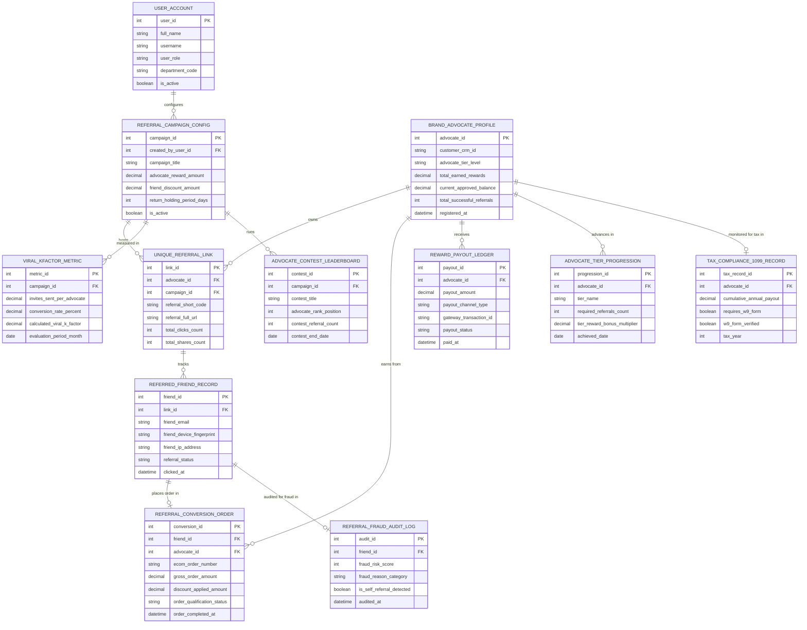

# Conceptual ERD — Referral Marketing Management System

## Mermaid Code

## Entity Description Table | Bảng mô tả Entity

| # | Entity Name | Vietnamese Name | Description | Key Attributes | Main Relationships |
|---|-------------|-----------------|-------------|----------------|-------------------|
| 1 | USER_ACCOUNT | Tài khoản Nguời dùng | System credentials and access roles for referral campaign managers, growth VPs, and admins. | `user_id`, `username`, `user_role`, `department_code` | Configures `REFERRAL_CAMPAIGN_CONFIG`. |
| 2 | REFERRAL_CAMPAIGN_CONFIG | Cấu hình Chiến dịch Referral | Master referral campaign configuration specifying advocate reward amounts, friend discounts, and holding periods. | `campaign_id`, `created_by_user_id`, `campaign_title`, `advocate_reward_amount`, `friend_discount_amount`, `return_holding_period_days` | Hosts `UNIQUE_REFERRAL_LINK`, measured in `VIRAL_KFACTOR_METRIC`, runs `ADVOCATE_CONTEST_LEADERBOARD`. |
| 3 | BRAND_ADVOCATE_PROFILE | Profile Brand Advocate | Brand advocate profile entity tracking customer CRM ID, tier level, earned rewards, and approved balances. | `advocate_id`, `customer_crm_id`, `advocate_tier_level`, `total_earned_rewards`, `current_approved_balance`, `total_successful_referrals` | Owns `UNIQUE_REFERRAL_LINK`, earns from `REFERRAL_CONVERSION_ORDER`, receives `REWARD_PAYOUT_LEDGER`, advances in `ADVOCATE_TIER_PROGRESSION`, monitored in `TAX_COMPLIANCE_1099_RECORD`. |
| 4 | UNIQUE_REFERRAL_LINK | Link Referral Độc quyền | Unique referral short link entity storing referral slug, full URL, click counters, and share counters. | `link_id`, `advocate_id`, `campaign_id`, `referral_short_code`, `referral_full_url`, `total_clicks_count` | Belongs to `BRAND_ADVOCATE_PROFILE` and `REFERRAL_CAMPAIGN_CONFIG`, tracks `REFERRED_FRIEND_RECORD`. |
| 5 | REFERRED_FRIEND_RECORD | Bản ghi Bạn bè Đuợc Giới thiệu | Tracking record for referred friends recording email, device fingerprint, IP address, and referral status. | `friend_id`, `link_id`, `friend_email`, `friend_device_fingerprint`, `friend_ip_address`, `referral_status` | Belongs to `UNIQUE_REFERRAL_LINK`, places order in `REFERRAL_CONVERSION_ORDER`, audited in `REFERRAL_FRAUD_AUDIT_LOG`. |
| 6 | REFERRAL_CONVERSION_ORDER | Đơn hàng Chuyển đổi Referral | Conversion order tracking e-commerce order numbers, order amounts, friend discounts applied, and qualification status. | `conversion_id`, `friend_id`, `advocate_id`, `ecom_order_number`, `gross_order_amount`, `order_qualification_status` | Relates `REFERRED_FRIEND_RECORD` and `BRAND_ADVOCATE_PROFILE`. |
| 7 | REFERRAL_FRAUD_AUDIT_LOG | Nhật ký Audit Fraud Referral | Security audit log evaluating fraud risk scores, self-referral flags, IP match categories, and block decisions. | `audit_id`, `friend_id`, `fraud_risk_score`, `fraud_reason_category`, `is_self_referral_detected` | Belongs to `REFERRED_FRIEND_RECORD`. |
| 8 | REWARD_PAYOUT_LEDGER | Sổ cái Payout Phần thưởng | Financial payout execution ledger recording reward payout amounts, payout channel types (PayPal/TangoCard), and transaction IDs. | `payout_id`, `advocate_id`, `payout_amount`, `payout_channel_type`, `gateway_transaction_id`, `payout_status` | Belongs to `BRAND_ADVOCATE_PROFILE`. |
| 9 | ADVOCATE_TIER_PROGRESSION | Tiến trình Tier Advocate | Advocate tier progression entity tracking tier names (Bronze, Gold, Platinum), required referral counts, and bonus multipliers. | `progression_id`, `advocate_id`, `tier_name`, `required_referrals_count`, `tier_reward_bonus_multiplier` | Belongs to `BRAND_ADVOCATE_PROFILE`. |
| 10 | VIRAL_KFACTOR_METRIC | Chỉ số Viral K-Factor | Monthly viral growth metrics tracking average invites per advocate ($i$), conversion rate ($c$), and Viral $K\text{-Factor}$. | `metric_id`, `campaign_id`, `invites_sent_per_advocate`, `conversion_rate_percent`, `calculated_viral_k_factor` | Belongs to `REFERRAL_CAMPAIGN_CONFIG`. |
| 11 | TAX_COMPLIANCE_1099_RECORD | Bản ghi Tuân thủ Thuế 1099 | Tax compliance tracking entity recording cumulative annual payout totals, W-9 form verification status, and tax year. | `tax_record_id`, `advocate_id`, `cumulative_annual_payout`, `requires_w9_form`, `w9_form_verified`, `tax_year` | Belongs to `BRAND_ADVOCATE_PROFILE`. |
| 12 | ADVOCATE_CONTEST_LEADERBOARD | Bảng Xếp hạng Contest Advocate | Gamified advocate contest leaderboard tracking advocate ranks, contest referral counts, and end dates. | `contest_id`, `campaign_id`, `contest_title`, `advocate_rank_position`, `contest_referral_count` | Belongs to `REFERRAL_CAMPAIGN_CONFIG`. |

## Relationship Description | Mô tả Quan hệ

| # | From Entity | Cardinality | To Entity | Label | Business Explanation |
|---|-------------|-------------|-----------|-------|----------------------|
| 1 | REFERRAL_CAMPAIGN_CONFIG | 1 to 1..N | UNIQUE_REFERRAL_LINK | hosts | A referral campaign hosts multiple unique advocate referral links. |
| 2 | REFERRAL_CAMPAIGN_CONFIG | 1 to 0..N | VIRAL_KFACTOR_METRIC | measured in | A referral campaign is measured in monthly Viral K-Factor metrics. |
| 3 | REFERRAL_CAMPAIGN_CONFIG | 1 to 0..N | ADVOCATE_CONTEST_LEADERBOARD | runs | A referral campaign runs gamified advocate contest leaderboards. |
| 4 | BRAND_ADVOCATE_PROFILE | 1 to 1..N | UNIQUE_REFERRAL_LINK | owns | A brand advocate profile owns unique referral short links. |
| 5 | BRAND_ADVOCATE_PROFILE | 1 to 0..N | REFERRAL_CONVERSION_ORDER | earns from | A brand advocate profile earns rewards from qualifying conversion orders. |
| 6 | BRAND_ADVOCATE_PROFILE | 1 to 0..N | REWARD_PAYOUT_LEDGER | receives | A brand advocate profile receives reward payout fulfillment transactions. |
| 7 | BRAND_ADVOCATE_PROFILE | 1 to 0..N | ADVOCATE_TIER_PROGRESSION | advances in | A brand advocate profile advances in advocate tier progressions. |
| 8 | BRAND_ADVOCATE_PROFILE | 1 to 0..1 | TAX_COMPLIANCE_1099_RECORD | monitored for tax in | An advocate profile is monitored for IRS 1099 tax thresholds. |
| 9 | UNIQUE_REFERRAL_LINK | 1 to 0..N | REFERRED_FRIEND_RECORD | tracks | A unique referral link tracks referred friend clicks and form fills. |
| 10 | REFERRED_FRIEND_RECORD | 1 to 0..1 | REFERRAL_CONVERSION_ORDER | places order in | A referred friend record places a first order conversion. |
| 11 | REFERRED_FRIEND_RECORD | 1 to 0..1 | REFERRAL_FRAUD_AUDIT_LOG | audited for fraud in | A referred friend record is audited for self-referral and coupon fraud. |
| 12 | USER_ACCOUNT | 1 to 0..N | REFERRAL_CAMPAIGN_CONFIG | configures | A campaign manager user account configures referral campaigns. |
