# Swimlane Diagram — Referral Marketing Management System

## Mermaid Code

```mermaid
flowchart LR
    Start(["Start Referral Marketing Journey"])

    subgraph Lane_Advocate["Brand Advocate (Referrer)"]
        A1["Generate Unique Referral Link & Share via WhatsApp"]
        A2["View Approved Reward Balance on Dashboard"]
        A3["Request PayPal Payout Withdrawal"]
    end

    subgraph Lane_Friend["Referred Friend"]
        F1["Click Referral Link & View Personalized Welcome"]
        F2["Place First Order with $20 Welcome Discount"]
    end

    subgraph Lane_System["Referral Marketing Management System"]
        S1["Track Referral Link Click & Log Telemetry Tokens"]
        S2["Validate Discount Code at E-Commerce Checkout"]
        S3{"Passes Fraud Checks & 14-Day Order Holding Period?"}
        S4["Flag Self-Referral Fraud & Cancel Pending Reward"]
        S5["Approve $20 Reward & Credit Advocate Balance"]
        S6["Verify 1099 Tax Limit & Trigger Payout API Payload"]
    end

    subgraph Lane_Payout["Payout Fulfillment Gateway"]
        P1["Process PayPal Payout & Deposit Cash to Advocate"]
        P2["Return Transaction Receipt Webhook"]
    end

    Finish(["End Referral Payout Cycle"])

    Start --> A1 --> F1 --> F2 --> S1 --> S2 --> S3
    S3 -->|"No / Fraud or Returned"| S4 --> Finish
    S3 -->|"Yes / Approved Order"| S5 --> A2 --> A3 --> S6 --> P1 --> P2 --> Finish
```

## Flow Description | Mô tả luồng

| Lane | Actor | Role in Flow |
|------|-------|-------------|
| 1 | Brand Advocate (Referrer) | Generates unique referral links, shares invites across social channels (WhatsApp/Email), monitors earned reward balances on self-service dashboards, and submits payout withdrawal requests. |
| 2 | Referred Friend | Clicks referral short links, views personalized welcome discount banners, redeems welcome promo codes, and places qualifying first purchases. |
| 3 | Referral Marketing Management System | Tracks link clicks, validates dynamic promo codes at checkout, evaluates real-time self-referral fraud rules, enforces 14-day return holding periods, credits advocate reward balances, verifies IRS 1099 tax thresholds, and triggers automated payout payloads. |
| 4 | Payout Fulfillment Gateway | Executes automated cash payout deposits via PayPal Payouts API or dispatches digital gift cards via TangoCard API, returning transaction receipt webhooks. |
