# Action Tree — Referral Marketing Management System

## Mermaid Code

```mermaid
graph TD
    Root["Referral Marketing Management System"]

    Root --> M1["Campaign Building & Dual-Sided Incentives"]
    Root --> M2["Unique Referral Link & Social Sharing"]
    Root --> M3["Referral Fraud & Self-Referral Prevention"]
    Root --> M4["Conversion Qualification & Order Holding"]
    Root --> M5["Automated Payout Fulfillment & Tax 1099"]
    Root --> M6["Viral K-Factor Analytics & Leaderboards"]

    M1 --> A11["Configure Dual-Sided Reward Campaign Rules (Give X / Get Y)"]
    M1 --> A12["Embed On-Site Referral Popups & Post-Purchase Modals"]
    M1 --> A13["Configure Tiered Advocate Progression (Bronze -> Gold)"]
    M1 --> A14["Set Minimum Order Spend & Product Eligibility Rules"]

    M2 --> A21["Generate Unique Advocate Referral Short Links (ref.co/alex402)"]
    M2 --> A22["Render Downloadable High-Res Vector Referral QR Codes"]
    M2 --> A23["Populate Pre-Formatted WhatsApp, SMS & Email Share Templates"]
    M2 --> A24["Track Social Media Share Dispatches & Unique Link Clicks"]

    M3 --> A31["Detect Self-Referral Attempts via IP Address Matching"]
    M3 --> A32["Evaluate Device Fingerprinting & Browser Telemetry Tokens"]
    M3 --> A33["Detect Sybil Account Creation & Disposable Email Loops"]
    M3 --> A34["Block Fraudulent Reward Qualification & Update Advocate Risk"]

    M4 --> A41["Validate Referred Friend Welcome Discount Codes at Checkout"]
    M4 --> A42["Ingest E-Commerce First-Order Completion Webhooks"]
    M4 --> A43["Enforce 14-Day Order Return Holding Periods before Reward Release"]
    M4 --> A44["Sync Advocate Referral Totals & Tags to Salesforce CRM"]

    M5 --> A51["Execute Automated Cash Payouts via PayPal Payouts API"]
    M5 --> A52["Dispatch Digital Gift Cards via TangoCard RaaS API"]
    M5 --> A53["Apply Auto-Credit Store Balance to Advocate Accounts"]
    M5 --> A54["Enforce IRS 1099-MISC Tax Thresholds & W-9 Verification ($600 Limit)"]

    M6 --> A61["Calculate Viral Coefficient K-Factor Metrics (K = i * c)"]
    M6 --> A62["Measure 3-Year Customer LTV of Referred vs Non-Referred Cohorts"]
    M6 --> A63["Manage Gamified Advocate Leaderboards & Viral Growth Contests"]
    M6 --> A64["Export Executive Referral CAC & Net ROMI Scorecard PDFs"]
```

## Module Description | Mô tả Module

| # | Module | Description | Actions |
|---|--------|-------------|---------|
| 1 | Campaign Building & Dual-Sided Incentives | Configures dual-sided reward rules, embeds post-purchase popups, sets advocate tiers, and defines minimum order spend rules. | Configure Dual-Sided Reward Rules, Embed Post-Purchase Popups, Configure Tiered Advocate Progression, Set Minimum Order Spend Rules. |
| 2 | Unique Referral Link & Social Sharing | Generates unique short URLs, renders QR codes, populates social share templates (WhatsApp/SMS/Email), and tracks link click telemetry. | Generate Unique Referral Short Links, Render Referral QR Codes, Populate Social Share Templates, Track Social Share Telemetry. |
| 3 | Referral Fraud & Self-Referral Prevention | Detects self-referrals via IP matching, evaluates device fingerprints, detects Sybil fake account loops, and blocks fraudulent payouts. | Detect Self-Referrals via IP Matching, Evaluate Device Fingerprints, Detect Sybil Account Loops, Block Fraudulent Reward Qualification. |
| 4 | Conversion Qualification & Order Holding | Validates welcome codes at checkout, ingests first-order webhooks, enforces 14-day return holding periods, and syncs advocate CRM tags. | Validate Welcome Codes at Checkout, Ingest First-Order Webhooks, Enforce 14-Day Return Holding Periods, Sync Advocate CRM Tags. |
| 5 | Automated Payout Fulfillment & Tax 1099 | Dispatches cash payouts via PayPal, dispatches TangoCard digital gift cards, credits store balances, and enforces IRS 1099 tax rules ($600 limit). | Execute Cash Payouts via PayPal, Dispatch TangoCard Digital Gift Cards, Apply Store Balance Credits, Enforce IRS 1099 Tax Thresholds. |
| 6 | Viral K-Factor Analytics & Leaderboards | Calculates Viral $K\text{-Factor}$ metrics, measures 3-year referred customer LTV, manages gamified leaderboards, and exports referral CAC reports. | Calculate Viral K-Factor Metrics, Measure 3-Year Referred Customer LTV, Manage Advocate Leaderboards, Export Executive Referral CAC Reports. |
