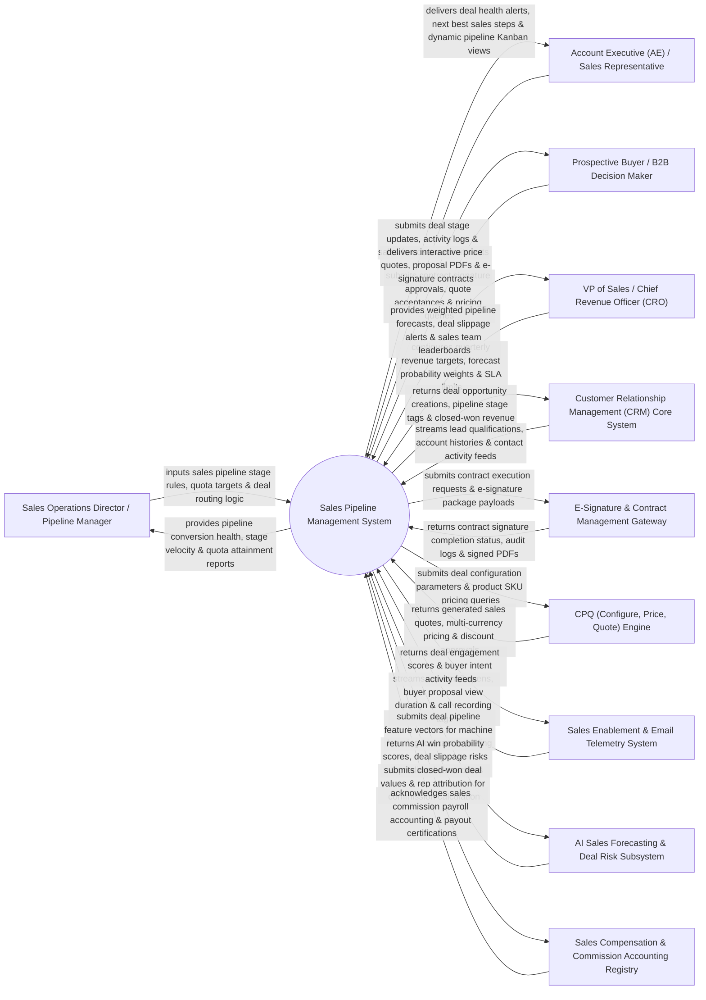

# Context Diagram — Sales Pipeline Management System

## Mermaid Code

## Actor & Interaction Table | Bảng Actor & Tương tác

| # | Actor | Actor Type | Data Sent TO System | Data Received FROM System | Notes |
|---|-------|------------|---------------------|---------------------------|-------|
| 1 | Sales Operations Director / Pipeline Manager | Primary | Sales pipeline stage definitions (Prospecting -> Discovery -> Proposal -> Negotiation -> Closed-Won), deal stage probability weights, territory routing rules. | Pipeline conversion health dashboards, stage velocity metrics, rep quota attainment reports, pipeline bottleneck analytics. | Sales operations leader configuring pipeline stages, quota targets, and territory routing matrices. |
| 2 | Account Executive (AE) / Sales Representative | Primary | Deal stage updates, deal value edits, next step notes, sales forecast commitments (Commit/Best Case/Pipeline). | Real-time deal health alerts, Next Best Action (NBA) prompts, dynamic drag-and-drop Kanban pipeline views, opportunity cards. | Sales rep managing active deals, updating pipeline stages, and forecasting quarterly sales revenue. |
| 3 | Prospective Buyer / B2B Decision Maker | Primary | Quote acceptances, contract signature approvals, pricing discount counter-offers. | Interactive price quotes, sales proposal PDFs, e-signature contracts, executive summary decks. | Enterprise buyer reviewing sales proposals, approving pricing quotes, and executing contract signatures. |
| 4 | VP of Sales / Chief Revenue Officer (CRO) | Primary | Quarterly revenue targets, weighted forecast probability rules, deal stall SLA alert limits. | Weighted pipeline revenue forecasts, deal slippage alerts, sales rep quota leaderboards, sales velocity metrics. | Sales executive evaluating global pipeline health, forecast accuracy, and quarterly revenue achievement. |
| 5 | Customer Relationship Management (CRM) Core System | Supporting | Lead qualification handoffs, enterprise account hierarchies, key contact activity streams. | Opportunity deal creations, sales pipeline stage updates, closed-won deal revenue tags. | Backend CRM system synchronizing core account profiles and pipeline deal opportunity records. |
| 6 | E-Signature & Contract Management Gateway | Supporting | Contract signature completion status, audit trail logs, signed contract PDF files. | Contract execution requests, DocuSign / PandaDoc e-signature package payloads, signer recipient lists. | E-signature gateway executing contract signatures and returning signed agreement files. |
| 7 | CPQ (Configure, Price, Quote) Engine | Supporting | Approved sales quotes, multi-currency price calculations, volume discount approval workflows. | Deal configuration parameters, custom product SKU pricing requests, discount authorization queries. | CPQ platform generating accurate multi-line item quotes and managing discount approval tiers. |
| 8 | Sales Enablement & Email Telemetry System | Supporting | Buyer email open webhooks, proposal view duration (seconds per slide), call recording sentiment tags. | Deal engagement scores, buyer intent activity feeds, content enablement usage logs. | Enablement platform tracking buyer engagement with sent sales collateral and proposal slides. |
| 9 | AI Sales Forecasting & Deal Risk Subsystem | Supporting | AI win probability scores (0-100%), deal slippage risk flags, predicted deal close dates, deal health scores. | Historical pipeline deal feature vectors, stage duration histories, buyer activity velocity. | AI engine applying machine learning models to forecast quarterly deal closure probabilities. |
| 10 | Sales Compensation & Commission Accounting Registry | Supporting / Regulatory | Sales rep commission rate schedules, quota tier multipliers, commission payout accounting logs. | Closed-won deal revenue payloads, rep deal attribution splits, commission payout audit receipts. | Financial registry calculating sales rep commission payouts upon closed-won deal confirmation. |

## System Boundary Description | Mô tả Phạm vi Hệ thống

The **Sales Pipeline Management System** is an enterprise sales opportunity tracking, AI revenue forecasting, deal velocity analytics, CPQ integration, and sales pipeline governance platform designed to shorten sales cycles and maximize win rates.

**Inside System Scope:**
- Visual drag-and-drop Kanban Sales Pipeline board supporting multi-stage sales lifecycles.
- AI Machine Learning revenue forecasting (Commit, Best Case, Pipeline) predicting deal win probabilities and close dates.
- CPQ integration generating accurate sales quotes, multi-currency pricing, and multi-tier discount approvals.
- Contract execution workflow integration with DocuSign / PandaDoc for seamless e-signature tracking.
- Sales velocity metrics ($\text{Sales Velocity} = \frac{\text{Deals} \times \text{Average Deal Size} \times \text{Win Rate \%}}{\text{Sales Cycle Length (Days)}}$).

**Outside System Scope:**
- Direct physical hosting of cloud CRM database infrastructure (handled by Salesforce / Cloud Providers).
- Direct legal litigation of contract breach disputes (handled by Corporate General Counsel).
- Direct processing of bank wire transfers for closed contracts (handled by Corporate Accounting).
