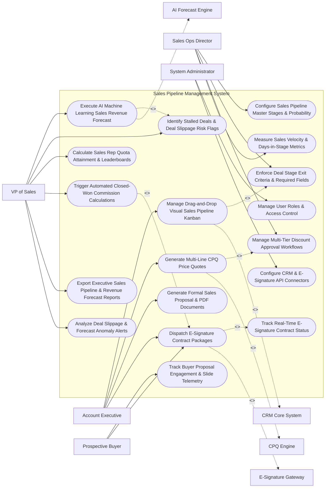

# Use Case Diagram — Sales Pipeline Management System

## Mermaid Code

## Actor Table | Bảng Actor

| # | Actor | Actor Type | Role Description | Related Use Cases |
|---|-------|------------|------------------|-------------------|
| 1 | Sales Ops Director | Primary | Operations leader configuring pipeline stages, stage exit criteria, discount approval tiers, and sales velocity rules. | UC01, UC03, UC06, UC12 |
| 2 | Account Executive | Primary | Sales rep updating pipeline Kanban boards, building CPQ quotes, generating proposals, and dispatching contracts. | UC02, UC05, UC07, UC08 |
| 3 | Prospective Buyer | Primary | B2B buyer reviewing proposal engagement slides and signing e-signature contract packages. | UC04, UC08 |
| 4 | VP of Sales | Primary | Executive analyzing AI sales forecasts, deal slippage flags, rep quota attainment, commission payouts, and forecast scorecards. | UC10, UC11, UC13, UC14, UC15, UC18 |
| 5 | System Administrator | Primary | IT admin managing user security roles, CRM API connectors, and e-signature gateway OAuth keys. | UC16, UC17 |
| 6 | CRM Core System | System (Secondary) | Backend CRM synchronizing deal opportunity records, account histories, and contact profiles. | UC02 |
| 7 | CPQ Engine | System (Secondary) | Configure, Price, Quote platform generating multi-line item quotes and managing discount tiers. | UC05 |
| 8 | E-Signature Gateway | System (Secondary) | E-signature platform (DocuSign/PandaDoc) executing contract signatures and returning signed agreement files. | UC08 |
| 9 | AI Forecast Engine | System (Secondary) | Machine learning service forecasting quarterly revenue, deal win probabilities, and close dates. | UC10 |

## Use Case Table | Bảng Use Case

| # | UC ID | Use Case Name | Primary Actor | Secondary Actor | Description | Priority |
|---|-------|---------------|---------------|-----------------|-------------|----------|
| 1 | UC01 | Configure Sales Pipeline Master Stages & Probability | SalesOps | None | Configures sales pipeline stages (Prospecting 10%, Discovery 20%, Proposal 50%, Negotiation 80%, Closed-Won 100%). | Critical |
| 2 | UC02 | Manage Drag-and-Drop Visual Sales Pipeline Kanban | AE | CRM System | Renders a visual drag-and-drop Kanban board enabling AEs to advance deal cards across pipeline stages. | Critical |
| 3 | UC03 | Enforce Deal Stage Exit Criteria & Required Fields | SalesOps | None | Enforces mandatory field entry (e.g., Next Step, Close Date, Decision Maker Identified) before advancing stage. | Critical |
| 4 | UC04 | Track Buyer Proposal Engagement & Slide Telemetry | Buyer | None | Tracks buyer proposal view duration (seconds per slide), forward shares, and content engagement scores. | High |
| 5 | UC05 | Generate Multi-Line CPQ Price Quotes | AE | CPQ Engine | Generates multi-line item CPQ pricing quotes with recurring subscription pricing, volume tiers, and add-on SKUs. | Critical |
| 6 | UC06 | Manage Multi-Tier Discount Approval Workflows | SalesOps | None | Enforces automated discount approval chains (e.g., Discount > 15% requires Sales Director sign-off). | Critical |
| 7 | UC07 | Generate Formal Sales Proposal & PDF Documents | AE | None | Merges deal data, CPQ quotes, and case studies into a formal branded PDF sales proposal document. | High |
| 8 | UC08 | Dispatch E-Signature Contract Packages | AE | E-Signature GW | Transmits master service agreements (MSA) and order forms to DocuSign/PandaDoc for e-signature execution. | Critical |
| 9 | UC09 | Track Real-Time E-Signature Contract Status | AE | None | Tracks e-signature document status (Delivered, Viewed, Signed) and updates deal stage to Closed-Won upon completion. | High |
| 10 | UC10 | Execute AI Machine Learning Sales Revenue Forecast | VP of Sales | AI Forecast | Runs machine learning algorithms to generate weighted quarterly revenue forecasts (Commit, Best Case, Pipeline). | Critical |
| 11 | UC11 | Identify Stalled Deals & Deal Slippage Risk Flags | VP of Sales | None | Identifies deals stalled in a stage $> 30$ days or pushing close dates, flagging deal slippage risk scores. | Critical |
| 12 | UC12 | Measure Sales Velocity & Days-in-Stage Metrics | SalesOps | None | Calculates Sales Velocity ($\frac{\text{Deals} \times \text{Deal Size} \times \text{Win Rate \%}}{\text{Cycle Length (Days)}}$) and average days per stage. | High |
| 13 | UC13 | Calculate Sales Rep Quota Attainment & Leaderboards | VP of Sales | None | Computes sales rep quota achievement percentages against quarterly targets, rendering team leaderboards. | High |
| 14 | UC14 | Trigger Automated Closed-Won Commission Calculations | VP of Sales | None | Automatically calculates sales rep commission payouts upon closed-won deal execution based on rate tiers. | High |
| 15 | UC15 | Export Executive Sales Pipeline & Revenue Forecast Reports | VP of Sales | None | Renders executive pipeline scorecards detailing total pipeline value, weighted forecast, win rate %, and velocity. | High |
| 16 | UC16 | Manage User Roles & Access Control | Admin | None | Controls user login credentials, RBAC permissions, and pipeline deal visibility scopes. | High |
| 17 | UC17 | Configure CRM & E-Signature API Connectors | Admin | None | Configures API connection parameters for Salesforce, HubSpot, DocuSign, PandaDoc, and CPQ engines. | High |
| 18 | UC18 | Analyze Deal Slippage & Forecast Anomaly Alerts | VP of Sales | None | Dispatches urgent alerts to Sales Management when quarterly forecast commitments drop below target by $> 15\%$. | High |

## Use Case Specification | Đặc tả Use Case

---

### UC02 — Manage Drag-and-Drop Visual Sales Pipeline Kanban

| Field | Detail |
|-------|--------|
| **UC ID** | UC02 |
| **Use Case Name** | Manage Drag-and-Drop Visual Sales Pipeline Kanban |
| **Actor(s)** | Primary: Account Executive (AE)   Secondary: Customer Relationship Management (CRM) Core System |
| **Description** | Renders an interactive visual drag-and-drop Kanban pipeline board displaying deal cards across sequential sales stages, allowing AEs to advance deals, view weighted values, and log activities. |
| **Precondition** | 1. Pipeline master stages and probability weights are configured (UC01).   2. Active deal opportunity records exist in CRM. |
| **Main Flow** | 1. Account Executive opens "Visual Sales Pipeline Kanban Board".   2. System renders multi-column Kanban board across 5 sequential stages:   &nbsp;&nbsp;&nbsp;&nbsp; a. Column 1: `1. Discovery (20% Prob)` -> 8 Deals | Total Unweighted: `$400,000` | Weighted: `$80,000`.   &nbsp;&nbsp;&nbsp;&nbsp; b. Column 2: `2. Evaluation (40% Prob)` -> 5 Deals | Total Unweighted: `$500,000` | Weighted: `$200,000`.   &nbsp;&nbsp;&nbsp;&nbsp; c. Column 3: `3. Proposal (60% Prob)` -> 4 Deals | Total Unweighted: `$600,000` | Weighted: `$360,000`.   &nbsp;&nbsp;&nbsp;&nbsp; d. Column 4: `4. Negotiation (80% Prob)` -> 2 Deals | Total Unweighted: `$300,000` | Weighted: `$240,000`.   &nbsp;&nbsp;&nbsp;&nbsp; e. Column 5: `5. Closed-Won (100% Prob)` -> 12 Deals | Total Unweighted: `$1,200,000`.   3. AE drags deal card `Acme Cloud Expansion ($150,000)` from `Proposal` column to `Negotiation` column.   4. System triggers UC03 (Enforce Deal Stage Exit Criteria):   &nbsp;&nbsp;&nbsp;&nbsp; a. Checks mandatory fields: `Decision Maker Approved = TRUE`, `CPQ Quote Attached = TRUE`, `Next Step Date = Set`.   &nbsp;&nbsp;&nbsp;&nbsp; b. All exit criteria satisfied -> `STAGE_ADVANCEMENT_APPROVED`.   5. System updates deal stage to `Negotiation`, increases win probability weight from 60% to 80%, and updates weighted pipeline total.   6. System syncs deal stage advancement via REST API to CRM Core System. |
| **Alternative Flow** | **AF1** — Deal Loss Movement: AE drags deal card to "Closed-Lost" drop zone at bottom of canvas; System prompts mandatory popup for "Primary Competitor" and "Loss Reason Code", saving feedback. |
| **Exception Flow** | **EX1** — Missing Exit Criteria Block: AE attempts to drag deal to `Negotiation` without attaching a CPQ quote; System blocks card drop, displaying modal "Stage Exit Violation: CPQ Price Quote Required before entering Negotiation stage". |
| **Postcondition** | Deal card is moved to new stage column, win probability weight updates, pipeline weighted totals recalculate, and CRM sync completes. |
| **Business Rule** | **BR1**: Advancing a deal card to a higher pipeline stage MUST enforce all mandatory stage exit criteria before saving the new stage. |

---

### UC05 — Generate Multi-Line CPQ Price Quotes

| Field | Detail |
|-------|--------|
| **UC ID** | UC05 |
| **Use Case Name** | Generate Multi-Line CPQ Price Quotes |
| **Actor(s)** | Primary: Account Executive (AE)   Secondary: CPQ (Configure, Price, Quote) Engine |
| **Description** | Generates multi-line item sales price quotes incorporating recurring subscription products, volume tier pricing, professional service add-ons, multi-currency conversion, and discount rules. |
| **Precondition** | 1. Active deal opportunity exists in pipeline (UC02).   2. Master product SKU price book is synchronized. |
| **Main Flow** | 1. AE opens "CPQ Quote Configurator" from deal opportunity view.   2. AE selects Product SKUs and Quantities:   &nbsp;&nbsp;&nbsp;&nbsp; a. Line 1: `Enterprise Cloud SaaS License` - 500 Seats @ `$20.00 / seat / month` = `$120,000.00 ARR`.   &nbsp;&nbsp;&nbsp;&nbsp; b. Line 2: `Premium 24/7 Support Add-On` - 1 Year = `$15,000.00 / year`.   &nbsp;&nbsp;&nbsp;&nbsp; c. Line 3: `Professional Implementation Services` - 100 Hours @ `$200.00 / hour` = `$20,000.00 One-Time`.   3. System calculates Subtotal: `$155,000.00 Total First Year Value`.   4. AE inputs Requested Line-Item Discount: `15.0% Discount on Enterprise SaaS Licenses` (-$18,000.00).   5. System triggers UC06 (Manage Multi-Tier Discount Approval Workflows):   &nbsp;&nbsp;&nbsp;&nbsp; a. Discount Level: 15.0% <= Maximum AE Discount Limit (15.0%) -> `AUTO_APPROVED_DISCOUNT`.   6. System calculates Final Net Price: `$137,000.00 Total Net Price`.   7. System generates formal CPQ Quote PDF file (`Quote_Q-88412.pdf`), stores quote record, attaches quote to deal opportunity, and updates deal value to `$137,000.00`. |
| **Alternative Flow** | **AF1** — Multi-Year Contract Escalation: AE configures a 3-year contract with annual 5% price escalation clauses; System auto-calculates Year 1 ($137k), Year 2 ($143.8k), and Year 3 ($151k), displaying Total Contract Value (TCV = $431.8k). |
| **Exception Flow** | **EX1** — Excessive Discount Approval Escalation: AE requests 25% discount (exceeds 15% AE limit); System flags `DISCOUNT_APPROVAL_REQUIRED`, submitting approval request to Sales Director and pausing quote generation. |
| **Postcondition** | Multi-line item CPQ quote is generated, discount approvals are verified, quote PDF is generated, and deal opportunity value updates. |
| **Business Rule** | **BR1**: Line-item pricing discounts exceeding AE authorization limits (15%) MUST receive automated multi-tier approval prior to quote release. |

---

### UC08 — Dispatch E-Signature Contract Packages

| Field | Detail |
|-------|--------|
| **UC ID** | UC08 |
| **Use Case Name** | Dispatch E-Signature Contract Packages |
| **Actor(s)** | Primary: Account Executive, Prospective Buyer   Secondary: E-Signature & Contract Management Gateway (DocuSign / PandaDoc) |
| **Description** | Assembles formal contract packages (Master Service Agreement + CPQ Order Form), mapping dynamic form fields, and transmits packages to DocuSign/PandaDoc for e-signature execution. |
| **Precondition** | 1. CPQ price quote is approved (UC05).   2. Buyer signatory contact details (Name, Title, Email) are verified.   3. DocuSign API integration is active. |
| **Main Flow** | 1. AE opens "Contract Execution Wizard" on deal opportunity page.   2. System merges deal parameters into Master Service Agreement (MSA) template:   &nbsp;&nbsp;&nbsp;&nbsp; a. Company Legal Name: `Acme Corporation`.   &nbsp;&nbsp;&nbsp;&nbsp; b. Contract Term: `36 Months (Nov 01, 2026 to Oct 31, 2029)`.   &nbsp;&nbsp;&nbsp;&nbsp; c. Total Contract Value (TCV): `$431,800.00`.   &nbsp;&nbsp;&nbsp;&nbsp; d. Attached Order Form: `CPQ Quote Q-88412`.   3. AE configures Signatory Routing Order:   &nbsp;&nbsp;&nbsp;&nbsp; a. Signer 1 (Buyer Signatory): `John Doe (VP of IT) - john.doe@acme.com`.   &nbsp;&nbsp;&nbsp;&nbsp; b. Signer 2 (Company Signatory): `Jane Smith (VP of Sales) - jane.smith@company.com`.   4. AE clicks "Dispatch DocuSign E-Signature Package".   5. System transmits HTTPS REST API payload to DocuSign API endpoint.   6. DocuSign API generates e-signature envelope `ENV-99412` and dispatches signature invitation email to John Doe.   7. System updates deal stage to `Contract Sent / Out for Signature` and initializes real-time e-signature tracking (UC09). |
| **Alternative Flow** | **AF1** — Automated Contract Signing & Deal Closure: John Doe and Jane Smith sign contract; DocuSign returns `ENVELOPE_COMPLETED` webhook; System automatically advances deal stage to `Closed-Won` and updates CRM. |
| **Exception Flow** | **EX1** — E-Signature Recipient Email Rejected: DocuSign API returns error `INVALID_RECIPIENT_EMAIL`; System flags error, notifying AE to verify buyer email address. |
| **Postcondition** | Contract package is assembled, transmitted to DocuSign API, envelope is generated, and deal stage updates to Out for Signature. |
| **Business Rule** | **BR1**: Contract packages MUST include an approved CPQ order form and enforce sequential multi-party signature routing. |

---

### UC10 — Execute AI Machine Learning Sales Revenue Forecast

| Field | Detail |
|-------|--------|
| **UC ID** | UC10 |
| **Use Case Name** | Execute AI Machine Learning Sales Revenue Forecast |
| **Actor(s)** | Primary: Chief Revenue Officer, VP of Sales   Secondary: AI Sales Forecasting & Deal Risk Subsystem |
| **Description** | Runs machine learning forecasting models analyzing historical pipeline deal features, stage velocity, buyer engagement telemetry, and rep win rates to generate predictive quarterly revenue forecasts. |
| **Precondition** | 1. Active pipeline deals and historical win/loss deal records are ingested.   2. AI Sales Forecast engine connection is active. |
| **Main Flow** | 1. User opens "AI Revenue Forecasting & Pipeline Intelligence Studio".   2. User selects Forecast Target Period: `Q4 2026` and Scope: `Global Enterprise Sales`.   3. System gathers pipeline feature vectors across 250 active deals:   &nbsp;&nbsp;&nbsp;&nbsp; a. Total Unweighted Pipeline Value: `$15,000,000.00`.   &nbsp;&nbsp;&nbsp;&nbsp; b. Traditional Stage-Weighted Forecast: `$7,200,000.00`.   4. System invokes AI Sales Forecast Engine (Gradient Boosting ML Model).   5. AI Engine evaluates deal-level features for every active opportunity:   &nbsp;&nbsp;&nbsp;&nbsp; a. Buyer Engagement Score: Email open rates, proposal slide view time.   &nbsp;&nbsp;&nbsp;&nbsp; b. Stage Velocity Ratio: Days in current stage vs historical win averages.   &nbsp;&nbsp;&nbsp;&nbsp; c. AE Historical Win Rate: Individual rep win rate against named competitor.   &nbsp;&nbsp;&nbsp;&nbsp; d. Push Count: Number of times deal close date was pushed to next month.   6. AI Engine outputs Predictive Forecast Categories:   &nbsp;&nbsp;&nbsp;&nbsp; a. AI Commit Forecast (High-confidence deals > 85% win prob): `$5,800,000.00`.   &nbsp;&nbsp;&nbsp;&nbsp; b. AI Most Likely Forecast (Commit + Likely deals): `$6,950,000.00`.   &nbsp;&nbsp;&nbsp;&nbsp; c. AI Best Case Forecast (Upper bound): `$8,400,000.00`.   7. System compares AI Most Likely ($6.95M) vs Quarterly Quota Target ($7.00M) -> `Predicting 99.3% Quota Achievement (-$50K gap)`.   8. System highlights 12 High-Risk Slippage Deals (UC11) that require immediate sales management intervention. |
| **Alternative Flow** | **AF1** — Rep Commit vs AI Model Comparison: System renders side-by-side comparison between rep manual forecast commitments ($7.5M) vs AI predictive forecast ($6.95M), highlighting over-optimistic reps. |
| **Exception Flow** | **EX1** — Pipeline Coverage Deficit Warning: Total pipeline ($15M) is less than 3x quarterly quota ($21M needed for 3x coverage); System flags "Insufficient Pipeline Coverage Alert (2.1x)", notifying CRO. |
| **Postcondition** | AI predictive revenue forecasts (Commit, Most Likely, Best Case) are calculated, win probabilities update, and forecast reports render. |
| **Business Rule** | **BR1**: AI revenue forecasts MUST evaluate deal engagement telemetry and close-date push counts to adjust traditional stage-weighted probabilities. |

---

### UC12 — Measure Sales Velocity & Days-in-Stage Metrics

| Field | Detail |
|-------|--------|
| **UC ID** | UC12 |
| **Use Case Name** | Measure Sales Velocity & Days-in-Stage Metrics |
| **Actor(s)** | Primary: Sales Operations Director, VP of Sales   Secondary: None |
| **Description** | Calculates total Sales Velocity ($\text{Sales Velocity} = \frac{\text{Active Deals} \times \text{Average Deal Size} \times \text{Win Rate \%}}{\text{Sales Cycle Length (Days)}}$) and analyzes average days spent in each pipeline stage to detect sales bottlenecks. |
| **Precondition** | 1. Pipeline deal stage transition timestamps and win rates are logged in database. |
| **Main Flow** | 1. User opens "Sales Velocity & Pipeline Bottleneck Console".   2. User selects Analysis Period: `Q3 2026` and Team Scope: `Enterprise US Sales`.   3. System retrieves Sales Velocity Components:   &nbsp;&nbsp;&nbsp;&nbsp; a. Active Opportunities Count ($N$): `120 Deals`.   &nbsp;&nbsp;&nbsp;&nbsp; b. Average Deal Size ($S$): `$100,000.00`.   &nbsp;&nbsp;&nbsp;&nbsp; c. Win Rate Percentage ($W$): `30.0% Win Rate` ($0.30$).   &nbsp;&nbsp;&nbsp;&nbsp; d. Average Sales Cycle Length ($L$): `90 Days` (First contact to closed-won).   4. System calculates Sales Velocity (Revenue generated per day):   $$\text{Sales Velocity} = \frac{N \times S \times W}{L} = \frac{120 \times \$100,000 \times 0.30}{90 \text{ Days}} = \frac{\$3,600,000}{90} = \$40,000.00 / \text{Day}$$   5. System computes Days-in-Stage Bottleneck Analysis:   &nbsp;&nbsp;&nbsp;&nbsp; a. Stage 1 (Discovery): `10 Days` (Benchmark: 12 Days -> Healthy).   &nbsp;&nbsp;&nbsp;&nbsp; b. Stage 2 (Evaluation): `15 Days` (Benchmark: 15 Days -> Healthy).   &nbsp;&nbsp;&nbsp;&nbsp; c. Stage 3 (Proposal): `45 Days` (Benchmark: 20 Days -> `HIGH_STAGE_BOTTLENECK`).   &nbsp;&nbsp;&nbsp;&nbsp; d. Stage 4 (Negotiation): `20 Days` (Benchmark: 15 Days -> Minor Delay).   6. System highlights Stage 3 (`Proposal`) in red, identifying that deals are stalling in Proposal stage 25 days longer than benchmark.   7. User exports sales velocity report and schedules pipeline review with Sales Directors. |
| **Alternative Flow** | **AF1** — Sales Velocity Scenario Simulation: User simulates velocity impact of reducing sales cycle from 90 days to 75 days; System shows velocity increases from $40k/day to $48k/day (+20% revenue acceleration). |
| **Exception Flow** | **EX1** — Stalled Deal Alert Execution: An individual deal spends $> 45$ days in Proposal stage; System triggers UC11 (Identify Stalled Deals), sending alert notification to the assigned AE and Sales Manager. |
| **Postcondition** | Sales velocity ($/day) and stage duration metrics are calculated, pipeline bottlenecks are highlighted, and velocity reports export. |
| **Business Rule** | **BR1**: Deals spending > 2x the average benchmark duration in any single pipeline stage MUST be automatically flagged as Stalled Bottleneck Deals. |
