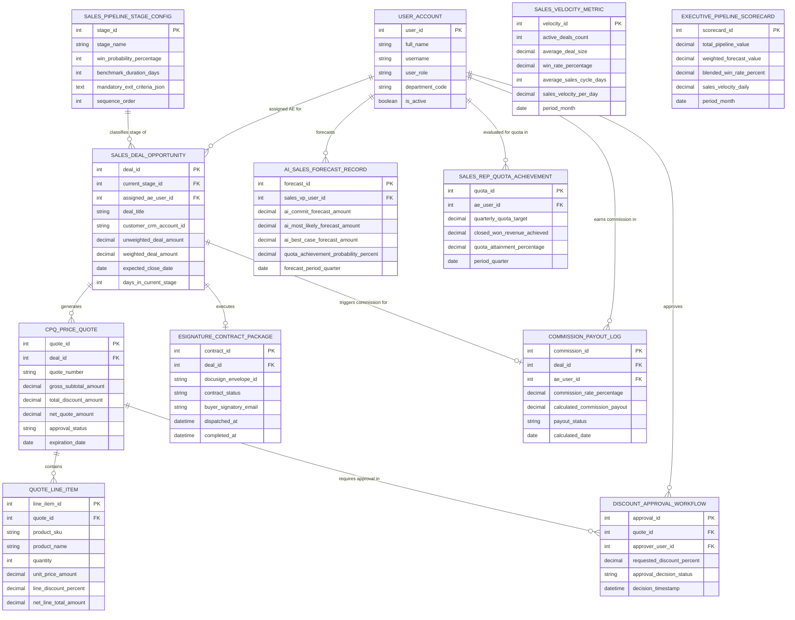

# Conceptual ERD — Sales Pipeline Management System

## Mermaid Code

## Entity Description Table | Bảng mô tả Entity

| # | Entity Name | Vietnamese Name | Description | Key Attributes | Main Relationships |
|---|-------------|-----------------|-------------|----------------|-------------------|
| 1 | USER_ACCOUNT | Tài khoản Nguời dùng | System credentials and access roles for sales ops directors, AEs, sales VPs, and admins. | `user_id`, `username`, `user_role`, `department_code` | Assigned AE for `SALES_DEAL_OPPORTUNITY`, approves `DISCOUNT_APPROVAL_WORKFLOW`, forecasts `AI_SALES_FORECAST_RECORD`. |
| 2 | SALES_PIPELINE_STAGE_CONFIG | Cấu hình Stage Pipeline | Master sales pipeline stage definition storing stage names, win probability %, benchmark duration, and exit criteria. | `stage_id`, `stage_name`, `win_probability_percentage`, `benchmark_duration_days`, `sequence_order` | Classifies stage of `SALES_DEAL_OPPORTUNITY`. |
| 3 | SALES_DEAL_OPPORTUNITY | Cơ hội Bán hàng Deal | Sales deal opportunity record tracking deal title, CRM account ID, unweighted/weighted amounts, close date, and days in stage. | `deal_id`, `current_stage_id`, `assigned_ae_user_id`, `deal_title`, `unweighted_deal_amount`, `weighted_deal_amount`, `days_in_current_stage` | Classified by `SALES_PIPELINE_STAGE_CONFIG`, generates `CPQ_PRICE_QUOTE`, executes `ESIGNATURE_CONTRACT_PACKAGE`, triggers `COMMISSION_PAYOUT_LOG`. |
| 4 | CPQ_PRICE_QUOTE | Báo giá CPQ | Sales price quote entity storing quote numbers, subtotal, discount amount, net quote amount, and approval status. | `quote_id`, `deal_id`, `quote_number`, `gross_subtotal_amount`, `total_discount_amount`, `net_quote_amount`, `approval_status` | Belongs to `SALES_DEAL_OPPORTUNITY`, contains `QUOTE_LINE_ITEM`, requires approval in `DISCOUNT_APPROVAL_WORKFLOW`. |
| 5 | QUOTE_LINE_ITEM | Mục Dòng Báo giá Line Item | Individual quote line item specifying product SKU, name, quantity, unit price, line discount %, and net line total. | `line_item_id`, `quote_id`, `product_sku`, `product_name`, `quantity`, `unit_price_amount`, `net_line_total_amount` | Belongs to `CPQ_PRICE_QUOTE`. |
| 6 | DISCOUNT_APPROVAL_WORKFLOW | Luồng Phê duyệt Chiết khấu | Multi-tier discount approval record tracking approver user ID, requested discount %, and approval decision status. | `approval_id`, `quote_id`, `approver_user_id`, `requested_discount_percent`, `approval_decision_status` | Belongs to `CPQ_PRICE_QUOTE`, approved by `USER_ACCOUNT`. |
| 7 | ESIGNATURE_CONTRACT_PACKAGE | Gói Hợp đồng E-Signature | Contract execution record storing DocuSign envelope ID, contract status (Out for Signature / Signed), and signatory email. | `contract_id`, `deal_id`, `docusign_envelope_id`, `contract_status`, `buyer_signatory_email`, `completed_at` | Belongs to `SALES_DEAL_OPPORTUNITY`. |
| 8 | AI_SALES_FORECAST_RECORD | Bản ghi Forecast Sales AI | Machine learning predictive sales forecast record storing AI Commit, AI Most Likely, AI Best Case, and quota achievement probability %. | `forecast_id`, `sales_vp_user_id`, `ai_commit_forecast_amount`, `ai_most_likely_forecast_amount`, `quota_achievement_probability_percent` | Forecasted by `USER_ACCOUNT`. |
| 9 | SALES_VELOCITY_METRIC | Chỉ số Vận tốc Bán hàng | Monthly sales velocity metric tracking active deals count, average deal size, win rate %, sales cycle days, and daily velocity $. | `velocity_id`, `active_deals_count`, `average_deal_size`, `win_rate_percentage`, `average_sales_cycle_days`, `sales_velocity_per_day` | Standalone pipeline efficiency entity. |
| 10 | SALES_REP_QUOTA_ACHIEVEMENT | Đạt Quota Sales Rep | Sales rep quarterly quota tracking record storing quarterly quota target, closed-won revenue achieved, and attainment %. | `quota_id`, `ae_user_id`, `quarterly_quota_target`, `closed_won_revenue_achieved`, `quota_attainment_percentage` | Evaluated for `USER_ACCOUNT`. |
| 11 | COMMISSION_PAYOUT_LOG | Nhật ký Payout Hoa hồng | Sales rep commission payout calculation record storing commission rate %, calculated payout $, and payout status. | `commission_id`, `deal_id`, `ae_user_id`, `commission_rate_percentage`, `calculated_commission_payout`, `payout_status` | Belongs to `SALES_DEAL_OPPORTUNITY`, earned by `USER_ACCOUNT`. |
| 12 | EXECUTIVE_PIPELINE_SCORECARD | Scorecard Executive Pipeline | Executive pipeline scorecard aggregating total pipeline value, weighted forecast value, blended win rate %, and daily sales velocity. | `scorecard_id`, `total_pipeline_value`, `weighted_forecast_value`, `blended_win_rate_percent`, `sales_velocity_daily` | Standalone executive performance entity. |

## Relationship Description | Mô tả Quan hệ

| # | From Entity | Cardinality | To Entity | Label | Business Explanation |
|---|-------------|-------------|-----------|-------|----------------------|
| 1 | SALES_PIPELINE_STAGE_CONFIG | 1 to 0..N | SALES_DEAL_OPPORTUNITY | classifies stage of | A pipeline stage config classifies the current stage of deal opportunities. |
| 2 | SALES_DEAL_OPPORTUNITY | 1 to 0..N | CPQ_PRICE_QUOTE | generates | A sales deal opportunity generates CPQ price quotes. |
| 3 | SALES_DEAL_OPPORTUNITY | 1 to 0..1 | ESIGNATURE_CONTRACT_PACKAGE | executes | A sales deal opportunity executes e-signature contract packages. |
| 4 | SALES_DEAL_OPPORTUNITY | 1 to 0..1 | COMMISSION_PAYOUT_LOG | triggers commission for | A closed-won sales deal triggers sales rep commission payouts. |
| 5 | CPQ_PRICE_QUOTE | 1 to 1..N | QUOTE_LINE_ITEM | contains | A CPQ price quote contains multiple quote line items. |
| 6 | CPQ_PRICE_QUOTE | 1 to 0..N | DISCOUNT_APPROVAL_WORKFLOW | requires approval in | A CPQ price quote requires approval in discount approval workflows. |
| 7 | USER_ACCOUNT | 1 to 0..N | SALES_DEAL_OPPORTUNITY | assigned AE for | An AE user account is assigned sales deal opportunities. |
| 8 | USER_ACCOUNT | 1 to 0..N | DISCOUNT_APPROVAL_WORKFLOW | approves | A sales director user account approves excessive quote discounts. |
| 9 | USER_ACCOUNT | 1 to 0..N | AI_SALES_FORECAST_RECORD | forecasts | A sales VP user account forecasts AI quarterly revenue records. |
| 10 | USER_ACCOUNT | 1 to 0..N | SALES_REP_QUOTA_ACHIEVEMENT | evaluated for quota in | An AE user account is evaluated for quarterly quota achievement. |
| 11 | USER_ACCOUNT | 1 to 0..N | COMMISSION_PAYOUT_LOG | earns commission in | An AE user account earns sales commissions on closed deals. |
