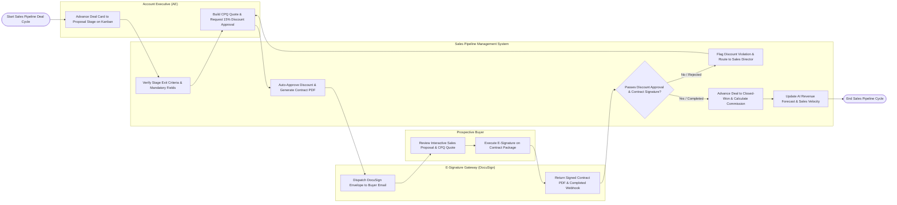

# Swimlane Diagram — Sales Pipeline Management System

## Mermaid Code

## Flow Description | Mô tả luồng

| Lane | Actor | Role in Flow |
|------|-------|-------------|
| 1 | Account Executive (AE) | Advances deal cards across Kanban pipeline stages, verifies mandatory exit criteria, builds multi-line CPQ price quotes, requests discount approvals, and dispatches contracts. |
| 2 | Prospective Buyer | Reviews interactive web proposals and CPQ pricing quotes, approves pricing terms, and signs legal contract agreements via e-signature. |
| 3 | Sales Pipeline Management System | Verifies deal stage exit criteria, enforces automated discount approval workflows, generates contract PDFs, dispatches e-signature packages, processes completed signature webhooks, auto-advances deals to Closed-Won, calculates sales rep commissions, and updates AI revenue forecasts. |
| 4 | E-Signature Gateway (DocuSign) | Delivers e-signature envelope invitations to buyer email addresses, collects cryptographic digital signatures, and streams completed contract PDF webhooks back to the system. |
