# Action Tree — Sales Pipeline Management System

## Mermaid Code

```mermaid
graph TD
    Root["Sales Pipeline Management System"]

    Root --> M1["Pipeline Stages & Visual Kanban Board"]
    Root --> M2["CPQ Pricing Quotes & Discount Workflows"]
    Root --> M3["Proposal Generation & Buyer Enablement"]
    Root --> M4["E-Signature & Contract Execution"]
    Root --> M5["AI Machine Learning Revenue Forecasting"]
    Root --> M6["Sales Velocity & Commission Analytics"]

    M1 --> A11["Configure Sales Pipeline Master Stages & Win Probabilities"]
    M1 --> A12["Manage Drag-and-Drop Visual Sales Pipeline Kanban Board"]
    M1 --> A13["Enforce Mandatory Deal Stage Exit Criteria & Required Fields"]
    M1 --> A14["Route Qualified Leads to AEs via Territory Assignment Rules"]

    M2 --> A21["Generate Multi-Line CPQ Price Quotes with Subscription SKUs"]
    M2 --> A22["Configure Volume Tier Pricing & Multi-Currency Rate Books"]
    M2 --> A23["Enforce Automated Multi-Tier Discount Approval Chains (> 15%)"]
    M2 --> A24["Sync Approved CPQ Quote Totals with CRM Opportunity Values"]

    M3 --> A31["Merge Deal Data & CPQ Quotes into Formal PDF Sales Proposals"]
    M3 --> A32["Track Buyer Proposal View Duration (Seconds per Slide)"]
    M3 --> A33["Calculate Buyer Intent Engagement Scores based on Content Views"]
    M3 --> A34["Alert Sales Reps when Buyer Views Proposal Slide Deck"]

    M4 --> A41["Assemble Master Service Agreements (MSA) & Order Forms"]
    M4 --> A42["Dispatch E-Signature Packages via DocuSign & PandaDoc APIs"]
    M4 --> A43["Track Real-Time Contract Envelope Status (Delivered, Viewed, Signed)"]
    M4 --> A44["Auto-Advance Deal to Closed-Won upon Contract Completion"]

    M5 --> A51["Execute AI Machine Learning Revenue Forecasts (BG-NBD / Gradient Boost)"]
    M5 --> A52["Categorize Quarterly Revenue into Commit, Most Likely & Best Case"]
    M5 --> A53["Identify Stalled Deals (> 30 Days in Stage) & Slippage Risk Flags"]
    M5 --> A54["Compare AE Manual Commit Forecasts vs AI Model Predictions"]

    M6 --> A61["Calculate Sales Velocity ($/Day = Deals * Size * Win Rate / Cycle)"]
    M6 --> A62["Measure Average Days-in-Stage & Identify Pipeline Bottlenecks"]
    M6 --> A63["Calculate Sales Rep Quota Attainment % & Team Leaderboards"]
    M6 --> A64["Trigger Automated Closed-Won Commission Payout Calculations"]
```

## Module Description | Mô tả Module

| # | Module | Description | Actions |
|---|--------|-------------|---------|
| 1 | Pipeline Stages & Visual Kanban Board | Configures master pipeline stages, manages drag-and-drop Kanban boards, enforces stage exit criteria, and routes leads to AEs. | Configure Pipeline Stages & Win Probabilities, Manage Visual Sales Pipeline Kanban Board, Enforce Mandatory Stage Exit Criteria, Route Leads via Territory Rules. |
| 2 | CPQ Pricing Quotes & Discount Workflows | Generates multi-line CPQ quotes, configures volume pricing books, enforces discount approval chains, and syncs quotes with CRM values. | Generate Multi-Line CPQ Quotes, Configure Multi-Currency Price Books, Enforce Discount Approval Chains, Sync Approved Quote Totals to CRM. |
| 3 | Proposal Generation & Buyer Enablement | Merges deal data into PDF proposals, tracks buyer proposal view duration (seconds/slide), calculates engagement scores, and alerts reps. | Generate Formal PDF Proposals, Track Buyer Proposal View Duration, Calculate Buyer Intent Engagement Scores, Alert Reps on Proposal Slide Views. |
| 4 | E-Signature & Contract Execution | Assembles MSA contract packages, dispatches DocuSign/PandaDoc e-signatures, tracks envelope status, and auto-advances deals to Closed-Won. | Assemble Master Service Agreements, Dispatch E-Signature Packages via API, Track Real-Time Contract Envelope Status, Auto-Advance Deal to Closed-Won. |
| 5 | AI Machine Learning Revenue Forecasting | Runs AI revenue forecast models, categorizes Commit/Likely/Best Case, flags stalled deals and slippage risks, and compares AE commits vs AI. | Execute AI Machine Learning Revenue Forecasts, Categorize Forecasts into Commit/Likely/Best Case, Identify Stalled Deals & Slippage Risks, Compare AE Commits vs AI Models. |
| 6 | Sales Velocity & Commission Analytics | Calculates sales velocity ($/day), measures average days-in-stage, computes AE quota attainment %, and triggers commission calculations. | Calculate Sales Velocity ($/Day), Measure Average Days-in-Stage, Calculate Sales Rep Quota Attainment %, Trigger Automated Commission Calculations. |
